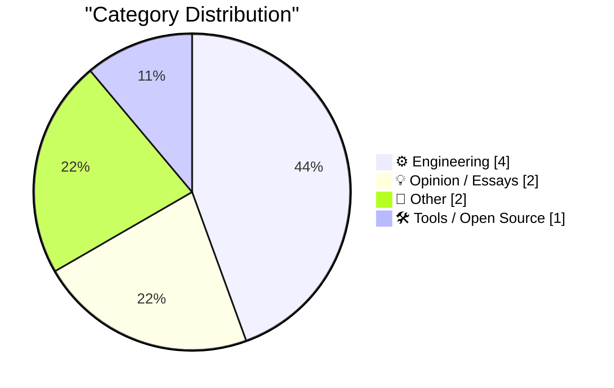
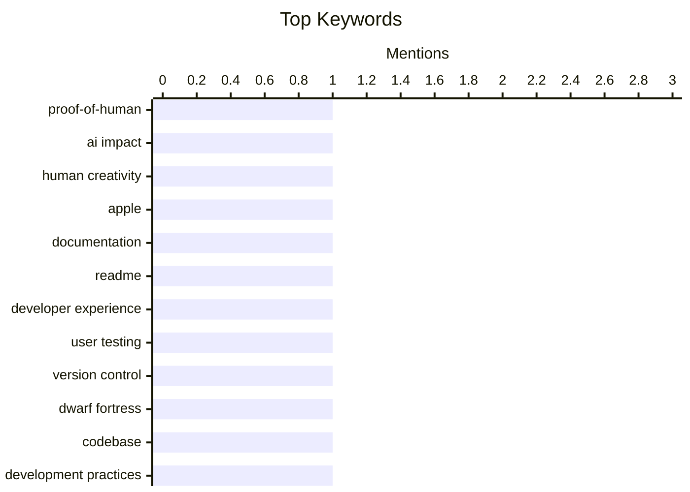

## Today's Highlights
Today's tech news highlights a dual focus on evolving software development and the enduring human element in technology. Projects like Dwarf Fortress are embracing modern practices with version control, while essential tools like Python continue to see updates for developers. Simultaneously, the industry grapples with the need for clear documentation and "Proof-of-Human" to ensure authenticity and user understanding in an increasingly automated world.
---
## Must Read Today
1. **‘Proof-of-Human’**
[‘Proof-of-Human’](https://x.com/bzamayo/status/2108498107184934914) — daringfireball.net · 21h ago · 💡 Opinion / Essays
> The article discusses the emerging phenomenon where companies accompany their published art with "proof-of-human" videos, showcasing manual creation. This trend, coined "Proof-of-Human," is a direct response to the rise of AI-generated content. While previously a fun insight into craftsmanship, it is now becoming a necessary validation to differentiate human artistry. The author suggests this phenomenon is a consequence of AI's rapid advancement, forcing companies to explicitly demonstrate human involvement. The main takeaway is that demonstrating human origin is becoming a crucial differentiator in an AI-driven creative landscape.
💡 **Why read it**: It introduces a relevant new term, 'Proof-of-Human,' to describe a growing trend in content creation driven by the rise of AI.
🏷️ Proof-of-Human, AI impact, human creativity, Apple
2. **I paid people to try and follow my README**
[I paid people to try and follow my README](https://shkspr.mobi/blog/2026/10/i-paid-people-to-try-and-follow-my-readme/) — shkspr.mobi · 2h ago · ⚙️ Engineering
> Developers often produce inadequate documentation, leading to user frustration and repeated questions. The author advocates for testing documentation by paying external users to follow a README, revealing issues like missing prerequisites (e.g., `sudo apt install python3-pip`) and environment-specific problems (e.g., `pip install --user` vs. `pip install`). This process highlighted the need for explicit, step-by-step instructions that account for diverse user environments. The main conclusion is that proactive, user-tested documentation is crucial for improving user experience and reducing support overhead.
💡 **Why read it**: It offers a practical, user-centric method for improving technical documentation by directly testing it with external users.
🏷️ Documentation, README, developer experience, user testing
3. **Dwarf Fortress uses version control now**
[Dwarf Fortress uses version control now](https://simonwillison.net/2026/Oct/11/dwarf-fortress/) — simonwillison.net · 13h ago · ⚙️ Engineering
> The highly complex game Dwarf Fortress famously operated for years without version control, a surprising fact given its intricate codebase. Creator Tarn Adams initially resisted version control, stating in March 2013 that he "just use[d] backups." By October 2026, he confirmed they now use Git, specifically mentioning GitHub, for managing the game's development. This shift occurred as the team grew and the codebase became more collaborative. The article concludes that even for highly idiosyncratic projects, the benefits of modern version control systems like Git become indispensable with team growth and increasing complexity.
💡 **Why read it**: It highlights a significant shift in the development practices of a notoriously complex and long-running software project, demonstrating the universal utility of version control.
🏷️ Version control, Dwarf Fortress, codebase, development practices
---
## Data Overview
| Sources Scanned | Articles Fetched | Time Window | Selected |
|:---:|:---:|:---:|:---:|
| 85/92 | 2365 -> 9 | 24h | **9** |
### Category Distribution

### Top Keywords

<details>
<summary>Plain Text Keyword Chart (Terminal Friendly)</summary>
```
proof-of-human       │ ████████████████████ 1
ai impact            │ ████████████████████ 1
human creativity     │ ████████████████████ 1
apple                │ ████████████████████ 1
documentation        │ ████████████████████ 1
readme               │ ████████████████████ 1
developer experience │ ████████████████████ 1
user testing         │ ████████████████████ 1
version control      │ ████████████████████ 1
dwarf fortress       │ ████████████████████ 1
```
</details>
### Topic Tags
**proof-of-human**(1) · **ai impact**(1) · **human creativity**(1) · apple(1) · documentation(1) · readme(1) · developer experience(1) · user testing(1) · version control(1) · dwarf fortress(1) · codebase(1) · development practices(1) · ward christensen(1) · xmodem(1) · bbs(1) · telecommunications(1) · integrated circuit(1) · reverse engineering(1) · hardware(1) · electronics(1)
---
## Engineering
### 1. I paid people to try and follow my README
[I paid people to try and follow my README](https://shkspr.mobi/blog/2026/10/i-paid-people-to-try-and-follow-my-readme/) — **shkspr.mobi** · 2h ago · ⭐ 25/30
> Developers often produce inadequate documentation, leading to user frustration and repeated questions. The author advocates for testing documentation by paying external users to follow a README, revealing issues like missing prerequisites (e.g., `sudo apt install python3-pip`) and environment-specific problems (e.g., `pip install --user` vs. `pip install`). This process highlighted the need for explicit, step-by-step instructions that account for diverse user environments. The main conclusion is that proactive, user-tested documentation is crucial for improving user experience and reducing support overhead.
🏷️ Documentation, README, developer experience, user testing
---
### 2. Dwarf Fortress uses version control now
[Dwarf Fortress uses version control now](https://simonwillison.net/2026/Oct/11/dwarf-fortress/) — **simonwillison.net** · 13h ago · ⭐ 24/30
> The highly complex game Dwarf Fortress famously operated for years without version control, a surprising fact given its intricate codebase. Creator Tarn Adams initially resisted version control, stating in March 2013 that he "just use[d] backups." By October 2026, he confirmed they now use Git, specifically mentioning GitHub, for managing the game's development. This shift occurred as the team grew and the codebase became more collaborative. The article concludes that even for highly idiosyncratic projects, the benefits of modern version control systems like Git become indispensable with team growth and increasing complexity.
🏷️ Version control, Dwarf Fortress, codebase, development practices
---
### 3. Ward Christensen, telecommunications pioneer
[Ward Christensen, telecommunications pioneer](https://dfarq.homeip.net/ward-christensen-telecommunications-pioneer/?utm_source=rss&#038;utm_medium=rss&#038;utm_campaign=ward-christensen-telecommunications-pioneer) — **dfarq.homeip.net** · 3h ago · ⭐ 23/30
> The article announces the passing of Ward Christensen, a key figure in early telecommunications. Ward Christensen, born October 23, 1945, and died October 11, 2024, at age 78, was a telecommunications pioneer. He is credited with inventing the Xmodem file transfer protocol and co-inventing the bulletin board system (BBS). These innovations were foundational for early computer networking and online communities. Christensen's contributions significantly shaped the landscape of early digital communication and file sharing.
🏷️ Ward Christensen, Xmodem, BBS, telecommunications
---
### 4. Inside a 1980s filter chip that uses switched capacitors
[Inside a 1980s filter chip that uses switched capacitors](http://www.righto.com/feeds/5504631233106574875/comments/default) — **righto.com** · 21h ago · ⭐ 20/30
> The article details the identification and analysis of a mysterious 1980s Harris IC labeled "F1-10-5" that lacked databook information. The chip was opened and analyzed under a microscope, revealing a prominent grid of square capacitors. This design, combined with other circuit elements, indicated it was a switched-capacitor filter. Switched-capacitor filters use capacitors and switches instead of resistors to create precise analog filters, making them suitable for integration into ICs and allowing frequency response to be controlled by an external clock. The analysis successfully identified the "F1-10-5" as a switched-capacitor filter, showcasing a clever analog design technique from the 1980s.
🏷️ Integrated circuit, reverse engineering, hardware, electronics
---
## Opinion / Essays
### 5. ‘Proof-of-Human’
[‘Proof-of-Human’](https://x.com/bzamayo/status/2108498107184934914) — **daringfireball.net** · 21h ago · ⭐ 26/30
> The article discusses the emerging phenomenon where companies accompany their published art with "proof-of-human" videos, showcasing manual creation. This trend, coined "Proof-of-Human," is a direct response to the rise of AI-generated content. While previously a fun insight into craftsmanship, it is now becoming a necessary validation to differentiate human artistry. The author suggests this phenomenon is a consequence of AI's rapid advancement, forcing companies to explicitly demonstrate human involvement. The main takeaway is that demonstrating human origin is becoming a crucial differentiator in an AI-driven creative landscape.
🏷️ Proof-of-Human, AI impact, human creativity, Apple
---
### 6. Don't diagnose your opponents
[Don't diagnose your opponents](https://seangoedecke.com/dont-diagnose-your-opponents/) — **seangoedecke.com** · 14h ago · ⭐ 19/30
> When disagreeing, people often resort to "diagnosing" their opponent's motivations rather than engaging with their arguments. The article distinguishes between engaging with an argument's substance (reasons, truth, evidence) and diagnosing the arguer's underlying psychological or social reasons for holding a belief. Diagnosing shifts the focus from "what is true?" to "why are they saying it?", hindering productive discourse and often leading to ad hominem attacks, particularly in online debates like monolith vs. microservices. To foster constructive dialogue, one should prioritize addressing the content of an argument over speculating about the opponent's motives.
🏷️ Communication, disagreement, professionalism
---
## Other
### 7. Reading List 10/10/26
[Reading List 10/10/26](https://www.construction-physics.com/p/reading-list-101026) — **construction-physics.com** · 23h ago · ⭐ 11/30
> This article presents a curated reading list covering various topics in construction and related technologies. The list includes diverse subjects such as the use of propane in air conditioners, Anduril's involvement in manufacturing submarine parts, the concept of nuclear reactors on the moon, and an overview of the robotic hand landscape. It serves as a digest of recent developments and interesting discussions across these fields. The reading list provides a concise overview of current trends and notable advancements in construction, energy, and robotics.
🏷️ Reading list, robotics, space tech
---
### 8. Sunnny
[Sunnny](https://sunnny.com/) — **daringfireball.net** · 21h ago · ⭐ 9/30
> This article is a sponsored post introducing a new B2B software called Sunnny. Sunnny is presented as a B2B software aiming to be "delicious," suggesting a focus on user experience and efficiency. Early access for the platform is scheduled to launch on Monday, October 19. The article serves as an announcement for the upcoming launch of Sunnny, a new B2B software solution.
🏷️ Sponsor, B2B software, advertisement
---
## Tools / Open Source
### 9. Python 3.15.0 added to actions/python-versions
[Python 3.15.0 added to actions/python-versions](https://simonwillison.net/2026/Oct/10/python-actions/) — **simonwillison.net** · 14h ago · ⭐ 18/30
> The article highlights the update of GitHub Actions' `actions/python-versions` repository to include Python 3.15.0. The addition of Python 3.15.0 via commit `49858b91c92d27403416ee43117032e91d00ce24` is significant for developers relying on GitHub Actions for CI/CD. This update enables them to officially use the latest stable Python version in their workflows, which the author had been actively anticipating. The inclusion of Python 3.15.0 in `actions/python-versions` is a crucial update for Python developers utilizing GitHub Actions, streamlining the adoption of the newest language features in CI/CD pipelines.
🏷️ Python 3.15, GitHub Actions, developer tools
---
*Generated at 2026-10-11 14:01 | Scanned 85 sources -> 2365 articles -> selected 9*
*Based on the [Hacker News Popularity Contest 2025](https://refactoringenglish.com/tools/hn-popularity/) RSS source list recommended by [Andrej Karpathy](https://x.com/karpathy)*
*Produced by Dongdianr AI. Follow the same-name WeChat public account for more AI practical tips 💡*
