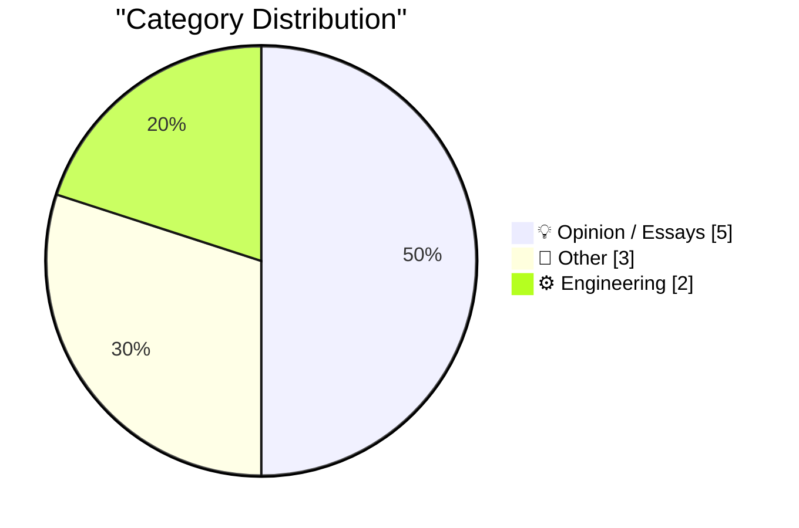
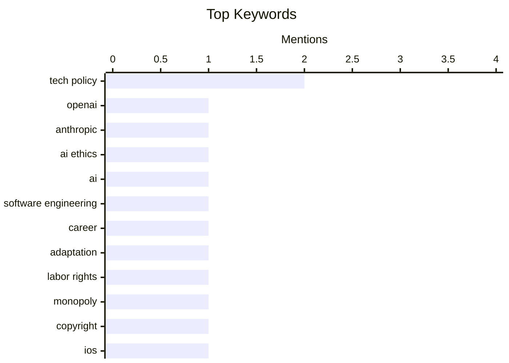

## Today's Highlights
Today's tech highlights underscore a growing tension around artificial intelligence, with strong opinions emerging against supporting major AI developers and engineers grappling with its disruptive impact on their roles. This debate extends to broader concerns about power dynamics within the tech industry, emphasizing the importance of labor rights in countering monopolistic control and platform influence. Amidst these shifts, the foundational elements of internet infrastructure and computing history continue to draw attention, providing context to the evolving landscape.
---
## Must Read Today
1. **Just say no to OpenAI and Anthropic**
[Just say no to OpenAI and Anthropic](https://micahflee.com/just-say-no-to-openai-and-anthropic/) — micahflee.com · 14h ago · 💡 Opinion / Essays
> The article argues against supporting OpenAI and Anthropic, viewing them as key components of a "tech oligarch" coalition contributing to "end-times fascism." It draws parallels to Naomi Klein and Astra Taylor's "End Times Fascism and the Fight for the Living World," suggesting these AI companies represent a dangerous concentration of power and control. The author implies their business models and influence align with broader anti-democratic trends. Readers are urged to actively reject and disengage from these specific AI platforms to resist their growing influence and the broader political implications.
💡 **Why read it**: It offers a critical, politically charged perspective on major AI companies, framing their operations within a broader critique of tech oligarchy and fascism.
🏷️ OpenAI, Anthropic, AI ethics, tech policy
2. **Software engineers don't get to be Luddites about AI**
[Software engineers don't get to be Luddites about AI](https://seangoedecke.com/software-engineers-dont-get-to-be-luddites-about-ai/) — seangoedecke.com · 14h ago · 💡 Opinion / Essays
> Many software engineers are resistant to AI's impact on their profession, feeling their skills are being automated away. The author contends that software engineers, having historically automated other industries, lack the moral standing to complain about AI automating their own work. They argue that engineers should embrace AI as a tool for innovation, similar to how they've leveraged previous technological shifts. The piece suggests that resisting AI is hypocritical given the profession's history of disruption. Software engineers should adapt to and leverage AI, rather than resisting it, recognizing that their profession is not immune to the automation they've long championed.
💡 **Why read it**: It challenges software engineers to reconsider their stance on AI, arguing against a Luddite approach and advocating for adaptation and innovation within the profession.
🏷️ AI, software engineering, career, adaptation
3. **Pluralistic: How labor rights rescued Ultima from a monopolist (12 Oct 2026)**
[Pluralistic: How labor rights rescued Ultima from a monopolist (12 Oct 2026)](https://pluralistic.net/2026/10/12/termination-of-transfer/) — pluralistic.net · 2h ago · 💡 Opinion / Essays
> The article discusses how labor rights, specifically "termination of transfer" provisions, can protect artists from monopolistic control over their creations, using the Ultima game series as an example. It suggests that focusing solely on copyright is insufficient for artist protection, advocating instead for stronger labor justice frameworks. The "termination of transfer" right allows creators to reclaim rights to their work after a set period (e.g., 35 years in the US), preventing perpetual corporate ownership. This mechanism empowers artists to renegotiate or re-license their creations, countering initial exploitative contracts. Stronger labor rights, particularly the "termination of transfer," are more effective than copyright alone in protecting artists from monopolistic exploitation and ensuring fair compensation for their work.
💡 **Why read it**: It provides a compelling argument for the importance of labor rights, specifically "termination of transfer," as a mechanism to protect artists and creators from monopolistic control, using a concrete example like the Ultima series.
🏷️ labor rights, monopoly, copyright, tech policy
---
## Data Overview
| Sources Scanned | Articles Fetched | Time Window | Selected |
|:---:|:---:|:---:|:---:|
| 86/92 | 2581 -> 10 | 24h | **10** |
### Category Distribution

### Top Keywords

<details>
<summary>Plain Text Keyword Chart (Terminal Friendly)</summary>
```
tech policy          │ ████████████████████ 2
openai               │ ██████████░░░░░░░░░░ 1
anthropic            │ ██████████░░░░░░░░░░ 1
ai ethics            │ ██████████░░░░░░░░░░ 1
ai                   │ ██████████░░░░░░░░░░ 1
software engineering │ ██████████░░░░░░░░░░ 1
career               │ ██████████░░░░░░░░░░ 1
adaptation           │ ██████████░░░░░░░░░░ 1
labor rights         │ ██████████░░░░░░░░░░ 1
monopoly             │ ██████████░░░░░░░░░░ 1
```
</details>
### Topic Tags
**tech policy**(2) · **openai**(1) · **anthropic**(1) · ai ethics(1) · ai(1) · software engineering(1) · career(1) · adaptation(1) · labor rights(1) · monopoly(1) · copyright(1) · ios(1) · apple(1) · software update(1) · deployment(1) · category theory(1) · modal logic(1) · formal logic(1) · mathematics(1) · x(1)
---
## Opinion / Essays
### 1. Just say no to OpenAI and Anthropic
[Just say no to OpenAI and Anthropic](https://micahflee.com/just-say-no-to-openai-and-anthropic/) — **micahflee.com** · 14h ago · ⭐ 25/30
> The article argues against supporting OpenAI and Anthropic, viewing them as key components of a "tech oligarch" coalition contributing to "end-times fascism." It draws parallels to Naomi Klein and Astra Taylor's "End Times Fascism and the Fight for the Living World," suggesting these AI companies represent a dangerous concentration of power and control. The author implies their business models and influence align with broader anti-democratic trends. Readers are urged to actively reject and disengage from these specific AI platforms to resist their growing influence and the broader political implications.
🏷️ OpenAI, Anthropic, AI ethics, tech policy
---
### 2. Software engineers don't get to be Luddites about AI
[Software engineers don't get to be Luddites about AI](https://seangoedecke.com/software-engineers-dont-get-to-be-luddites-about-ai/) — **seangoedecke.com** · 14h ago · ⭐ 24/30
> Many software engineers are resistant to AI's impact on their profession, feeling their skills are being automated away. The author contends that software engineers, having historically automated other industries, lack the moral standing to complain about AI automating their own work. They argue that engineers should embrace AI as a tool for innovation, similar to how they've leveraged previous technological shifts. The piece suggests that resisting AI is hypocritical given the profession's history of disruption. Software engineers should adapt to and leverage AI, rather than resisting it, recognizing that their profession is not immune to the automation they've long championed.
🏷️ AI, software engineering, career, adaptation
---
### 3. Pluralistic: How labor rights rescued Ultima from a monopolist (12 Oct 2026)
[Pluralistic: How labor rights rescued Ultima from a monopolist (12 Oct 2026)](https://pluralistic.net/2026/10/12/termination-of-transfer/) — **pluralistic.net** · 2h ago · ⭐ 24/30
> The article discusses how labor rights, specifically "termination of transfer" provisions, can protect artists from monopolistic control over their creations, using the Ultima game series as an example. It suggests that focusing solely on copyright is insufficient for artist protection, advocating instead for stronger labor justice frameworks. The "termination of transfer" right allows creators to reclaim rights to their work after a set period (e.g., 35 years in the US), preventing perpetual corporate ownership. This mechanism empowers artists to renegotiate or re-license their creations, countering initial exploitative contracts. Stronger labor rights, particularly the "termination of transfer," are more effective than copyright alone in protecting artists from monopolistic exploitation and ensuring fair compensation for their work.
🏷️ labor rights, monopoly, copyright, tech policy
---
### 4. ★ X Once Again Marks the Spot
[★ X Once Again Marks the Spot](https://daringfireball.net/2026/10/x_once_again_marks_the_spot) — **daringfireball.net** · 16h ago · ⭐ 19/30
> The article comments on the current state of the social media platform X (formerly Twitter), implying significant changes and a decline in its original identity. It uses a hypothetical scenario of someone returning from exile to find X unrecognizable, suggesting that Elon Musk's ownership has drastically altered the platform. The author implies a loss of its core functionality, community, or overall appeal, making it seem as though it might have been sold or abandoned. This reflects widespread sentiment regarding the platform's transformation since its acquisition. The platform X has undergone such profound changes under its current ownership that it is barely recognizable from its previous incarnation as Twitter.
🏷️ X, Twitter, Elon Musk, social media
---
### 5. Why I Get Bored
[Why I Get Bored](https://idiallo.com/byte-size/why-i-get-bored) — **idiallo.com** · 22h ago · ⭐ 15/30
> The author explores boredom as a signal, specifically indicating a roadblock or a task they perceive themselves as bad at. For the author, boredom is a mental resistance mechanism, often triggered when attempting tasks like making YouTube videos, which they feel they are not good at. This signal prompts thoughts of giving up, despite initial excitement for the subject. The article suggests that boredom isn't just idleness but a specific psychological response to perceived incompetence or difficulty, leading to procrastination or abandonment. Boredom serves as a crucial internal signal, often indicating a perceived lack of skill or a mental roadblock, rather than simple disinterest.
🏷️ boredom, productivity, motivation, self-improvement
---
## Other
### 6. Categorical models of logics
[Categorical models of logics](https://www.johndcook.com/blog/2026/10/12/categorical-models-of-logics/) — **johndcook.com** · 57m ago · ⭐ 20/30
> The article introduces categorical models as an alternative way to understand logics, building on a previous discussion of topological models for modal logic. It suggests that if one finds general topology more intuitive than modal logic, the correspondence between them can be illuminating. The post implies that categorical models offer another framework for understanding logical systems, potentially simplifying complex concepts by relating them to more familiar mathematical structures. This approach aims to provide a different perspective for those who struggle with the abstract nature of certain logics. Categorical models provide a valuable alternative perspective for understanding various logics, potentially making them more accessible by relating them to established mathematical fields like category theory.
🏷️ category theory, modal logic, formal logic, mathematics
---
### 7. Nvidia’s first GPU: GeForce 256
[Nvidia’s first GPU: GeForce 256](https://dfarq.homeip.net/nvidias-first-gpu-geforce-256/?utm_source=rss&#038;utm_medium=rss&#038;utm_campaign=nvidias-first-gpu-geforce-256) — **dfarq.homeip.net** · 3h ago · ⭐ 16/30
> The article discusses the historical significance of Nvidia's GeForce 256, released on October 11, 1999, as the company's first product explicitly described as a GPU. It explores what distinguished the GeForce 256 as the first "GPU," acknowledging that competitors like 3dfx might argue they also produced GPU-like products. The GeForce 256 integrated transform, clipping, and lighting (TCL) hardware, offloading these complex calculations from the CPU, a key innovation that defined the modern GPU. This integration significantly boosted 3D graphics performance and set a new standard for graphics accelerators. Nvidia's GeForce 256, released in 1999, was a landmark product that defined the modern GPU by integrating transform, clipping, and lighting hardware, fundamentally changing 3D graphics processing.
🏷️ Nvidia, GPU, GeForce, hardware history
---
### 8. Refurb weekend II: Alpha Micro Eagle 300 and friends
[Refurb weekend II: Alpha Micro Eagle 300 and friends](https://oldvcr.blogspot.com/feeds/3996311687258717625/comments/default) — **oldvcr.blogspot.com** · 12h ago · ⭐ 13/30
> The article details a refurbishment project for an Alpha Micro Eagle 300, a vintage 68EC030-based computer running the AMOS operating system. This project is a follow-up to a previous repair six years prior, where the power supply and case fan were fixed. The Alpha Micro Eagle 300, described as a "blue-collar box," was common in vertical markets due to its integrated business-specific software. These systems are notable for their unique DEC-inspired multiuser operating system, AMOS, and their use of 68EC030 processors, making them substantially faster than earlier models. The Alpha Micro Eagle 300, a 68EC030-based system running the unique AMOS operating system, represents a significant piece of vintage computing history, often used in business-specific applications.
🏷️ retro computing, hardware repair, Alpha Micro, refurbishment
---
## Engineering
### 9. Apple Only Started Suggesting iOS 26 Users Upgrade to 27 Three Days Ago
[Apple Only Started Suggesting iOS 26 Users Upgrade to 27 Three Days Ago](https://www.macrumors.com/2026/10/08/apple-now-pushing-ios-27/) — **daringfireball.net** · 18h ago · ⭐ 21/30
> Apple recently changed its iOS update suggestion policy, only prominently pushing iOS 27.0.1 to users on iOS 26.x three days prior to the article's publication. Previously, users on iOS 26.x were primarily offered iOS 26.7.1, with iOS 27.0.1 relegated to a smaller "Also Available" section. As of Thursday, iOS 27.0.1 became the default prominent suggestion in the Settings app under General → Software Update. This change highlights Apple's control over update visibility and how it influences user adoption of new major OS versions. Apple's strategic timing in prominently suggesting major iOS upgrades significantly impacts user update behavior, even for those who update manually.
🏷️ iOS, Apple, software update, deployment
---
### 10. The Fascinating World of Domains
[The Fascinating World of Domains](https://blog.jim-nielsen.com/2026/domains-article-on-wired/) — **blog.jim-nielsen.com** · 19h ago · ⭐ 19/30
> The article highlights the intricate and often overlooked details of the domain name system, referencing a Wired article by Pete Millspaugh. It delves into the esoteric aspects of domains, such as the operation of the .com registry, which is a critical piece of internet infrastructure. The piece points out that Verisign manages the .com registry, processing millions of DNS queries daily and generating significant revenue. It emphasizes the complex technical and business ecosystem behind seemingly simple domain names. The world of domain names, particularly the .com registry, is a complex and fascinating system with significant technical and economic implications.
🏷️ domains, DNS, internet, TLDs
---
*Generated at 2026-10-12 14:01 | Scanned 86 sources -> 2581 articles -> selected 10*
*Based on the [Hacker News Popularity Contest 2025](https://refactoringenglish.com/tools/hn-popularity/) RSS source list recommended by [Andrej Karpathy](https://x.com/karpathy)*
*Produced by Dongdianr AI. Follow the same-name WeChat public account for more AI practical tips 💡*
