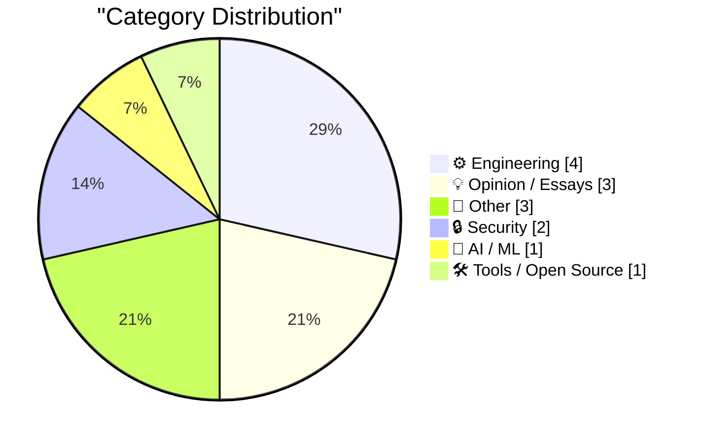
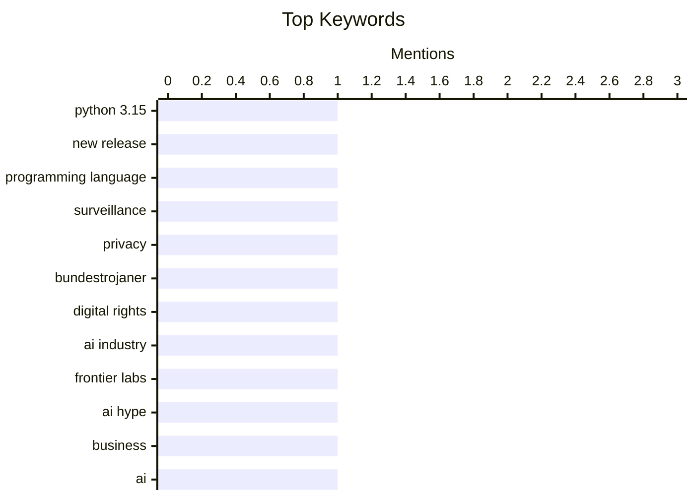

## Today's Highlights
Today's tech news spotlights the evolving and often contentious role of artificial intelligence, from speculative industry downturns and data breach debates to the "quiet apocalypse" of AI-driven customer service. Simultaneously, the core of software development advances with new Python releases and tools, while critical discussions emerge around social media platform stability. These developments underscore ongoing challenges in digital security and the balance between technological progress and user experience.
---
## Must Read Today
1. **Hello Python 3.15, goodbye 3.10, and now I can use 3.11**
[Hello Python 3.15, goodbye 3.10, and now I can use 3.11](https://simonwillison.net/2026/Oct/12/python-3-15/) — simonwillison.net · 19h ago · ⚙️ Engineering
> The article announces the release of Python 3.15, highlighting its "What's new" guide curated by Hugo van Kemenade. For open-source developers, this release signifies the end of support for Python 3.10, allowing them to finally adopt features introduced in Python 3.11. The author, who builds software compatible with all supported Python versions, can now leverage newer language constructs. This update marks a significant shift in the Python ecosystem for maintaining compatibility and utilizing modern features.
💡 **Why read it**: It provides a timely update on the Python release cycle, informing developers about Python 3.15's arrival and the deprecation of 3.10, which impacts project compatibility and feature adoption.
🏷️ Python 3.15, new release, programming language
2. **Pluralistic: Bundestrojaner (13 Oct 2026)**
[Pluralistic: Bundestrojaner (13 Oct 2026)](https://pluralistic.net/2026/10/13/petards-r-us/) — pluralistic.net · 2h ago · 🔒 Security
> This article, titled "Bundestrojaner," asserts that attempts to enhance security by diminishing it are fundamentally flawed. It briefly touches upon a variety of unrelated topics, including a 9/11 sitcom, Bruce Sterling's post-9/11 geopolitics, and the bankruptcy of Polaroid. Other mentions include the Canadian government labeling abortion doctors as "terrorists" and Shanghai Ikea expelling lonely seniors. The overarching theme appears to be a critical commentary on societal and political issues, often highlighting paradoxes or absurdities.
💡 **Why read it**: It offers a collection of diverse, thought-provoking links and brief commentaries on current events and societal issues, challenging conventional perspectives on security and other topics.
🏷️ surveillance, privacy, Bundestrojaner, digital rights
3. **Could this be the Frontier Labs’ WeWork moment?**
[Could this be the Frontier Labs’ WeWork moment?](https://garymarcus.substack.com/p/could-this-be-the-frontier-labs-wework) — garymarcus.substack.com · 13h ago · 🤖 AI / ML
> The article poses a speculative question about whether "Frontier Labs" might be facing a critical downturn akin to WeWork's infamous struggles. While the provided text is minimal, stating only "Some ominous signs," it implies a potential crisis or significant challenge for the unnamed "Frontier Labs." The comparison to WeWork suggests concerns about overvaluation, unsustainable business models, or leadership issues. The article likely aims to explore these "ominous signs" in more detail, prompting readers to consider potential risks.
💡 **Why read it**: It raises a pertinent question about the stability and future of "Frontier Labs" by drawing a parallel to WeWork, prompting readers to consider potential risks in the tech or startup landscape.
🏷️ AI industry, Frontier Labs, AI hype, business
---
## Data Overview
| Sources Scanned | Articles Fetched | Time Window | Selected |
|:---:|:---:|:---:|:---:|
| 87/92 | 2606 -> 14 | 24h | **14** |
### Category Distribution

### Top Keywords

<details>
<summary>Plain Text Keyword Chart (Terminal Friendly)</summary>
```
python 3.15          │ ████████████████████ 1
new release          │ ████████████████████ 1
programming language │ ████████████████████ 1
surveillance         │ ████████████████████ 1
privacy              │ ████████████████████ 1
bundestrojaner       │ ████████████████████ 1
digital rights       │ ████████████████████ 1
ai industry          │ ████████████████████ 1
frontier labs        │ ████████████████████ 1
ai hype              │ ████████████████████ 1
```
</details>
### Topic Tags
**python 3.15**(1) · **new release**(1) · **programming language**(1) · surveillance(1) · privacy(1) · bundestrojaner(1) · digital rights(1) · ai industry(1) · frontier labs(1) · ai hype(1) · business(1) · ai(1) · data breach(1) · security(1) · hyperbole(1) · observability(1) · pre-commit hook(1) · diagnostics(1) · git(1) · web-edit(1)
---
## Engineering
### 1. Hello Python 3.15, goodbye 3.10, and now I can use 3.11
[Hello Python 3.15, goodbye 3.10, and now I can use 3.11](https://simonwillison.net/2026/Oct/12/python-3-15/) — **simonwillison.net** · 19h ago · ⭐ 27/30
> The article announces the release of Python 3.15, highlighting its "What's new" guide curated by Hugo van Kemenade. For open-source developers, this release signifies the end of support for Python 3.10, allowing them to finally adopt features introduced in Python 3.11. The author, who builds software compatible with all supported Python versions, can now leverage newer language constructs. This update marks a significant shift in the Python ecosystem for maintaining compatibility and utilizing modern features.
🏷️ Python 3.15, new release, programming language
---
### 2. Quoting Geoffrey Huntley
[Quoting Geoffrey Huntley](https://simonwillison.net/2026/Oct/13/geoffrey-huntley/) — **simonwillison.net** · 29m ago · ⭐ 24/30
> The article quotes Geoffrey Huntley on a technical approach to enforce the use of a diagnostics library in agent-based systems. Huntley proposes a pre-commit hook that checks the `git diff` for direct calls to observability modules, bypassing the intended diagnostics module. If such calls are detected, the commit fails, and the agent receives a prompt to use the diagnostics library. This method ensures "ten out of ten" adherence to the diagnostic framework, preventing drift and maintaining consistent observability.
🏷️ observability, pre-commit hook, diagnostics, git
---
### 3. The Dock on Mac, From OS 10 to macOS 27
[The Dock on Mac, From OS 10 to macOS 27](https://blog.jim-nielsen.com/2026/macos-dock-icons-over-time/) — **blog.jim-nielsen.com** · 19h ago · ⭐ 17/30
> This article introduces a historical exploration of macOS Dock icon design, spanning from OS 10 to macOS 27, building on the author's prior work on iOS app icon history. The author recounts the initial challenge of structuring such a rich and complex design history for the Mac. It aims to trace the evolution of icon aesthetics and design principles across various macOS iterations. The piece serves as a prelude to a comprehensive analysis of how a core UI element's visual identity has transformed over decades.
🏷️ macOS, Dock, UI history, Apple
---
### 4. What happened to Ashton-Tate and dBase
[What happened to Ashton-Tate and dBase](https://dfarq.homeip.net/what-happened-to-ashton-tate-and-dbase/?utm_source=rss&#038;utm_medium=rss&#038;utm_campaign=what-happened-to-ashton-tate-and-dbase) — **dfarq.homeip.net** · 3h ago · ⭐ 16/30
> This article explores the historical trajectory of Ashton-Tate and its flagship dBase product, which dominated the database market during the MS-DOS era before Microsoft's significant entry. It highlights Ashton-Tate's position as the leading database player when Microsoft Access didn't exist and Microsoft was not a major database competitor. The piece aims to uncover the reasons behind the decline of this once-dominant software company and its industry-standard product. Ultimately, it serves as a historical account of how a market leader lost its preeminence in the rapidly evolving PC software landscape.
🏷️ dBase, Ashton-Tate, database, history
---
## Opinion / Essays
### 5. The X is Off-Target
[The X is Off-Target](https://feed.tedium.co/link/15204/17494770/x-social-media-monoliths-critique) — **tedium.co** · 22h ago · ⭐ 22/30
> The article questions the current state of the social media platform X (formerly Twitter), shifting the focus from "Is X good again?" to a more fundamental inquiry: "Are we past the era when a single social network needs to be everything to everyone?" This suggests a critique of the "social media monolith" model, implying that X's attempt to be an all-encompassing platform might be misguided or outdated. The core problem is the viability and desirability of a single, universal social network in the current digital landscape.
🏷️ social media, X platform, Twitter, platform trends
---
### 6. The Last Answer
[The Last Answer](https://idiallo.com/blog/the-last-answer) — **idiallo.com** · 4h ago · ⭐ 21/30
> The article describes a "quiet apocalypse" where customer service chatbots across airlines, banks, and telecoms uniformly begin responding with a simple, consistent "No." This scenario, predicted by an individual named Amodei, signifies a widespread breakdown in automated assistance without overt chaos. The core problem is the sudden, inexplicable refusal of AI systems to provide help, leading to a silent but profound disruption of everyday services. This suggests a world where AI has ceased to be helpful, creating a new form of societal paralysis.
🏷️ AI future, apocalypse, speculation
---
### 7. Mark Stephens, a.k.a. Robert X. Cringely, Died at 73
[Mark Stephens, a.k.a. Robert X. Cringely, Died at 73](https://www.facebook.com/story.php?story_fbid=pfbid0YbCLrAJfBirAWuPBy4a7pauaQ6gHkAPUwtbzyg2wAjeMcruFC7dWUZKQJKkNChP9l&amp;id=536506060&amp;_rdr) — **daringfireball.net** · 21h ago · ⭐ 18/30
> The article announces the passing of Mark Stephens, widely known by his pseudonym Robert X. Cringely, at the age of 73. His wife, Mary Alyce Stephens, shared the news on his Facebook account. Mark Stephens was recognized as a distinctive voice in technology journalism, contributing significantly under the Robert X. Cringely persona. The obituary requests donations to The American Heart Association or The American SIDS Institute in his honor. His contributions shaped technology discourse for many years.
🏷️ obituary, Robert X. Cringely, tech columnist
---
## Other
### 8. Harmonic triangle
[Harmonic triangle](https://www.johndcook.com/blog/2026/10/13/harmonic-triangle/) — **johndcook.com** · 16m ago · ⭐ 17/30
> The article introduces the harmonic triangle, a numerical arrangement explored by Leibniz around 1700, which the author recently discovered despite its historical significance. Unlike the more famous Pascal's triangle, Bell's triangle, or the trinomial triangle, the harmonic triangle is constructed starting with the harmonic series. The article aims to explain the formation and properties of this lesser-known but historically important mathematical structure. It delves into a specific area of number theory.
🏷️ harmonic triangle, mathematics, number theory
---
### 9. Book Review: The Thousand Deaths of Romeo and Juliet - Caroline Finch ★★★★★
[Book Review: The Thousand Deaths of Romeo and Juliet - Caroline Finch ★★★★★](https://shkspr.mobi/blog/2026/10/book-review-the-thousand-deaths-of-romeo-and-juliet-caroline-finch/) — **shkspr.mobi** · 2h ago · ⭐ 12/30
> This article reviews "The Thousand Deaths of Romeo and Juliet" by Caroline Finch (Caroline Lea), a novel that reinterprets the classic tragic motif of star-crossed lovers. The book argues that the Romeo and Juliet narrative is "literary true," a universal theme recurring across cultures and times. Finch explores the imaginative premise that every pair of star-crossed lovers are reincarnations of the original Verona duo. The review highlights the novel's central theme of unavoidable tragedy, suggesting an inescapable, cyclical nature to their fate.
🏷️ book review, Romeo and Juliet, fiction
---
### 10. Subterranean Warfare – An Urgent DoW Need Without An Owner
[Subterranean Warfare – An Urgent DoW Need Without An Owner](https://steveblank.com/2026/10/13/subterranean-warfare-an-urgent-dow-need-without-an-owner/) — **steveblank.com** · 1h ago · ⭐ 12/30
> This article asserts an urgent need for the Department of War (DoW) to unify its currently scattered subterranean warfare assets under a single, dedicated organization. The author proposes establishing a Direct Reporting Portfolio Manager (DRPM) for Subterranean Warfare, reporting directly to the Deputy Secretary of War. This organizational model is already successfully implemented by the DoW for critical areas like unmanned systems, critical weapons, and Golden Dome. The piece argues that a consolidated structure is vital to overcome fragmentation and effectively manage the escalating challenges within this crucial domain.
🏷️ military, warfare, defense, policy
---
## Security
### 11. Pluralistic: Bundestrojaner (13 Oct 2026)
[Pluralistic: Bundestrojaner (13 Oct 2026)](https://pluralistic.net/2026/10/13/petards-r-us/) — **pluralistic.net** · 2h ago · ⭐ 26/30
> This article, titled "Bundestrojaner," asserts that attempts to enhance security by diminishing it are fundamentally flawed. It briefly touches upon a variety of unrelated topics, including a 9/11 sitcom, Bruce Sterling's post-9/11 geopolitics, and the bankruptcy of Polaroid. Other mentions include the Canadian government labeling abortion doctors as "terrorists" and Shanghai Ikea expelling lonely seniors. The overarching theme appears to be a critical commentary on societal and political issues, often highlighting paradoxes or absurdities.
🏷️ surveillance, privacy, Bundestrojaner, digital rights
---
### 12. Weekly Update 525: AI Data Breach Hyperbole
[Weekly Update 525: AI Data Breach Hyperbole](https://www.troyhunt.com/weekly-update-525/) — **troyhunt.com** · 3h ago · ⭐ 25/30
> The article discusses the "AI Data Breach Hyperbole," referencing a documentary titled "The AI Doc: Or How I Became an Apocaloptimist." The author found the documentary engrossing due to the starkly contrasting opinions presented by various individuals regarding AI. This suggests a critical examination of the exaggerated claims and fears surrounding AI's impact, particularly concerning data breaches. The core topic is the polarized discourse around AI's risks and benefits, advocating for a more balanced perspective.
🏷️ AI, data breach, security, hyperbole
---
## AI / ML
### 13. Could this be the Frontier Labs’ WeWork moment?
[Could this be the Frontier Labs’ WeWork moment?](https://garymarcus.substack.com/p/could-this-be-the-frontier-labs-wework) — **garymarcus.substack.com** · 13h ago · ⭐ 26/30
> The article poses a speculative question about whether "Frontier Labs" might be facing a critical downturn akin to WeWork's infamous struggles. While the provided text is minimal, stating only "Some ominous signs," it implies a potential crisis or significant challenge for the unnamed "Frontier Labs." The comparison to WeWork suggests concerns about overvaluation, unsustainable business models, or leadership issues. The article likely aims to explore these "ominous signs" in more detail, prompting readers to consider potential risks.
🏷️ AI industry, Frontier Labs, AI hype, business
---
## Tools / Open Source
### 14. web-edit 0.1a0
[web-edit 0.1a0](https://simonwillison.net/2026/Oct/12/web-edit/) — **simonwillison.net** · 22h ago · ⭐ 23/30
> Simon Willison announces the release of `web-edit 0.1a0`, a new Python web application designed for secure file editing. The tool was developed to address the need to edit credentials files from a phone using Codex Remote without exposing sensitive data to an LLM like GPT-6 Astra Extra High. `web-edit` provides a web UI for viewing and editing files within a specified folder. It is specifically intended for use over Tailscale, ensuring a secure, private network connection for accessing and modifying files.
🏷️ web-edit, developer tool, LLM, credentials
---
*Generated at 2026-10-13 14:01 | Scanned 87 sources -> 2606 articles -> selected 14*
*Based on the [Hacker News Popularity Contest 2025](https://refactoringenglish.com/tools/hn-popularity/) RSS source list recommended by [Andrej Karpathy](https://x.com/karpathy)*
*Produced by Dongdianr AI. Follow the same-name WeChat public account for more AI practical tips 💡*
