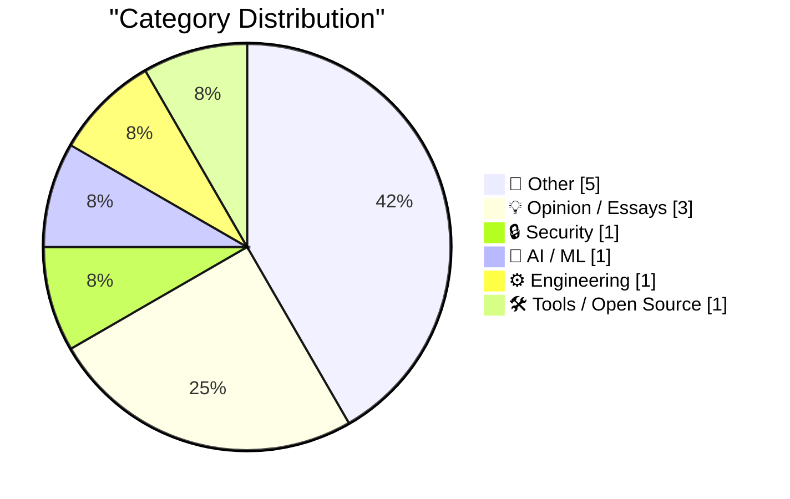
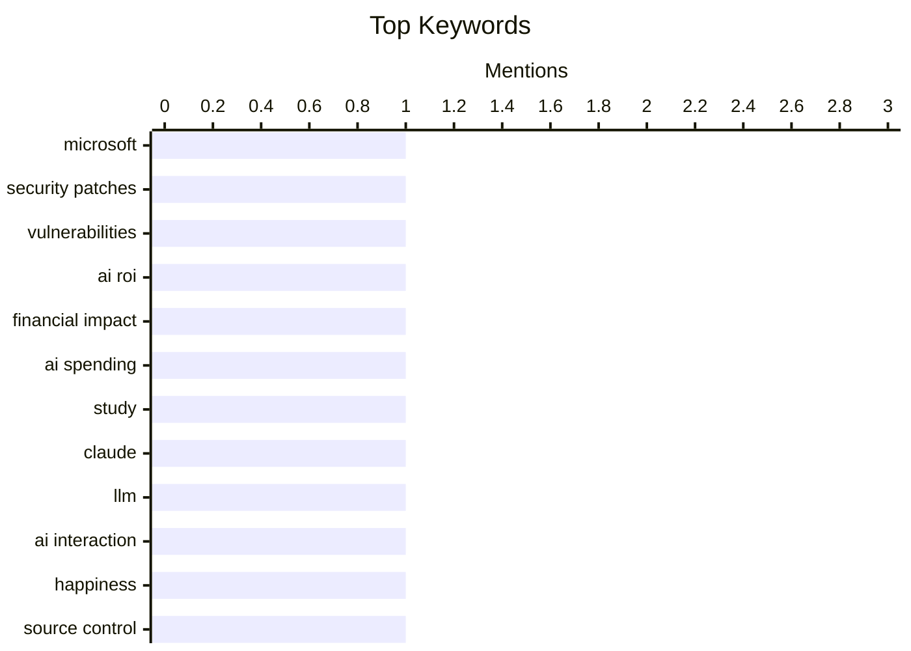

## Today's Highlights
Today's tech landscape reveals a dynamic interplay between advancing AI capabilities and persistent challenges. While new AI models and custom engineering solutions are emerging, businesses are still struggling to quantify the financial returns of their AI investments. Concurrently, hardware continues its trend towards greater accessibility, with increasingly affordable IoT devices and 3D printers entering the market. This rapid evolution is set against a backdrop of critical cybersecurity concerns, highlighted by Microsoft's unprecedented release of over 1,400 security patches.
---
## Must Read Today
1. **Microsoft Patches More Than 1,400 Security Flaws**
[Microsoft Patches More Than 1,400 Security Flaws](https://krebsonsecurity.com/2026/10/microsoft-patches-more-than-1400-security-flaws/) — krebsonsecurity.com · 14h ago · 🔒 Security
> Microsoft released an unprecedented "epic patch batch" addressing over 1,400 security vulnerabilities across its Windows operating systems and other software. This massive update significantly surpasses September's record of nearly 1,000 fixes, which was already ten times the normal monthly load. The sheer volume of patches highlights a substantial and escalating challenge in maintaining software security. This continuous effort underscores the critical need for users and administrators to apply updates promptly to mitigate widespread risks.
💡 **Why read it**: It's worth reading to understand the unprecedented scale of Microsoft's recent security patching efforts and the implications for system administrators and users.
🏷️ Microsoft, Security patches, Vulnerabilities
2. **It remains “very difficult [to find] actual, materially measurable financial impacts” from spending on AI, per new study**
[It remains “very difficult [to find] actual, materially measurable financial impacts” from spending on AI, per new study](https://garymarcus.substack.com/p/it-remains-very-difficult-to-find) — garymarcus.substack.com · 12h ago · 💡 Opinion / Essays
> A new study indicates that it remains "very difficult" to find actual, materially measurable financial impacts from spending on AI. This finding suggests a persistent challenge in quantifying the return on investment for AI initiatives across various industries. The study reinforces previous observations that despite significant investment, tangible financial benefits are not easily demonstrated. It implies that organizations may be struggling to translate AI adoption into clear economic gains, prompting a re-evaluation of AI investment strategies.
💡 **Why read it**: It's worth reading for anyone investing in or evaluating AI, as it questions the immediate, measurable financial returns of AI expenditures.
🏷️ AI ROI, Financial impact, AI spending, Study
3. **Claude, don’t touch my lump**
[Claude, don’t touch my lump](https://www.experimental-history.com/p/claude-dont-touch-my-lump) — experimental-history.com · 16h ago · 🤖 AI / ML
> This article, subtitled "OR: the secret key to permanent happiness," appears to be a personal or philosophical exploration, potentially using the AI "Claude" as a narrative device. The title "Claude, don’t touch my lump" suggests a humorous or protective stance towards something idiosyncratic or deeply personal. It likely delves into themes of personal well-being, the nature of happiness, or the boundaries of human-AI interaction. The piece may offer a unique perspective on finding contentment in an increasingly AI-driven world.
💡 **Why read it**: It's worth reading for a potentially unique, personal, or philosophical perspective on happiness or human-AI interaction, presented with a distinctive title.
🏷️ Claude, LLM, AI Interaction, Happiness
---
## Data Overview
| Sources Scanned | Articles Fetched | Time Window | Selected |
|:---:|:---:|:---:|:---:|
| 87/92 | 2606 -> 12 | 24h | **12** |
### Category Distribution

### Top Keywords

<details>
<summary>Plain Text Keyword Chart (Terminal Friendly)</summary>
```
microsoft        │ ████████████████████ 1
security patches │ ████████████████████ 1
vulnerabilities  │ ████████████████████ 1
ai roi           │ ████████████████████ 1
financial impact │ ████████████████████ 1
ai spending      │ ████████████████████ 1
study            │ ████████████████████ 1
claude           │ ████████████████████ 1
llm              │ ████████████████████ 1
ai interaction   │ ████████████████████ 1
```
</details>
### Topic Tags
**microsoft**(1) · **security patches**(1) · **vulnerabilities**(1) · ai roi(1) · financial impact(1) · ai spending(1) · study(1) · claude(1) · llm(1) · ai interaction(1) · happiness(1) · source control(1) · git alternative(1) · anthropic(1) · llm-gemini(1) · gemini api(1) · llm tool(1) · release(1) · iot(1) · cheap hardware(1)
---
## Other
### 1. Apple HomeView
[Apple HomeView](https://www.apple.com/newsroom/2026/10/meet-apple-homeview-a-new-way-to-enjoy-entertainment-and-manage-the-home/) — **daringfireball.net** · 23h ago · ⭐ 22/30
> Apple introduced Apple HomeView, a new device designed to be a central hub for home entertainment, connection, and smart home management. Featuring a stunning 7-inch Liquid Retina display, HomeView supports playing music, making FaceTime calls, home monitoring, and hands-free automations via voice control. It incorporates privacy and security at its core, including user recognition by face to personalize access. This device aims to consolidate various smart home functions into a single, user-friendly interface, enhancing the connected home experience.
🏷️ Apple, HomeView, Smart home, Product launch
---
### 2. Formlabs dropped the Raspberry Pi on the way to a $699 SLA printer
[Formlabs dropped the Raspberry Pi on the way to a $699 SLA printer](https://www.jeffgeerling.com/blog/2026/formlabs-form-studio-1-resin-printer/) — **jeffgeerling.com** · 1h ago · ⭐ 20/30
> Formlabs introduced the Form Studio 1, a new SLA 3D printer priced at an accessible $699, notably omitting the Raspberry Pi from its internal components. This decision likely contributes to the lower price point and potentially optimized performance for its specific function. The Form Studio 1 aims to make high-quality SLA printing more accessible to a broader market. The shift away from Raspberry Pi suggests Formlabs found a more cost-effective or tailored embedded solution for their new budget-friendly printer design.
🏷️ 3D printer, Formlabs, Raspberry Pi
---
### 3. A generalization of the Pythagorean theorem
[A generalization of the Pythagorean theorem](https://www.johndcook.com/blog/2026/10/14/pythagorean-variation/) — **johndcook.com** · 2h ago · ⭐ 15/30
> G. D. Chakerian discovered a generalization of the Pythagorean theorem applicable to any triangle, not just right-angled ones. The generalization involves attaching squares to each side of an arbitrary triangle. It states that if lines are extended perpendicularly from each triangle vertex through the opposite side and its attached square, specific rectangles formed will have areas with a particular relationship. This extends the classic theorem's principles to a broader geometric context. The article likely details the geometric construction and the resulting area relationships.
🏷️ Pythagorean theorem, Geometry, Mathematics
---
### 4. Poe, Bessel, and Drones
[Poe, Bessel, and Drones](https://www.johndcook.com/blog/2026/10/14/poe-bessel-and-drones/) — **johndcook.com** · 4h ago · ⭐ 14/30
> This article explores the unexpected connection between Edgar Allan Poe's story "The Pit and the Pendulum" and advanced mathematics, specifically Bessel functions. Poe's description of a pendulum with a semicircular blade being lowered on a cable represents a non-harmonic oscillator due to its increasing length (L). This physical setup leads to a differential equation whose solution involves Bessel functions, a concept far beyond Poe's era. The author suggests this mathematical model could be relevant to modern drone applications, such as lowering a payload on a cable, which creates a similar variable-length pendulum system. The core takeaway is that seemingly disparate fields like classic literature, advanced physics, and modern engineering can be linked through fundamental mathematical principles.
🏷️ Pendulum, Physics, Poe, Bessel
---
### 5. When SCO fired Darl McBride
[When SCO fired Darl McBride](https://dfarq.homeip.net/when-sco-fired-darl-mcbride/?utm_source=rss&#038;utm_medium=rss&#038;utm_campaign=when-sco-fired-darl-mcbride) — **dfarq.homeip.net** · 3h ago · ⭐ 10/30
> This article commemorates the nearly 15-year anniversary of SCO's termination of its CEO, Darl McBride, on October 14, 2009, and notes his recent passing at age 64 from ALS complications. McBride's firing marked the end of his controversial tenure, during which he was widely regarded as "the most hated man in technology." His leadership was defined by SCO's aggressive legal campaigns against Linux, claiming intellectual property infringement. The article implicitly highlights the significance of his departure as a turning point in the protracted SCO-Linux legal battles. The main takeaway is that McBride's dismissal symbolized the beginning of the end for SCO's contentious legal strategy and its prominent role in the tech industry.
🏷️ SCO, Darl McBride, Tech History, Linux
---
## Opinion / Essays
### 6. It remains “very difficult [to find] actual, materially measurable financial impacts” from spending on AI, per new study
[It remains “very difficult [to find] actual, materially measurable financial impacts” from spending on AI, per new study](https://garymarcus.substack.com/p/it-remains-very-difficult-to-find) — **garymarcus.substack.com** · 12h ago · ⭐ 25/30
> A new study indicates that it remains "very difficult" to find actual, materially measurable financial impacts from spending on AI. This finding suggests a persistent challenge in quantifying the return on investment for AI initiatives across various industries. The study reinforces previous observations that despite significant investment, tangible financial benefits are not easily demonstrated. It implies that organizations may be struggling to translate AI adoption into clear economic gains, prompting a re-evaluation of AI investment strategies.
🏷️ AI ROI, Financial impact, AI spending, Study
---
### 7. The Internet of Very Cheap Things
[The Internet of Very Cheap Things](https://shkspr.mobi/blog/2026/10/the-internet-of-very-cheap-things/) — **shkspr.mobi** · 2h ago · ⭐ 23/30
> The article highlights the dramatic decrease in the cost of IoT devices, exemplified by a £4 color-changing Zigbee lightbulb purchased recently. This contrasts sharply with complaints twelve years ago about expensive IoT devices, suggesting Moore's Law continues to drive down hardware costs for domestic gadgets. While AI consumes significant RAM, the affordability of IoT components like Zigbee bulbs indicates a parallel trend in consumer electronics. This makes smart home technology significantly more accessible to a broader market.
🏷️ IoT, Cheap hardware, Moore's Law, AI costs
---
### 8. Annualized Enron Rate
[Annualized Enron Rate](https://www.wheresyoured.at/annualized-enron-rate/) — **wheresyoured.at** · 21h ago · ⭐ 22/30
> This article promotes a premium newsletter offering in-depth financial analysis of the AI industry, available for $70 annually, $18 quarterly, or $7 monthly. The provocative title "Annualized Enron Rate" suggests a critical or skeptical examination of financial practices within the AI sector. It implies the newsletter will uncover potentially problematic or unsustainable financial trends. The content likely focuses on rigorous financial analysis, aiming to expose risks or overvaluations prevalent in the rapidly growing AI market.
🏷️ AI finance, Enron Rate, Economics
---
## Security
### 9. Microsoft Patches More Than 1,400 Security Flaws
[Microsoft Patches More Than 1,400 Security Flaws](https://krebsonsecurity.com/2026/10/microsoft-patches-more-than-1400-security-flaws/) — **krebsonsecurity.com** · 14h ago · ⭐ 29/30
> Microsoft released an unprecedented "epic patch batch" addressing over 1,400 security vulnerabilities across its Windows operating systems and other software. This massive update significantly surpasses September's record of nearly 1,000 fixes, which was already ten times the normal monthly load. The sheer volume of patches highlights a substantial and escalating challenge in maintaining software security. This continuous effort underscores the critical need for users and administrators to apply updates promptly to mitigate widespread risks.
🏷️ Microsoft, Security patches, Vulnerabilities
---
## AI / ML
### 10. Claude, don’t touch my lump
[Claude, don’t touch my lump](https://www.experimental-history.com/p/claude-dont-touch-my-lump) — **experimental-history.com** · 16h ago · ⭐ 25/30
> This article, subtitled "OR: the secret key to permanent happiness," appears to be a personal or philosophical exploration, potentially using the AI "Claude" as a narrative device. The title "Claude, don’t touch my lump" suggests a humorous or protective stance towards something idiosyncratic or deeply personal. It likely delves into themes of personal well-being, the nature of happiness, or the boundaries of human-AI interaction. The piece may offer a unique perspective on finding contentment in an increasingly AI-driven world.
🏷️ Claude, LLM, AI Interaction, Happiness
---
## Engineering
### 11. Redesigning source control at Anthropic
[Redesigning source control at Anthropic](https://simonwillison.net/2026/Oct/13/redesigning-source-control-at-anthropic/) — **simonwillison.net** · 15h ago · ⭐ 24/30
> Anthropic redesigned its source control system, building a custom alternative to Git, due to an explosive increase in code change rates. In May 2026, Anthropic averaged around 2,500 code changes merged per day, which dramatically surged to over 30,000 per day by September. This 12x increase in just four months necessitated a new system to handle the extreme volume and velocity of code contributions. The custom solution aims to scale with their rapid development pace, addressing limitations encountered with traditional Git workflows.
🏷️ Source control, Git alternative, Anthropic
---
## Tools / Open Source
### 12. llm-gemini 0.35
[llm-gemini 0.35](https://simonwillison.net/2026/Oct/13/llm-gemini/) — **simonwillison.net** · 15h ago · ⭐ 23/30
> Simon Willison released llm-gemini 0.35, introducing support for the new Gemini 4 Argon model. This model is now accessible via the Gemini API and for customers subscribed to their $100/month plan. The update enhances the llm-gemini tool's capabilities by integrating the latest Google AI model, allowing users to leverage Gemini 4 Argon's advanced features. This provides developers with immediate access to cutting-edge AI capabilities through a familiar interface.
🏷️ llm-gemini, Gemini API, LLM tool, Release
---
*Generated at 2026-10-14 14:01 | Scanned 87 sources -> 2606 articles -> selected 12*
*Based on the [Hacker News Popularity Contest 2025](https://refactoringenglish.com/tools/hn-popularity/) RSS source list recommended by [Andrej Karpathy](https://x.com/karpathy)*
*Produced by Dongdianr AI. Follow the same-name WeChat public account for more AI practical tips 💡*
