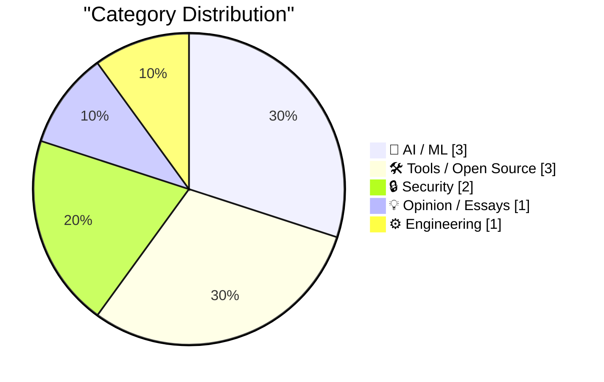
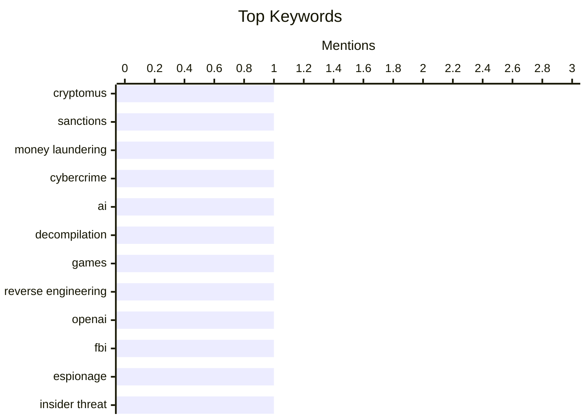

## Today's Highlights
The tech world is grappling with the rapid, yet complex, evolution of artificial intelligence, marked by significant revenue growth for AI leaders like Anthropic, innovative applications such as AI-powered game decompilation, and internal challenges. This progress is shadowed by escalating security concerns, including UK sanctions against a cryptocurrency platform for money laundering and an FBI arrest at OpenAI for corporate espionage. These developments paint a picture of an industry experiencing both unprecedented advancement and heightened vigilance against digital threats.
---
## Must Read Today
1. **U.K. Sanctions Cryptomus for RU Money Laundering**
[U.K. Sanctions Cryptomus for RU Money Laundering](https://krebsonsecurity.com/2026/10/u-k-sanctions-cryptomus-for-ru-money-laundering/) — krebsonsecurity.com · 23h ago · 🔒 Security
> The United Kingdom has issued economic sanctions against Cryptomus, a cryptocurrency platform, for allegedly facilitating money laundering for Russian cybercrime and sanctions evasion. Experts state Cryptomus serves as a major conduit for payments related to ransomware, narcotics, darknet markets, fraud, and cybercrime services. These activities are helping Russia circumvent existing financial restrictions. The sanctions aim to disrupt financial flows supporting Russian illicit activities and cybercrime.
💡 **Why read it**: It highlights a significant action by the UK government against a cryptocurrency platform involved in international money laundering and sanctions evasion, particularly concerning Russia.
🏷️ Cryptomus, Sanctions, Money Laundering, Cybercrime
2. **AI is mass decompiling games. That's both awesome and scary.**
[AI is mass decompiling games. That's both awesome and scary.](https://simonwillison.net/2026/Oct/14/ai-is-mass-decompiling-games/) — simonwillison.net · 21h ago · 🤖 AI / ML
> Indie game developer Popcar discusses the emerging trend of AI-powered mass decompilation of existing games. This technology enables the creation of novel game mashups and significantly boosts game preservation efforts, allowing old games to run on new hardware, often via WebAssembly in browsers. The article explores both the creative potential and potential concerns associated with this advancement. It suggests a future where game modification and historical game access are dramatically simplified.
💡 **Why read it**: It explores a cutting-edge application of AI in game development and preservation, highlighting both its innovative potential and inherent risks.
🏷️ AI, Decompilation, Games, Reverse Engineering
3. **The FBI Arrested a Saudi National OpenAI Employee for Planting a Recording Device in the Company’s Executive Conference Room**
[The FBI Arrested a Saudi National OpenAI Employee for Planting a Recording Device in the Company’s Executive Conference Room](https://www.justice.gov/opa/pr/saudi-national-arrested-installing-surreptitious-audio-recording-device-openai) — daringfireball.net · 17h ago · 🔒 Security
> Abdulrahman Alfozan, a 35-year-old Saudi national and OpenAI employee, was arrested on October 9th and charged with attempting to intercept oral communications. He allegedly planted a surreptitious audio recording device in OpenAI's executive conference room. The Department of Justice emphasizes this incident underscores the national security importance of winning the global super intelligence race. This event highlights the severe security challenges faced by leading AI companies.
💡 **Why read it**: It reveals a significant security breach at a prominent AI company, underscoring the national security implications and espionage risks in the AI sector.
🏷️ OpenAI, FBI, Espionage, Insider Threat
---
## Data Overview
| Sources Scanned | Articles Fetched | Time Window | Selected |
|:---:|:---:|:---:|:---:|
| 87/92 | 2606 -> 10 | 24h | **10** |
### Category Distribution

### Top Keywords

<details>
<summary>Plain Text Keyword Chart (Terminal Friendly)</summary>
```
cryptomus           │ ████████████████████ 1
sanctions           │ ████████████████████ 1
money laundering    │ ████████████████████ 1
cybercrime          │ ████████████████████ 1
ai                  │ ████████████████████ 1
decompilation       │ ████████████████████ 1
games               │ ████████████████████ 1
reverse engineering │ ████████████████████ 1
openai              │ ████████████████████ 1
fbi                 │ ████████████████████ 1
```
</details>
### Topic Tags
**cryptomus**(1) · **sanctions**(1) · **money laundering**(1) · cybercrime(1) · ai(1) · decompilation(1) · games(1) · reverse engineering(1) · openai(1) · fbi(1) · espionage(1) · insider threat(1) · generative ai(1) · ai limitations(1) · gary marcus(1) · ai critique(1) · anthropic(1) · revenue(1) · ipo(1) · ai industry(1)
---
## AI / ML
### 1. AI is mass decompiling games. That's both awesome and scary.
[AI is mass decompiling games. That's both awesome and scary.](https://simonwillison.net/2026/Oct/14/ai-is-mass-decompiling-games/) — **simonwillison.net** · 21h ago · ⭐ 26/30
> Indie game developer Popcar discusses the emerging trend of AI-powered mass decompilation of existing games. This technology enables the creation of novel game mashups and significantly boosts game preservation efforts, allowing old games to run on new hardware, often via WebAssembly in browsers. The article explores both the creative potential and potential concerns associated with this advancement. It suggests a future where game modification and historical game access are dramatically simplified.
🏷️ AI, Decompilation, Games, Reverse Engineering
---
### 2. Generative AI in disarray
[Generative AI in disarray](https://garymarcus.substack.com/p/generative-ai-in-disarray) — **garymarcus.substack.com** · 12h ago · ⭐ 26/30
> This article briefly touches upon the current state of generative AI, suggesting it is experiencing a period of "disarray." While the specific "seven brief items from Delhi" are not detailed in the provided snippet, the title implies a critical perspective on the technology's challenges. It likely discusses issues such as reliability, ethical concerns, or practical limitations. The overall takeaway is that generative AI, despite its advancements, faces significant unresolved problems.
🏷️ Generative AI, AI Limitations, Gary Marcus, AI Critique
---
### 3. Anthropic tells investors quarterly revenue up nearly 50% to $16.8bn ahead of IPO
[Anthropic tells investors quarterly revenue up nearly 50% to $16.8bn ahead of IPO](https://simonwillison.net/2026/Oct/15/anthropic-tells-investors/) — **simonwillison.net** · 57m ago · ⭐ 24/30
> Anthropic has informed investors that its quarterly revenue has surged by nearly 50%, reaching $16.8 billion, in anticipation of its upcoming IPO. This significant financial growth was revealed during an investor day, with details emerging from "people with knowledge of the matter." The substantial revenue increase positions Anthropic as a major player in the AI market. This financial performance indicates strong market adoption and investor confidence in the company's AI offerings.
🏷️ Anthropic, Revenue, IPO, AI Industry
---
## Tools / Open Source
### 4. Tree Appreciator
[Tree Appreciator](https://simonwillison.net/2026/Oct/14/tree-appreciator/) — **simonwillison.net** · 16h ago · ⭐ 17/30
> Simon Willison developed "Tree Appreciator," a new game experiment using the default Claude iPhone app (chat mode) and Claude Opus 5.5 Max. The game is built with Three.js and challenges players to appreciate the differences between two algorithmically generated trees. This project demonstrates the potential of using advanced AI models like Claude for rapid game prototyping and conceptual design. It highlights an innovative approach to game mechanics focused on observation and subtle distinctions.
🏷️ Claude, LLM, Experiment, App
---
### 5. [Sponsor] WorkOS AuthKit: Auth for Your App, Free Up to 1M Monthly Active Users
[[Sponsor] WorkOS AuthKit: Auth for Your App, Free Up to 1M Monthly Active Users](https://workos.com/?utm_source=daringfireball&amp;utm_medium=newsletter&amp;utm_campaign=q42026) — **daringfireball.net** · 16h ago · ⭐ 17/30
> WorkOS AuthKit offers a comprehensive authentication solution for applications, simplifying complex features like password resets, email verification, MFA, social providers, and enterprise SSO. It supports various authentication methods including SSO, MFA, passkeys, passwords, email codes, and social sign-in. AuthKit also provides SCIM provisioning for user management and audit logs for tracking activities. The service is free for up to 1 million monthly active users, making it accessible for growing applications.
🏷️ AuthKit, Authentication, SSO, Developer Tool
---
### 6. LaTeX package for Pascal-like triangles
[LaTeX package for Pascal-like triangles](https://www.johndcook.com/blog/2026/10/14/latex-package-for-pascal-like-triangles/) — **johndcook.com** · 20h ago · ⭐ 15/30
> John D. Cook discusses the creation of a LaTeX package to format Pascal-like triangles, specifically mentioning the harmonic triangle. Previously, he displayed these triangles left-aligned with fixed-width text due to formatting difficulties. He leveraged Claude to generate the LaTeX code for proper, visually appealing formatting, similar to the traditional Pascal's triangle layout. This demonstrates how AI tools can assist in specialized technical document formatting tasks.
🏷️ LaTeX, Pascal's Triangle, Technical Writing, Math
---
## Security
### 7. U.K. Sanctions Cryptomus for RU Money Laundering
[U.K. Sanctions Cryptomus for RU Money Laundering](https://krebsonsecurity.com/2026/10/u-k-sanctions-cryptomus-for-ru-money-laundering/) — **krebsonsecurity.com** · 23h ago · ⭐ 28/30
> The United Kingdom has issued economic sanctions against Cryptomus, a cryptocurrency platform, for allegedly facilitating money laundering for Russian cybercrime and sanctions evasion. Experts state Cryptomus serves as a major conduit for payments related to ransomware, narcotics, darknet markets, fraud, and cybercrime services. These activities are helping Russia circumvent existing financial restrictions. The sanctions aim to disrupt financial flows supporting Russian illicit activities and cybercrime.
🏷️ Cryptomus, Sanctions, Money Laundering, Cybercrime
---
### 8. The FBI Arrested a Saudi National OpenAI Employee for Planting a Recording Device in the Company’s Executive Conference Room
[The FBI Arrested a Saudi National OpenAI Employee for Planting a Recording Device in the Company’s Executive Conference Room](https://www.justice.gov/opa/pr/saudi-national-arrested-installing-surreptitious-audio-recording-device-openai) — **daringfireball.net** · 17h ago · ⭐ 26/30
> Abdulrahman Alfozan, a 35-year-old Saudi national and OpenAI employee, was arrested on October 9th and charged with attempting to intercept oral communications. He allegedly planted a surreptitious audio recording device in OpenAI's executive conference room. The Department of Justice emphasizes this incident underscores the national security importance of winning the global super intelligence race. This event highlights the severe security challenges faced by leading AI companies.
🏷️ OpenAI, FBI, Espionage, Insider Threat
---
## Opinion / Essays
### 9. Pluralistic: Expedia amazoned hotel rooms (15 Oct 2026)
[Pluralistic: Expedia amazoned hotel rooms (15 Oct 2026)](https://pluralistic.net/2026/10/15/enshittipedia/) — **pluralistic.net** · 2h ago · ⭐ 20/30
> This article, titled "Expedia amazoned hotel rooms," critiques the monopolistic practices of platforms like Expedia in the hotel industry. It argues that such consolidation leads to higher prices for consumers and reduced options, mirroring Amazon's impact on retail. The piece suggests a broader trend of "enshittification" where platforms degrade user experience and increase costs once they achieve market dominance. It implies that these monopolies negatively impact both businesses and consumers, creating an environment where "everything more expensive for everyone."
🏷️ Monopolies, Expedia, Market Power, Tech Industry
---
## Engineering
### 10. What was a Token Ring network?
[What was a Token Ring network?](https://dfarq.homeip.net/what-was-a-token-ring-network/?utm_source=rss&#038;utm_medium=rss&#038;utm_campaign=what-was-a-token-ring-network) — **dfarq.homeip.net** · 3h ago · ⭐ 8/30
> Token Ring was an obsolete networking technology that competed with Ethernet during the 1980s and 1990s. IBM first announced this standard on October 15, 1985. Unlike Ethernet's contention-based access, Token Ring used a token-passing mechanism to grant network access, ensuring fair bandwidth allocation. Today, it is primarily a historical curiosity, having been largely superseded by Ethernet due to cost-effectiveness and higher speeds.
🏷️ Token Ring, Networking, Obsolete, IBM
---
*Generated at 2026-10-15 14:01 | Scanned 87 sources -> 2606 articles -> selected 10*
*Based on the [Hacker News Popularity Contest 2025](https://refactoringenglish.com/tools/hn-popularity/) RSS source list recommended by [Andrej Karpathy](https://x.com/karpathy)*
*Produced by Dongdianr AI. Follow the same-name WeChat public account for more AI practical tips 💡*
