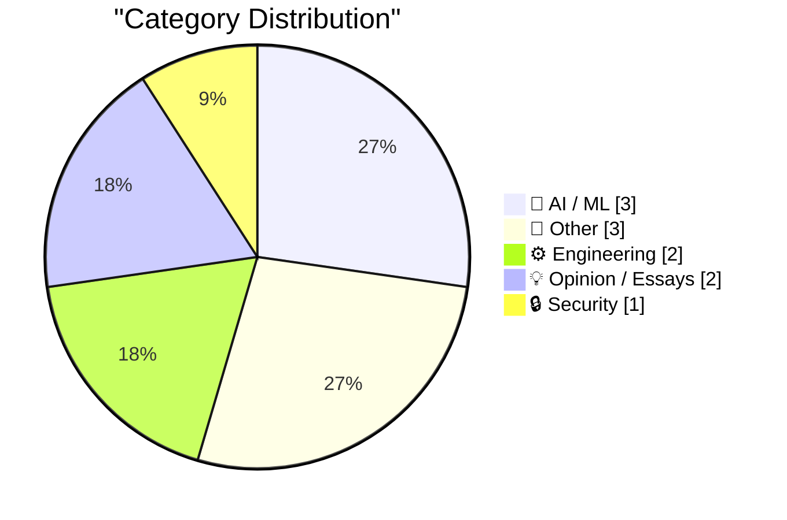
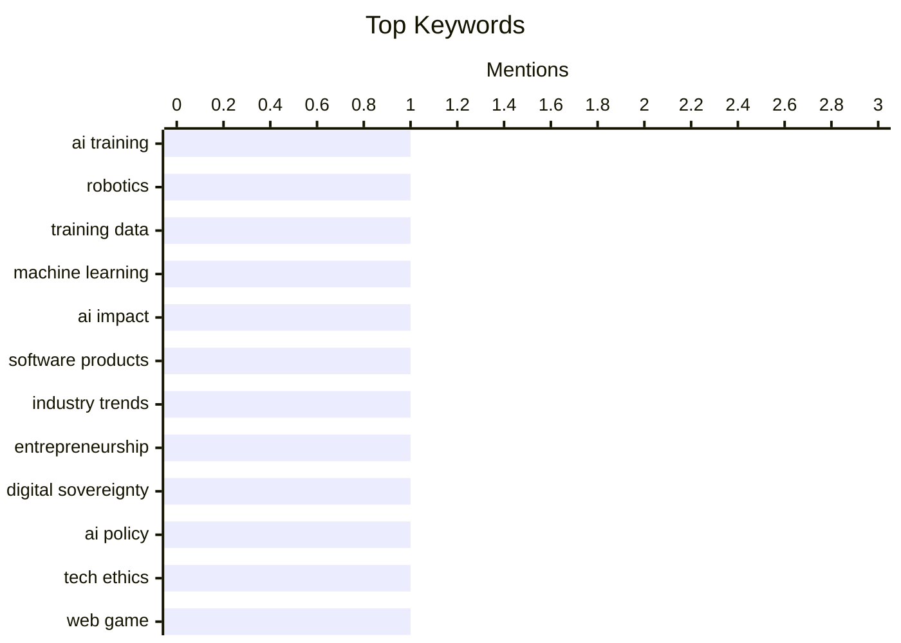

## Today's Highlights
Today's tech news highlights the evolving and often challenging landscape of artificial intelligence, from the significant hurdles in training robots for physical tasks to its role in driving a boom of modestly successful software projects rather than groundbreaking ones. This expansion of AI also brings critical discussions on digital sovereignty to the forefront. Concurrently, successful software development increasingly emphasizes the necessity of integrating multiple disciplines for effective outcomes.
---
## Must Read Today
1. **How to Train Your Robot**
[How to Train Your Robot](https://www.construction-physics.com/p/how-to-train-your-robot) — construction-physics.com · 23h ago · 🤖 AI / ML
> The article addresses the significant challenge of training robots for physical tasks, which lags behind AI's progress in digital domains due to the scarcity of real-world training data. It highlights that while simulation offers a scalable data generation solution, the "sim-to-real gap" remains a major hurdle, requiring accurate physics modeling, sensor noise replication, and robust domain randomization. Bridging this gap is crucial, often necessitating real-world fine-tuning to overcome discrepancies between simulated and physical environments. The core takeaway is that overcoming data limitations and the sim-to-real transfer problem is fundamental for advancing general-purpose robotics.
💡 **Why read it**: It provides a clear overview of the fundamental challenges and current approaches in robotics training, particularly the sim-to-real problem.
🏷️ AI Training, Robotics, Training Data, Machine Learning
2. **AI is driving a boom in modestly successful software projects**
[AI is driving a boom in modestly successful software projects](https://seangoedecke.com/ai-is-driving-a-boom-in-modestly-successful-software/) — seangoedecke.com · 14h ago · 🤖 AI / ML
> The article explores why AI hasn't led to an explosion of groundbreaking software products, instead suggesting it's fueling a boom in "modestly successful" projects. It argues that AI, particularly coding agents, lowers the barrier to entry, enabling individuals to rapidly build and launch niche applications. This trend results in a proliferation of functional, albeit not revolutionary, software solving specific problems for smaller audiences. The author concludes that AI is democratizing software creation, leading to a broader distribution of smaller successes rather than a few massive breakthroughs.
💡 **Why read it**: It offers a nuanced perspective on AI's impact on software development, explaining why we see many small successes rather than a few large ones.
🏷️ AI Impact, Software Products, Industry Trends, Entrepreneurship
3. **Pluralistic: Load-bearing (16 Oct 2026)**
[Pluralistic: Load-bearing (16 Oct 2026)](https://pluralistic.net/2026/10/15/sovereign-it/) — pluralistic.net · 7h ago · 🤖 AI / ML
> This Pluralistic entry primarily features "Load-bearing: Digital sovereignty vs AI" as its main topic. It briefly touches upon the inherent tension and critical implications arising from the intersection of digital sovereignty and the pervasive influence of artificial intelligence. The article suggests a need to critically examine how AI impacts national and individual control over digital infrastructure and data. The core takeaway is that AI introduces new complexities and challenges to established notions of digital autonomy and control.
💡 **Why read it**: It highlights a critical, emerging geopolitical and technological issue: the conflict between digital sovereignty and the pervasive influence of AI.
🏷️ Digital Sovereignty, AI Policy, Tech Ethics
---
## Data Overview
| Sources Scanned | Articles Fetched | Time Window | Selected |
|:---:|:---:|:---:|:---:|
| 86/92 | 2581 -> 11 | 24h | **11** |
### Category Distribution

### Top Keywords

<details>
<summary>Plain Text Keyword Chart (Terminal Friendly)</summary>
```
ai training         │ ████████████████████ 1
robotics            │ ████████████████████ 1
training data       │ ████████████████████ 1
machine learning    │ ████████████████████ 1
ai impact           │ ████████████████████ 1
software products   │ ████████████████████ 1
industry trends     │ ████████████████████ 1
entrepreneurship    │ ████████████████████ 1
digital sovereignty │ ████████████████████ 1
ai policy           │ ████████████████████ 1
```
</details>
### Topic Tags
**ai training**(1) · **robotics**(1) · **training data**(1) · machine learning(1) · ai impact(1) · software products(1) · industry trends(1) · entrepreneurship(1) · digital sovereignty(1) · ai policy(1) · tech ethics(1) · web game(1) · audio communication(1) · static html(1) · experiment(1) · software development(1) · teamwork(1) · engineering disciplines(1) · apple tv(1) · homepod mini(1)
---
## AI / ML
### 1. How to Train Your Robot
[How to Train Your Robot](https://www.construction-physics.com/p/how-to-train-your-robot) — **construction-physics.com** · 23h ago · ⭐ 27/30
> The article addresses the significant challenge of training robots for physical tasks, which lags behind AI's progress in digital domains due to the scarcity of real-world training data. It highlights that while simulation offers a scalable data generation solution, the "sim-to-real gap" remains a major hurdle, requiring accurate physics modeling, sensor noise replication, and robust domain randomization. Bridging this gap is crucial, often necessitating real-world fine-tuning to overcome discrepancies between simulated and physical environments. The core takeaway is that overcoming data limitations and the sim-to-real transfer problem is fundamental for advancing general-purpose robotics.
🏷️ AI Training, Robotics, Training Data, Machine Learning
---
### 2. AI is driving a boom in modestly successful software projects
[AI is driving a boom in modestly successful software projects](https://seangoedecke.com/ai-is-driving-a-boom-in-modestly-successful-software/) — **seangoedecke.com** · 14h ago · ⭐ 26/30
> The article explores why AI hasn't led to an explosion of groundbreaking software products, instead suggesting it's fueling a boom in "modestly successful" projects. It argues that AI, particularly coding agents, lowers the barrier to entry, enabling individuals to rapidly build and launch niche applications. This trend results in a proliferation of functional, albeit not revolutionary, software solving specific problems for smaller audiences. The author concludes that AI is democratizing software creation, leading to a broader distribution of smaller successes rather than a few massive breakthroughs.
🏷️ AI Impact, Software Products, Industry Trends, Entrepreneurship
---
### 3. Pluralistic: Load-bearing (16 Oct 2026)
[Pluralistic: Load-bearing (16 Oct 2026)](https://pluralistic.net/2026/10/15/sovereign-it/) — **pluralistic.net** · 7h ago · ⭐ 25/30
> This Pluralistic entry primarily features "Load-bearing: Digital sovereignty vs AI" as its main topic. It briefly touches upon the inherent tension and critical implications arising from the intersection of digital sovereignty and the pervasive influence of artificial intelligence. The article suggests a need to critically examine how AI impacts national and individual control over digital infrastructure and data. The core takeaway is that AI introduces new complexities and challenges to established notions of digital autonomy and control.
🏷️ Digital Sovereignty, AI Policy, Tech Ethics
---
## Other
### 4. ★ Initial Thoughts on This Week’s New Apple TV 4K (4th Generation) and HomePod Mini 2
[★ Initial Thoughts on This Week’s New Apple TV 4K (4th Generation) and HomePod Mini 2](https://daringfireball.net/2026/10/thoughts_on_new_apple_tv_4k_and_homepod_mini_2) — **daringfireball.net** · 12h ago · ⭐ 16/30
> The article critically examines the significant price increase for Apple's new Apple TV 4K (4th Generation) and HomePod Mini 2. It highlights a stark comparison: a 128 GB Apple TV and a pair of HomePod Minis, which previously cost $350 ($150 + $100 + $100), now retail for $600 ($300 + $150 + $150). This represents a substantial 71% price hike for the same combination of devices within just four months. The main conclusion is that Apple has drastically increased the cost of its home entertainment ecosystem components.
🏷️ Apple TV, HomePod Mini, Hardware Review
---
### 5. Secret Documents Reveal Donors Behind $330 Million for Trump’s Ballroom — Apple and Nvidia Top the List at $25 Million Each
[Secret Documents Reveal Donors Behind $330 Million for Trump’s Ballroom — Apple and Nvidia Top the List at $25 Million Each](https://www.washingtonpost.com/investigations/2026/10/15/secret-documents-reveal-donors-behind-330-million-trumps-ballroom/) — **daringfireball.net** · 21h ago · ⭐ 13/30
> Secret documents obtained by The Washington Post reveal major donors to President Donald Trump’s White House ballroom project, which amassed $330 million. The report highlights previously undisclosed contributors who allegedly benefited from regulatory decisions, government contracts, or pardons. Notably, tech giants Nvidia and Apple each committed $25 million, making them the top contributors to the project. This revelation raises significant questions about the influence of corporate donations on political outcomes and government actions.
🏷️ Political Donations, Apple, Nvidia, Trump
---
### 6. Book Review: Africa Is Not A Country - Breaking Stereotypes of Modern Africa by Dipo Faloyin ★★★★⯪
[Book Review: Africa Is Not A Country - Breaking Stereotypes of Modern Africa by Dipo Faloyin ★★★★⯪](https://shkspr.mobi/blog/2026/10/book-review-africa-is-not-a-country-breaking-stereotypes-of-modern-africa-by-dipo-faloyin/) — **shkspr.mobi** · 2h ago · ⭐ 10/30
> This article reviews Dipo Faloyin's book, "Africa Is Not A Country," which received a 4.5-star rating. The book is highly praised for its ability to combine "righteous indignation" with humor, accessibility, and informative content, effectively dismantling common myths and stereotypes about Africa. It challenges the monolithic view often perpetuated about the continent, providing a nuanced and critical perspective on its diverse realities. The core takeaway is that Faloyin's book is a spectacular and engaging work that successfully educates readers on the complexities of modern Africa.
🏷️ Book Review, Africa, Culture
---
## Engineering
### 7. Chirp Pong
[Chirp Pong](https://simonwillison.net/2026/Oct/15/chirp-pong/) — **simonwillison.net** · 18h ago · ⭐ 24/30
> Simon Willison experimented with "Chirp Pong," a two-player competitive Pong-like game designed to run on two separate phones using static HTML. The innovative technical approach involves transmitting game state information between phones via audio chirps sent through the microphone. This experiment aimed to test the feasibility of such an unconventional networking method for a real-time game. The author confirmed that this method "seems to work," demonstrating a viable, albeit niche, alternative to traditional network communication for simple game states.
🏷️ Web Game, Audio Communication, Static HTML, Experiment
---
### 8. We Need All the Disciplines
[We Need All the Disciplines](https://blog.jim-nielsen.com/2026/we-need-all-disciplines/) — **blog.jim-nielsen.com** · 19h ago · ⭐ 21/30
> The article argues that successful software development necessitates the integration of multiple disciplines, including product, design, engineering, and DevOps. It emphasizes that each discipline contributes unique values, judgments, and perspectives essential for defining, building, and shipping dependable software. While acknowledging that a multi-disciplinary approach might slow down the development process, the author asserts its crucial role in achieving superior outcomes. The core takeaway is that a holistic, collaborative approach across all relevant disciplines is fundamental for creating great, reliable software.
🏷️ Software Development, Teamwork, Engineering Disciplines
---
## Opinion / Essays
### 9. This video is 2 minutes long
[This video is 2 minutes long](https://idiallo.com/byte-size/two-minutes-long-video) — **idiallo.com** · 8h ago · ⭐ 10/30
> The author discusses their strategy of releasing video content in short, digestible "chunks" due to the extensive time required for editing longer videos. The video series aims to critically examine the discrepancy between the promised future of automation, where technology frees up time for leisure, and the current reality dominated by the pursuit of "productivity." It questions whether technology truly delivers on its promise of more free time or merely shifts the focus to optimizing output. The core takeaway is a critical reflection on technology's impact on personal time and the evolving concept of productivity.
🏷️ Video Editing, Personal Reflection, Future
---
### 10. Yours truly
[Yours truly](https://blog.coredump.cx/p/yours-truly) — **lcamtuf.substack.com** · 14h ago · ⭐ 6/30
> This article delves into the complex nature of truth and reliability in information, particularly within the context of online content and personal blogging. The author reflects on the inherent challenges of maintaining objectivity, even when striving for factual reporting, and acknowledges how personal biases and perspectives inevitably shape narratives. It highlights the subjective interpretation of "truth" and the difficulty in presenting a universally accepted account of events. The author also discusses the evolution of their blog from a technical security focus to a broader, more philosophical scope, emphasizing the increased presence of personal opinion. Ultimately, the piece encourages readers to approach all information, including the author's own, with critical discernment, recognizing the pervasive influence of subjectivity in human communication.
🏷️ Truth, Philosophy, Reflection
---
## Security
### 11. Spyware invented October 16, 1995
[Spyware invented October 16, 1995](https://dfarq.homeip.net/spyware-invented-october-16-1995/?utm_source=rss&#038;utm_medium=rss&#038;utm_campaign=spyware-invented-october-16-1995) — **dfarq.homeip.net** · 3h ago · ⭐ 15/30
> The article clarifies the origin of the term "spyware," attributing its first recorded use to Roland Vossen in a Usenet post on October 16, 1995. It emphasizes that Vossen did not invent the concept of software designed to monitor user activity, but rather coined the specific term that would later become widely adopted. This historical detail marks a significant moment in the lexicon of cybersecurity and privacy. The core takeaway is that the term "spyware" has a precise origin date and inventor, distinct from the invention of the underlying malicious software.
🏷️ spyware, history, cybersecurity, term origin
---
*Generated at 2026-10-16 14:01 | Scanned 86 sources -> 2581 articles -> selected 11*
*Based on the [Hacker News Popularity Contest 2025](https://refactoringenglish.com/tools/hn-popularity/) RSS source list recommended by [Andrej Karpathy](https://x.com/karpathy)*
*Produced by Dongdianr AI. Follow the same-name WeChat public account for more AI practical tips 💡*
