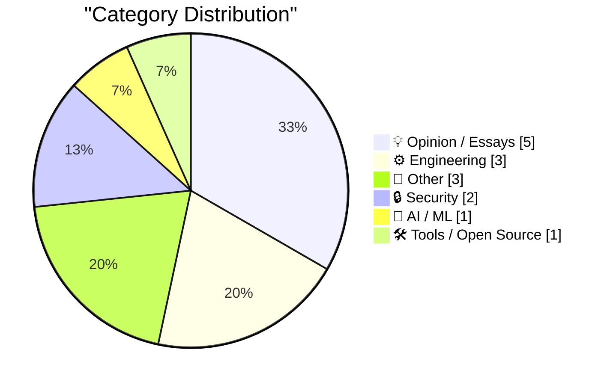
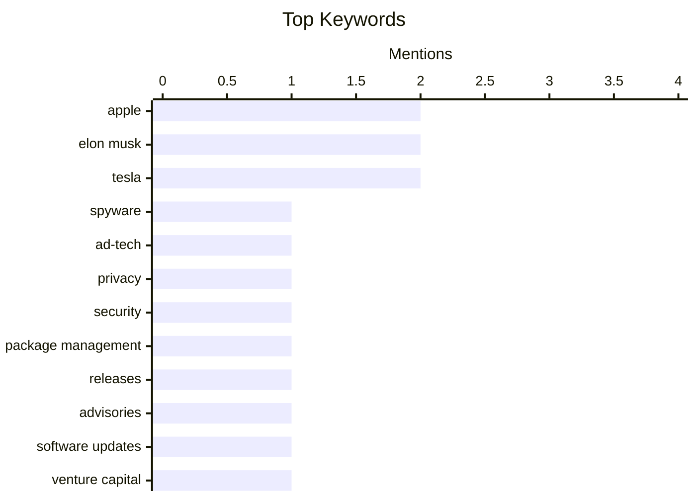

## Today's Highlights
Today's tech landscape reveals a dual focus on security and the evolving AI frontier. Cybersecurity defenses are tightening against mercenary spyware and app integrity threats, while the AI sector navigates intense hype and critical scrutiny, with some researchers holding almost "quasi-religious" beliefs about its transformative power. This introspection extends to broader industry practices, including venture capital and the realities of innovation.
---
## Must Read Today
1. **Pluralistic: Israeli ad-tech company was a delivery system for "mercenary spyware" (17 Oct 2026)**
[Pluralistic: Israeli ad-tech company was a delivery system for "mercenary spyware" (17 Oct 2026)](https://pluralistic.net/2026/10/17/mercenary-spyware/) — pluralistic.net · 3h ago · 🔒 Security
> An Israeli ad-tech company has been identified as a delivery system for "mercenary spyware." This company allegedly leveraged major ad platforms, including Google and Facebook, to distribute its malicious software. The incident highlights a significant vulnerability within the digital advertising ecosystem, where legitimate platforms can be exploited for covert surveillance. This raises serious concerns about the security integrity of widely used ad networks and the privacy of their users. The core takeaway is the urgent need for enhanced scrutiny and security measures within the ad-tech industry to prevent such abuses.
💡 **Why read it**: It exposes how mainstream ad platforms can be exploited to distribute sophisticated spyware, impacting digital security and privacy.
🏷️ spyware, ad-tech, privacy, security
2. **This Week in Package Management: 17 October 2026**
[This Week in Package Management: 17 October 2026](https://nesbitt.io/2026/10/17/this-week-in-package-management.html) — nesbitt.io · 4h ago · ⚙️ Engineering
> This article provides a weekly compilation of significant updates within the package management landscape. It aggregates recent releases, critical security advisories, and relevant articles from various package management systems and communities. The content is curated to offer a concise overview of the latest developments and potential issues. This serves as an essential resource for professionals and enthusiasts monitoring the dynamic world of software package management. The main conclusion is that staying informed about these weekly changes is crucial for maintaining secure and up-to-date software environments.
💡 **Why read it**: It offers a quick, centralized overview of the latest releases, advisories, and articles in the package management world.
🏷️ Package management, Releases, Advisories, Software updates
3. **Premium: Venture Capital Is Killing Itself**
[Premium: Venture Capital Is Killing Itself](https://www.wheresyoured.at/premium-venture-capital-is-killing-itself/) — wheresyoured.at · 21h ago · 💡 Opinion / Essays
> The article argues that venture capital practices, stemming from a government mistake made approximately fourteen years ago, are detrimental to both the industry and retail investors. This error allegedly enabled tech companies and VCs to legally manipulate retail investors, withholding crucial information and spuriously inflating the valuations of major tech IPOs. This systemic issue has created a distorted market where company valuations are not grounded in true fundamentals. The author concludes that these unsustainable practices are ultimately self-destructive for the venture capital ecosystem, leading to market instability and investor disillusionment.
💡 **Why read it**: It presents a critical perspective on how venture capital and tech IPOs allegedly exploit retail investors due to past regulatory oversights.
🏷️ Venture capital, Tech finance, Startups, Investment
---
## Data Overview
| Sources Scanned | Articles Fetched | Time Window | Selected |
|:---:|:---:|:---:|:---:|
| 86/92 | 2579 -> 17 | 24h | **15** |
### Category Distribution

### Top Keywords

<details>
<summary>Plain Text Keyword Chart (Terminal Friendly)</summary>
```
apple              │ ████████████████████ 2
elon musk          │ ████████████████████ 2
tesla              │ ████████████████████ 2
spyware            │ ██████████░░░░░░░░░░ 1
ad-tech            │ ██████████░░░░░░░░░░ 1
privacy            │ ██████████░░░░░░░░░░ 1
security           │ ██████████░░░░░░░░░░ 1
package management │ ██████████░░░░░░░░░░ 1
releases           │ ██████████░░░░░░░░░░ 1
advisories         │ ██████████░░░░░░░░░░ 1
```
</details>
### Topic Tags
**apple**(2) · **elon musk**(2) · **tesla**(2) · spyware(1) · ad-tech(1) · privacy(1) · security(1) · package management(1) · releases(1) · advisories(1) · software updates(1) · venture capital(1) · tech finance(1) · startups(1) · investment(1) · ai model(1) · mac studio(1) · local inference(1) · meta(1) · ai culture(1)
---
## Opinion / Essays
### 1. Premium: Venture Capital Is Killing Itself
[Premium: Venture Capital Is Killing Itself](https://www.wheresyoured.at/premium-venture-capital-is-killing-itself/) — **wheresyoured.at** · 21h ago · ⭐ 24/30
> The article argues that venture capital practices, stemming from a government mistake made approximately fourteen years ago, are detrimental to both the industry and retail investors. This error allegedly enabled tech companies and VCs to legally manipulate retail investors, withholding crucial information and spuriously inflating the valuations of major tech IPOs. This systemic issue has created a distorted market where company valuations are not grounded in true fundamentals. The author concludes that these unsustainable practices are ultimately self-destructive for the venture capital ecosystem, leading to market instability and investor disillusionment.
🏷️ Venture capital, Tech finance, Startups, Investment
---
### 2. Shyam Sankar, CTO of Palantir, Says AI Researchers Have Started Smoking Because They’re Convinced AI (Claude, Probably) Is Going to Cure Cancer
[Shyam Sankar, CTO of Palantir, Says AI Researchers Have Started Smoking Because They’re Convinced AI (Claude, Probably) Is Going to Cure Cancer](https://www.cbsnews.com/news/shyam-sankar-chief-technology-officer-palantir-face-the-nation-transcript-10-11-2026/) — **daringfireball.net** · 21h ago · ⭐ 23/30
> Palantir CTO Shyam Sankar discusses the quasi-religious belief some AI researchers hold regarding Artificial General Intelligence (AGI)'s potential. Sankar observes that many Silicon Valley AI developers have filled a "god-shaped hole" with the "machine God of AGI," leading to extreme and irrational beliefs. He cites an anecdote where AI researchers started smoking, convinced that AI (likely Claude) would soon cure cancer, rendering health concerns irrelevant. This illustrates a concerning level of irrational optimism and potentially dangerous detachment from reality among some in the AI development community. The core conclusion is that such extreme beliefs can lead to a distorted perception of AI's current capabilities and future implications.
🏷️ AI culture, Palantir, Silicon Valley, AI ethics
---
### 3. ★ Real Artists Ship, Tesla Edition
[★ Real Artists Ship, Tesla Edition](https://daringfireball.net/2026/10/real_artists_ship_tesla_edition) — **daringfireball.net** · 17h ago · ⭐ 19/30
> The article offers a nuanced perspective on Elon Musk's reputation, acknowledging both his extraordinary accomplishments and his consistent tendency for making unfulfilled promises. It argues that viewing Musk as either entirely legitimate or an utter fraud is an oversimplification. He has undeniably led companies to "extraordinary accomplishments" but has also made promises based on "complete bullshit," particularly regarding timelines and capabilities. The author characterizes him as a "shameless bullshitter who *sometimes* delivers." The main conclusion is that Musk's career is a complex blend of visionary achievement and significant over-promising, making him a figure who defies simple categorization.
🏷️ Elon Musk, leadership, Tesla, industry commentary
---
### 4. iPhone Duo Pre-Orders Launched, and Three Hours Later It’s Sold Out Through the End of January
[iPhone Duo Pre-Orders Launched, and Three Hours Later It’s Sold Out Through the End of January](https://www.macrumors.com/2026/10/16/iphone-duo-sold-out-for-christmas/) — **daringfireball.net** · 22h ago · ⭐ 17/30
> This article reports on the rapid sell-out of the new iPhone Duo following its pre-order launch. Within just three hours of pre-orders opening, Apple's online store in the U.S. began showing estimated shipping dates of January 25 for all configurations. This indicates that the device is effectively sold out for Christmas delivery. While some Apple Stores might have limited stock for walk-in customers on the October 23 launch day, inventory is expected to be extremely tight. The main conclusion is that the iPhone Duo has experienced exceptionally high demand, leading to significant supply constraints and extended shipping delays immediately after pre-orders began.
🏷️ Apple, product launch, satire, consumer hype
---
### 5. The Late Charlie Munger on Elon Musk and Tesla
[The Late Charlie Munger on Elon Musk and Tesla](https://www.cnbc.com/make-it/2020/02/14/charlie-munger-shares-opinion-of-tesla-ceo-elon-musk.html) — **daringfireball.net** · 12h ago · ⭐ 16/30
> This article presents Charlie Munger's perspective on Elon Musk and Tesla's stock volatility, shared at Berkshire Hathaway's 2020 shareholder meeting. Munger famously stated, "I would never buy it, and I would never sell it short" regarding Tesla. This reflects his cautious investment philosophy towards highly volatile assets and personalities like Musk, despite acknowledging Musk's ability to deliver on ambitious projects. Munger's stance highlights a conservative investment approach that avoids both long and short positions on highly speculative and volatile stocks like Tesla, even for companies led by innovative figures. The main conclusion is that Munger's view underscores a preference for avoiding high-risk, high-reward investments, even in the face of disruptive innovation.
🏷️ Elon Musk, Tesla, Charlie Munger, industry opinion
---
## Engineering
### 6. This Week in Package Management: 17 October 2026
[This Week in Package Management: 17 October 2026](https://nesbitt.io/2026/10/17/this-week-in-package-management.html) — **nesbitt.io** · 4h ago · ⭐ 24/30
> This article provides a weekly compilation of significant updates within the package management landscape. It aggregates recent releases, critical security advisories, and relevant articles from various package management systems and communities. The content is curated to offer a concise overview of the latest developments and potential issues. This serves as an essential resource for professionals and enthusiasts monitoring the dynamic world of software package management. The main conclusion is that staying informed about these weekly changes is crucial for maintaining secure and up-to-date software environments.
🏷️ Package management, Releases, Advisories, Software updates
---
### 7. Intel 386 released October 17, 1985
[Intel 386 released October 17, 1985](https://dfarq.homeip.net/intel-386-released-october-17-1985/?utm_source=rss&#038;utm_medium=rss&#038;utm_campaign=intel-386-released-october-17-1985) — **dfarq.homeip.net** · 3h ago · ⭐ 22/30
> This article commemorates the release of the Intel 386 CPU on October 17, 1985. Also known as the 80386 or 386DX, this chip is described as having fundamentally changed the direction of the computer industry more profoundly than almost any other processor before or since. Its introduction marked a significant "disruptive product" moment, laying crucial groundwork for modern computing architectures and operating systems. The 386's 32-bit architecture and protected mode capabilities were revolutionary for its time. The main conclusion is that the Intel 386 was a groundbreaking CPU that served as a foundational pillar for subsequent advancements in personal computing.
🏷️ Intel 386, CPU, Computer history, Microprocessor
---
### 8. Quoting Addy Osmani, Morgan Westlee Lunt, and Qing Wang
[Quoting Addy Osmani, Morgan Westlee Lunt, and Qing Wang](https://simonwillison.net/2026/Oct/16/code-review/) — **simonwillison.net** · 15h ago · ⭐ 21/30
> The article discusses a paradigm shift in the philosophy of code review, moving beyond the simplistic question of "did a human read the code?" It quotes a perspective suggesting the precise question should be "what could go wrong with this change, and which check—automated or human—is the right one to catch it?" This approach transforms code review from a final gate at the end of development into a continuous process, akin to spellcheck, integrated throughout the coding workflow rather than just at the pull request stage. This new paradigm advocates for a more proactive, risk-focused, and continuous integration of review mechanisms. The main takeaway is that effective code review should be an ongoing, intelligent process leveraging both automated tools and human insight.
🏷️ code review, engineering practices, Anthropic, automation
---
## Other
### 9. Monoliths and Lagrange Points
[Monoliths and Lagrange Points](https://www.johndcook.com/blog/2026/10/16/monoliths-and-lagrange-points/) — **johndcook.com** · 23h ago · ⭐ 18/30
> This article discusses the scientific accuracy of the movie "2010: The Year We Make Contact" regarding the placement of a monolith at a Lagrange point between Jupiter and Io. It explains that Lagrange points are stable gravitational points in a two-body system, but the Jupiter-Io system is part of a more complex three-body problem (Sun-Jupiter-Io). A stable Lagrange point for a third body (like the monolith) cannot exist *between* Jupiter and Io, as Io is already orbiting Jupiter. The monolith would need to orbit Jupiter at the same distance as Io to be at a stable point, not positioned between them. The main conclusion is that the movie's depiction of a stable Lagrange point between Jupiter and Io for the monolith is scientifically inaccurate due to the complexities of multi-body gravitational dynamics.
🏷️ Lagrange points, Physics, Astronomy, Science
---
### 10. Reading List 10/17/26
[Reading List 10/17/26](https://www.construction-physics.com/p/reading-list-101726) — **construction-physics.com** · 1h ago · ⭐ 17/30
> This article is a curated reading list covering various topics related to construction, technology, and energy. The list includes articles on Icon's fundraising activities, employment trends within China's solar industry, and the reliability of grid-scale battery systems. It also features updates on Tesla's flying roadster project and other relevant news. The post serves as a digest of recent developments across these diverse but interconnected fields. The main conclusion is that the post offers a concise overview of current events and significant developments in construction technology, renewable energy, and advanced transportation.
🏷️ Industry news, Construction, Energy, Reading list
---
### 11. Book Review: Are You *Really* The Doctor? by Matthew Hutchinson ★★★⯪☆
[Book Review: Are You *Really* The Doctor? by Matthew Hutchinson ★★★⯪☆](https://shkspr.mobi/blog/2026/10/book-review-are-you-really-the-doctor-by-matthew-hutchinson/) — **shkspr.mobi** · 2h ago · ⭐ 12/30
> This article is a book review of "Are You *Really* The Doctor?" by Matthew Hutchinson, which explores his experiences as a Black doctor in the NHS. The book, based on Hutchinson's stand-up comedy special, details the racial biases he faced from the public, who often doubted his professional role due to his ethnicity. It draws parallels with Adam Kay's "This Is Going To Hurt" but focuses on the unique challenges of being a Black medical professional in the UK. The review highlights the book's candid portrayal of systemic racism within the healthcare system, offering a critical perspective on professional identity and public perception. The main conclusion is that the book provides an important and humorous account of racial prejudice faced by Black doctors in the NHS.
🏷️ Book review, Social commentary, NHS, Race
---
## Security
### 12. Pluralistic: Israeli ad-tech company was a delivery system for "mercenary spyware" (17 Oct 2026)
[Pluralistic: Israeli ad-tech company was a delivery system for "mercenary spyware" (17 Oct 2026)](https://pluralistic.net/2026/10/17/mercenary-spyware/) — **pluralistic.net** · 3h ago · ⭐ 28/30
> An Israeli ad-tech company has been identified as a delivery system for "mercenary spyware." This company allegedly leveraged major ad platforms, including Google and Facebook, to distribute its malicious software. The incident highlights a significant vulnerability within the digital advertising ecosystem, where legitimate platforms can be exploited for covert surveillance. This raises serious concerns about the security integrity of widely used ad networks and the privacy of their users. The core takeaway is the urgent need for enhanced scrutiny and security measures within the ad-tech industry to prevent such abuses.
🏷️ spyware, ad-tech, privacy, security
---
### 13. Apple: ‘Strengthening App Review Guidelines Against Nonconsensual Intimate Imagery and Bait-And-Switch Apps’
[Apple: ‘Strengthening App Review Guidelines Against Nonconsensual Intimate Imagery and Bait-And-Switch Apps’](https://developer.apple.com/news/?id=vvzx6cul) — **daringfireball.net** · 13h ago · ⭐ 22/30
> Apple is reinforcing its App Review Guidelines to combat the proliferation of nonconsensual intimate imagery and deceptive bait-and-switch applications. The updated guidelines explicitly prohibit apps that generate nudity or sexually explicit images, specifically targeting "nudification" apps that create such content of real individuals without their consent. Furthermore, apps hosting user-generated content are now required to implement robust filtering for objectionable material, provide clear reporting mechanisms, and enable users to block abusive accounts. This initiative demonstrates Apple's stronger stance on content moderation and user safety. The main conclusion is Apple's commitment to creating a safer App Store environment by proactively addressing emerging threats like AI-generated explicit content.
🏷️ Apple, App Store, guidelines, content moderation
---
## AI / ML
### 14. Strange Times Make for Strange Bedfellows
[Strange Times Make for Strange Bedfellows](https://x.com/finkd/status/2110778025629347999) — **daringfireball.net** · 14h ago · ⭐ 23/30
> This article highlights a notable public interaction between Mark Zuckerberg and Apple's John Ternus concerning the performance of AI models on Apple hardware. Zuckerberg announced that Meta's Muse Spark Open AI model, with weights releasing today, runs "great" on new Mac Studios, attributing this to collaboration with Ternus and Apple. Ternus confirmed the efficiency of running such a high-caliber and large-scale model on-device, emphasizing the M5 Ultra Mac Studio's AI capabilities, which is set to ship by the end of October with 512 GB RAM. This exchange signals a surprising collaboration between Meta and Apple in the on-device AI space. The main takeaway is the Mac Studio's growing prowess for demanding AI workloads, even for models from competing tech giants.
🏷️ AI model, Mac Studio, local inference, Meta
---
## Tools / Open Source
### 15. How They Got Duo Support in NetNewsWire
[How They Got Duo Support in NetNewsWire](https://netnewswire.blog/2026/10/16/how-we-got-duo-support.html) — **daringfireball.net** · 17h ago · ⭐ 19/30
> The NetNewsWire team explains how their iOS application gained support for the novel iPhone Duo without requiring any specific development work. Developers achieved iPhone Duo compatibility simply by building the app with Xcode 27.1 and its default iOS SDK. This seamless integration was possible because NetNewsWire already adhered to Apple's standard UI/UX guidelines, utilizing standard controls like toolbars, navigation controllers, and split views, and paying close attention to size classes and adaptive layouts. The article demonstrates the power of following Apple's recommended design principles. The main conclusion is that robust adaptive design allows apps to automatically support new and evolving form factors like the iPhone Duo.
🏷️ iOS development, Xcode, SDK, developer tools
---
*Generated at 2026-10-17 14:01 | Scanned 86 sources -> 2579 articles -> selected 15*
*Based on the [Hacker News Popularity Contest 2025](https://refactoringenglish.com/tools/hn-popularity/) RSS source list recommended by [Andrej Karpathy](https://x.com/karpathy)*
*Produced by Dongdianr AI. Follow the same-name WeChat public account for more AI practical tips 💡*
