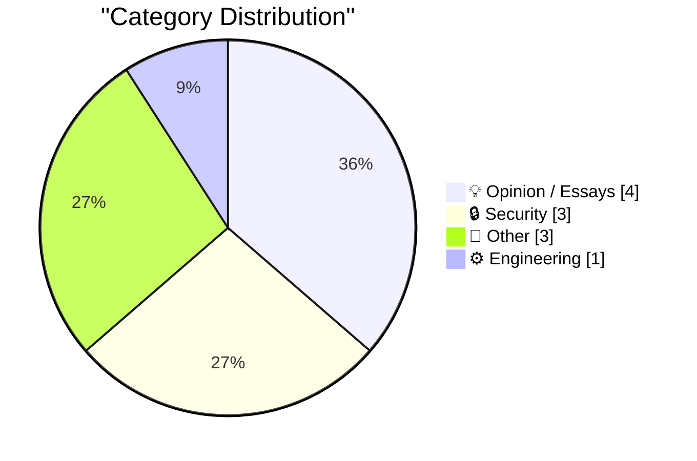
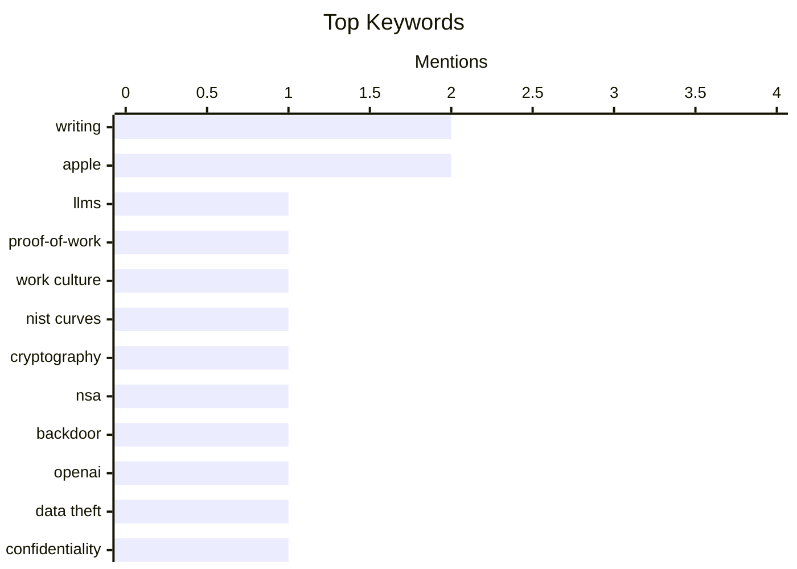

## Today's Highlights
The ongoing AI boom dominates today's tech discussions, with experts exploring its potential future scenarios and the shifting nature of work. This rapid evolution also brings heightened security concerns, exemplified by allegations of an OpenAI employee taking sensitive files to Apple. Meanwhile, the broader digital security landscape continues to evolve, from lifting long-standing suspicions on NIST cryptographic curves to new personal multi-factor authentication solutions. These trends highlight a period of intense innovation coupled with critical scrutiny over data integrity and the future of technology.
---
## Must Read Today
1. **Writing is no longer proof of work**
[Writing is no longer proof of work](https://seangoedecke.com/writing-is-no-longer-proof-of-work/) — seangoedecke.com · 14h ago · 💡 Opinion / Essays
> Tech companies traditionally rely on writing as "proof-of-work" to evidence compliance, effort, or understanding, akin to Bitcoin's hashing. However, the rise of Large Language Models (LLMs) is fundamentally undermining this practice. LLMs can rapidly generate plausible text, making it challenging to distinguish genuine human effort or deep comprehension from AI-assisted output. This devalues writing as a reliable signal for assessing individual contributions and adherence to processes. Consequently, the tech industry needs to re-evaluate how it measures and validates work in an era where AI can mimic human writing so effectively.
💡 **Why read it**: This article is worth reading for anyone in tech to understand how AI is changing the fundamental value and perception of written work and the need for new evaluation paradigms.
🏷️ LLMs, proof-of-work, writing, work culture
2. **Cloud of suspicion lifted from NIST curves**
[Cloud of suspicion lifted from NIST curves](https://www.johndcook.com/blog/2026/10/17/nist-curves-exonorated/) — johndcook.com · 22h ago · 🔒 Security
> NIST published elliptic curves for cryptography in 2000, which faced long-standing suspicion of NSA-installed backdoors due to the NSA supplying the seeds and a prior Dual_EC_DRBG backdoor incident. Recently, researchers at Anthropic conducted an analysis of these curves. Their findings indicate no evidence of backdoors, suggesting the curves are genuinely random and secure. This research effectively lifts the "cloud of suspicion" that has surrounded the NIST curves for over two decades.
💡 **Why read it**: This article is worth reading for cryptographers and security professionals interested in the integrity of foundational cryptographic standards and the resolution of long-standing security concerns.
🏷️ NIST curves, cryptography, NSA, backdoor
3. **Whatever You Say Bounces Off Me and Sticks to You**
[Whatever You Say Bounces Off Me and Sticks to You](https://www.reuters.com/business/retail-consumer/openai-employee-who-left-apple-took-files-about-unreleased-device-openai-alleges-2026-10-14/) — daringfireball.net · 13h ago · 🔒 Security
> An OpenAI employee who left for Apple is alleged to have sent over 100 files about an unreleased product to a personal account, according to a Reuters report based on a US federal court filing. OpenAI's filing in San Jose, California, further claims this individual later made a presentation about the unreleased product to senior Apple leadership months ago. Apple is reportedly now making efforts to secure these files. This legal dispute highlights significant concerns regarding intellectual property protection and employee transitions between competing tech giants.
💡 **Why read it**: This article is worth reading for those interested in high-stakes intellectual property disputes, tech industry employee mobility, and the legal battles between major companies like OpenAI and Apple.
🏷️ OpenAI, Apple, data theft, confidentiality
---
## Data Overview
| Sources Scanned | Articles Fetched | Time Window | Selected |
|:---:|:---:|:---:|:---:|
| 86/92 | 2580 -> 11 | 24h | **11** |
### Category Distribution

### Top Keywords

<details>
<summary>Plain Text Keyword Chart (Terminal Friendly)</summary>
```
writing       │ ████████████████████ 2
apple         │ ████████████████████ 2
llms          │ ██████████░░░░░░░░░░ 1
proof-of-work │ ██████████░░░░░░░░░░ 1
work culture  │ ██████████░░░░░░░░░░ 1
nist curves   │ ██████████░░░░░░░░░░ 1
cryptography  │ ██████████░░░░░░░░░░ 1
nsa           │ ██████████░░░░░░░░░░ 1
backdoor      │ ██████████░░░░░░░░░░ 1
openai        │ ██████████░░░░░░░░░░ 1
```
</details>
### Topic Tags
**writing**(2) · **apple**(2) · **llms**(1) · proof-of-work(1) · work culture(1) · nist curves(1) · cryptography(1) · nsa(1) · backdoor(1) · openai(1) · data theft(1) · confidentiality(1) · ai boom(1) · market trends(1) · investment(1) · scenarios(1) · totp(1) · mfa(1) · watch app(1) · security posture(1)
---
## Opinion / Essays
### 1. Writing is no longer proof of work
[Writing is no longer proof of work](https://seangoedecke.com/writing-is-no-longer-proof-of-work/) — **seangoedecke.com** · 14h ago · ⭐ 26/30
> Tech companies traditionally rely on writing as "proof-of-work" to evidence compliance, effort, or understanding, akin to Bitcoin's hashing. However, the rise of Large Language Models (LLMs) is fundamentally undermining this practice. LLMs can rapidly generate plausible text, making it challenging to distinguish genuine human effort or deep comprehension from AI-assisted output. This devalues writing as a reliable signal for assessing individual contributions and adherence to processes. Consequently, the tech industry needs to re-evaluate how it measures and validates work in an era where AI can mimic human writing so effectively.
🏷️ LLMs, proof-of-work, writing, work culture
---
### 2. How the AI boom might really end: 5 scenarios
[How the AI boom might really end: 5 scenarios](https://martinalderson.com/posts/how-the-ai-boom-might-really-end/?utm_source=rss&amp;utm_medium=rss&amp;utm_campaign=feed) — **martinalderson.com** · 14h ago · ⭐ 24/30
> The article explores five potential scenarios for the conclusion of the current AI boom, set against a backdrop of chip stocks' longest losing streak since 2008 and Anthropic's impending IPO. It argues that while the fundamental value of AI technology is genuine, this value may not accrue to the individuals or entities currently investing heavily. The scenarios likely encompass outcomes from a market correction to a more sustained, but re-distributed, growth. The core takeaway is that the distribution of economic benefits from AI innovation might not align with current investment patterns.
🏷️ AI boom, Market trends, Investment, Scenarios
---
### 3. ★ HomeView Thoughts and Observations
[★ HomeView Thoughts and Observations](https://daringfireball.net/2026/10/homeview_thoughts_and_observations) — **daringfireball.net** · 20h ago · ⭐ 18/30
> The article critically questions the necessity and practical utility of Apple's new "HomeView" feature, arguing that Apple's promotional video fails to provide a compelling answer. The author suggests that users may not frequently choose HomeView over existing interaction methods, such as controlling smart home devices via their iPhone or through voice commands to a screenless HomePod. The core argument is that HomeView appears to lack a clear value proposition or significant improvement over current smart home management solutions.
🏷️ Apple, HomeView, smart home, product review
---
### 4. The tyranny of the op-ed
[The tyranny of the op-ed](https://blog.coredump.cx/p/the-tyranny-of-the-op-ed) — **lcamtuf.substack.com** · 16h ago · ⭐ 14/30
> The article critiques the pervasive and potentially problematic influence of opinion pieces, or op-eds, in contemporary public discourse. It likely argues that while op-eds aim to provide diverse perspectives, they often prioritize strong, sometimes polarizing, opinions over nuanced reporting or factual analysis. This can lead to a "tyranny" where sensationalism or personal biases dominate public conversation, potentially overshadowing objective journalism. The piece suggests that the op-ed format can oversimplify complex issues and be exploited for agenda-setting rather than fostering genuine understanding.
🏷️ op-ed, blogosphere, media criticism, writing
---
## Security
### 5. Cloud of suspicion lifted from NIST curves
[Cloud of suspicion lifted from NIST curves](https://www.johndcook.com/blog/2026/10/17/nist-curves-exonorated/) — **johndcook.com** · 22h ago · ⭐ 26/30
> NIST published elliptic curves for cryptography in 2000, which faced long-standing suspicion of NSA-installed backdoors due to the NSA supplying the seeds and a prior Dual_EC_DRBG backdoor incident. Recently, researchers at Anthropic conducted an analysis of these curves. Their findings indicate no evidence of backdoors, suggesting the curves are genuinely random and secure. This research effectively lifts the "cloud of suspicion" that has surrounded the NIST curves for over two decades.
🏷️ NIST curves, cryptography, NSA, backdoor
---
### 6. Whatever You Say Bounces Off Me and Sticks to You
[Whatever You Say Bounces Off Me and Sticks to You](https://www.reuters.com/business/retail-consumer/openai-employee-who-left-apple-took-files-about-unreleased-device-openai-alleges-2026-10-14/) — **daringfireball.net** · 13h ago · ⭐ 24/30
> An OpenAI employee who left for Apple is alleged to have sent over 100 files about an unreleased product to a personal account, according to a Reuters report based on a US federal court filing. OpenAI's filing in San Jose, California, further claims this individual later made a presentation about the unreleased product to senior Apple leadership months ago. Apple is reportedly now making efforts to secure these files. This legal dispute highlights significant concerns regarding intellectual property protection and employee transitions between competing tech giants.
🏷️ OpenAI, Apple, data theft, confidentiality
---
### 7. Una Watch TOTP - MFA on your wrist!
[Una Watch TOTP - MFA on your wrist!](https://shkspr.mobi/blog/2026/10/una-watch-totp-mfa-on-your-wrist/) — **shkspr.mobi** · 2h ago · ⭐ 23/30
> The author developed a watch application to display Two-Factor Authentication (TOTP) codes for personal convenience, despite explicitly stating it creates a "terrible security posture." This app allows easy access to one-time codes directly from the wrist. However, the significant drawback is that a stolen watch would provide an attacker with immediate access to these MFA codes. Additionally, the article warns that a sophisticated attacker could potentially decompile the app to extract the underlying secret keys, further compromising security.
🏷️ TOTP, MFA, watch app, security posture
---
## Other
### 8. Notes on the complex roots of unity
[Notes on the complex roots of unity](https://eli.thegreenplace.net/2026/notes-on-the-complex-roots-of-unity/) — **eli.thegreenplace.net** · 12h ago · ⭐ 19/30
> The article explores the mathematical concept of complex roots of unity, starting with basic real number roots and expanding into the complex plane. It delves into the solutions for z^n = 1, where 'unity' refers to the number 1. The discussion likely covers their geometric representation as points equally spaced on the unit circle in the complex plane, forming a regular n-gon. This exploration demonstrates how seemingly simple mathematical questions can lead to profound insights in algebra, geometry, and complex analysis.
🏷️ roots of unity, complex numbers, mathematics, number theory
---
### 9. Apple TV Price History, Charted
[Apple TV Price History, Charted](https://glog.glennf.com/blog/2026/10/17/apple-tv-price-history/) — **daringfireball.net** · 23h ago · ⭐ 11/30
> Glenn Fleishman charted the entry-level, initial price of every Apple TV box, adjusted for inflation, from the March 2007 original to the Apple TV 4K (4th generation) announced on October 13, 2026. This analysis provides a historical perspective on the pricing strategy of Apple's set-top box over nearly two decades. The author observes that while the physical Apple TV device may not be price-accessible to everyone, Apple now ensures content accessibility through the Apple TV app available on various "smart" TV operating systems. This suggests a strategic pivot towards broader content distribution beyond dedicated hardware.
🏷️ Apple TV, price history, inflation, consumer electronics
---
### 10. How many VICmodems Commodore sold
[How many VICmodems Commodore sold](https://dfarq.homeip.net/how-many-vicmodems-commodore-sold/?utm_source=rss&#038;utm_medium=rss&#038;utm_campaign=how-many-vicmodems-commodore-sold) — **dfarq.homeip.net** · 3h ago · ⭐ 11/30
> This article introduces an investigation into the historical claim that the Commodore 1600 VICmodem was the first modem to sell a million units. The author notes having previously repeated this assertion but expresses growing skepticism regarding its accuracy. This doubt prompts a deeper dive into the actual sales figures and market impact of the VICmodem. The piece serves as an introduction to a forthcoming analysis challenging a long-held belief in vintage computing history.
🏷️ VICmodem, Commodore, modem history, retro computing
---
## Engineering
### 11. Inline rendering with document​.currentScript
[Inline rendering with document​.currentScript](https://simonwillison.net/2026/Oct/17/document-currentscript/) — **simonwillison.net** · 16h ago · ⭐ 22/30
> The article highlights a "neat trick" by Lean Rada utilizing the `document.currentScript` property for inline rendering. This technique involves embedding a small, inline `<script>` element that programmatically replaces itself with dynamic content once the page loads. For instance, `document.currentScript.replaceWith('The year is ' + new Date().getFullYear())` can insert the current year directly into the DOM where the script tag was. This method provides a concise way to inject dynamic HTML or text without needing a separate container element or ID.
🏷️ document.currentScript, inline rendering, JavaScript, web development
---
*Generated at 2026-10-18 14:01 | Scanned 86 sources -> 2580 articles -> selected 11*
*Based on the [Hacker News Popularity Contest 2025](https://refactoringenglish.com/tools/hn-popularity/) RSS source list recommended by [Andrej Karpathy](https://x.com/karpathy)*
*Produced by Dongdianr AI. Follow the same-name WeChat public account for more AI practical tips 💡*
