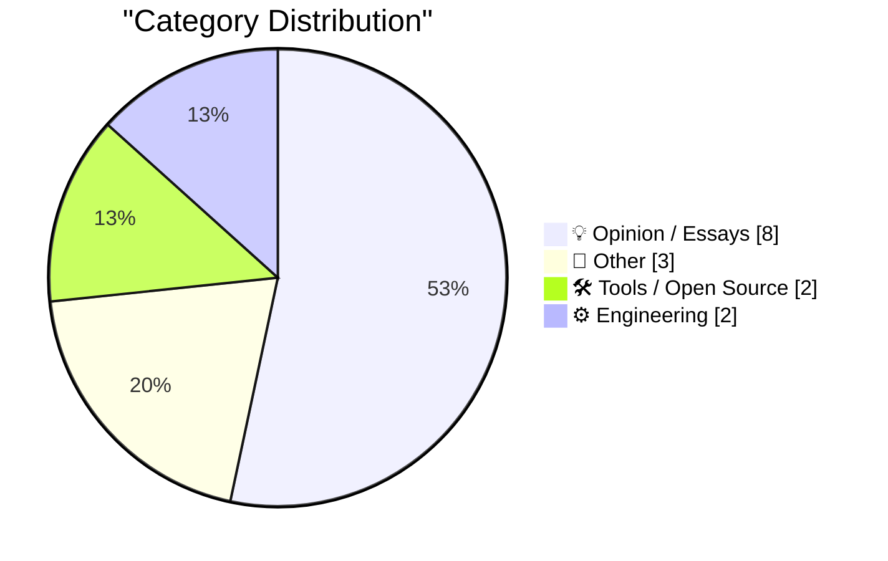
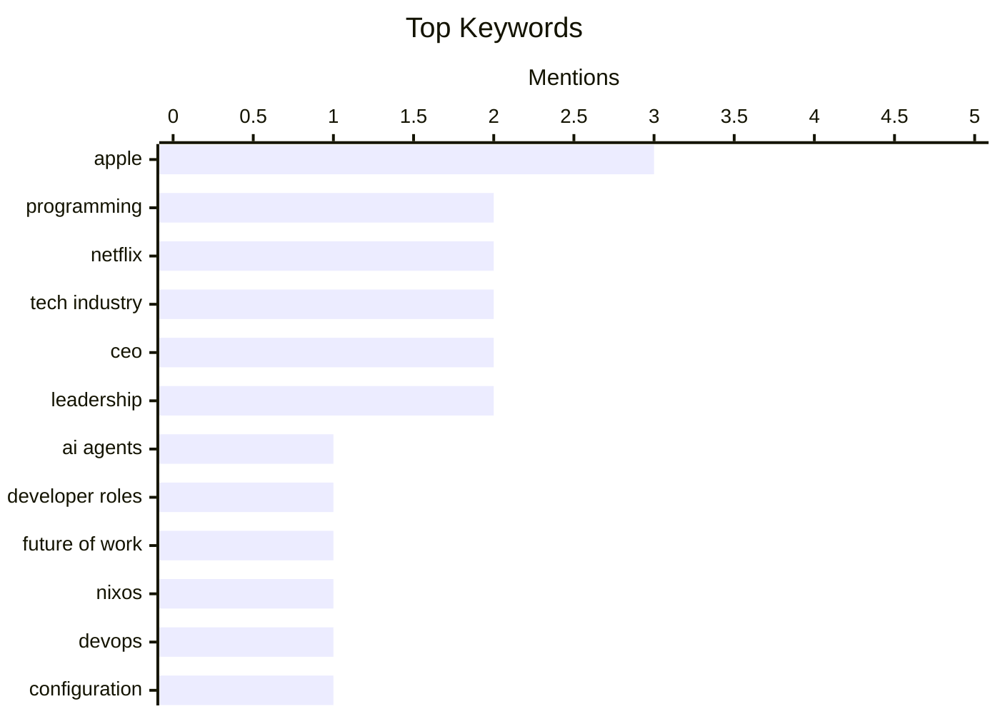

## Today's Highlights
The tech world is grappling with the evolving role of AI, sparking debates about the future of programming careers and the integration of LLMs into technical fields. Concurrently, Apple is poised for a major product event, highlighting new hardware and the leadership of CEO John Ternus, even as the company navigates design controversies. This dynamic backdrop is set against broader industry challenges, with Netflix implementing significant layoffs and executive changes amid slowing growth and customer engagement struggles.
---
## Must Read Today
1. **My obituary for programming**
[My obituary for programming](https://simonwillison.net/2026/Oct/19/my-obituary-for-programming/) — simonwillison.net · 14h ago · 💡 Opinion / Essays
> The article discusses the potential loss of the "puzzle" aspect of programming careers due to the rise of coding agents. Jeremy Scheff's "obituary" highlights that programming was valued for solving tricky logic puzzles, with compensation increasing with complexity. Coding agents, while efficient, may remove this core intellectual challenge, fundamentally altering the job's appeal for those who enjoyed the problem-solving process. The shift towards AI-driven code generation could diminish the intrinsic satisfaction and career path for programmers who thrive on complex logical challenges.
💡 **Why read it**: It offers a thought-provoking perspective on how AI coding agents might fundamentally change the nature and appeal of programming as a career, particularly for those who enjoy the problem-solving aspect.
🏷️ programming, AI agents, developer roles, future of work
2. **NixOS Is Making Me Less Afraid**
[NixOS Is Making Me Less Afraid](https://entropicthoughts.com/nixos-is-making-me-less-afraid) — entropicthoughts.com · 16h ago · 🛠 Tools / Open Source
> The author previously hesitated to deploy new services due to concerns about system brittleness and complexity, exemplified by a local-only RSS feed setup. NixOS's declarative and reproducible configuration system has significantly reduced this fear, enabling the author to easily deploy services like FreshRSS on a server. This contrasts with a previous setup where RSS feeds were brittle and confined to a phone, demonstrating NixOS's reliability and ease of management. NixOS fosters confidence in deploying and managing server applications by providing a robust, reproducible, and less intimidating environment.
💡 **Why read it**: It illustrates how NixOS's declarative nature can overcome common anxieties associated with server management and application deployment, encouraging users to experiment more freely.
🏷️ NixOS, DevOps, Configuration, Reproducibility
3. **Laypeople support technical fields for technology, not art**
[Laypeople support technical fields for technology, not art](https://seangoedecke.com/laypeople-support-technical-fields-for-technology-not-art/) — seangoedecke.com · 14h ago · 💡 Opinion / Essays
> The article addresses the argument that LLMs should not be used in technical fields like programming or mathematics because these fields are considered "art," and why this argument fails to persuade the general public. While some argue programming and mathematics are artistic, the general population primarily supports these fields for their technological output and practical benefits, not their aesthetic or intellectual purity. Arguments against LLM adoption based on an "art" premise are unlikely to resonate with laypeople who value utility and progress. Public support for technical fields, and consequently for new technologies like LLMs within them, is driven by perceived technological utility rather than an appreciation for their artistic or intellectual essence.
💡 **Why read it**: It provides a pragmatic perspective on public perception of technical fields, arguing that utility and technological advancement, rather than artistic merit, drive laypeople's support for innovation, including LLM integration.
🏷️ LLMs, programming, technology perception, technical fields
---
## Data Overview
| Sources Scanned | Articles Fetched | Time Window | Selected |
|:---:|:---:|:---:|:---:|
| 87/92 | 2611 -> 17 | 24h | **15** |
### Category Distribution

### Top Keywords

<details>
<summary>Plain Text Keyword Chart (Terminal Friendly)</summary>
```
apple           │ ████████████████████ 3
programming     │ █████████████░░░░░░░ 2
netflix         │ █████████████░░░░░░░ 2
tech industry   │ █████████████░░░░░░░ 2
ceo             │ █████████████░░░░░░░ 2
leadership      │ █████████████░░░░░░░ 2
ai agents       │ ███████░░░░░░░░░░░░░ 1
developer roles │ ███████░░░░░░░░░░░░░ 1
future of work  │ ███████░░░░░░░░░░░░░ 1
nixos           │ ███████░░░░░░░░░░░░░ 1
```
</details>
### Topic Tags
**apple**(3) · **programming**(2) · **netflix**(2) · tech industry(2) · ceo(2) · leadership(2) · ai agents(1) · developer roles(1) · future of work(1) · nixos(1) · devops(1) · configuration(1) · reproducibility(1) · llms(1) · technology perception(1) · technical fields(1) · apple event(1) · macbook pro(1) · oled(1) · m6(1)
---
## Opinion / Essays
### 1. My obituary for programming
[My obituary for programming](https://simonwillison.net/2026/Oct/19/my-obituary-for-programming/) — **simonwillison.net** · 14h ago · ⭐ 26/30
> The article discusses the potential loss of the "puzzle" aspect of programming careers due to the rise of coding agents. Jeremy Scheff's "obituary" highlights that programming was valued for solving tricky logic puzzles, with compensation increasing with complexity. Coding agents, while efficient, may remove this core intellectual challenge, fundamentally altering the job's appeal for those who enjoyed the problem-solving process. The shift towards AI-driven code generation could diminish the intrinsic satisfaction and career path for programmers who thrive on complex logical challenges.
🏷️ programming, AI agents, developer roles, future of work
---
### 2. Laypeople support technical fields for technology, not art
[Laypeople support technical fields for technology, not art](https://seangoedecke.com/laypeople-support-technical-fields-for-technology-not-art/) — **seangoedecke.com** · 14h ago · ⭐ 24/30
> The article addresses the argument that LLMs should not be used in technical fields like programming or mathematics because these fields are considered "art," and why this argument fails to persuade the general public. While some argue programming and mathematics are artistic, the general population primarily supports these fields for their technological output and practical benefits, not their aesthetic or intellectual purity. Arguments against LLM adoption based on an "art" premise are unlikely to resonate with laypeople who value utility and progress. Public support for technical fields, and consequently for new technologies like LLMs within them, is driven by perceived technological utility rather than an appreciation for their artistic or intellectual essence.
🏷️ LLMs, programming, technology perception, technical fields
---
### 3. Netflix Lays Off 6 Percent of Staff
[Netflix Lays Off 6 Percent of Staff](https://www.wsj.com/business/media/netflix-eliminates-about-6-of-staff-in-biggest-cuts-since-2022-0a2d8ec3?st=NtEg5v&amp;reflink=desktopwebshare_permalink) — **daringfireball.net** · 21h ago · ⭐ 24/30
> Netflix is undergoing significant layoffs due to struggles with slowing growth and customer engagement. Netflix is cutting 6% of its global staff, approximately 1,000 positions, marking its largest layoff round since 2022. Co-CEOs Greg Peters and Ted Sarandos indicated that the bulk of these cuts would impact the streaming giant’s product, tech, legal, and human-resources teams. Netflix is implementing substantial workforce reductions, particularly in key operational and development departments, in response to business performance challenges.
🏷️ Netflix, layoffs, tech industry, job market
---
### 4. Time Magazine Profiles John Ternus
[Time Magazine Profiles John Ternus](https://time.com/collection/best-inventions/2026/apple-iphone-duo/) — **daringfireball.net** · 21h ago · ⭐ 23/30
> Time Magazine profiled Apple's new CEO, John Ternus, during the launch of a highly anticipated new product. The profile captures Ternus on a September day in Silicon Valley, surrounded by celebrities and media at Apple Park, for the unveiling of the company's new foldable phone, the "Duo." Ternus was seen taking photos with the device, highlighting his role in launching a significant new product. John Ternus, as Apple's new CEO, is leading the company into a new era with the launch of innovative products like the foldable iPhone Duo.
🏷️ Apple, CEO, Leadership, Tech industry
---
### 5. From the DF Archive: Should a CEO Be a Nerd About Their Company’s Products?
[From the DF Archive: Should a CEO Be a Nerd About Their Company’s Products?](https://daringfireball.net/linked/2022/10/11/ceos-as-nerds) — **daringfireball.net** · 15h ago · ⭐ 20/30
> The article explores whether a CEO should possess deep, "nerdy" knowledge about their company's products and competitors. Drawing from a 2022 post by Ben Schlappig, the article notes two extremes among airline executives: some know nothing about competitors, while others are intimately familiar with every detail of their rivals' passenger experience and fleet. The implication is that a CEO's level of product and competitive knowledge can vary significantly and potentially impact leadership effectiveness. The debate centers on the value of a CEO's detailed product and competitive knowledge, suggesting a spectrum of engagement exists among top executives.
🏷️ CEO, leadership, product knowledge, business strategy
---
### 6. Ex-Apple Employee Fred Potter on HomeView
[Ex-Apple Employee Fred Potter on HomeView](https://www.linkedin.com/posts/frpotter_tonight-im-looking-back-through-the-photo-share-7515791565718454272-ue-R/) — **daringfireball.net** · 19h ago · ⭐ 20/30
> An ex-Apple employee, Fred Potter, reflects on individual contributions to large Apple projects and specifically mentions HomeView. Potter emphasizes that while many claim individual credit for Apple products, success is always a team effort, and being part of that team is commendable. He notes the immense reward of recognizing personal touches in the final product. Potter's LinkedIn bio confirms his involvement with Apple's HomeKit and HomeView teams, suggesting his contributions to these smart home technologies. Fred Potter's reflection highlights the collaborative nature of Apple's product development and the personal satisfaction derived from contributing to major projects like HomeView.
🏷️ Apple, corporate culture, teamwork, product credit
---
### 7. No More Icons In Every Menu By Default
[No More Icons In Every Menu By Default](https://blog.jim-nielsen.com/2026/icons-in-every-menu/) — **blog.jim-nielsen.com** · 19h ago · ⭐ 20/30
> macOS Tahoe introduced a controversial design choice of displaying an icon in every menu item by default. The article celebrates the removal of this design in macOS Golden Gate, reverting to the previous standard. John Gruber previously reported on this change in June, noting that Apple's new Human Interface Guidelines now specifically advise against Tahoe's approach, indicating a formal acknowledgment and correction of a design misstep. Apple has reversed its controversial decision to include icons in every menu item by default in macOS Golden Gate, aligning with updated Human Interface Guidelines.
🏷️ macOS, UI/UX, Design, Menus
---
### 8. What happened to Epyx
[What happened to Epyx](https://dfarq.homeip.net/what-happened-to-epyx/?utm_source=rss&#038;utm_medium=rss&#038;utm_campaign=what-happened-to-epyx) — **dfarq.homeip.net** · 3h ago · ⭐ 15/30
> This article details the history and eventual bankruptcy of Epyx, a once-celebrated software publisher for 8-bit home computers like Atari, Commodore, and Apple. Epyx achieved significant success in the 8-bit era, known for its prolific software output. However, the company struggled profoundly to transition its business and products to newer computing platforms as technology evolved. This inability to adapt to changing market demands and technological shifts ultimately led to its financial collapse. The main takeaway is that even highly successful companies in one technological era can fail if they cannot effectively pivot to new platforms and market conditions.
🏷️ Epyx, Software history, Retro computing, Business failure
---
## Other
### 9. Netflix Shitcanned Film Chief Dan Lin Too
[Netflix Shitcanned Film Chief Dan Lin Too](https://deadline.com/2026/10/netflix-dan-lin-out-1237167562/) — **daringfireball.net** · 16h ago · ⭐ 18/30
> Netflix is undergoing executive changes, with Film Chief Dan Lin being removed from his position. Dan Lin's departure as Netflix's film boss, though speculated for weeks, has been confirmed despite earlier denials from insiders. He is meeting with his staff for a post-mortem, and a successor will not be named until Peter Rice assumes the Chief Content Officer role. This indicates a broader executive restructuring within Netflix's content division. Netflix has removed Film Chief Dan Lin as part of an ongoing executive reshuffle, with a new content leadership structure anticipated under Peter Rice.
🏷️ Netflix, Dan Lin, corporate leadership
---
### 10. ★ Estimated Arrival Dates for DF Readers’ Pre-Ordered iPhone Duos
[★ Estimated Arrival Dates for DF Readers’ Pre-Ordered iPhone Duos](https://daringfireball.net/2026/10/estimated_arrival_dates_for_preordered_iphone_duos) — **daringfireball.net** · 15h ago · ⭐ 17/30
> This article discusses the estimated arrival dates for pre-ordered iPhone Duos among Daring Fireball readers, an audience known for early tech adoption. The author posits that his readership, while not representative of the general public, is likely indicative of early adopters willing to spend $2000 to $3200 on a new iPhone form factor. The piece informally surveys typical shipping timelines for this high-demand, high-cost Apple product within a tech-savvy demographic. It aims to provide insight into the initial product rollout and consumer expectations. The main takeaway is an informal snapshot of early iPhone Duo adopters' delivery expectations, reflecting initial market trends.
🏷️ iPhone Duos, pre-order, Apple, consumer tech
---
### 11. Barack Obama on the Trump Administration’s Intimidation Campaign Against Congresswoman Ilhan Omar
[Barack Obama on the Trump Administration’s Intimidation Campaign Against Congresswoman Ilhan Omar](https://x.com/BarackObama/status/2111819687524774170) — **daringfireball.net** · 12h ago · ⭐ 15/30
> This article features a 430-word essay by Barack Obama, condemning the Trump Administration's alleged intimidation campaign against Congresswoman Ilhan Omar. Obama asserts that selectively targeting individuals based on political beliefs or speech violates a fundamental principle of American democracy. He argues that such transparent efforts to intimidate a public official should provoke outrage across all Americans, regardless of their political leanings. The essay underscores the importance of protecting free speech and democratic norms from governmental overreach. The core message is a strong denouncement of political intimidation tactics as a threat to the integrity of democratic governance.
🏷️ politics, Barack Obama, Ilhan Omar
---
## Tools / Open Source
### 12. NixOS Is Making Me Less Afraid
[NixOS Is Making Me Less Afraid](https://entropicthoughts.com/nixos-is-making-me-less-afraid) — **entropicthoughts.com** · 16h ago · ⭐ 26/30
> The author previously hesitated to deploy new services due to concerns about system brittleness and complexity, exemplified by a local-only RSS feed setup. NixOS's declarative and reproducible configuration system has significantly reduced this fear, enabling the author to easily deploy services like FreshRSS on a server. This contrasts with a previous setup where RSS feeds were brittle and confined to a phone, demonstrating NixOS's reliability and ease of management. NixOS fosters confidence in deploying and managing server applications by providing a robust, reproducible, and less intimidating environment.
🏷️ NixOS, DevOps, Configuration, Reproducibility
---
### 13. Apple Event, in Los Angeles, Next Week: ‘Pro and Tell’
[Apple Event, in Los Angeles, Next Week: ‘Pro and Tell’](https://x.com/gregjoz/status/2112212372182249831) — **daringfireball.net** · 15h ago · ⭐ 24/30
> Apple is preparing for a significant product announcement event, generating anticipation for new hardware. Greg Joswiak announced an upcoming Apple event in Los Angeles with the tagline "Pro and Tell." Rumors suggest major product debuts, including a new MacBook Pro with an OLED touchscreen display, an M6 entry-level MacBook Pro, an M6 iMac, and an iPad mini with an OLED display. Apple is poised to unveil several new "Pro" level devices and updates across its Mac and iPad lines, featuring advanced display and chip technologies.
🏷️ Apple Event, MacBook Pro, OLED, M6
---
## Engineering
### 14. The Secret Life of Circuits is now in stock everywhere
[The Secret Life of Circuits is now in stock everywhere](https://blog.coredump.cx/p/the-secret-life-of-circuits-is-now) — **lcamtuf.substack.com** · 6h ago · ⭐ 18/30
> This article announces the widespread availability of the technical book "The Secret Life of Circuits." Penned by the author, the book was initially available only directly from the publisher. It is now readily accessible through various retailers, making it easier for a broader audience to purchase. The book likely delves into the intricate workings and underlying principles of electronic circuits. The core takeaway is that the author's latest work on circuit technology is now widely distributed and easily obtainable.
🏷️ Circuits, Hardware, Book, Embedded systems
---
### 15. Refactoring factorials
[Refactoring factorials](https://www.johndcook.com/blog/2026/10/19/refactoring-factorials/) — **johndcook.com** · 23h ago · ⭐ 18/30
> This article explores the non-trivial mathematical problem of "refactoring" N! into N factors when a minimum size requirement is imposed on those factors. While splitting N! into factors 1 through N is straightforward, the challenge arises when factors must be, for instance, ≥ 2. The author illustrates this with 3!, which cannot be split into three factors ≥ 2, versus 4!, which can be factored as 2 * 2 * 2 * 3. The discussion delves into the conditions and methods required for such constrained factorizations. The main conclusion is that adding a minimum factor size fundamentally alters the problem of decomposing factorials, demanding a different mathematical approach.
🏷️ Factorials, Mathematics, Algorithms, Number theory
---
*Generated at 2026-10-20 14:01 | Scanned 87 sources -> 2611 articles -> selected 15*
*Based on the [Hacker News Popularity Contest 2025](https://refactoringenglish.com/tools/hn-popularity/) RSS source list recommended by [Andrej Karpathy](https://x.com/karpathy)*
*Produced by Dongdianr AI. Follow the same-name WeChat public account for more AI practical tips 💡*
