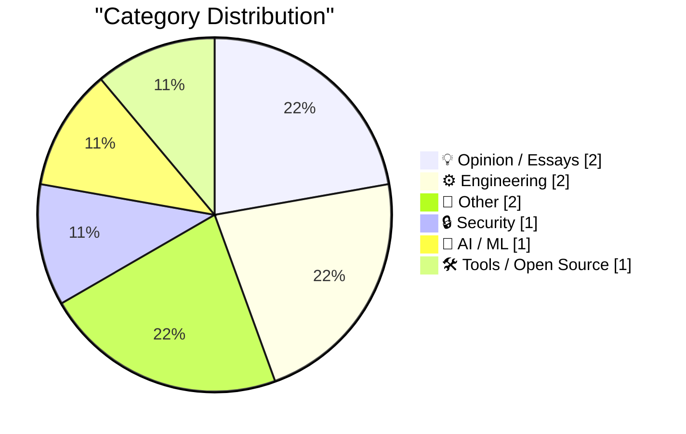
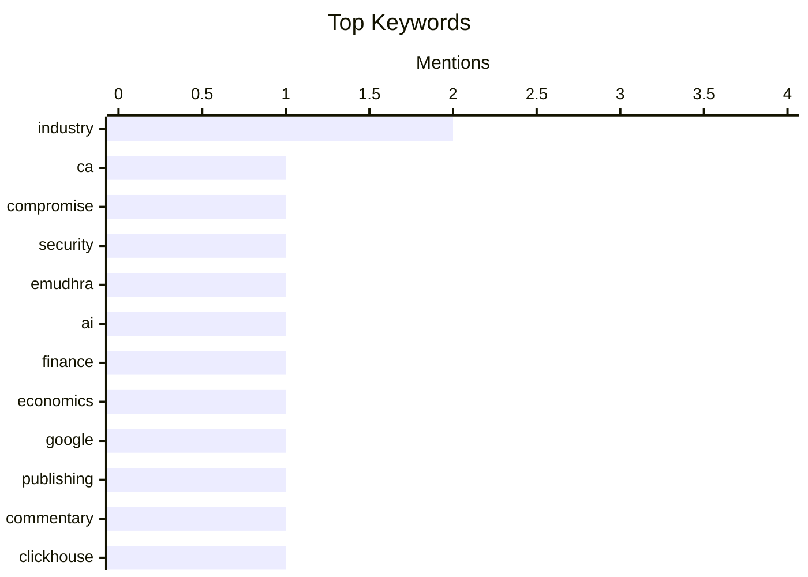

## Today's Highlights
Today's tech news highlights pressing concerns over digital security, following a significant CA compromise that underscores the fragility of online trust. The industry also faces the high stakes of AI's future and the complex engineering trade-offs needed for scaling systems. Amidst these challenges, there's a reflective look at computing's rich history, from its foundational moments to ongoing debates about digital permanence and the evolving landscape of information.
---
## Must Read Today
1. **eMudhra Intermediate CA Compromise**
[eMudhra Intermediate CA Compromise](https://simonwillison.net/2026/Oct/20/emudhra-certificates/) — simonwillison.net · 14h ago · 🔒 Security
> The private keys of eight eMudhra intermediate CA certificates have been compromised, posing a significant security threat. These certificates chain to roots trusted by major programs including Mozilla, Microsoft, Apple, and Chrome, impacting numerous downstream trust stores. Consequently, any software that bundles a list of trusted certificates requires immediate updates to mitigate the risk. This incident highlights a critical vulnerability in the global trust infrastructure. The main takeaway is the urgent need for widespread software updates to address this compromise.
💡 **Why read it**: It details a critical security vulnerability affecting global trust infrastructure and highlights the immediate need for software updates.
🏷️ CA, compromise, security, eMudhra
2. **AI Had Better Work Out**
[AI Had Better Work Out](https://www.wheresyoured.at/ai-had-better-work-out/) — wheresyoured.at · 21h ago · 🤖 AI / ML
> The article's title, "AI Had Better Work Out," suggests a critical examination of the high stakes and significant investments in the AI industry. It implies a focus on the financial viability and potential pressures for AI technologies to deliver on their promises. The author promotes a premium newsletter that dives deep into the finances of AI, indicating a detailed analysis of the economic landscape. The piece likely explores the necessity for AI's success given the substantial resources allocated to its development and deployment.
💡 **Why read it**: It hints at a critical financial perspective on the AI industry, suggesting an analysis of its economic viability and potential impact.
🏷️ AI, industry, finance, economics
3. **Pluralistic: The death of history's most successful publisher (20 Oct 2026)**
[Pluralistic: The death of history's most successful publisher (20 Oct 2026)](https://pluralistic.net/2026/10/20/main-character-syndrome/) — pluralistic.net · 20h ago · 💡 Opinion / Essays
> The article discusses the potential "death of history's most successful publisher," implicitly referring to Google, attributing its decline to "main character syndrome." This suggests a critique of Google's internal focus or hubris leading to strategic missteps despite its previous market dominance. The piece likely explores how an insular or self-centered approach could undermine even the most successful entities. The main conclusion is that Google's trajectory is at risk due to its own internal culture and strategy.
💡 **Why read it**: It provides a critical, potentially provocative, analysis of Google's long-term viability and strategic direction.
🏷️ Google, publishing, industry, commentary
---
## Data Overview
| Sources Scanned | Articles Fetched | Time Window | Selected |
|:---:|:---:|:---:|:---:|
| 85/92 | 2575 -> 9 | 24h | **9** |
### Category Distribution

### Top Keywords

<details>
<summary>Plain Text Keyword Chart (Terminal Friendly)</summary>
```
industry   │ ████████████████████ 2
ca         │ ██████████░░░░░░░░░░ 1
compromise │ ██████████░░░░░░░░░░ 1
security   │ ██████████░░░░░░░░░░ 1
emudhra    │ ██████████░░░░░░░░░░ 1
ai         │ ██████████░░░░░░░░░░ 1
finance    │ ██████████░░░░░░░░░░ 1
economics  │ ██████████░░░░░░░░░░ 1
google     │ ██████████░░░░░░░░░░ 1
publishing │ ██████████░░░░░░░░░░ 1
```
</details>
### Topic Tags
**industry**(2) · **ca**(1) · **compromise**(1) · security(1) · emudhra(1) · ai(1) · finance(1) · economics(1) · google(1) · publishing(1) · commentary(1) · clickhouse(1) · database(1) · columnar storage(1) · observability(1) · domains(1) · digital legacy(1) · internet(1) · permanence(1) · game development(1)
---
## Opinion / Essays
### 1. Pluralistic: The death of history's most successful publisher (20 Oct 2026)
[Pluralistic: The death of history's most successful publisher (20 Oct 2026)](https://pluralistic.net/2026/10/20/main-character-syndrome/) — **pluralistic.net** · 20h ago · ⭐ 24/30
> The article discusses the potential "death of history's most successful publisher," implicitly referring to Google, attributing its decline to "main character syndrome." This suggests a critique of Google's internal focus or hubris leading to strategic missteps despite its previous market dominance. The piece likely explores how an insular or self-centered approach could undermine even the most successful entities. The main conclusion is that Google's trajectory is at risk due to its own internal culture and strategy.
🏷️ Google, publishing, industry, commentary
---
### 2. Deliberate imperfection
[Deliberate imperfection](https://www.johndcook.com/blog/2026/10/21/deliberate-imperfection/) — **johndcook.com** · 1h ago · ⭐ 14/30
> The article explores the concept of "deliberate imperfection," drawing philosophical inspiration from a biblical passage. It references Ecclesiastes 3, which speaks of "a time for everything," suggesting that imperfection can be a natural and even intended part of life and creation. The piece likely delves into the philosophical or artistic reasons for embracing flaws rather than striving for absolute perfection. The main takeaway is that imperfection can be a deliberate and meaningful aspect of existence or design, not merely a flaw to be avoided.
🏷️ Imperfection, philosophy, reflection
---
## Engineering
### 3. ClickHouse Will Let You Be Wrong at Scale
[ClickHouse Will Let You Be Wrong at Scale](https://matduggan.com/clickhouse-will-let-you-be-wrong-at-scale/) — **matduggan.com** · 1d ago · ⭐ 24/30
> The article explores the potential pitfalls of using ClickHouse, despite its acknowledged benefits like fast columnar storage and amazing compression. The title suggests that ClickHouse's ability to handle massive data volumes can inadvertently allow users to scale incorrect assumptions or data models without immediate detection. While powerful, the technology demands careful implementation to avoid propagating errors across large datasets. The main takeaway is that users must understand ClickHouse's nuances to prevent scaling errors alongside their data.
🏷️ ClickHouse, database, columnar storage, observability
---
### 4. Death & Domains
[Death & Domains](https://feed.tedium.co/link/15204/17501584/death-domains-commentary) — **tedium.co** · 20h ago · ⭐ 21/30
> The article addresses the critical issue of digital permanence, specifically how domain ownership is affected by the death of the owner. It questions the current domain system's reliance on individual owners and proposes the need for new systems that do not depend on domains for long-term digital presence. A recent discussion on "forever domains" sparked this broader inquiry into post-mortem digital asset management. The piece advocates for a re-evaluation of how online identities and digital assets persist beyond an individual's lifetime.
🏷️ Domains, digital legacy, internet, permanence
---
## Other
### 5. Creative Computing launched October 1974
[Creative Computing launched October 1974](https://dfarq.homeip.net/creative-computing-launched-october-1974/?utm_source=rss&#038;utm_medium=rss&#038;utm_campaign=creative-computing-launched-october-1974) — **dfarq.homeip.net** · 3h ago · ⭐ 11/30
> The article celebrates the 52nd anniversary of the launch of "Creative Computing," a seminal computer magazine. Debuting in October 1974, it quickly became one of the most influential publications of the 1970s and 1980s. Originating at Digital Equipment Corporation, "Creative Computing" competed with "Byte" magazine, highlighting its significant role in the early personal computing landscape. The piece commemorates its foundational contribution to shaping the nascent computer enthusiast community.
🏷️ Computing history, magazines, Creative Computing
---
### 6. How to install an app on your Commodore 64
[How to install an app on your Commodore 64](https://anildash.com/2026/10/08/install-an-app-commodore-64/) — **anildash.com** · 20h ago · ⭐ 9/30
> The article humorously describes the process of "installing an app" on a Commodore 64 in 1986, contrasting it with modern software acquisition. In this era, "programs" were primarily obtained from physical magazines like "COMPUTE!’s Gazette" and "RUN." Users had to physically purchase these magazines at a bookstore, often requiring a trip to the mall and hoping the desired issue wasn't sold out. This highlights the vastly different methods of software acquisition and user experience compared to today's digital distribution. The piece offers a nostalgic look at early personal computing's unique challenges.
🏷️ Commodore 64, retro computing, programs
---
## Security
### 7. eMudhra Intermediate CA Compromise
[eMudhra Intermediate CA Compromise](https://simonwillison.net/2026/Oct/20/emudhra-certificates/) — **simonwillison.net** · 14h ago · ⭐ 27/30
> The private keys of eight eMudhra intermediate CA certificates have been compromised, posing a significant security threat. These certificates chain to roots trusted by major programs including Mozilla, Microsoft, Apple, and Chrome, impacting numerous downstream trust stores. Consequently, any software that bundles a list of trusted certificates requires immediate updates to mitigate the risk. This incident highlights a critical vulnerability in the global trust infrastructure. The main takeaway is the urgent need for widespread software updates to address this compromise.
🏷️ CA, compromise, security, eMudhra
---
## AI / ML
### 8. AI Had Better Work Out
[AI Had Better Work Out](https://www.wheresyoured.at/ai-had-better-work-out/) — **wheresyoured.at** · 21h ago · ⭐ 26/30
> The article's title, "AI Had Better Work Out," suggests a critical examination of the high stakes and significant investments in the AI industry. It implies a focus on the financial viability and potential pressures for AI technologies to deliver on their promises. The author promotes a premium newsletter that dives deep into the finances of AI, indicating a detailed analysis of the economic landscape. The piece likely explores the necessity for AI's success given the substantial resources allocated to its development and deployment.
🏷️ AI, industry, finance, economics
---
## Tools / Open Source
### 9. Battle Drones - a vibe coded RTS with audio-based multiplayer
[Battle Drones - a vibe coded RTS with audio-based multiplayer](https://simonwillison.net/2026/Oct/20/battledrones/) — **simonwillison.net** · 18h ago · ⭐ 20/30
> The author developed "Battle Drones," a Command & Conquer-style Real-Time Strategy (RTS) game using a "vibe coded" approach. This game features innovative audio-based multiplayer functionality. Notably, the author achieved a genuinely fun gameplay experience by explicitly prompting Claude (an AI) to "Make it a LOT more fun." This demonstrates an AI-assisted development process for enhancing game enjoyment. The project successfully showcases the application of "vibe coding" and AI prompting to create an engaging RTS with a unique multiplayer mechanic.
🏷️ Game development, RTS, multiplayer, experiment
---
*Generated at 2026-10-21 14:01 | Scanned 85 sources -> 2575 articles -> selected 9*
*Based on the [Hacker News Popularity Contest 2025](https://refactoringenglish.com/tools/hn-popularity/) RSS source list recommended by [Andrej Karpathy](https://x.com/karpathy)*
*Produced by Dongdianr AI. Follow the same-name WeChat public account for more AI practical tips 💡*
