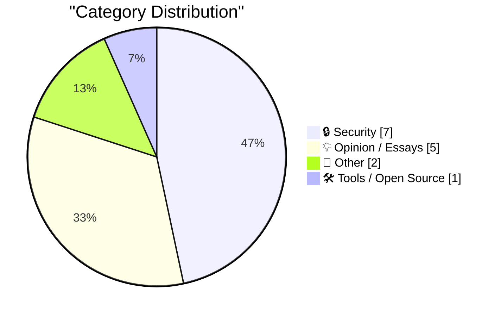
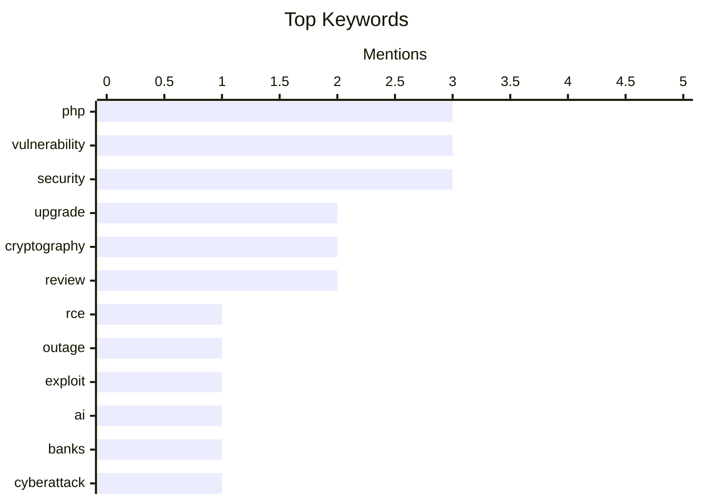

## Today's Highlights
Today's tech landscape is dominated by urgent cybersecurity threats, with critical PHP vulnerabilities taking center stage. Multiple advisories warn of widespread remote code execution flaws affecting a vast percentage of websites, requiring immediate patching to prevent attackers from seizing control. Meanwhile, the security landscape is evolving rapidly as U.S. banks report attacks from sophisticated AI agents, signaling a new era of automated threats. Further concerns are surfacing regarding the integrity of foundational cryptographic elements, with NIST elliptic curves and trust stores under renewed scrutiny for potential backdoors and overlooked dependencies.
---
## Must Read Today
1. **Upgrade your PHP installs immediately to protect against php2shell**
[Upgrade your PHP installs immediately to protect against php2shell](https://www.jeffgeerling.com/blog/2026/php-vulnerability-php2shell/) — jeffgeerling.com · 23h ago · 🔒 Security
> Two critical PHP security advisories, rated 9.2/10, have been published for RCE via OOM corruption and RCE via stale global state, demanding immediate attention. These vulnerabilities allow remote code execution and affect all PHP installations. Users are urged to upgrade to patched versions 8.2.35, 8.3.36, 8.4.27, or 8.5.12. Immediate upgrades are essential to mitigate these high-severity RCE flaws and protect PHP services from compromise.
💡 **Why read it**: This article provides urgent, specific upgrade instructions for critical PHP vulnerabilities, directly impacting server security.
🏷️ PHP, RCE, Vulnerability, Upgrade
2. **Widespread PHP Flaw May Cause Many Site Outages Today**
[Widespread PHP Flaw May Cause Many Site Outages Today](https://krebsonsecurity.com/2026/10/widespread-php-flaw-may-cause-many-site-outages-today/) — krebsonsecurity.com · 22h ago · 🔒 Security
> A widespread PHP flaw, affecting nearly 70% of websites, allows attackers to seize full control over affected servers, potentially leading to numerous site outages. Working exploits for these critical bugs are already circulating and being actively exploited in the wild. The vulnerabilities necessitate immediate updates to core PHP software. The active exploitation and broad impact of these PHP flaws demand urgent patching to prevent server compromise and service disruption.
💡 **Why read it**: It highlights the immediate and widespread threat of the PHP vulnerabilities, emphasizing the urgency of patching due to active exploitation.
🏷️ PHP, Vulnerability, Outage, Exploit
3. **Breaking news: U.S. banks are taking hits from AI agents**
[Breaking news: U.S. banks are taking hits from AI agents](https://garymarcus.substack.com/p/breaking-news-us-banks-are-taking) — garymarcus.substack.com · 9m ago · 🔒 Security
> U.S. banks are reportedly experiencing attacks from AI agents, signaling a new and concerning development in cyber threats. The article provides minimal detail, only stating that banks are "taking hits" from these agents, without specifying the nature of the attacks or the AI technologies involved. This lack of information leaves the exact scope and technical mechanisms unclear. This brief mention serves as an early warning of an emerging threat landscape where AI agents are being leveraged for malicious purposes against critical infrastructure like banking systems.
💡 **Why read it**: It flags an emerging and potentially significant threat vector where AI agents are actively targeting financial institutions.
🏷️ AI, Security, Banks, Cyberattack
---
## Data Overview
| Sources Scanned | Articles Fetched | Time Window | Selected |
|:---:|:---:|:---:|:---:|
| 86/92 | 2581 -> 18 | 24h | **15** |
### Category Distribution

### Top Keywords

<details>
<summary>Plain Text Keyword Chart (Terminal Friendly)</summary>
```
php           │ ████████████████████ 3
vulnerability │ ████████████████████ 3
security      │ ████████████████████ 3
upgrade       │ █████████████░░░░░░░ 2
cryptography  │ █████████████░░░░░░░ 2
review        │ █████████████░░░░░░░ 2
rce           │ ███████░░░░░░░░░░░░░ 1
outage        │ ███████░░░░░░░░░░░░░ 1
exploit       │ ███████░░░░░░░░░░░░░ 1
ai            │ ███████░░░░░░░░░░░░░ 1
```
</details>
### Topic Tags
**php**(3) · **vulnerability**(3) · **security**(3) · upgrade(2) · cryptography(2) · review(2) · rce(1) · outage(1) · exploit(1) · ai(1) · banks(1) · cyberattack(1) · elliptic curves(1) · nist(1) · backdoors(1) · trust stores(1) · dependencies(1) · ca bundles(1) · interoperability(1) · jailbreak(1)
---
## Security
### 1. Upgrade your PHP installs immediately to protect against php2shell
[Upgrade your PHP installs immediately to protect against php2shell](https://www.jeffgeerling.com/blog/2026/php-vulnerability-php2shell/) — **jeffgeerling.com** · 23h ago · ⭐ 27/30
> Two critical PHP security advisories, rated 9.2/10, have been published for RCE via OOM corruption and RCE via stale global state, demanding immediate attention. These vulnerabilities allow remote code execution and affect all PHP installations. Users are urged to upgrade to patched versions 8.2.35, 8.3.36, 8.4.27, or 8.5.12. Immediate upgrades are essential to mitigate these high-severity RCE flaws and protect PHP services from compromise.
🏷️ PHP, RCE, Vulnerability, Upgrade
---
### 2. Widespread PHP Flaw May Cause Many Site Outages Today
[Widespread PHP Flaw May Cause Many Site Outages Today](https://krebsonsecurity.com/2026/10/widespread-php-flaw-may-cause-many-site-outages-today/) — **krebsonsecurity.com** · 22h ago · ⭐ 27/30
> A widespread PHP flaw, affecting nearly 70% of websites, allows attackers to seize full control over affected servers, potentially leading to numerous site outages. Working exploits for these critical bugs are already circulating and being actively exploited in the wild. The vulnerabilities necessitate immediate updates to core PHP software. The active exploitation and broad impact of these PHP flaws demand urgent patching to prevent server compromise and service disruption.
🏷️ PHP, Vulnerability, Outage, Exploit
---
### 3. Breaking news: U.S. banks are taking hits from AI agents
[Breaking news: U.S. banks are taking hits from AI agents](https://garymarcus.substack.com/p/breaking-news-us-banks-are-taking) — **garymarcus.substack.com** · 9m ago · ⭐ 27/30
> U.S. banks are reportedly experiencing attacks from AI agents, signaling a new and concerning development in cyber threats. The article provides minimal detail, only stating that banks are "taking hits" from these agents, without specifying the nature of the attacks or the AI technologies involved. This lack of information leaves the exact scope and technical mechanisms unclear. This brief mention serves as an early warning of an emerging threat landscape where AI agents are being leveraged for malicious purposes against critical infrastructure like banking systems.
🏷️ AI, Security, Banks, Cyberattack
---
### 4. Backdoors, Incompetence, and Elliptic Curves
[Backdoors, Incompetence, and Elliptic Curves](https://www.johndcook.com/blog/2026/10/21/emudhra/) — **johndcook.com** · 22h ago · ⭐ 27/30
> NIST elliptic curves are under renewed scrutiny due to recent news regarding potential backdoors and broken certificates, following a previous paper by Anthropic on NIST curve seeds. The article connects recent issues with broken certificates to earlier concerns about the NSA's potential influence on NIST curve design, suggesting either deliberate backdoors or incompetence. The recurring controversies surrounding NIST elliptic curves highlight ongoing concerns about their security and trustworthiness, prompting questions about their design and implementation.
🏷️ Elliptic Curves, NIST, Cryptography, Backdoors
---
### 5. Trust Stores Are Dependencies Too
[Trust Stores Are Dependencies Too](https://nesbitt.io/2026/10/21/trust-stores-are-dependencies-too.html) — **nesbitt.io** · 22h ago · ⭐ 26/30
> Trust stores, specifically Certificate Authority (CA) bundles, are often overlooked dependencies, leading to significant security vulnerabilities. A critical finding reveals that 26 out of 29 CA bundles in common packages still contain root certificates that Mozilla has already removed due to security concerns. This indicates a widespread failure to update and maintain these crucial security components. Organizations must treat trust stores as critical dependencies, actively managing and updating them to prevent the use of compromised or deprecated root certificates.
🏷️ Trust Stores, Dependencies, CA Bundles, Security
---
### 6. Today's PHP Security Release, and How We're Strengthening PHP Security
[Today's PHP Security Release, and How We're Strengthening PHP Security](https://simonwillison.net/2026/Oct/21/php-security-release/) — **simonwillison.net** · 19h ago · ⭐ 24/30
> PHP has released urgent security updates across its 8.x line to address two remote code execution (RCE) vulnerabilities, with exploits already circulating due to a leak in the coordinated disclosure process. The updates are critical for all PHP users, as the RCE holes are actively being exploited. The article also alludes to broader efforts by The PHP Foundation to strengthen PHP security. Immediate upgrading of PHP installations is vital to mitigate active RCE threats, underscoring the ongoing need for robust security practices and proactive updates.
🏷️ PHP, Security, Upgrade, Vulnerability
---
### 7. The number of points on an elliptic curve
[The number of points on an elliptic curve](https://www.johndcook.com/blog/2026/10/22/the-number-of-points-on-an-elliptic-curve/) — **johndcook.com** · 2h ago · ⭐ 22/30
> Understanding the number of points on an elliptic curve is fundamental in cryptography, where these curves are defined over finite fields. An elliptic curve E over a finite field F is defined by the equation y² = x³ + ax + b, with x and y in F. In cryptography, F is typically integers modulo a very large prime p. The number of points on E is roughly the number of elements in F. The article provides a foundational explanation of elliptic curves and their point counting, a crucial concept for cryptographic applications.
🏷️ Cryptography, Elliptic Curve, Mathematics, Finite Field
---
## Opinion / Essays
### 8. Pluralistic: Adversarial interoperability is a team sport (21 Oct 2026)
[Pluralistic: Adversarial interoperability is a team sport (21 Oct 2026)](https://pluralistic.net/2026/10/21/brittle-individualism/) — **pluralistic.net** · 17h ago · ⭐ 24/30
> The article, presented as a daily link compilation, primarily discusses "adversarial interoperability" as a concept requiring a collaborative "team sport" approach rather than individual "vibe-coded jailbreaks." It argues that isolated efforts are insufficient to solve systemic problems. The article then lists a diverse collection of unrelated news items, ranging from political events to tech policy and historical references, without further elaboration on their connection to interoperability. While advocating for collective action in adversarial interoperability, the article primarily serves as a curated list of diverse news snippets rather than a deep dive into the technical aspects.
🏷️ Interoperability, Jailbreak, Tech Policy, Cory Doctorow
---
### 9. Can they write a function?
[Can they write a function?](https://idiallo.com/blog/can-they-write-a-function) — **idiallo.com** · 19h ago · ⭐ 20/30
> Hiring great software developers is challenging, especially with candidates automating applications and traditional criteria proving insufficient. The author proposes a simplified hiring process focusing on practical skills: asking candidates to write a function, conducting a live FizzBuzz test, and having them deploy a service from localhost to a public server. This direct, hands-on approach aims to quickly identify truly capable software developers by assessing fundamental coding and deployment abilities.
🏷️ Hiring, Software Developer, Interview, Career
---
### 10. ★ The iPhone Duo
[★ The iPhone Duo](https://daringfireball.net/2026/10/the_iphone_duo) — **daringfireball.net** · 15h ago · ⭐ 18/30
> This article provides an early review of a device referred to as the "Duo" after a week of use. The reviewer found the experience enjoyable, describing the device as an "extraordinarily polished prototype." However, despite its advanced state, it is not considered a finished product. The main conclusion is that the Duo, while impressive, isn't ready for purchase and daily carry.
🏷️ iPhone, Duo, Mobile, Review
---
### 11. If people would just
[If people would just](https://herman.bearblog.dev/if-people-would-just/) — **herman.bearblog.dev** · 1h ago · ⭐ 12/30
> This article briefly discusses the concept of designing systems that encourage positive human behavior. The core idea revolves around creating structures or environments where desired actions are naturally incentivized. The focus is on proactive system design to guide human actions towards beneficial outcomes rather than relying solely on individual willpower. It advocates for building systems that inherently promote good behavior.
🏷️ Incentives, Behavior, System Design
---
### 12. No Need for Retirement When Utopia Is Around the Corner
[No Need for Retirement When Utopia Is Around the Corner](https://blog.jim-nielsen.com/2026/skip-retirement-for-utopia/) — **blog.jim-nielsen.com** · 19h ago · ⭐ 11/30
> This article discusses the author's ongoing interest in the history and development of nuclear weapons. The author is currently reading Daniel Ellsberg's book, "The Doomsday Machine: Confessions of a Nuclear War Planner." Ellsberg's work details his experiences at the RAND Corporation, particularly during the Cold War era and nuclear war planning. The article highlights the importance of understanding the historical context and planning behind nuclear warfare, as revealed through Ellsberg's insights.
🏷️ Nuclear Weapons, History, Book Review
---
## Other
### 13. Gadget Review: Mokin 17 Port USB-C Tower ★★☆☆☆
[Gadget Review: Mokin 17 Port USB-C Tower ★★☆☆☆](https://shkspr.mobi/blog/2026/10/gadget-review-mokin-17-port-usb-c-tower/) — **shkspr.mobi** · 2h ago · ⭐ 17/30
> This article reviews the Mokin MODK2403, a 17-port USB-C hub designed as a comprehensive docking solution. The hub boasts extensive connectivity, including triple display output options (3x HDMI or 1x HDMI and 2x DisplayPort) and multiple USB ports. A notable and peculiar feature is an integrated LCD monitor intended for displaying weather information. The review suggests that while feature-rich, the inclusion of an unexpected and potentially irrelevant feature like a weather display raises questions about its overall design focus and practicality.
🏷️ USB-C, Hub, Gadget, Review
---
### 14. Panache — RTS Belle Époque pour mobile
[Panache — RTS Belle Époque pour mobile](https://simonwillison.net/2026/Oct/21/panache/) — **simonwillison.net** · 21h ago · ⭐ 16/30
> This article introduces "Panache," a French-language fork of the "Battle Drones" real-time strategy (RTS) mobile game. "Battle Drones" was recently released under an Apache 2.0 License, which facilitated rapid community modification. "Panache" reskins the original game to a steampunk 1900s France setting and incorporates an animated intro. The quick emergence of "Panache" demonstrates the power of open-source licensing (Apache 2.0) to foster creative community adaptations and expansions of games.
🏷️ Mobile Game, RTS, Open Source, Project
---
## Tools / Open Source
### 15. Script dependencies with Nix
[Script dependencies with Nix](https://entropicthoughts.com/python-dependencies-with-nix) — **entropicthoughts.com** · 16h ago · ⭐ 23/30
> Managing dependencies for simple scripts, particularly in different languages like Python, can be challenging and lead to inconsistent environments. The author proposes using Nix to manage script dependencies, even on non-NixOS Linux distributions, to ensure reproducibility and reliability. This method is demonstrated first for Python scripts and then generalized to any other language. Nix offers a powerful and portable solution for managing script dependencies, enabling consistent execution across various Linux environments and enhancing development confidence.
🏷️ Nix, Dependency Management, Reproducibility, Scripts
---
*Generated at 2026-10-22 14:01 | Scanned 86 sources -> 2581 articles -> selected 15*
*Based on the [Hacker News Popularity Contest 2025](https://refactoringenglish.com/tools/hn-popularity/) RSS source list recommended by [Andrej Karpathy](https://x.com/karpathy)*
*Produced by Dongdianr AI. Follow the same-name WeChat public account for more AI practical tips 💡*
