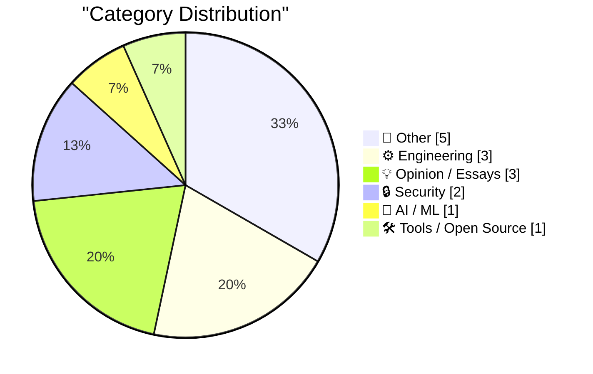
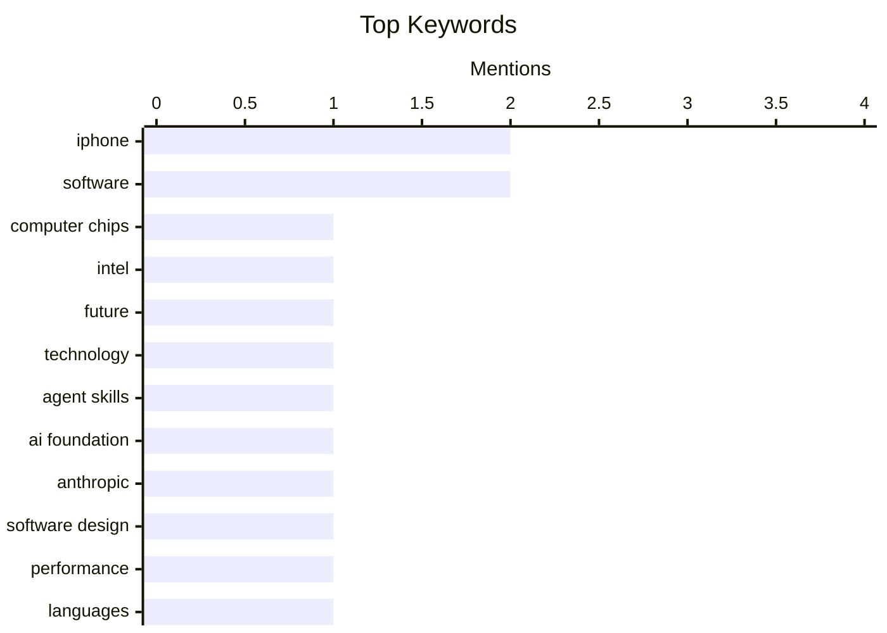

## Today's Highlights
Today's highlights reveal a growing focus on the future of technology, particularly in the realms of computer chips and software design. As advancements in chip technology are anticipated by 2045, discussions around software performance emphasize that design flaws, rather than programming languages, are the root of many issues. Meanwhile, security concerns continue to rise, with an increase in phishing attacks and vulnerabilities stemming from weak password practices.
---
## Must Read Today
1. **What will computer chips look like in 2045?**
[What will computer chips look like in 2045?](https://www.dwarkesh.com/p/intel-tour) — dwarkesh.com · 22h ago · ⚙️ Engineering
> The article discusses the future of computer chips, focusing on advancements anticipated by 2045. It highlights insights gained from a tour of Intel's advanced fabrication facilities, emphasizing innovations in chip architecture, manufacturing processes, and materials. Key findings include the potential for 3D chip stacking and the integration of AI in chip design to enhance performance and efficiency. The main conclusion is that the evolution of computer chips will significantly impact computing power and capabilities in various applications. 
💡 **Why read it**: This article provides a forward-looking perspective on semiconductor technology, informed by firsthand insights from industry leaders.
🏷️ computer chips, Intel, future, technology
2. **Donating Agent Skills to the Agentic AI Foundation**
[Donating Agent Skills to the Agentic AI Foundation](https://simonwillison.net/2026/Oct/22/donating-agent-skills/) — simonwillison.net · 19h ago · 🤖 AI / ML
> The article announces Anthropic's donation of the Agent Skills standard to the Agentic AI Foundation, aiming to promote an open and community-driven approach to AI development. It discusses the importance of keeping AI frameworks vendor-neutral and the potential benefits of collaboration in advancing AI technologies. The main takeaway is that this move could foster innovation and accessibility in AI, aligning with broader industry trends towards open-source solutions.
💡 **Why read it**: This article is significant for understanding the evolving landscape of AI governance and the importance of community-driven standards.
🏷️ Agent Skills, AI Foundation, Anthropic
3. **Software is slow because of bad design, not slow languages**
[Software is slow because of bad design, not slow languages](https://seangoedecke.com/software-is-slow-because-of-bad-design-not-slow-languages/) — seangoedecke.com · 14h ago · ⚙️ Engineering
> The article argues that software performance issues stem from poor design choices rather than the programming languages used. It presents evidence that rewriting software in faster languages like C or Rust often yields minimal performance improvements due to inherent design flaws. The conclusion emphasizes the need for better software architecture and design practices to achieve meaningful performance gains.
💡 **Why read it**: This article challenges common misconceptions about programming languages and highlights critical factors affecting software performance.
🏷️ software design, performance, languages
---
## Data Overview
| Sources Scanned | Articles Fetched | Time Window | Selected |
|:---:|:---:|:---:|:---:|
| 88/92 | 2638 -> 16 | 24h | **15** |
### Category Distribution

### Top Keywords

<details>
<summary>Plain Text Keyword Chart (Terminal Friendly)</summary>
```
iphone          │ ████████████████████ 2
software        │ ████████████████████ 2
computer chips  │ ██████████░░░░░░░░░░ 1
intel           │ ██████████░░░░░░░░░░ 1
future          │ ██████████░░░░░░░░░░ 1
technology      │ ██████████░░░░░░░░░░ 1
agent skills    │ ██████████░░░░░░░░░░ 1
ai foundation   │ ██████████░░░░░░░░░░ 1
anthropic       │ ██████████░░░░░░░░░░ 1
software design │ ██████████░░░░░░░░░░ 1
```
</details>
### Topic Tags
**iphone**(2) · **software**(2) · **computer chips**(1) · intel(1) · future(1) · technology(1) · agent skills(1) · ai foundation(1) · anthropic(1) · software design(1) · performance(1) · languages(1) · phishing(1) · booking.com(1) · novotel(1) · emudrha(1) · password(1) · security keys(1) · debacle(1) · apps(1)
---
## Other
### 1. All the king’s horses and all the king’s men haven’t been able to put CoreWeave back together again
[All the king’s horses and all the king’s men haven’t been able to put CoreWeave back together again](https://garymarcus.substack.com/p/all-the-kings-horses-and-all-the) — **garymarcus.substack.com** · 22h ago · ⭐ 19/30
> The article discusses the significant decline in CoreWeave's stock, which has dropped over 50% in the past six months, despite industry support for the company. It examines the factors contributing to this downturn, including market pressures and operational challenges. The conclusion reflects on the uncertainty surrounding CoreWeave's future and the broader implications for the tech industry.
🏷️ CoreWeave, stock, collapse
---
### 2. Ubiquiti's $99 Vape Detector is actually pretty good
[Ubiquiti's $99 Vape Detector is actually pretty good](https://www.jeffgeerling.com/blog/2026/ubiquiti-vape-detector-teardown/) — **jeffgeerling.com** · 1h ago · ⭐ 16/30
> The article reviews Ubiquiti's $99 vape detector, highlighting its effectiveness in monitoring air quality and detecting vaping in various environments. It discusses the technical specifications and features that contribute to its performance, including CO2 monitoring capabilities. The conclusion is that the device offers good value for its price, making it a worthwhile investment for air quality management.
🏷️ CO2, air quality, monitoring
---
### 3. Windows XP released October 25, 2001
[Windows XP released October 25, 2001](https://dfarq.homeip.net/windows-xp-released-october-25-2001/?utm_source=rss&#038;utm_medium=rss&#038;utm_campaign=windows-xp-released-october-25-2001) — **dfarq.homeip.net** · 3h ago · ⭐ 12/30
> It was 25 years ago this week, on October 25, 2001, that Microsoft released Windows XP. I find it interesting that Microsoft released two of the most beloved Windows versions in the same week, 8 years
🏷️ Windows XP, release, history, Microsoft
---
### 4. Productivity
[Productivity](https://idiallo.com/byte-size/productivity-video) — **idiallo.com** · 21h ago · ⭐ 11/30
> I'd say in a given week I probably only do about fifteen minutes of real, actual, work. &mdash; Office Space
I was watching a video where a guy said he has 8 agents working in the background. He was 
🏷️ productivity, work, agents
---
### 5. One Small Bug
[One Small Bug](https://nesbitt.io/2026/10/23/one-small-bug.html) — **nesbitt.io** · 5h ago · ⭐ 11/30
> Want me to fix that too?
🏷️ bug, fix, software
---
## Engineering
### 6. What will computer chips look like in 2045?
[What will computer chips look like in 2045?](https://www.dwarkesh.com/p/intel-tour) — **dwarkesh.com** · 22h ago · ⭐ 25/30
> The article discusses the future of computer chips, focusing on advancements anticipated by 2045. It highlights insights gained from a tour of Intel's advanced fabrication facilities, emphasizing innovations in chip architecture, manufacturing processes, and materials. Key findings include the potential for 3D chip stacking and the integration of AI in chip design to enhance performance and efficiency. The main conclusion is that the evolution of computer chips will significantly impact computing power and capabilities in various applications. 
🏷️ computer chips, Intel, future, technology
---
### 7. Software is slow because of bad design, not slow languages
[Software is slow because of bad design, not slow languages](https://seangoedecke.com/software-is-slow-because-of-bad-design-not-slow-languages/) — **seangoedecke.com** · 14h ago · ⭐ 24/30
> The article argues that software performance issues stem from poor design choices rather than the programming languages used. It presents evidence that rewriting software in faster languages like C or Rust often yields minimal performance improvements due to inherent design flaws. The conclusion emphasizes the need for better software architecture and design practices to achieve meaningful performance gains.
🏷️ software design, performance, languages
---
### 8. Working around a strange Python problem
[Working around a strange Python problem](https://www.johndcook.com/blog/2026/10/22/pep-723/) — **johndcook.com** · 22h ago · ⭐ 17/30
> The article addresses a peculiar issue encountered with a Python script that failed after recent updates, specifically related to PEP 723 metadata blocks. It details the troubleshooting process and potential causes linked to recent security updates. The main takeaway is the importance of understanding changes in Python's evolving standards and their impact on existing code.
🏷️ Python, PEP 723, error, script
---
## Opinion / Essays
### 9. Quoting Armin Ronacher
[Quoting Armin Ronacher](https://simonwillison.net/2026/Oct/22/armin-ronacher/) — **simonwillison.net** · 22h ago · ⭐ 15/30
> The article features a quote from Armin Ronacher, reflecting on the poor quality of software developed over the past three decades and the repercussions faced today. It emphasizes the need for accountability in software development practices and the consequences of neglecting quality. The main takeaway is a call for improvement in software engineering standards to avoid future pitfalls.
🏷️ AI, software, design
---
### 10. Updates to My iPhone Duo Review
[Updates to My iPhone Duo Review](https://daringfireball.net/2026/10/the_iphone_duo) — **daringfireball.net** · 19h ago · ⭐ 15/30
> Nothing major, but since publishing at 7:00pm last night, I’ve made a few additions and changes to my iPhone Duo review. I’m calling them out here, so that if you’ve already read it, you can see the c
🏷️ iPhone, review, updates
---
### 11. NYC, New Webinar, Differential Testing
[NYC, New Webinar, Differential Testing](https://buttondown.com/hillelwayne/archive/nyc-new-webinar-differential-testing/) — **buttondown.com/hillelwayne** · 22h ago · ⭐ 14/30
> <p>Been a while! Man, it's so much harder to write essays for a newsletter when I have a full time job writing essays for a company.</p>
<p>So three bits of housekeeping first of all:</p>
<ul>
<li>As 
🏷️ webinar, NYC, writing, newsletter
---
## Security
### 12. More phishing messages via Booking.com and Novotel
[More phishing messages via Booking.com and Novotel](https://shkspr.mobi/blog/2026/10/more-phishing-messages-via-booking-com-and-novotel/) — **shkspr.mobi** · 2h ago · ⭐ 21/30
> The article recounts a personal experience with phishing messages received after booking a hotel through Booking.com. It details how the phishing attempts included personal information such as the author's name and booking details, raising concerns about data security. The author notes the ineptitude of the phishing attempts, which lacked credibility despite the targeted information. The main takeaway is the increasing sophistication of phishing attacks and the importance of vigilance in online transactions.
🏷️ phishing, Booking.com, Novotel
---
### 13. How the eMudrha certificate debacle might have happened
[How the eMudrha certificate debacle might have happened](https://www.johndcook.com/blog/2026/10/22/certificate-debacle/) — **johndcook.com** · 23h ago · ⭐ 20/30
> The article explores the eMudrha certificate issue, focusing on the use of weak passwords, including the number 4, as secret keys. It discusses the implications of such poor security practices and how they could lead to significant vulnerabilities. The conclusion underscores the necessity for robust security measures and better password management to prevent similar incidents in the future.
🏷️ eMudrha, password, security keys, debacle
---
## AI / ML
### 14. Donating Agent Skills to the Agentic AI Foundation
[Donating Agent Skills to the Agentic AI Foundation](https://simonwillison.net/2026/Oct/22/donating-agent-skills/) — **simonwillison.net** · 19h ago · ⭐ 24/30
> The article announces Anthropic's donation of the Agent Skills standard to the Agentic AI Foundation, aiming to promote an open and community-driven approach to AI development. It discusses the importance of keeping AI frameworks vendor-neutral and the potential benefits of collaboration in advancing AI technologies. The main takeaway is that this move could foster innovation and accessibility in AI, aligning with broader industry trends towards open-source solutions.
🏷️ Agent Skills, AI Foundation, Anthropic
---
## Tools / Open Source
### 15. Apple Highlights 50+ iPhone Apps That Have Already Been Optimized for the Duo
[Apple Highlights 50+ iPhone Apps That Have Already Been Optimized for the Duo](https://www.apple.com/newsroom/2026/10/developers-bring-incredible-new-app-experiences-to-iphone-duo/) — **daringfireball.net** · 18h ago · ⭐ 19/30
> The article highlights over 50 iPhone apps that have been optimized for the new iPhone Duo, showcasing the transition to accommodate its unique screen design. It notes that these apps will feature a 'Made for iPhone Duo' badge, making them easily identifiable in the App Store. The main conclusion is that such optimizations are crucial for enhancing user experience and functionality on new devices.
🏷️ iPhone, apps, optimization
---
*Generated at 2026-10-23 14:00 | Scanned 88 sources -> 2638 articles -> selected 15*
*Based on the [Hacker News Popularity Contest 2025](https://refactoringenglish.com/tools/hn-popularity/) RSS source list recommended by [Andrej Karpathy](https://x.com/karpathy)*
*Produced by Dongdianr AI. Follow the same-name WeChat public account for more AI practical tips 💡*
