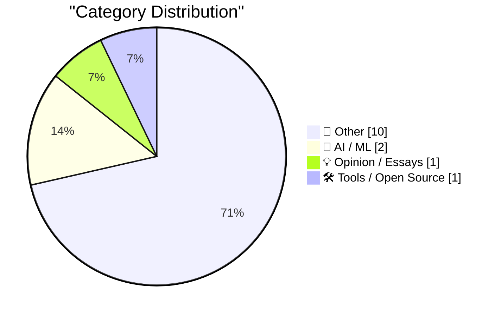
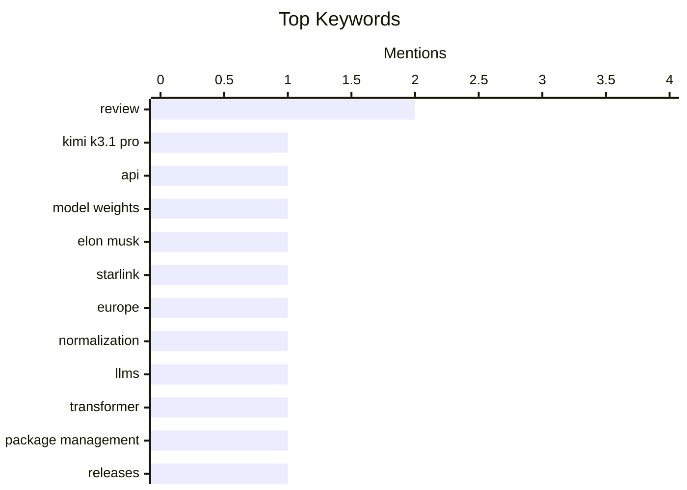

## Today's Highlights
Today's Highlights: The tech landscape is buzzing with innovation as the launch of the Kimi K3.1 Pro underscores the rapid advancements in AI and machine learning, while normalization techniques like RMSNorm are gaining attention for their critical role in enhancing large language models. Meanwhile, the ongoing debate around technology sovereignty is heating up, with Elon Musk's Starlink decisions prompting European nations to reconsider their reliance on American tech. Additionally, nostalgia meets modernity as reviews of Apple's new folding phone reveal both excitement and usability challenges, reflecting the ongoing evolution of consumer electronics.
---
## Must Read Today
1. **Introducing Kimi K3.1 Pro**
[Introducing Kimi K3.1 Pro](https://simonwillison.net/2026/Oct/23/kimi-k31-pro/) — simonwillison.net · 18h ago · 🤖 AI / ML
> The Kimi K3.1 Pro has been launched on the Kimi API, with full model weights expected to be released by November 4, 2026. This model includes a 'Highspeed' version that operates 2-3 times faster than the standard version, priced at double the cost, although input token cache hits remain the same. The pricing for the Kimi K3.1 Pro is set at $2.00 per unit. The introduction of this model aims to enhance performance and accessibility for developers. Overall, the Kimi K3.1 Pro represents a significant advancement in AI model capabilities.
💡 **Why read it**: This article provides insights into the latest advancements in AI model performance and pricing strategies.
🏷️ Kimi K3.1 Pro, API, model weights
2. **Elon Musk Just Gave Europe a Reason to Replace American Technology**
[Elon Musk Just Gave Europe a Reason to Replace American Technology](https://steveblank.com/2026/10/24/europe-gets-a-wake-up-call/) — steveblank.com · 1h ago · 💡 Opinion / Essays
> Elon Musk's decision to restrict the military version of Starlink, known as Starshield, to Ukraine has prompted European policymakers to reconsider their reliance on American technology. This incident has highlighted vulnerabilities in Europe's technological infrastructure and has sparked discussions about developing independent alternatives. The article emphasizes the need for Europe to bolster its own technological capabilities to avoid future dependencies. Ultimately, this situation serves as a wake-up call for Europe to innovate and invest in homegrown solutions.
💡 **Why read it**: The article discusses significant geopolitical implications of technology dependency, making it relevant for those interested in international relations and tech policy.
🏷️ Elon Musk, Starlink, Europe
3. **RMSNorm**
[RMSNorm](https://www.gilesthomas.com/2026/10/rmsnorm) — gilesthomas.com · 19h ago · 🤖 AI / ML
> The article discusses the importance of normalization techniques in large language models (LLMs), specifically focusing on RMSNorm. It compares RMSNorm to LayerNorm, explaining its application in Transformer architectures, particularly in the GPT-2 model, where it is utilized before multi-head attention and feed-forward networks. The findings suggest that RMSNorm can enhance model performance by improving training stability and efficiency. The conclusion underscores the potential of RMSNorm as a viable alternative to traditional normalization methods in LLMs.
💡 **Why read it**: This article is valuable for AI researchers and practitioners interested in advanced normalization techniques for improving model performance.
🏷️ normalization, LLMs, Transformer
---
## Data Overview
| Sources Scanned | Articles Fetched | Time Window | Selected |
|:---:|:---:|:---:|:---:|
| 88/92 | 2637 -> 14 | 24h | **14** |
### Category Distribution

### Top Keywords

<details>
<summary>Plain Text Keyword Chart (Terminal Friendly)</summary>
```
review        │ ████████████████████ 2
kimi k3.1 pro │ ██████████░░░░░░░░░░ 1
api           │ ██████████░░░░░░░░░░ 1
model weights │ ██████████░░░░░░░░░░ 1
elon musk     │ ██████████░░░░░░░░░░ 1
starlink      │ ██████████░░░░░░░░░░ 1
europe        │ ██████████░░░░░░░░░░ 1
normalization │ ██████████░░░░░░░░░░ 1
llms          │ ██████████░░░░░░░░░░ 1
transformer   │ ██████████░░░░░░░░░░ 1
```
</details>
### Topic Tags
**review**(2) · **kimi k3.1 pro**(1) · **api**(1) · model weights(1) · elon musk(1) · starlink(1) · europe(1) · normalization(1) · llms(1) · transformer(1) · package management(1) · releases(1) · advisories(1) · photo(1) · artifact(1) · claude(1) · reading list(1) · boeing(1) · figure ai(1) · commodore(1)
---
## Other
### 1. Quick Study
[Quick Study](https://simonwillison.net/2026/Oct/23/quick-study-painter/) — **simonwillison.net** · 16h ago · ⭐ 15/30
> The article introduces the Quick Study tool, which allows users to create a painted version of a photo using a canvas element and simulated paintbrush in a matter of seconds. It details a prompt used with Claude Opus 5.5 High to generate this artifact, showcasing the tool's capabilities in rapid image processing. The Quick Study tool exemplifies the intersection of art and technology, providing a unique approach to digital painting. The main takeaway is that such tools can significantly enhance creative workflows.
🏷️ photo, artifact, Claude
---
### 2. Reading List 10/24/26
[Reading List 10/24/26](https://www.construction-physics.com/p/reading-list-102426) — **construction-physics.com** · 1h ago · ⭐ 13/30
> This reading list compiles various articles and resources related to construction and technology, covering topics such as minimum lot sizes, Boeing's upcoming 737 MAX, and the training data used by Figure AI. Each entry provides a brief overview of the subject matter, offering insights into current trends and challenges in the industry. The list serves as a valuable resource for professionals seeking to stay updated on relevant developments. Overall, it reflects the diverse issues impacting the construction and tech sectors.
🏷️ reading list, Boeing, Figure AI
---
### 3. Commodore 1600 VICmodem
[Commodore 1600 VICmodem](https://dfarq.homeip.net/commodore-1600-vicmodem/?utm_source=rss&#038;utm_medium=rss&#038;utm_campaign=commodore-1600-vicmodem) — **dfarq.homeip.net** · 3h ago · ⭐ 13/30
> The article explores the history of the Commodore 1600 VICmodem, which aimed to make computing more accessible in the early 1980s. It highlights the significance of Commodore's efforts to produce affordable color computers, particularly the VIC-20, priced under $300. The discussion emphasizes how these innovations contributed to the popularization of personal computing. The main conclusion is that Commodore played a pivotal role in making technology accessible to the masses.
🏷️ Commodore, VICmodem, 1982
---
### 4. The Verge’s Duo Review: ‘Apple’s Folding Phone Is a Messy, Expensive Good Time’
[The Verge’s Duo Review: ‘Apple’s Folding Phone Is a Messy, Expensive Good Time’](https://www.theverge.com/tech/1015028/iphone-duo-review) — **daringfireball.net** · 21h ago · ⭐ 12/30
> The review discusses the Apple Duo, a folding phone that presents unique usability challenges, particularly in its orientation and camera placement. Testers found that while the device works regardless of how it is rotated, a counterclockwise rotation is preferred for optimal use. The review highlights both the innovative aspects and the shortcomings of the device, suggesting that while it is fun, it may not meet all user expectations. Ultimately, the Duo represents a bold step in smartphone design, albeit with notable flaws.
🏷️ Apple, folding phone, review
---
### 5. Joanna Stern Reviews the Duo: ‘The Good, the Bad, and the Buggy’
[Joanna Stern Reviews the Duo: ‘The Good, the Bad, and the Buggy’](https://www.youtube.com/watch?v=bxDTWuL9GxY) — **daringfireball.net** · 23h ago · ⭐ 12/30
> Joanna Stern's review of the Apple Duo includes extensive testing, including a custom robot that folded and unfolded the device over 32,000 times to assess hinge durability. The review captures the device's strengths and weaknesses, including camera performance in low-light conditions and the absence of Face ID. Stern's thorough approach provides a comprehensive evaluation of the Duo's functionality and design. The main takeaway is that while the Duo has exciting features, it also faces significant usability challenges.
🏷️ Duo, review, camera
---
### 6. How to install an app on your Commodore 64
[How to install an app on your Commodore 64](https://anildash.com/2026/10/08/install-an-app-commodore-64/) — **anildash.com** · 17h ago · ⭐ 9/30
> The article provides a nostalgic guide on installing programs on the Commodore 64, emphasizing the era's reliance on physical media and magazines for software access. It outlines the steps needed to obtain and install programs, reflecting the challenges users faced in the 1980s. The guide serves as a reminder of how far technology has come since then. Ultimately, it highlights the importance of understanding the history of computing for appreciating modern advancements.
🏷️ Commodore 64, install, programs
---
### 7. Pluralistic: Critique and writing (23 Oct 2026)
[Pluralistic: Critique and writing (23 Oct 2026)](https://pluralistic.net/2026/10/23/better-to-give/) — **pluralistic.net** · 17h ago · ⭐ 7/30
> The article discusses the importance of critique in writing workshops, emphasizing that analyzing others' stories is crucial for improving one's own writing. It highlights various topics, including the USPS's issues with mail delivery and the implications of international hacking. The author suggests that engaging with diverse narratives can enhance understanding and creativity in writing. Ultimately, the piece advocates for the value of constructive feedback in the writing process.
🏷️ writing, critique, workshop
---
### 8. An Ion Storm!, Part 2: The Return to Ground Level
[An Ion Storm!, Part 2: The Return to Ground Level](https://www.filfre.net/2026/10/an-ion-storm-part-2-the-return-to-ground-level/) — **filfre.net** · 21h ago · ⭐ 6/30
> This article continues the narrative surrounding John Romero, a significant figure in the gaming industry, particularly known for his work at Ion Storm. It recounts rumors of Romero's dramatic exit from the company's penthouse, symbolizing the tumultuous environment of the gaming scene during that era. The piece delves into the complexities of Romero's career and the cultural impact of his work. The conclusion reflects on the chaotic nature of the gaming industry and its influential personalities.
🏷️ John Romero, Ion Storm, Texas
---
### 9. Book Review: Get Ahead of Being Dead by Evie King ★★★★☆
[Book Review: Get Ahead of Being Dead by Evie King ★★★★☆](https://shkspr.mobi/blog/2026/10/book-review-get-ahead-of-being-dead-by-evie-king/) — **shkspr.mobi** · 2h ago · ⭐ 4/30
> The review discusses Evie King's book, which serves as a practical guide to handling the aftermath of death, focusing on the necessary paperwork and family dynamics involved. It builds on themes from her previous work, emphasizing the often-overlooked logistical challenges that arise after someone passes away. The reviewer praises King's ability to blend humor with serious topics, making the book both informative and engaging. Overall, it highlights the importance of being prepared for end-of-life matters.
🏷️ book review, death, paperwork
---
### 10. Premium: The Hater's Guide To Blackstone
[Premium: The Hater's Guide To Blackstone](https://www.wheresyoured.at/premium-the-haters-guide-to-blackstone/) — **wheresyoured.at** · 21h ago · ⭐ 4/30
> The article critiques Stephen A. Schwarzman's autobiographical series, which presents a self-congratulatory narrative of his life and career in finance. It examines the disconnect between Schwarzman's portrayal of himself as a principled leader and the broader implications of his business practices. The piece argues that such narratives often obscure the complexities and ethical dilemmas inherent in the financial industry. Ultimately, it encourages readers to critically assess the motivations behind personal histories in business.
🏷️ Blackstone, history, finance
---
## AI / ML
### 11. Introducing Kimi K3.1 Pro
[Introducing Kimi K3.1 Pro](https://simonwillison.net/2026/Oct/23/kimi-k31-pro/) — **simonwillison.net** · 18h ago · ⭐ 27/30
> The Kimi K3.1 Pro has been launched on the Kimi API, with full model weights expected to be released by November 4, 2026. This model includes a 'Highspeed' version that operates 2-3 times faster than the standard version, priced at double the cost, although input token cache hits remain the same. The pricing for the Kimi K3.1 Pro is set at $2.00 per unit. The introduction of this model aims to enhance performance and accessibility for developers. Overall, the Kimi K3.1 Pro represents a significant advancement in AI model capabilities.
🏷️ Kimi K3.1 Pro, API, model weights
---
### 12. RMSNorm
[RMSNorm](https://www.gilesthomas.com/2026/10/rmsnorm) — **gilesthomas.com** · 19h ago · ⭐ 21/30
> The article discusses the importance of normalization techniques in large language models (LLMs), specifically focusing on RMSNorm. It compares RMSNorm to LayerNorm, explaining its application in Transformer architectures, particularly in the GPT-2 model, where it is utilized before multi-head attention and feed-forward networks. The findings suggest that RMSNorm can enhance model performance by improving training stability and efficiency. The conclusion underscores the potential of RMSNorm as a viable alternative to traditional normalization methods in LLMs.
🏷️ normalization, LLMs, Transformer
---
## Opinion / Essays
### 13. Elon Musk Just Gave Europe a Reason to Replace American Technology
[Elon Musk Just Gave Europe a Reason to Replace American Technology](https://steveblank.com/2026/10/24/europe-gets-a-wake-up-call/) — **steveblank.com** · 1h ago · ⭐ 27/30
> Elon Musk's decision to restrict the military version of Starlink, known as Starshield, to Ukraine has prompted European policymakers to reconsider their reliance on American technology. This incident has highlighted vulnerabilities in Europe's technological infrastructure and has sparked discussions about developing independent alternatives. The article emphasizes the need for Europe to bolster its own technological capabilities to avoid future dependencies. Ultimately, this situation serves as a wake-up call for Europe to innovate and invest in homegrown solutions.
🏷️ Elon Musk, Starlink, Europe
---
## Tools / Open Source
### 14. This Week in Package Management: 24 October 2026
[This Week in Package Management: 24 October 2026](https://nesbitt.io/2026/10/24/this-week-in-package-management.html) — **nesbitt.io** · 4h ago · ⭐ 18/30
> This article provides a roundup of the latest releases, advisories, and developments in the package management ecosystem. It highlights key updates from various package managers and discusses emerging trends and challenges within the field. The content serves as a comprehensive resource for developers and system administrators to stay informed about important changes and best practices. Overall, it emphasizes the dynamic nature of package management and its critical role in software development.
🏷️ package management, releases, advisories
---
*Generated at 2026-10-24 14:00 | Scanned 88 sources -> 2637 articles -> selected 14*
*Based on the [Hacker News Popularity Contest 2025](https://refactoringenglish.com/tools/hn-popularity/) RSS source list recommended by [Andrej Karpathy](https://x.com/karpathy)*
*Produced by Dongdianr AI. Follow the same-name WeChat public account for more AI practical tips 💡*
