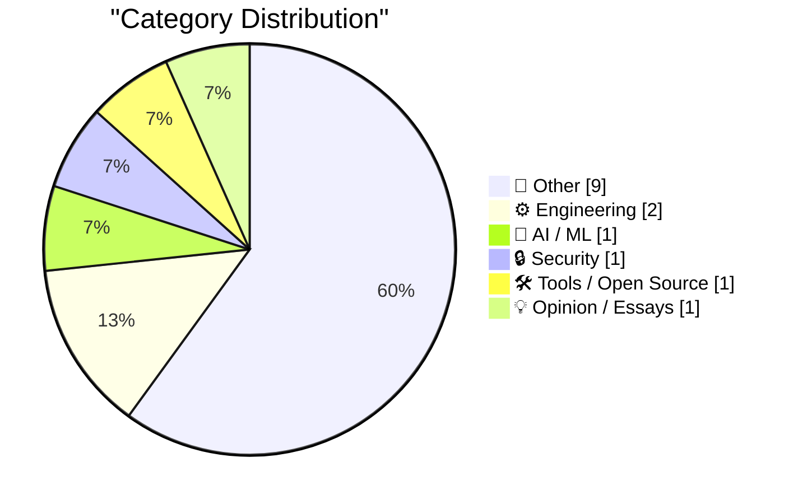
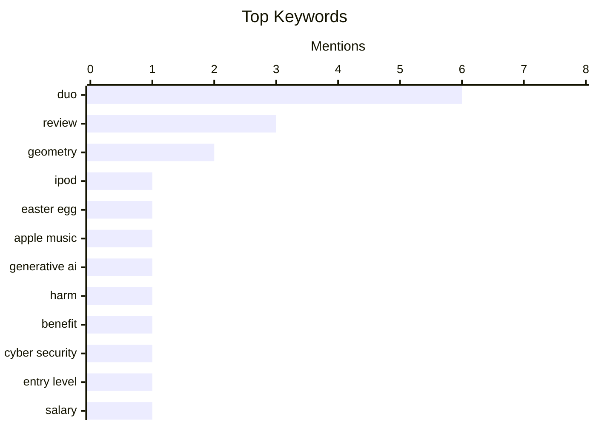

## Today's Highlights
Today's Highlights: Apple continues to innovate with a nostalgic twist, unveiling a photo-realistic replica of the original iPod to commemorate its legacy while launching the iPhone Duo, which has sparked mixed reviews due to its design and functionality. Meanwhile, the conversation around generative AI intensifies, as experts weigh its potential risks against its benefits, highlighting the ongoing debate in the tech community. Additionally, the cybersecurity job market is gaining traction, with discussions on entry-level salary expectations reflecting the growing demand for skilled professionals in this critical field.
---
## Must Read Today
1. **Apple Built a Photo-Realistic Functional Original iPod for Apple Music’s 404 Page**
[Apple Built a Photo-Realistic Functional Original iPod for Apple Music’s 404 Page](https://music.apple.com/404) — daringfireball.net · 22h ago · 📝 Other
> Apple has created a photo-realistic functional replica of the original iPod to celebrate its 25th anniversary, featured on Apple Music’s 404 error page. This Easter egg showcases meticulous attention to detail, replicating the iPod's design and functionality. The initiative highlights Apple's commitment to nostalgia and user engagement through innovative design. Overall, it serves as a clever marketing strategy that resonates with long-time Apple fans.
💡 **Why read it**: This article is worth reading for its insight into Apple's creative marketing strategies and their ability to evoke nostalgia through design.
🏷️ iPod, Easter egg, Apple Music
2. **Will Generative AI do more harm than good?**
[Will Generative AI do more harm than good?](https://garymarcus.substack.com/p/will-generative-ai-do-more-harm-than) — garymarcus.substack.com · 18h ago · 🤖 AI / ML
> The article explores the potential negative impacts of generative AI technologies, questioning whether their benefits outweigh the risks. Key arguments include concerns over misinformation, ethical dilemmas, and the societal implications of AI-generated content. The author emphasizes the need for careful regulation and ethical considerations in AI development. Ultimately, the article suggests that while generative AI holds promise, it also poses significant challenges that must be addressed.
💡 **Why read it**: This article is worth reading for its critical examination of generative AI and its implications for society.
🏷️ Generative AI, harm, benefit
3. **How much you can make in an entry level cyber security job**
[How much you can make in an entry level cyber security job](https://dfarq.homeip.net/how-much-you-can-make-in-an-entry-level-cyber-security-job/?utm_source=rss&#038;utm_medium=rss&#038;utm_campaign=how-much-you-can-make-in-an-entry-level-cyber-security-job) — dfarq.homeip.net · 3h ago · 🔒 Security
> The article discusses salary expectations for entry-level positions in the cybersecurity field, addressing the ongoing talent shortage in the industry. It provides specific figures, noting that salaries can range from $50,000 to $80,000 annually, depending on location and company size. The author also highlights the importance of certifications and skills in determining earning potential. Overall, it serves as a valuable resource for those considering a career in cybersecurity.
💡 **Why read it**: This article is worth reading for anyone interested in pursuing a career in cybersecurity, as it provides realistic salary expectations and career insights.
🏷️ cyber security, entry level, salary
---
## Data Overview
| Sources Scanned | Articles Fetched | Time Window | Selected |
|:---:|:---:|:---:|:---:|
| 88/92 | 2640 -> 16 | 24h | **15** |
### Category Distribution

### Top Keywords

<details>
<summary>Plain Text Keyword Chart (Terminal Friendly)</summary>
```
duo            │ ████████████████████ 6
review         │ ██████████░░░░░░░░░░ 3
geometry       │ ███████░░░░░░░░░░░░░ 2
ipod           │ ███░░░░░░░░░░░░░░░░░ 1
easter egg     │ ███░░░░░░░░░░░░░░░░░ 1
apple music    │ ███░░░░░░░░░░░░░░░░░ 1
generative ai  │ ███░░░░░░░░░░░░░░░░░ 1
harm           │ ███░░░░░░░░░░░░░░░░░ 1
benefit        │ ███░░░░░░░░░░░░░░░░░ 1
cyber security │ ███░░░░░░░░░░░░░░░░░ 1
```
</details>
### Topic Tags
**duo**(6) · **review**(3) · **geometry**(2) · ipod(1) · easter egg(1) · apple music(1) · generative ai(1) · harm(1) · benefit(1) · cyber security(1) · entry level(1) · salary(1) · face id(1) · design(1) · transition(1) · smartphone(1) · launch(1) · ceo(1) · iphone(1) · screen issue(1)
---
## Other
### 1. Apple Built a Photo-Realistic Functional Original iPod for Apple Music’s 404 Page
[Apple Built a Photo-Realistic Functional Original iPod for Apple Music’s 404 Page](https://music.apple.com/404) — **daringfireball.net** · 22h ago · ⭐ 24/30
> Apple has created a photo-realistic functional replica of the original iPod to celebrate its 25th anniversary, featured on Apple Music’s 404 error page. This Easter egg showcases meticulous attention to detail, replicating the iPod's design and functionality. The initiative highlights Apple's commitment to nostalgia and user engagement through innovative design. Overall, it serves as a clever marketing strategy that resonates with long-time Apple fans.
🏷️ iPod, Easter egg, Apple Music
---
### 2. MKBHD’s Duo Review
[MKBHD’s Duo Review](https://youtu.be/ESABTN4VtrA) — **daringfireball.net** · 17h ago · ⭐ 19/30
> Marques Brownlee reviews the iPhone Duo, highlighting the absence of Face ID as a significant drawback. He notes that while the device is polished in design, it suffers from optimization issues with third-party apps, particularly those from less reputable developers. The review underscores the importance of app compatibility in the user experience of new devices. Overall, it provides a balanced view of the Duo's strengths and weaknesses.
🏷️ Duo, review, Face ID
---
### 3. Chan Karunamuni on the Duo’s Open/Close Translucent Transition
[Chan Karunamuni on the Duo’s Open/Close Translucent Transition](https://x.com/chan_k/status/2113622379050246243) — **daringfireball.net** · 22h ago · ⭐ 19/30
> Chan Karunamuni, a human interface designer at Apple, discusses the innovative design of the iPhone Duo's open/close transition. The design aims to create a seamless experience by perceptually bending the focal plane, enhancing the illusion of a single display. Karunamuni acknowledges the contributions of specific engineers, emphasizing teamwork in the design process. This insight into the design philosophy highlights Apple's focus on user experience.
🏷️ Duo, design, transition
---
### 4. Nicole Nguyen’s Duo Review for the WSJ
[Nicole Nguyen’s Duo Review for the WSJ](https://www.wsj.com/tech/personal-tech/iphone-duo-review-cafcbbe7?st=GaYVMf) — **daringfireball.net** · 15h ago · ⭐ 17/30
> Nicole Nguyen reviews the iPhone Duo, noting its considerable weight and size compared to other smartphones, which may impact one-handed use. She mentions the durability of the titanium frame but highlights discomfort during prolonged use. The review provides a critical perspective on the device's ergonomics and usability. Overall, it raises important considerations for potential buyers regarding comfort and practicality.
🏷️ Duo, review, smartphone
---
### 5. Reuters and the WSJ on the Duo Launch
[Reuters and the WSJ on the Duo Launch](https://www.reuters.com/business/retail-consumer/apple-bets-iphone-duo-can-remake-foldable-market-sales-begin-2026-10-22/) — **daringfireball.net** · 15h ago · ⭐ 17/30
> The article covers the launch event of the iPhone Duo, where CEO Ternus engaged with customers in Austin, Texas, coinciding with the Formula 1 US Grand Prix. It highlights Apple's marketing strategy of creating buzz through direct customer interaction and event tie-ins. The report underscores Apple's commitment to making the Duo a significant player in the foldable market. Overall, it illustrates the company's innovative approach to product launches.
🏷️ Duo, launch, CEO
---
### 6. Marion Barry Meets the iPhone Duo
[Marion Barry Meets the iPhone Duo](https://www.theverge.com/tech/1017623/iphone-duo-broken-cracked-screen) — **daringfireball.net** · 16h ago · ⭐ 17/30
> The article reports on early issues with the iPhone Duo, specifically broken screens appearing in some units, particularly along the hinge. User reports on Reddit indicate a pattern of failure, raising concerns about the device's durability. While the problem is not widespread, it highlights potential quality control issues for Apple. Overall, it serves as a cautionary note for early adopters of the device.
🏷️ Duo, iPhone, screen issue
---
### 7. Tim Pan’s iPhone Duo Review
[Tim Pan’s iPhone Duo Review](https://www.youtube.com/watch?v=8pCccpKjjos) — **daringfireball.net** · 18h ago · ⭐ 17/30
> Tim Pan's review of the iPhone Duo emphasizes high production values and thorough testing, including a stress test of the hinge using an industrial robot. The review notes that the hinge was opened and closed 10,000 times, showcasing the device's durability under extreme conditions. Pan's analysis provides a comprehensive overview of the Duo's features and performance. Overall, it highlights the rigorous testing standards applied to new technology.
🏷️ Duo, review, production values
---
### 8. Gadget Review: LiberNovo Omni - the USB-C powered office chair ★★★★⯪
[Gadget Review: LiberNovo Omni - the USB-C powered office chair ★★★★⯪](https://shkspr.mobi/blog/2026/10/gadget-review-libernovo-omni-chair/) — **shkspr.mobi** · 1h ago · ⭐ 13/30
> The LiberNovo Omni chair introduces USB-C power to office furniture, addressing the need for modern, tech-friendly designs. It features full foam cushions, a comfortable headrest, and a recline function that enhances user comfort. The review highlights the chair's practicality and innovative charging method, making it a standout in ergonomic design. Overall, the chair successfully combines comfort with contemporary technology.
🏷️ USB-C, office chair, gadget
---
### 9. Stop! Ontology time!
[Stop! Ontology time!](https://blog.coredump.cx/p/stop-ontology-time) — **lcamtuf.substack.com** · 21h ago · ⭐ 10/30
> The article emphasizes the importance of clear reasoning and ontology in discussions, particularly in technical fields. It critiques the tendency to overlook foundational concepts, which can lead to flawed arguments. By advocating for a rigorous approach to ontology, the piece encourages readers to refine their reasoning processes.
🏷️ ontology, reasoning, logic
---
## Engineering
### 10. Computing polar triangles with linear algebra
[Computing polar triangles with linear algebra](https://www.johndcook.com/blog/2026/10/24/computing-polar-triangles/) — **johndcook.com** · 12h ago · ⭐ 13/30
> This article explores the construction of polar triangles in spherical geometry using linear algebra. It addresses the existence of polar triangles and provides a geometric construction method that starts from a spherical triangle's sides and angles. The findings emphasize the relationship between linear algebra and spherical geometry, offering insights into triangle properties on the sphere.
🏷️ polar triangles, linear algebra, geometry
---
### 11. Duality in spherical trigonometry
[Duality in spherical trigonometry](https://www.johndcook.com/blog/2026/10/24/polar-triangle/) — **johndcook.com** · 13h ago · ⭐ 13/30
> The article discusses the duality concept in spherical trigonometry, specifically focusing on the two laws of cosines for sides and angles. It highlights the similarities and differences between these laws, providing a deeper understanding of spherical triangles. The exploration of duality enhances the comprehension of trigonometric relationships on a sphere.
🏷️ spherical trigonometry, law of cosines, geometry
---
## AI / ML
### 12. Will Generative AI do more harm than good?
[Will Generative AI do more harm than good?](https://garymarcus.substack.com/p/will-generative-ai-do-more-harm-than) — **garymarcus.substack.com** · 18h ago · ⭐ 21/30
> The article explores the potential negative impacts of generative AI technologies, questioning whether their benefits outweigh the risks. Key arguments include concerns over misinformation, ethical dilemmas, and the societal implications of AI-generated content. The author emphasizes the need for careful regulation and ethical considerations in AI development. Ultimately, the article suggests that while generative AI holds promise, it also poses significant challenges that must be addressed.
🏷️ Generative AI, harm, benefit
---
## Security
### 13. How much you can make in an entry level cyber security job
[How much you can make in an entry level cyber security job](https://dfarq.homeip.net/how-much-you-can-make-in-an-entry-level-cyber-security-job/?utm_source=rss&#038;utm_medium=rss&#038;utm_campaign=how-much-you-can-make-in-an-entry-level-cyber-security-job) — **dfarq.homeip.net** · 3h ago · ⭐ 21/30
> The article discusses salary expectations for entry-level positions in the cybersecurity field, addressing the ongoing talent shortage in the industry. It provides specific figures, noting that salaries can range from $50,000 to $80,000 annually, depending on location and company size. The author also highlights the importance of certifications and skills in determining earning potential. Overall, it serves as a valuable resource for those considering a career in cybersecurity.
🏷️ cyber security, entry level, salary
---
## Tools / Open Source
### 14. List of Vim forks
[List of Vim forks](https://evanhahn.com/list-of-vim-forks/) — **evanhahn.com** · 21h ago · ⭐ 16/30
> The article provides a comprehensive list of Vim forks, including Neovim and Vim Classic, detailing their unique features and purposes. Neovim is highlighted for its extensibility and usability, while Vim Classic focuses on stability and long-term support. The list serves as a valuable resource for developers looking to explore alternatives to the traditional Vim editor. Overall, it emphasizes the diversity within the Vim ecosystem.
🏷️ Vim, forks, text editor
---
## Opinion / Essays
### 15. Don't anthropomorphize big tech companies
[Don't anthropomorphize big tech companies](https://seangoedecke.com/dont-anthropomorphize-big-tech-companies/) — **seangoedecke.com** · 14h ago · ⭐ 12/30
> The article argues against the tendency to anthropomorphize tech companies, suggesting that they should be viewed as tools rather than entities with human-like qualities. It uses a quote from Bryan Cantrill to illustrate the importance of maintaining a clear perspective on corporate motivations and behaviors. The main takeaway is that understanding companies as non-human entities can lead to more rational decision-making.
🏷️ anthropomorphize, big tech, perspective
---
*Generated at 2026-10-25 14:00 | Scanned 88 sources -> 2640 articles -> selected 15*
*Based on the [Hacker News Popularity Contest 2025](https://refactoringenglish.com/tools/hn-popularity/) RSS source list recommended by [Andrej Karpathy](https://x.com/karpathy)*
*Produced by Dongdianr AI. Follow the same-name WeChat public account for more AI practical tips 💡*
