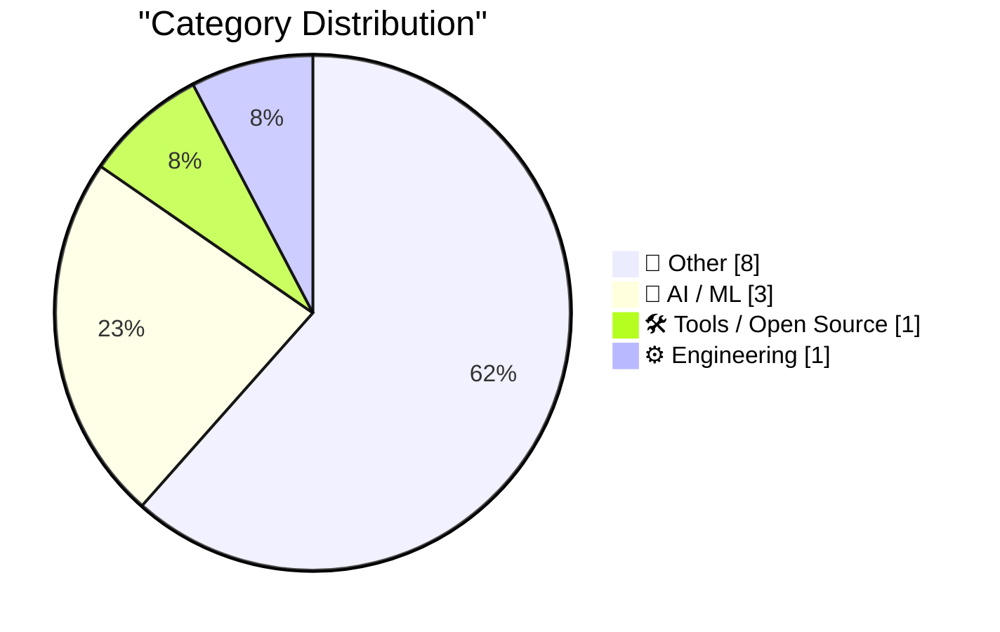
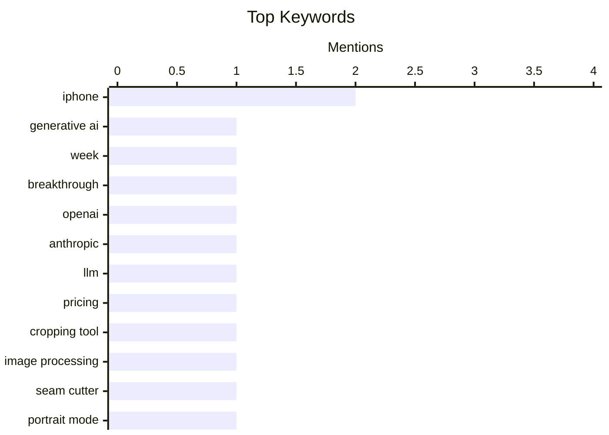

## Today's Highlights
Today's Highlights: Generative AI is at a critical juncture as major players like OpenAI and Anthropic slash their large language model prices by up to 80%, signaling a shift towards more accessible AI technologies. Meanwhile, advancements in user interface design are exemplified by innovative tools like Seam Cutter and new strategies for enhancing Touch ID functionality, reflecting a broader trend of improving user experience across devices.
---
## Must Read Today
1. **Generative AI’s make-or-break week?**
[Generative AI’s make-or-break week?](https://garymarcus.substack.com/p/ais-make-or-break-week) — garymarcus.substack.com · 39m ago · 🤖 AI / ML
> The article discusses the pivotal week for generative AI technologies, highlighting the anticipation around significant announcements and developments. Key arguments focus on the potential breakthroughs in AI capabilities and the implications for various industries, emphasizing the importance of timing and execution in this rapidly evolving field. The author suggests that the outcomes of this week could set the trajectory for future advancements in AI. Overall, it underscores the critical nature of this moment for stakeholders in the AI landscape.
💡 **Why read it**: This article is worth reading for insights into the current state and future potential of generative AI technologies.
🏷️ Generative AI, week, breakthrough
2. **OpenAI and Anthropic cut their LLM prices by up to 80% within a few months. Why?**
[OpenAI and Anthropic cut their LLM prices by up to 80% within a few months. Why?](https://minimaxir.com/2026/10/cheap-llms/) — minimaxir.com · 17h ago · 🤖 AI / ML
> This article explores the drastic price reductions by OpenAI and Anthropic for their large language models (LLMs), which have decreased by up to 80% in a short timeframe. It argues that these cuts are driven by increased competition and advancements in model efficiency, which lower operational costs. The analysis includes a discussion on the implications for the AI market and accessibility of LLMs for developers and businesses. The main takeaway is that these price changes could democratize access to powerful AI tools.
💡 **Why read it**: It's essential reading for understanding the economic dynamics shaping the AI industry and the impact on accessibility.
🏷️ OpenAI, Anthropic, LLM, pricing
3. **Seam Cutter**
[Seam Cutter](https://simonwillison.net/2026/Oct/25/seam-cutter/) — simonwillison.net · 22h ago · 🛠 Tools / Open Source
> The article introduces Seam Cutter, a specialized cropping tool designed to create horizontal or vertical cuts in images, allowing users to slide sections relative to each other. This tool addresses the need for precise image editing, particularly for users who frequently stitch screenshots. The author details the technical implementation and usability of the tool, emphasizing its unique functionality. The conclusion highlights Seam Cutter as a valuable resource for those needing advanced image manipulation capabilities.
💡 **Why read it**: This article is worth reading for anyone interested in innovative image editing tools and their practical applications.
🏷️ cropping tool, image processing, Seam Cutter
---
## Data Overview
| Sources Scanned | Articles Fetched | Time Window | Selected |
|:---:|:---:|:---:|:---:|
| 88/92 | 2637 -> 13 | 24h | **13** |
### Category Distribution

### Top Keywords

<details>
<summary>Plain Text Keyword Chart (Terminal Friendly)</summary>
```
iphone           │ ████████████████████ 2
generative ai    │ ██████████░░░░░░░░░░ 1
week             │ ██████████░░░░░░░░░░ 1
breakthrough     │ ██████████░░░░░░░░░░ 1
openai           │ ██████████░░░░░░░░░░ 1
anthropic        │ ██████████░░░░░░░░░░ 1
llm              │ ██████████░░░░░░░░░░ 1
pricing          │ ██████████░░░░░░░░░░ 1
cropping tool    │ ██████████░░░░░░░░░░ 1
image processing │ ██████████░░░░░░░░░░ 1
```
</details>
### Topic Tags
**iphone**(2) · **generative ai**(1) · **week**(1) · breakthrough(1) · openai(1) · anthropic(1) · llm(1) · pricing(1) · cropping tool(1) · image processing(1) · seam cutter(1) · portrait mode(1) · depth map(1) · polar triangles(1) · linear algebra(1) · geometry(1) · b2b(1) · customer data(1) · data consolidation(1) · fosdem(1)
---
## Other
### 1. Sunnny
[Sunnny](https://sunnny.com/) — **daringfireball.net** · 16h ago · ⭐ 15/30
> The article introduces Sunnny, a B2B solution designed to consolidate customer data from various systems, making it easier for businesses to manage and analyze their information. It highlights features such as data cleaning, identity resolution, and relationship identification, which streamline data presentation for teams and AI models. Early access is currently available, indicating a push for user engagement. The main takeaway is that Sunnny aims to simplify complex data management challenges for businesses.
🏷️ B2B, customer data, data consolidation
---
### 2. Package Management Devroom at FOSDEM 2027: Call for Participation
[Package Management Devroom at FOSDEM 2027: Call for Participation](https://nesbitt.io/2026/10/26/package-management-devroom-at-fosdem-2027-call-for-participation.html) — **nesbitt.io** · 4h ago · ⭐ 15/30
> The article announces a call for participation in the Package Management Devroom at FOSDEM 2027, inviting submissions until December 1. It emphasizes the importance of package management in software development and the need for community engagement in discussions around best practices and innovations. The author encourages contributors to share their insights and experiences. The conclusion highlights the event as a significant opportunity for collaboration and knowledge sharing in the field.
🏷️ FOSDEM, call for participation, package management
---
### 3. Duo Users Are Registering the Base of Their Index Finger as a Touch ID Coping Strategy
[Duo Users Are Registering the Base of Their Index Finger as a Touch ID Coping Strategy](https://www.reddit.com/r/iPhoneDuo/comments/1xehtcj/best_fingerprint_method/) — **daringfireball.net** · 16h ago · ⭐ 12/30
> The article discusses a novel strategy shared by users on Reddit for improving Touch ID functionality on the iPhone Duo by registering the base of the index finger. This method addresses common issues with accessing notifications on the lock screen, enhancing user experience. The author includes an illustrative video demonstrating the effectiveness of this technique. The main takeaway is that this simple adjustment can significantly improve the usability of Touch ID.
🏷️ Touch ID, Reddit, fingerprint
---
### 4. The Talk Show: ‘Lubricate the Inside of the Hinge’
[The Talk Show: ‘Lubricate the Inside of the Hinge’](https://daringfireball.net/thetalkshow/2026/10/25/ep-456) — **daringfireball.net** · 18h ago · ⭐ 12/30
> This episode of The Talk Show features a discussion with Joanna Stern, focusing on the iPhone Duo and its innovative features. The conversation covers various aspects of the device, including user experiences and technical specifications. Sponsored segments highlight products that enhance daily living, such as Factor and Notion. The main takeaway is the exploration of how the iPhone Duo represents a significant step forward in smartphone design and functionality.
🏷️ iPhone, podcast, Joanna Stern
---
### 5. Where else to find me
[Where else to find me](https://www.johndcook.com/blog/2026/10/26/where-to-find-me/) — **johndcook.com** · 1h ago · ⭐ 9/30
> In this blog post, the author outlines various platforms where they share content beyond their main blog, including multiple X accounts focused on specific topics. The post emphasizes the importance of engaging with audiences across different channels to disseminate knowledge effectively. The author also mentions the use of RSS feeds for updates. The conclusion reinforces the value of diverse platforms for reaching wider audiences.
🏷️ blog, social media, announcement
---
### 6. Why My Dad Didn’t Have a Cell Phone
[Why My Dad Didn’t Have a Cell Phone](https://blog.jim-nielsen.com/2026/why-dad-didnt-have-cellphone/) — **blog.jim-nielsen.com** · 19h ago · ⭐ 9/30
> The article discusses the overwhelming noise and distractions caused by modern communication tools. It highlights how these tools, once useful, now often serve as sources of anxiety and interruptions, demanding users' time and attention. The author reflects on personal experiences with messaging apps and the burden of constant notifications. The main takeaway is a critique of how technology has shifted from enhancing communication to becoming a source of stress.
🏷️ cell phone, communication, noise, attention
---
### 7. Windows 8 released Oct 26, 2012
[Windows 8 released Oct 26, 2012](https://dfarq.homeip.net/windows-8-released-oct-26-2012/?utm_source=rss&#038;utm_medium=rss&#038;utm_campaign=windows-8-released-oct-26-2012) — **dfarq.homeip.net** · 3h ago · ⭐ 9/30
> The article reflects on the release of Windows 8, which occurred on October 26, 2012, marking a significant UI redesign for Microsoft. It discusses the mixed reception of the operating system, noting that it was considered a flop compared to previous versions. The piece emphasizes the challenges Microsoft faced in adapting to new user expectations and the lessons learned from this experience. Ultimately, it serves as a reminder of the importance of user-centered design in software development.
🏷️ Windows 8, UI redesign, Microsoft, history
---
### 8. Theatre Review: Opera UnTouched's "The Telephone" ★★★★★
[Theatre Review: Opera UnTouched's "The Telephone" ★★★★★](https://shkspr.mobi/blog/2026/10/theatre-review-opera-untoucheds-the-telephone/) — **shkspr.mobi** · 1h ago · ⭐ 6/30
> The review covers a unique performance of the comic opera 'The Telephone' by Opera UnTouched, set in a real office environment. It describes the engaging atmosphere and the storyline revolving around a woman preoccupied with phone calls during a leaving party. The performance is praised for its innovative setting and the way it captures the comedic elements of modern communication. The main conclusion is that opera can thrive in unconventional spaces, enhancing the audience's experience.
🏷️ opera, review, performance
---
## AI / ML
### 9. Generative AI’s make-or-break week?
[Generative AI’s make-or-break week?](https://garymarcus.substack.com/p/ais-make-or-break-week) — **garymarcus.substack.com** · 39m ago · ⭐ 27/30
> The article discusses the pivotal week for generative AI technologies, highlighting the anticipation around significant announcements and developments. Key arguments focus on the potential breakthroughs in AI capabilities and the implications for various industries, emphasizing the importance of timing and execution in this rapidly evolving field. The author suggests that the outcomes of this week could set the trajectory for future advancements in AI. Overall, it underscores the critical nature of this moment for stakeholders in the AI landscape.
🏷️ Generative AI, week, breakthrough
---
### 10. OpenAI and Anthropic cut their LLM prices by up to 80% within a few months. Why?
[OpenAI and Anthropic cut their LLM prices by up to 80% within a few months. Why?](https://minimaxir.com/2026/10/cheap-llms/) — **minimaxir.com** · 17h ago · ⭐ 27/30
> This article explores the drastic price reductions by OpenAI and Anthropic for their large language models (LLMs), which have decreased by up to 80% in a short timeframe. It argues that these cuts are driven by increased competition and advancements in model efficiency, which lower operational costs. The analysis includes a discussion on the implications for the AI market and accessibility of LLMs for developers and businesses. The main takeaway is that these price changes could democratize access to powerful AI tools.
🏷️ OpenAI, Anthropic, LLM, pricing
---
### 11. iPhone Portrait Mode, 10 Years In
[iPhone Portrait Mode, 10 Years In](https://x.com/johnnie/status/2114007844605612167) — **daringfireball.net** · 19h ago · ⭐ 20/30
> This article reflects on the evolution of iPhone's Portrait Mode over the past decade, initially viewed as a complex mathematical challenge involving disparity calculations and depth maps. It discusses the limitations of early implementations, particularly in textureless areas and fine details, which led to unnatural results. The author highlights advancements in technology that have improved the realism of Portrait Mode. The main takeaway is the significant progress made in smartphone photography, enhancing user experience.
🏷️ Portrait Mode, iPhone, depth map
---
## Tools / Open Source
### 12. Seam Cutter
[Seam Cutter](https://simonwillison.net/2026/Oct/25/seam-cutter/) — **simonwillison.net** · 22h ago · ⭐ 21/30
> The article introduces Seam Cutter, a specialized cropping tool designed to create horizontal or vertical cuts in images, allowing users to slide sections relative to each other. This tool addresses the need for precise image editing, particularly for users who frequently stitch screenshots. The author details the technical implementation and usability of the tool, emphasizing its unique functionality. The conclusion highlights Seam Cutter as a valuable resource for those needing advanced image manipulation capabilities.
🏷️ cropping tool, image processing, Seam Cutter
---
## Engineering
### 13. Poles and polars
[Poles and polars](https://www.johndcook.com/blog/2026/10/25/poles-and-polars/) — **johndcook.com** · 18h ago · ⭐ 16/30
> The article delves into the concepts of poles and polars in the context of polar triangles, building on previous discussions about their mathematical properties. It explains how to compute polars using linear algebra and the significance of these geometric constructs on a sphere. The author provides insights into the theoretical underpinnings and practical applications of these concepts. The conclusion emphasizes the importance of understanding poles and polars for advanced mathematical studies.
🏷️ polar triangles, linear algebra, geometry
---
*Generated at 2026-10-26 14:01 | Scanned 88 sources -> 2637 articles -> selected 13*
*Based on the [Hacker News Popularity Contest 2025](https://refactoringenglish.com/tools/hn-popularity/) RSS source list recommended by [Andrej Karpathy](https://x.com/karpathy)*
*Produced by Dongdianr AI. Follow the same-name WeChat public account for more AI practical tips 💡*
