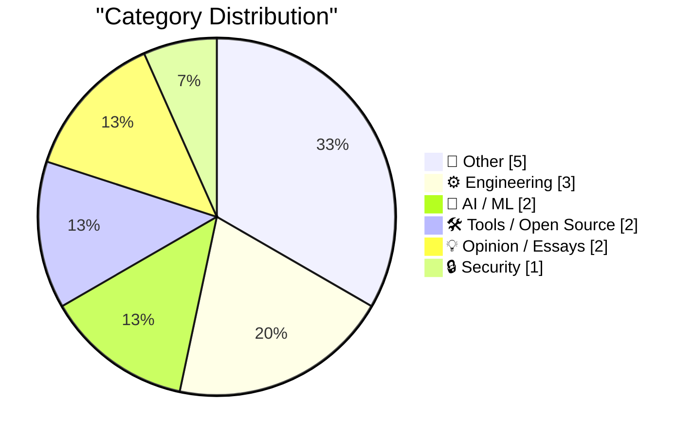
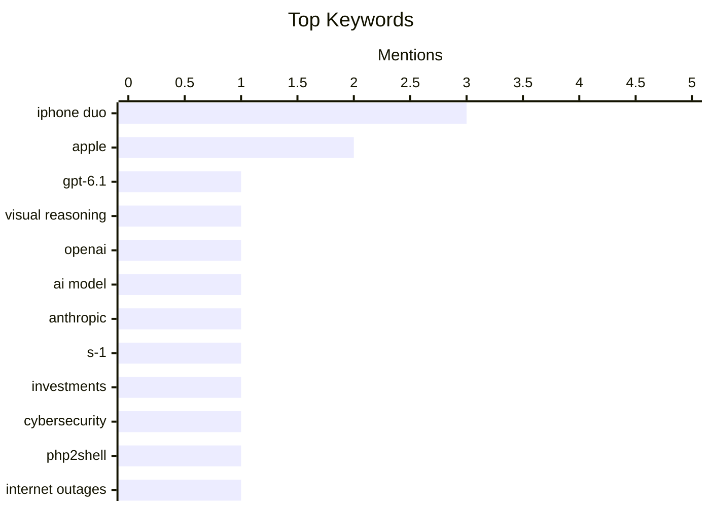

## Today's Highlights
Today's Highlights: The tech landscape is buzzing with advancements in AI, particularly with OpenAI's GPT-6.1 Terra enhancing visual reasoning capabilities, while Anthropic faces scrutiny over omissions in its draft S-1 filing. Meanwhile, Apple is addressing user concerns with the iPhone Duo's display issues and has launched the new A20 Pro iPad Mini, showcasing its commitment to innovation amidst ongoing challenges in tech support reliance on AI tools.
---
## Must Read Today
1. **GPT-6.1 Terra**
[GPT-6.1 Terra](https://simonwillison.net/2026/Oct/26/gpt-61-terra/) — simonwillison.net · 14h ago · 🤖 AI / ML
> OpenAI's GPT-6.1 Terra focuses on enhanced visual reasoning and improved computer use capabilities. The model is designed to provide faster performance while delivering clearer and more natural writing. Key features include its ability to process visual data and execute complex tasks with precision. The main takeaway is that GPT-6.1 Terra represents a significant advancement in AI capabilities, particularly in integrating visual and textual understanding.
💡 **Why read it**: This article is worth reading for insights into the latest advancements in AI model capabilities and their practical applications.
🏷️ GPT-6.1, visual reasoning, OpenAI, AI model
2. **What Anthropic left out of their draft S-1**
[What Anthropic left out of their draft S-1](https://garymarcus.substack.com/p/what-anthropic-left-out-of-their) — garymarcus.substack.com · 20h ago · 🤖 AI / ML
> The article critiques Anthropic's draft S-1 filing, highlighting significant omissions that could mislead potential investors. Key arguments include the lack of transparency regarding financial health and operational challenges faced by the company. The author emphasizes the importance of thorough due diligence when evaluating such documents. The conclusion stresses that investors should be cautious and seek additional information before making decisions.
💡 **Why read it**: This article is essential for understanding the nuances of investment in AI companies and the importance of transparency in financial disclosures.
🏷️ Anthropic, S-1, investments
3. **Weekly Update 527: Cybergeddon News v. Reality**
[Weekly Update 527: Cybergeddon News v. Reality](https://www.troyhunt.com/weekly-update-527/) — troyhunt.com · 6h ago · 🔒 Security
> The article discusses the anticipated 'Cybergeddon' event that ultimately did not materialize, contrasting sensational news headlines with the actual outcomes. It reveals that the feared internet outages were largely exaggerated, with little evidence supporting the claims. The author emphasizes the importance of critical analysis of cybersecurity news and the need for reliable sources. The main takeaway is that media narratives can often distort the reality of cybersecurity incidents.
💡 **Why read it**: This article provides a critical perspective on media reporting in cybersecurity, making it a valuable read for professionals in the field.
🏷️ cybersecurity, PHP2Shell, internet outages
---
## Data Overview
| Sources Scanned | Articles Fetched | Time Window | Selected |
|:---:|:---:|:---:|:---:|
| 87/92 | 2613 -> 19 | 24h | **15** |
### Category Distribution

### Top Keywords

<details>
<summary>Plain Text Keyword Chart (Terminal Friendly)</summary>
```
iphone duo       │ ████████████████████ 3
apple            │ █████████████░░░░░░░ 2
gpt-6.1          │ ███████░░░░░░░░░░░░░ 1
visual reasoning │ ███████░░░░░░░░░░░░░ 1
openai           │ ███████░░░░░░░░░░░░░ 1
ai model         │ ███████░░░░░░░░░░░░░ 1
anthropic        │ ███████░░░░░░░░░░░░░ 1
s-1              │ ███████░░░░░░░░░░░░░ 1
investments      │ ███████░░░░░░░░░░░░░ 1
cybersecurity    │ ███████░░░░░░░░░░░░░ 1
```
</details>
### Topic Tags
**iphone duo**(3) · **apple**(2) · **gpt-6.1**(1) · visual reasoning(1) · openai(1) · ai model(1) · anthropic(1) · s-1(1) · investments(1) · cybersecurity(1) · php2shell(1) · internet outages(1) · webframe(1) · scraper(1) · sandbox(1) · evaluation(1) · apple notes(1) · markdown(1) · editing(1) · import export(1)
---
## Other
### 1. Apple Issues Statement on iPhone Duo’s Crack Problem
[Apple Issues Statement on iPhone Duo’s Crack Problem](https://9to5mac.com/2026/10/26/apple-responds-to-reports-of-iphone-duos-inner-display-cracking/) — **daringfireball.net** · 14h ago · ⭐ 16/30
> Apple has acknowledged reports of cracking issues with the inner display of some iPhone Duo units, stating that the response from users has been largely positive. The company advises affected users to contact AppleCare for replacements. The statement reflects Apple's commitment to addressing customer concerns while promoting the device's overall positive reception. The main conclusion is that while issues exist, Apple is proactive in managing customer support.
🏷️ iPhone Duo, Apple, crack problem, statement
---
### 2. ★ Apple Announces New A20 Pro iPad Mini
[★ Apple Announces New A20 Pro iPad Mini](https://daringfireball.net/2026/10/apple_announces_new_a20_pro_ipad_mini) — **daringfireball.net** · 19h ago · ⭐ 15/30
> Apple has unveiled the new A20 Pro iPad Mini, featuring an OLED display and a nano-texture option, while being thinner and lighter than previous models. However, it lacks Face ID and ProMotion technology, which may disappoint some users. The announcement highlights Apple's focus on enhancing display technology while balancing design considerations. The main takeaway is that the new iPad Mini offers significant upgrades but also comes with notable omissions.
🏷️ A20 Pro, iPad Mini, Apple, OLED display
---
### 3. IBM PC 5150 Revision A vs Revision B
[IBM PC 5150 Revision A vs Revision B](https://dfarq.homeip.net/ibm-pc-5150-revision-a-vs-revision-b/?utm_source=rss&#038;utm_medium=rss&#038;utm_campaign=ibm-pc-5150-revision-a-vs-revision-b) — **dfarq.homeip.net** · 3h ago · ⭐ 15/30
> This article compares the IBM PC 5150 Revision A and Revision B, focusing on the differences introduced in the BIOS on October 27, 1982. Key distinctions include changes in hardware compatibility and performance enhancements that Revision B offered over its predecessor. The author provides insights into how these revisions impacted user experience and software support. The conclusion highlights the significance of these revisions in the evolution of personal computing.
🏷️ IBM PC, revision, history
---
### 4. The NYT Seemingly Does Marissa Mayer Dirty
[The NYT Seemingly Does Marissa Mayer Dirty](https://www.nytimes.com/2026/10/25/style/marissa-mayer-ai-assistants-women.html?unlocked_article_code=1.L1E.xBwx.X_EjBGNsRNqr) — **daringfireball.net** · 13h ago · ⭐ 13/30
> The article critiques a New York Times profile of Marissa Mayer, focusing on her challenges as a mother and entrepreneur. It highlights Mayer's struggle to summarize her daughter's uniqueness in a few bullet points, reflecting broader themes of societal expectations on women in tech. The author suggests that the portrayal may undermine Mayer's accomplishments and contributions to the industry. The piece ultimately calls for a more nuanced understanding of women's roles in technology and entrepreneurship.
🏷️ Marissa Mayer, AI startup, profile, New York Times
---
### 5. Tiny Computers for iPhone Duo
[Tiny Computers for iPhone Duo](https://www.fountaininteractive.com/TinyComputers/) — **daringfireball.net** · 22h ago · ⭐ 13/30
> The article introduces innovative tiny computers designed specifically for the iPhone Duo, emphasizing their functionality and ease of use. It details the setup process and potential applications, encouraging users to explore these devices to enhance their iPhone experience. The author provides practical tips and insights on maximizing the utility of these tiny computers. In conclusion, the piece advocates for embracing new technology to improve personal productivity.
🏷️ Tiny Computers, iPhone Duo, setup
---
## Engineering
### 6. Glenn Fleishman on Apple Notes and Markdown
[Glenn Fleishman on Apple Notes and Markdown](https://sixcolors.com/post/2026/10/why-notes-will-never-let-us-edit-markdown/) — **daringfireball.net** · 17h ago · ⭐ 19/30
> The article discusses the limitations of Apple Notes regarding native Markdown editing, despite recent updates allowing Markdown import and export. The author argues that the lack of native support hinders users who rely on Markdown for content creation. Key points include the advantages of Markdown in content management systems and the user experience challenges posed by the current implementation. The main takeaway is that Apple Notes may not meet the needs of Markdown enthusiasts.
🏷️ Apple Notes, Markdown, editing, import export
---
### 7. The Exponential Time Hypothesis is False
[The Exponential Time Hypothesis is False](https://www.johndcook.com/blog/2026/10/27/eth-false/) — **johndcook.com** · 1h ago · ⭐ 18/30
> The article challenges the Exponential Time Hypothesis (ETH), which posits that certain Boolean expression evaluations require exponential time. The author presents evidence and arguments suggesting that there are more efficient algorithms than previously thought. This reevaluation has implications for computational complexity theory and algorithm design. The main conclusion is that the ETH may not hold true, prompting a reconsideration of established computational limits.
🏷️ Boolean variables, exponential time, computational complexity
---
### 8. Inversion in an ellipse
[Inversion in an ellipse](https://www.johndcook.com/blog/2026/10/26/inversion-in-an-ellipse/) — **johndcook.com** · 19h ago · ⭐ 15/30
> The article discusses the concept of inversion in the context of ellipses, a topic rooted in geometric duality. It explains the traditional terminology of 'pole' and 'polar,' originally derived from spherical geometry, and how these terms apply to ellipses. The author illustrates the mathematical principles involved and provides visual examples to clarify the concepts. Ultimately, the piece emphasizes the elegance of geometric relationships and their applications in various mathematical contexts.
🏷️ geometry, inversion, ellipse
---
## AI / ML
### 9. GPT-6.1 Terra
[GPT-6.1 Terra](https://simonwillison.net/2026/Oct/26/gpt-61-terra/) — **simonwillison.net** · 14h ago · ⭐ 26/30
> OpenAI's GPT-6.1 Terra focuses on enhanced visual reasoning and improved computer use capabilities. The model is designed to provide faster performance while delivering clearer and more natural writing. Key features include its ability to process visual data and execute complex tasks with precision. The main takeaway is that GPT-6.1 Terra represents a significant advancement in AI capabilities, particularly in integrating visual and textual understanding.
🏷️ GPT-6.1, visual reasoning, OpenAI, AI model
---
### 10. What Anthropic left out of their draft S-1
[What Anthropic left out of their draft S-1](https://garymarcus.substack.com/p/what-anthropic-left-out-of-their) — **garymarcus.substack.com** · 20h ago · ⭐ 24/30
> The article critiques Anthropic's draft S-1 filing, highlighting significant omissions that could mislead potential investors. Key arguments include the lack of transparency regarding financial health and operational challenges faced by the company. The author emphasizes the importance of thorough due diligence when evaluating such documents. The conclusion stresses that investors should be cautious and seek additional information before making decisions.
🏷️ Anthropic, S-1, investments
---
## Tools / Open Source
### 11. webframe: evaluated as a scraper and a sandbox
[webframe: evaluated as a scraper and a sandbox](https://simonwillison.net/2026/Oct/26/webframe-evaluation/) — **simonwillison.net** · 21h ago · ⭐ 20/30
> The article evaluates 'webframe,' a tool that allows users to run web pages as programs, analyzing its effectiveness as both a scraper and a sandbox. It highlights its ability to execute JavaScript and capture console output, making it a versatile tool for developers. The evaluation includes performance metrics and practical use cases, demonstrating its potential in web development. The conclusion suggests that webframe can significantly enhance web scraping and testing workflows.
🏷️ webframe, scraper, sandbox, evaluation
---
### 12. A Simple Two-Step Shortcuts Shortcut Lets You Lock the iPhone Duo When You Close It
[A Simple Two-Step Shortcuts Shortcut Lets You Lock the iPhone Duo When You Close It](https://x.com/viticci/status/2113888099784638932) — **daringfireball.net** · 21h ago · ⭐ 18/30
> The article presents a two-step automation using Shortcuts to enable auto-locking of the iPhone Duo when closed. It describes the conditional setup required to trigger the lock screen feature upon closing the device. The author shares personal insights on the usability of the Duo and the convenience of this automation. The conclusion highlights the potential for customizing device behavior through Shortcuts.
🏷️ iPhone Duo, Shortcuts, automation, lock screen
---
## Opinion / Essays
### 13. Quoting Jason Koebler
[Quoting Jason Koebler](https://simonwillison.net/2026/Oct/26/jason-koebler/) — **simonwillison.net** · 19h ago · ⭐ 17/30
> The article discusses the increasing reliance on ChatGPT for tech support due to the lack of human customer service from major tech platforms. It highlights instances where ChatGPT misdirects users to 404 Media for help, showcasing the challenges of AI in providing accurate support. The author emphasizes the need for better integration of AI with human support systems. The takeaway is that while AI can assist, it cannot fully replace human expertise in tech support.
🏷️ customer support, big tech, tech problems
---
### 14. The upvote dilemma
[The upvote dilemma](https://herman.bearblog.dev/the-upvote-dilemma/) — **herman.bearblog.dev** · 55m ago · ⭐ 14/30
> The article addresses the issue of hiding upvotes on discovery feeds, exploring the implications for user engagement and content visibility. It argues that while hiding upvotes may reduce social pressure, it could also diminish the perceived value of content. The author discusses potential effects on user behavior and platform dynamics, suggesting that transparency in upvotes can foster a more authentic community. Ultimately, the piece raises important questions about the balance between user experience and content curation.
🏷️ upvote, discovery feed, social media
---
## Security
### 15. Weekly Update 527: Cybergeddon News v. Reality
[Weekly Update 527: Cybergeddon News v. Reality](https://www.troyhunt.com/weekly-update-527/) — **troyhunt.com** · 6h ago · ⭐ 24/30
> The article discusses the anticipated 'Cybergeddon' event that ultimately did not materialize, contrasting sensational news headlines with the actual outcomes. It reveals that the feared internet outages were largely exaggerated, with little evidence supporting the claims. The author emphasizes the importance of critical analysis of cybersecurity news and the need for reliable sources. The main takeaway is that media narratives can often distort the reality of cybersecurity incidents.
🏷️ cybersecurity, PHP2Shell, internet outages
---
*Generated at 2026-10-27 14:01 | Scanned 87 sources -> 2613 articles -> selected 15*
*Based on the [Hacker News Popularity Contest 2025](https://refactoringenglish.com/tools/hn-popularity/) RSS source list recommended by [Andrej Karpathy](https://x.com/karpathy)*
*Produced by Dongdianr AI. Follow the same-name WeChat public account for more AI practical tips 💡*
