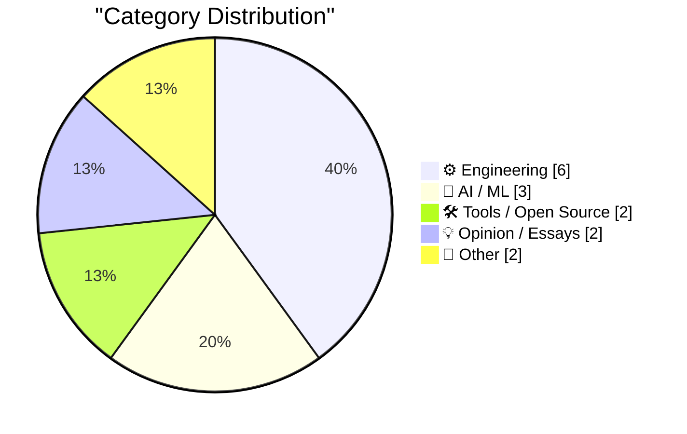
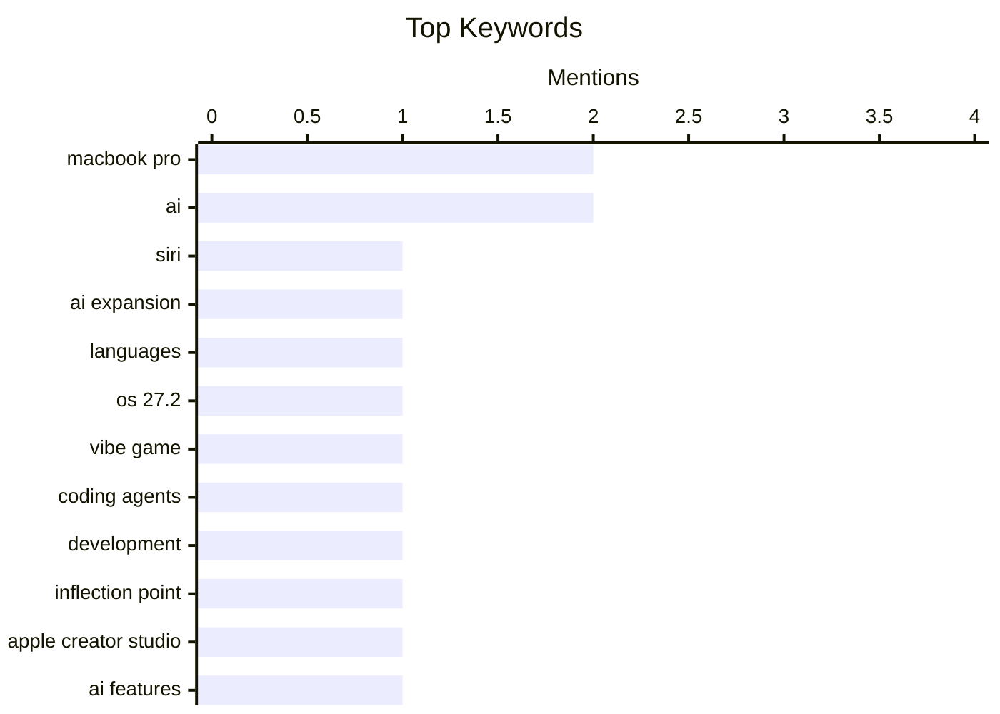

## Today's Highlights
Today's Highlights: The tech landscape is buzzing with significant advancements in AI, as Apple expands Siri's capabilities and enhances its Creator Studio with new AI features, showcasing a broader trend of integrating artificial intelligence into everyday tools. Meanwhile, the gaming industry is experiencing a pivotal shift in vibe coding, signaling a transformative moment for game development. As Apple unveils new MacBook Pro models, the emphasis on powerful hardware continues to drive innovation in creative and engineering fields.
---
## Must Read Today
1. **Siri AI Expands to More Languages in OS 27.2**
[Siri AI Expands to More Languages in OS 27.2](https://nr.apple.com/Du9G9W8Nq1) — daringfireball.net · 15h ago · 🤖 AI / ML
> Apple's latest software update, version 27.2, introduces a significantly enhanced Siri AI that now supports French, Japanese, Korean, Portuguese, and Spanish. This new version aims to provide a more capable, conversational, and personalized experience for users. However, Siri AI remains unavailable in the EU for iOS, iPadOS, and watchOS, as Apple seeks a resolution with EU regulators. The main takeaway is that Apple is expanding Siri's accessibility while navigating regulatory challenges in Europe.
💡 **Why read it**: This article is worth reading for insights into Apple's strategic expansion of Siri AI and its implications for global accessibility.
🏷️ Siri, AI expansion, languages, OS 27.2
2. **The October inflection point for vibe game development**
[The October inflection point for vibe game development](https://simonwillison.net/2026/Oct/28/vibe-game-development/) — simonwillison.net · 5m ago · ⚙️ Engineering
> The article discusses a pivotal moment in October 2026 for vibe coding in computer games, marking a significant evolution in game development tools. It highlights how advancements in AI, particularly with the introduction of Opus 4.5 and GPT-5.1, have made coding agents reliable for developers. This inflection point is characterized by improved user experiences and creative possibilities in game design. The conclusion emphasizes the transformative impact of these technologies on the future of game development.
💡 **Why read it**: This article is essential for understanding the latest trends in game development and the role of AI in shaping creative processes.
🏷️ vibe game, coding agents, development, inflection point
3. **Apple Creator Studio Updated With a Slew of AI Features, Along With a New Open JSON File Format for Keynote**
[Apple Creator Studio Updated With a Slew of AI Features, Along With a New Open JSON File Format for Keynote](https://www.apple.com/newsroom/2026/10/apple-creator-studio-adds-powerful-new-ai-features-and-even-more-creative-tools/) — daringfireball.net · 16h ago · 🛠 Tools / Open Source
> Apple has released significant updates to Apple Creator Studio, enhancing its suite of creative applications with new AI features and an open JSON file format for Keynote. The update includes built-in MotionVFX for Final Cut Pro, offering a wide range of visual effects and editing tools. These improvements aim to empower creators on Mac, iPad, and iPhone with more advanced capabilities. The main takeaway is that Apple is committed to providing cutting-edge tools for modern creators.
💡 **Why read it**: This article is valuable for creators looking to leverage new AI features and tools in their projects.
🏷️ Apple Creator Studio, AI features, JSON, Keynote
---
## Data Overview
| Sources Scanned | Articles Fetched | Time Window | Selected |
|:---:|:---:|:---:|:---:|
| 88/92 | 2638 -> 19 | 24h | **15** |
### Category Distribution

### Top Keywords

<details>
<summary>Plain Text Keyword Chart (Terminal Friendly)</summary>
```
macbook pro      │ ████████████████████ 2
ai               │ ████████████████████ 2
siri             │ ██████████░░░░░░░░░░ 1
ai expansion     │ ██████████░░░░░░░░░░ 1
languages        │ ██████████░░░░░░░░░░ 1
os 27.2          │ ██████████░░░░░░░░░░ 1
vibe game        │ ██████████░░░░░░░░░░ 1
coding agents    │ ██████████░░░░░░░░░░ 1
development      │ ██████████░░░░░░░░░░ 1
inflection point │ ██████████░░░░░░░░░░ 1
```
</details>
### Topic Tags
**macbook pro**(2) · **ai**(2) · **siri**(1) · ai expansion(1) · languages(1) · os 27.2(1) · vibe game(1) · coding agents(1) · development(1) · inflection point(1) · apple creator studio(1) · ai features(1) · json(1) · keynote(1) · oled(1) · m5 chip(1) · design(1) · apple(1) · m6(1) · performance(1)
---
## Engineering
### 1. The October inflection point for vibe game development
[The October inflection point for vibe game development](https://simonwillison.net/2026/Oct/28/vibe-game-development/) — **simonwillison.net** · 5m ago · ⭐ 24/30
> The article discusses a pivotal moment in October 2026 for vibe coding in computer games, marking a significant evolution in game development tools. It highlights how advancements in AI, particularly with the introduction of Opus 4.5 and GPT-5.1, have made coding agents reliable for developers. This inflection point is characterized by improved user experiences and creative possibilities in game design. The conclusion emphasizes the transformative impact of these technologies on the future of game development.
🏷️ vibe game, coding agents, development, inflection point
---
### 2. What’s Left for ‘Pro and Tell’ Week: Touch-Enabled OLED MacBooks
[What’s Left for ‘Pro and Tell’ Week: Touch-Enabled OLED MacBooks](https://www.macrumors.com/2026/10/27/macbook-pro-with-touchscreen-tomorrow/) — **daringfireball.net** · 20h ago · ⭐ 24/30
> Ahead of Apple's announcement, the article previews the upcoming 14-inch and 16-inch MacBook Pro models featuring touch-enabled OLED displays and M5 Pro and M5 Max chips. These models are expected to have thinner bezels and a Dynamic Island design, enhancing the user interface. The event is part of Apple's 'Pro and Tell' week, showcasing innovations in their hardware lineup. The conclusion suggests that these updates will significantly enhance the user experience for professionals.
🏷️ MacBook Pro, OLED, M5 chip, design
---
### 3. Apple Introduces New Base MacBook Pro With M6, 14-Inch-Only
[Apple Introduces New Base MacBook Pro With M6, 14-Inch-Only](https://www.apple.com/newsroom/2026/10/apple-introduces-the-new-14-inch-macbook-pro-with-m6/) — **daringfireball.net** · 22h ago · ⭐ 24/30
> Apple has launched a new 14-inch MacBook Pro powered by the M6 chip, which boasts a 12-core CPU and GPU designed for high performance and advanced AI capabilities. The M6 chip is touted as the world's fastest CPU core, enhancing productivity and demanding workflows. This model aims to cater to students and professionals seeking powerful computing solutions. The main takeaway is that Apple continues to push the boundaries of performance in its MacBook lineup.
🏷️ Apple, MacBook Pro, M6, performance
---
### 4. This Week in Source Control: 28 October 2026
[This Week in Source Control: 28 October 2026](https://nesbitt.io/2026/10/28/this-week-in-source-control.html) — **nesbitt.io** · 4h ago · ⭐ 17/30
> The article provides a roundup of recent releases, advisories, and articles related to version control and software forges. It highlights significant updates and trends in source control tools that are essential for developers. The main conclusion is that staying informed about these developments is crucial for effective software development practices. This resource serves as a valuable reference for developers seeking to enhance their source control knowledge.
🏷️ source control, releases, advisories, version control
---
### 5. Noctua Fan Swap on a Calnex Rb/GPS Frequency Reference
[Noctua Fan Swap on a Calnex Rb/GPS Frequency Reference](https://www.jeffgeerling.com/blog/2026/noctua-fan-swap-calnex-rb-gps-frequency-reference/) — **jeffgeerling.com** · 21h ago · ⭐ 15/30
> The article documents a fan replacement process on a Calnex Rb/GPS frequency reference device, highlighting a unique contribution to online resources. The author details the specific steps taken to swap out the original fan for a Noctua model, which is known for its quieter operation. This guide serves as a valuable reference for others attempting similar modifications on test equipment. The conclusion emphasizes the importance of documenting niche technical processes for community benefit.
🏷️ Noctua fan, Calnex, frequency reference, equipment
---
### 6. Apple Also Announces iMac With M6
[Apple Also Announces iMac With M6](https://www.apple.com/newsroom/2026/10/apple-unveils-new-imac-with-m6/) — **daringfireball.net** · 21h ago · ⭐ 14/30
> The article covers Apple's announcement of the new iMac featuring the M6 chip, which serves as a modest performance upgrade. It details the pricing and configuration options, including RAM and SSD choices, with base prices starting at $1500 for the M6 with 2 Thunderbolt ports. The article emphasizes that while the update is incremental, it still offers valuable enhancements for users. The conclusion is that the new iMac continues to provide solid performance for a range of users.
🏷️ iMac, M6 chip, pricing, configuration
---
## AI / ML
### 7. Siri AI Expands to More Languages in OS 27.2
[Siri AI Expands to More Languages in OS 27.2](https://nr.apple.com/Du9G9W8Nq1) — **daringfireball.net** · 15h ago · ⭐ 27/30
> Apple's latest software update, version 27.2, introduces a significantly enhanced Siri AI that now supports French, Japanese, Korean, Portuguese, and Spanish. This new version aims to provide a more capable, conversational, and personalized experience for users. However, Siri AI remains unavailable in the EU for iOS, iPadOS, and watchOS, as Apple seeks a resolution with EU regulators. The main takeaway is that Apple is expanding Siri's accessibility while navigating regulatory challenges in Europe.
🏷️ Siri, AI expansion, languages, OS 27.2
---
### 8. Inches & Miles
[Inches & Miles](https://feed.tedium.co/link/15204/17507724/ai-startups-sketchy-behavior) — **tedium.co** · 23h ago · ⭐ 21/30
> The article discusses the bold behaviors of AI startups in the current era, particularly regarding data usage without user consent. It highlights the ethical concerns surrounding data privacy and the responsibilities of startups in handling user information. The main conclusion is that the AI landscape is witnessing a resurgence of risky practices reminiscent of earlier tech booms. This serves as a cautionary tale for consumers and developers alike.
🏷️ AI, startups, data, privacy
---
### 9. Getting good at AI takes time and practice
[Getting good at AI takes time and practice](https://seangoedecke.com/getting-good-at-ai-takes-time-and-practice/) — **seangoedecke.com** · 14h ago · ⭐ 19/30
> The article addresses the misconception that mastering AI is a trivial pursuit, emphasizing the need for time and practice to truly understand and utilize AI technologies. It discusses the evolution of AI models and the learning curves associated with them. The conclusion reinforces that developing proficiency in AI is a gradual process requiring dedication and effort. This perspective is vital for aspiring AI practitioners.
🏷️ AI, practice, learning, skills
---
## Tools / Open Source
### 10. Apple Creator Studio Updated With a Slew of AI Features, Along With a New Open JSON File Format for Keynote
[Apple Creator Studio Updated With a Slew of AI Features, Along With a New Open JSON File Format for Keynote](https://www.apple.com/newsroom/2026/10/apple-creator-studio-adds-powerful-new-ai-features-and-even-more-creative-tools/) — **daringfireball.net** · 16h ago · ⭐ 24/30
> Apple has released significant updates to Apple Creator Studio, enhancing its suite of creative applications with new AI features and an open JSON file format for Keynote. The update includes built-in MotionVFX for Final Cut Pro, offering a wide range of visual effects and editing tools. These improvements aim to empower creators on Mac, iPad, and iPhone with more advanced capabilities. The main takeaway is that Apple is committed to providing cutting-edge tools for modern creators.
🏷️ Apple Creator Studio, AI features, JSON, Keynote
---
### 11. [Sponsor] WorkOS: Let Agents Sign Up for Your App Without a Browser
[[Sponsor] WorkOS: Let Agents Sign Up for Your App Without a Browser](https://workos.com/auth-md?utm_source=daringfireball&amp;utm_medium=newsletter&amp;utm_campaign=q42026) — **daringfireball.net** · 21h ago · ⭐ 16/30
> The article discusses the challenge of allowing agents to register for applications without a traditional browser interface. WorkOS introduces an 'auth.md' file that agents can read to self-register, providing them with scoped, short-lived credentials. This approach eliminates the need for user interruption during the signup process, streamlining agent integration. The main takeaway is that WorkOS simplifies the onboarding of agents into applications, enhancing user experience and efficiency.
🏷️ WorkOS, auth, agents, signup
---
## Opinion / Essays
### 12. I'm Full-Time Open Source Developer Now
[I'm Full-Time Open Source Developer Now](https://blog.miguelgrinberg.com/post/i-m-full-time-open-source-developer-now) — **miguelgrinberg.com** · 22h ago · ⭐ 22/30
> The author shares their transition to full-time open source development, managing 18 projects previously handled alongside a day job. This shift allows for greater focus on open source contributions and community engagement. The article serves as a call for support and awareness of the author's ongoing work in the open source space. The conclusion emphasizes the importance of community support in sustaining open source initiatives.
🏷️ open source, developer, projects, career
---
### 13. Quoting Terk Terkowitz
[Quoting Terk Terkowitz](https://simonwillison.net/2026/Oct/28/terk-terkowitz/) — **simonwillison.net** · 3h ago · ⭐ 18/30
> The article features a quote from Terk Terkowitz emphasizing that recognizing when AI tools do not benefit one's work is an important skill for engineers. It encourages professionals to document these instances and communicate them within their teams. This perspective highlights the importance of critical thinking in the adoption of AI technologies. The main takeaway is that engineers should leverage AI judiciously and be aware of its limitations.
🏷️ AI tooling, software engineer, documentation, community
---
## Other
### 14. The Unbalanced Group Theorem
[The Unbalanced Group Theorem](https://www.johndcook.com/blog/2026/10/28/the-unbalanced-group-theorem/) — **johndcook.com** · 2h ago · ⭐ 15/30
> The article explores the significance of the Unbalanced Group Theorem within the context of the classification of finite simple groups (CFSG). It highlights the monumental effort behind the proof of CFSG, which spanned decades and extensive literature. Recently, Axiom has formalized this proof, marking a significant milestone in mathematical research. The main takeaway is the ongoing relevance and complexity of group theory in modern mathematics.
🏷️ group theorem, mathematics, classification, proof
---
### 15. Game Boy Color on My Conference Badge
[Game Boy Color on My Conference Badge](https://simonwillison.net/2026/Oct/27/game-boy-color-on-my-conference-badge/) — **simonwillison.net** · 18h ago · ⭐ 13/30
> The article describes the author's experience with a conference badge that features a full-color screen computer, reminiscent of a Game Boy Color. The author shares insights into the hacking process and interactions with other attendees, showcasing the badge's capabilities. This creative use of technology at conferences highlights the intersection of nostalgia and modern tech innovation. The main takeaway is the potential for conference badges to serve as interactive and engaging tools for participants.
🏷️ Game Boy, conference badge, GitHub Universe, event
---
*Generated at 2026-10-28 14:00 | Scanned 88 sources -> 2638 articles -> selected 15*
*Based on the [Hacker News Popularity Contest 2025](https://refactoringenglish.com/tools/hn-popularity/) RSS source list recommended by [Andrej Karpathy](https://x.com/karpathy)*
*Produced by Dongdianr AI. Follow the same-name WeChat public account for more AI practical tips 💡*
