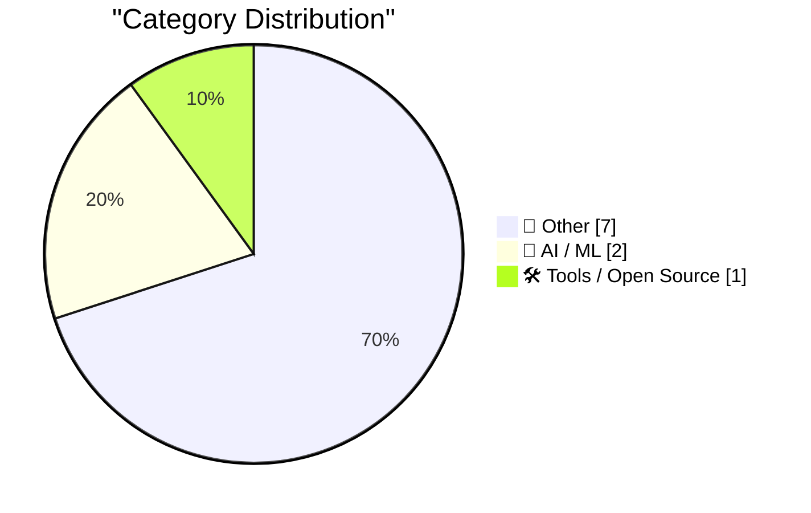
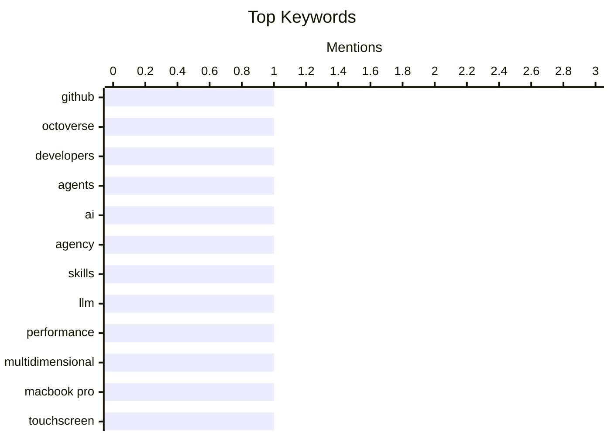

## Today's Highlights
Today's highlights reveal a surge in developer activity as showcased in GitHub's Octoverse 2026 report, underscoring the growing importance of collaborative coding environments. Meanwhile, the integration of AI into everyday tasks emphasizes the need for user agency and understanding of large language models, reflecting a shift towards more interactive and effective AI applications. Additionally, Apple's introduction of a touchscreen to the MacBook Pro signals a significant evolution in user interface design, merging traditional computing with modern touch technology.
---
## Must Read Today
1. **GitHub Octoverse 2026**
[GitHub Octoverse 2026](https://simonwillison.net/2026/Oct/28/github-octoverse-2026/) — simonwillison.net · 21h ago · 🛠 Tools / Open Source
> The GitHub Octoverse 2026 report highlights significant growth in developer activity, with commits and pushes reaching new highs. Key findings include a 25% increase in overall contributions and a notable rise in the use of AI tools among developers. The report emphasizes the importance of collaboration and the evolving landscape of software development. Overall, it showcases how developers are increasingly leveraging advanced tools to enhance productivity and innovation.
💡 **Why read it**: This article provides valuable insights into the latest trends in developer activity and the impact of AI on software development.
🏷️ GitHub, Octoverse, developers, agents
2. **You can just ask AI to do things**
[You can just ask AI to do things](https://seangoedecke.com/you-can-just-ask-ai-to-do-things/) — seangoedecke.com · 14h ago · 🤖 AI / ML
> The article discusses the importance of agency in effectively working with AI, emphasizing the need for users to experiment and embrace new possibilities. It argues that as AI models rapidly evolve, the ability to leverage these advancements is crucial for innovation. The author encourages readers to adopt a proactive mindset when interacting with AI technologies. Ultimately, the piece highlights that success in AI requires both creativity and a willingness to explore.
💡 **Why read it**: This article is worth reading for anyone looking to enhance their skills in utilizing AI effectively and creatively.
🏷️ AI, agency, skills
3. **Quoting Ted Sanders**
[Quoting Ted Sanders](https://simonwillison.net/2026/Oct/28/ted-sanders/) — simonwillison.net · 14h ago · 🤖 AI / ML
> Ted Sanders discusses the multidimensional performance of large language models (LLMs), noting that their effectiveness can vary significantly across different tasks. He highlights that model size is a primary factor influencing performance, with larger models generally offering better reliability and recall, albeit at a higher cost per token. The article concludes that understanding these dynamics is essential for optimizing the use of LLMs in various applications.
💡 **Why read it**: This article provides critical insights into the performance characteristics of LLMs, making it essential for developers and researchers in the AI field.
🏷️ LLM, performance, multidimensional
---
## Data Overview
| Sources Scanned | Articles Fetched | Time Window | Selected |
|:---:|:---:|:---:|:---:|
| 88/92 | 2638 -> 10 | 24h | **10** |
### Category Distribution

### Top Keywords

<details>
<summary>Plain Text Keyword Chart (Terminal Friendly)</summary>
```
github           │ ████████████████████ 1
octoverse        │ ████████████████████ 1
developers       │ ████████████████████ 1
agents           │ ████████████████████ 1
ai               │ ████████████████████ 1
agency           │ ████████████████████ 1
skills           │ ████████████████████ 1
llm              │ ████████████████████ 1
performance      │ ████████████████████ 1
multidimensional │ ████████████████████ 1
```
</details>
### Topic Tags
**github**(1) · **octoverse**(1) · **developers**(1) · agents(1) · ai(1) · agency(1) · skills(1) · llm(1) · performance(1) · multidimensional(1) · macbook pro(1) · touchscreen(1) · apple(1) · pdp(1) · history(1) · computers(1) · macbook(1) · studio(1) · oled(1) · ibm(1)
---
## Other
### 1. Steven Levy on the New MacBook Pro, With, Yes, a Touchscreen
[Steven Levy on the New MacBook Pro, With, Yes, a Touchscreen](https://www.wired.com/story/the-inside-story-of-why-apple-finally-brought-a-touch-display-to-the-mac/) — **daringfireball.net** · 9h ago · ⭐ 17/30
> The article reveals Apple's decision to introduce a touchscreen to the new MacBook Pro, marking a significant shift in the product's design philosophy. Apple executives emphasize that while the Mac remains primarily a keyboard and trackpad device, the touchscreen adds versatility for specific tasks. The piece discusses the balance Apple seeks to maintain between innovation and the traditional identity of the Mac. This development reflects Apple's broader strategy to integrate features from its mobile devices into the Mac lineup.
🏷️ MacBook Pro, touchscreen, Apple
---
### 2. Extremely brief history of PDP computers
[Extremely brief history of PDP computers](https://entropicthoughts.com/history-of-pdp-computers) — **entropicthoughts.com** · 15h ago · ⭐ 15/30
> This article provides a concise timeline of the history of PDP computers, highlighting their significance in early computing and hacker culture. It includes key details such as the PDP-1's experimental origins and the evolution of memory cycle times as a proxy for speed. The author presents the information in a visually intuitive format, making it accessible for readers interested in computing history. The piece underscores the impact of PDP machines on the development of modern computing.
🏷️ PDP, history, computers
---
### 3. Guessing the Name: MacBook Studio?
[Guessing the Name: MacBook Studio?](https://www.macrumors.com/2026/10/28/macbook-studio/) — **daringfireball.net** · 23h ago · ⭐ 14/30
> The article speculates on the potential naming of Apple's new touch-enabled MacBook models, suggesting 'MacBook Studio' as a likely candidate. It mentions an upcoming event where Apple will showcase these models to select tech reporters and content creators. The piece captures the anticipation surrounding Apple's product announcements and the significance of the new features. Ultimately, it reflects the ongoing evolution of Apple's product line in response to consumer demands.
🏷️ MacBook, Studio, OLED
---
### 4. IBM’s 2018 Red Hat acquisition
[IBM’s 2018 Red Hat acquisition](https://dfarq.homeip.net/ibms-2018-red-hat-acquisition/?utm_source=rss&#038;utm_medium=rss&#038;utm_campaign=ibms-2018-red-hat-acquisition) — **dfarq.homeip.net** · 3h ago · ⭐ 14/30
> This article revisits IBM's landmark acquisition of Red Hat for $34 billion, which was announced on October 28, 2018. It highlights the strategic importance of this acquisition for IBM's cloud computing ambitions and the impact it had on the open-source community. The piece also reflects on Red Hat's significant IPO history and its role in shaping the Linux landscape. The acquisition is framed as a pivotal moment in IBM's transformation into a cloud-centric company.
🏷️ IBM, Red Hat, acquisition
---
### 5. Deus ex machina
[Deus ex machina](https://blog.coredump.cx/p/deus-ex-machina) — **lcamtuf.substack.com** · 15h ago · ⭐ 9/30
> The article explores philosophical themes regarding reality and existence, suggesting that what is deemed real is often that which persists despite challenges. It delves into the implications of this perspective on technology and human experience. The piece invites readers to reflect on the nature of reality in an increasingly complex world. Ultimately, it encourages a deeper understanding of the forces that shape our perceptions.
🏷️ philosophy, reality
---
### 6. Fake it ‘til you make it (and then keep faking it)
[Fake it ‘til you make it (and then keep faking it)](https://www.experimental-history.com/p/fake-it-til-you-make-it-and-then) — **experimental-history.com** · 22h ago · ⭐ 8/30
> The article discusses the concept of 'faking it until you make it' in various contexts, emphasizing its relevance in personal and professional development. It highlights the importance of confidence and self-presentation in achieving success. The author argues that continual adaptation and reinvention are key to maintaining progress. The piece concludes that while authenticity is important, strategic self-presentation can also play a crucial role in achieving goals.
🏷️ fake it, updates
---
### 7. Exit Liquidity
[Exit Liquidity](https://www.wheresyoured.at/exit-liquidity/) — **wheresyoured.at** · 20h ago · ⭐ 7/30
> The article discusses the concept of exit liquidity in the context of financial markets, particularly focusing on the implications for investors and startups. It highlights the importance of understanding liquidity dynamics when planning exits and raises awareness about potential pitfalls. The piece emphasizes the need for strategic foresight in financial decision-making. Ultimately, it serves as a cautionary guide for investors navigating complex market conditions.
🏷️ liquidity, premium
---
## AI / ML
### 8. You can just ask AI to do things
[You can just ask AI to do things](https://seangoedecke.com/you-can-just-ask-ai-to-do-things/) — **seangoedecke.com** · 14h ago · ⭐ 23/30
> The article discusses the importance of agency in effectively working with AI, emphasizing the need for users to experiment and embrace new possibilities. It argues that as AI models rapidly evolve, the ability to leverage these advancements is crucial for innovation. The author encourages readers to adopt a proactive mindset when interacting with AI technologies. Ultimately, the piece highlights that success in AI requires both creativity and a willingness to explore.
🏷️ AI, agency, skills
---
### 9. Quoting Ted Sanders
[Quoting Ted Sanders](https://simonwillison.net/2026/Oct/28/ted-sanders/) — **simonwillison.net** · 14h ago · ⭐ 20/30
> Ted Sanders discusses the multidimensional performance of large language models (LLMs), noting that their effectiveness can vary significantly across different tasks. He highlights that model size is a primary factor influencing performance, with larger models generally offering better reliability and recall, albeit at a higher cost per token. The article concludes that understanding these dynamics is essential for optimizing the use of LLMs in various applications.
🏷️ LLM, performance, multidimensional
---
## Tools / Open Source
### 10. GitHub Octoverse 2026
[GitHub Octoverse 2026](https://simonwillison.net/2026/Oct/28/github-octoverse-2026/) — **simonwillison.net** · 21h ago · ⭐ 27/30
> The GitHub Octoverse 2026 report highlights significant growth in developer activity, with commits and pushes reaching new highs. Key findings include a 25% increase in overall contributions and a notable rise in the use of AI tools among developers. The report emphasizes the importance of collaboration and the evolving landscape of software development. Overall, it showcases how developers are increasingly leveraging advanced tools to enhance productivity and innovation.
🏷️ GitHub, Octoverse, developers, agents
---
*Generated at 2026-10-29 14:01 | Scanned 88 sources -> 2638 articles -> selected 10*
*Based on the [Hacker News Popularity Contest 2025](https://refactoringenglish.com/tools/hn-popularity/) RSS source list recommended by [Andrej Karpathy](https://x.com/karpathy)*
*Produced by Dongdianr AI. Follow the same-name WeChat public account for more AI practical tips 💡*
