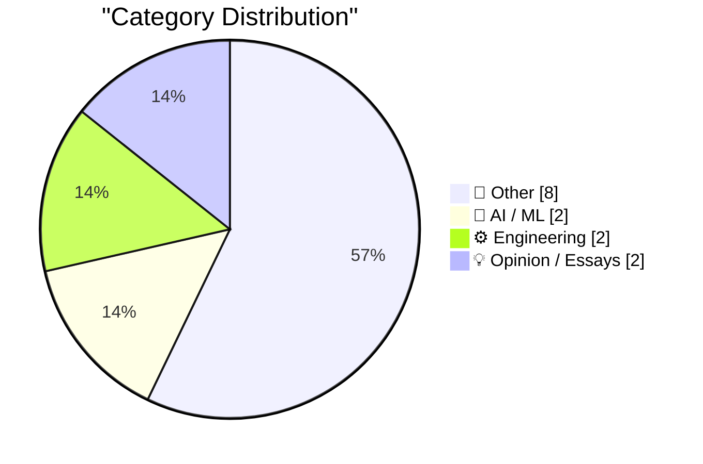
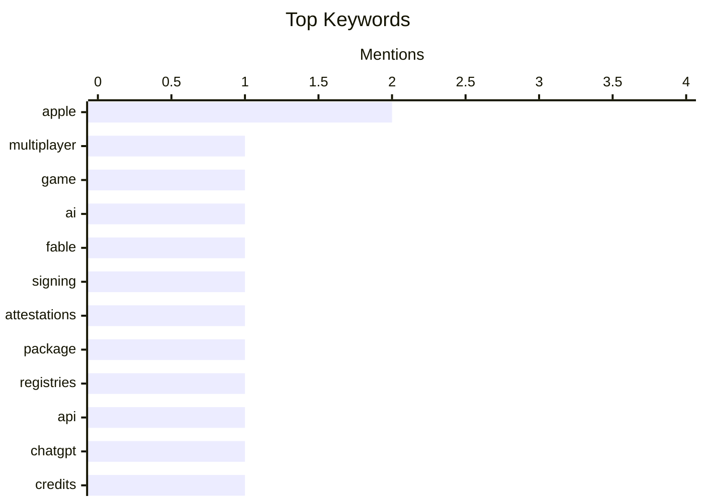

## Today's Highlights
Today's Highlights: The tech landscape is witnessing a surge in innovative gaming experiences, exemplified by the development of autonomous models for multiplayer environments. Concurrently, the competitive dynamics in the semiconductor industry are shifting, particularly as chip suppliers adapt to challenges posed by major players like Apple, which is also making headlines with its recent App Store commission reduction in Taiwan. These trends highlight a broader movement towards enhanced user engagement and evolving market strategies in the tech sector.
---
## Must Read Today
1. **Building a multiplayer game world with autonomous Fable-class models**
[Building a multiplayer game world with autonomous Fable-class models](https://simonwillison.net/2026/Oct/29/how-i-built-the-most-ai-pilled-company-in-the-world/) — simonwillison.net · 21h ago · 🤖 AI / ML
> The article discusses the development of Spawn, a massively multiplayer gaming environment leveraging autonomous Fable-class models. It highlights the innovative use of agentic engineering to create dynamic interactions between players and AI, allowing for a unique gaming experience. The author emphasizes the potential of these models to enhance player engagement and the complexity of game worlds. Ultimately, the piece illustrates how cutting-edge AI can transform multiplayer gaming landscapes.
💡 **Why read it**: This article is worth reading for insights into the intersection of AI and gaming, showcasing practical applications of advanced models in creating immersive environments.
🏷️ multiplayer, game, AI, Fable
2. **Signing and Attestations Across Package Registries**
[Signing and Attestations Across Package Registries](https://nesbitt.io/2026/10/30/signing-and-attestations-across-package-registries.html) — nesbitt.io · 4h ago · ⚙️ Engineering
> This article surveys the mechanisms of signing and provenance attestations across various package registries. It discusses the importance of trusted publishing and the challenges faced in ensuring package integrity and security. Key findings include the varying approaches taken by different registries and the need for standardized practices to enhance trustworthiness. The conclusion underscores the critical role of signing in maintaining the security of software supply chains.
💡 **Why read it**: This article is essential for developers and security professionals interested in understanding the complexities of package security and the importance of provenance in software development.
🏷️ signing, attestations, package, registries
3. **API credits benefit for eligible ChatGPT subscriptions**
[API credits benefit for eligible ChatGPT subscriptions](https://simonwillison.net/2026/Oct/29/api-credits/) — simonwillison.net · 15h ago · 🤖 AI / ML
> The article details a new benefit for eligible ChatGPT subscriptions, where subscribers receive API credits equivalent to their monthly subscription fees. This initiative by Anthropic aims to enhance user engagement by providing additional resources for utilizing their AI services. The credits are expiring, which encourages timely usage and experimentation with the API. The main takeaway is that this benefit significantly enhances the value proposition for subscribers, promoting broader adoption of AI tools.
💡 **Why read it**: This article is worth reading for those interested in maximizing their use of AI services and understanding the evolving landscape of subscription benefits in the tech industry.
🏷️ API, ChatGPT, credits, subscription
---
## Data Overview
| Sources Scanned | Articles Fetched | Time Window | Selected |
|:---:|:---:|:---:|:---:|
| 88/92 | 2639 -> 14 | 24h | **14** |
### Category Distribution

### Top Keywords

<details>
<summary>Plain Text Keyword Chart (Terminal Friendly)</summary>
```
apple        │ ████████████████████ 2
multiplayer  │ ██████████░░░░░░░░░░ 1
game         │ ██████████░░░░░░░░░░ 1
ai           │ ██████████░░░░░░░░░░ 1
fable        │ ██████████░░░░░░░░░░ 1
signing      │ ██████████░░░░░░░░░░ 1
attestations │ ██████████░░░░░░░░░░ 1
package      │ ██████████░░░░░░░░░░ 1
registries   │ ██████████░░░░░░░░░░ 1
api          │ ██████████░░░░░░░░░░ 1
```
</details>
### Topic Tags
**apple**(2) · **multiplayer**(1) · **game**(1) · ai(1) · fable(1) · signing(1) · attestations(1) · package(1) · registries(1) · api(1) · chatgpt(1) · credits(1) · subscription(1) · chip(1) · revenge(1) · suppliers(1) · app store(1) · commission(1) · taiwan(1) · elegance(1)
---
## Other
### 1. Rolfe Winkler at The WSJ: ‘The Beleaguered Chip Sellers Getting Their Revenge on Apple’
[Rolfe Winkler at The WSJ: ‘The Beleaguered Chip Sellers Getting Their Revenge on Apple’](https://www.wsj.com/tech/apple-iphone-memory-chips-ai-c0084cc9?st=FNAyaT) — **daringfireball.net** · 18h ago · ⭐ 19/30
> This article explores the competitive dynamics between chip suppliers and Apple, particularly focusing on the strategies employed by suppliers to gain leverage. It highlights the aggressive negotiation tactics used by suppliers, including creating competitive tensions among sales teams. The narrative illustrates how these tactics have shifted power dynamics in the semiconductor market, particularly in relation to Apple’s procurement strategies. The conclusion emphasizes the evolving landscape of supplier relationships and the impact on major tech companies.
🏷️ chip, Apple, revenge, suppliers
---
### 2. Apple Drops App Store Commission by a Whopping 4 Percentage Points in Taiwan
[Apple Drops App Store Commission by a Whopping 4 Percentage Points in Taiwan](https://developer.apple.com/news/?id=w9mxlhek) — **daringfireball.net** · 16h ago · ⭐ 18/30
> Apple has announced a reduction in the App Store commission rate from 30% to 26% for transactions in Taiwan, effective October 31, 2026. This change follows discussions with the Taiwan Fair Trade Commission and reflects Apple's ongoing adjustments to its business practices in response to regulatory pressures. The reduction aligns with similar changes made in Japan, indicating a broader strategy to enhance developer relations. The main takeaway is that Apple is actively adapting its commission structure to foster a more favorable environment for app developers.
🏷️ Apple, App Store, commission, Taiwan
---
### 3. Celebrating SIM Cards
[Celebrating SIM Cards](https://blog.jim-nielsen.com/2026/celebrating-sim-cards/) — **blog.jim-nielsen.com** · 19h ago · ⭐ 15/30
> The article recounts a personal experience involving the replacement of an old iPhone that used a SIM card, highlighting the simplicity of the SIM card transfer process. It details the steps taken to migrate the SIM from the old device to a new one, emphasizing the ease of this transition. The narrative serves as a reminder of the reliability and longevity of SIM cards in mobile technology. The conclusion celebrates small victories in everyday tech support scenarios.
🏷️ SIM cards, iPhone, family IT support
---
### 4. Quoting Ben Hylak
[Quoting Ben Hylak](https://simonwillison.net/2026/Oct/29/ben-hylak/) — **simonwillison.net** · 23h ago · ⭐ 13/30
> This article features a quote from Ben Hylak discussing the ideal of products functioning as headless systems feeding into an agent, minimizing user cognitive load. It humorously contrasts this with the author's own product, which is noted for its user-friendly interface. The piece reflects on the balance between complexity and usability in product design. The main takeaway is the ongoing conversation about user experience and the role of AI in simplifying interactions.
🏷️ quote, product, agent, UI
---
### 5. A Health Update From Craig Hockenberry
[A Health Update From Craig Hockenberry](https://furbo.org/2026/10/28/a-health-update/) — **daringfireball.net** · 18h ago · ⭐ 7/30
> Craig Hockenberry:

  If you noticed that the Iconfactory sites were kinda broken last
week, now you know why. It’s because I was kinda broken last week.
Now I’m finishing this post from a comfy cha
🏷️ health, update, WordPress, PHP
---
### 6. A New Kind of Chemistry
[A New Kind of Chemistry](https://www.construction-physics.com/p/a-new-kind-of-chemistry) — **construction-physics.com** · 22h ago · ⭐ 7/30
> Thanks to Kyle Schiller at Marathon Fusion for conversations and information that informed this essay.
🏷️ chemistry, construction, physics
---
### 7. The Space Shuttle Discovery’s Starboard Side ‘s’ Is Upside Down
[The Space Shuttle Discovery’s Starboard Side ‘s’ Is Upside Down](https://www.theautopian.com/a-typography-geek-pointed-out-something-about-the-space-shuttle-discovery-and-now-i-cant-unsee-it/) — **daringfireball.net** · 22h ago · ⭐ 4/30
> How Jason Snell beat me to linking to this, I don’t know. But like I said back in February, when it comes to signage, “Mind your P’s and Q’s” ought to be “Mind your H’s and S’s”.

 ★
🏷️ Space Shuttle, signage, upside down, letter
---
### 8. Book Review: The God of Small Things by Arundhati Roy ★★☆☆☆
[Book Review: The God of Small Things by Arundhati Roy ★★☆☆☆](https://shkspr.mobi/blog/2026/10/book-review-the-god-of-small-things-by-arundhati-roy/) — **shkspr.mobi** · 1h ago · ⭐ 4/30
> I did not care for this one bit. I found it cloying, infantilising, and far too circuitous.  It starts off as a bit of an overwritten melodrama, where every phrase is a delicious flower waiting to blo
🏷️ book review, Arundhati Roy, literature, critique
---
## AI / ML
### 9. Building a multiplayer game world with autonomous Fable-class models
[Building a multiplayer game world with autonomous Fable-class models](https://simonwillison.net/2026/Oct/29/how-i-built-the-most-ai-pilled-company-in-the-world/) — **simonwillison.net** · 21h ago · ⭐ 26/30
> The article discusses the development of Spawn, a massively multiplayer gaming environment leveraging autonomous Fable-class models. It highlights the innovative use of agentic engineering to create dynamic interactions between players and AI, allowing for a unique gaming experience. The author emphasizes the potential of these models to enhance player engagement and the complexity of game worlds. Ultimately, the piece illustrates how cutting-edge AI can transform multiplayer gaming landscapes.
🏷️ multiplayer, game, AI, Fable
---
### 10. API credits benefit for eligible ChatGPT subscriptions
[API credits benefit for eligible ChatGPT subscriptions](https://simonwillison.net/2026/Oct/29/api-credits/) — **simonwillison.net** · 15h ago · ⭐ 21/30
> The article details a new benefit for eligible ChatGPT subscriptions, where subscribers receive API credits equivalent to their monthly subscription fees. This initiative by Anthropic aims to enhance user engagement by providing additional resources for utilizing their AI services. The credits are expiring, which encourages timely usage and experimentation with the API. The main takeaway is that this benefit significantly enhances the value proposition for subscribers, promoting broader adoption of AI tools.
🏷️ API, ChatGPT, credits, subscription
---
## Engineering
### 11. Signing and Attestations Across Package Registries
[Signing and Attestations Across Package Registries](https://nesbitt.io/2026/10/30/signing-and-attestations-across-package-registries.html) — **nesbitt.io** · 4h ago · ⭐ 23/30
> This article surveys the mechanisms of signing and provenance attestations across various package registries. It discusses the importance of trusted publishing and the challenges faced in ensuring package integrity and security. Key findings include the varying approaches taken by different registries and the need for standardized practices to enhance trustworthiness. The conclusion underscores the critical role of signing in maintaining the security of software supply chains.
🏷️ signing, attestations, package, registries
---
### 12. When Federico Faggin left Intel
[When Federico Faggin left Intel](https://dfarq.homeip.net/when-federico-faggin-left-intel/?utm_source=rss&#038;utm_medium=rss&#038;utm_campaign=when-federico-faggin-left-intel) — **dfarq.homeip.net** · 3h ago · ⭐ 17/30
> This article commemorates the 52nd anniversary of Federico Faggin's departure from Intel, where he was a key figure in the development of early CPUs. It discusses his subsequent venture into creating the Zilog Z-80 CPU, which became a significant milestone in computing history. The piece reflects on Faggin's contributions to the semiconductor industry and his lasting impact on technology. The main takeaway is the importance of innovation and the personal journeys of pioneers in the tech field.
🏷️ Federico Faggin, Intel, Zilog Z-80
---
## Opinion / Essays
### 13. Elegance and intelligence are anticorrelated
[Elegance and intelligence are anticorrelated](https://seangoedecke.com/elegance-and-intelligence-are-anticorrelated/) — **seangoedecke.com** · 14h ago · ⭐ 17/30
> The article posits that there is a negative correlation between elegance and intelligence in problem-solving approaches. It argues that highly intelligent individuals may resort to brute-force solutions rather than seeking elegant, clever alternatives. Through anecdotes, including a story about John von Neumann, the piece illustrates how intelligence can sometimes lead to less refined solutions. The conclusion suggests that fostering elegance in problem-solving may require conscious effort, even from the most intelligent individuals.
🏷️ elegance, intelligence, solutions, problems
---
### 14. What I learned about power from LBJ and Robert Moses
[What I learned about power from LBJ and Robert Moses](https://www.dwarkesh.com/p/lessons-in-power) — **dwarkesh.com** · 21h ago · ⭐ 12/30
> The article shares insights gained from studying the power dynamics of historical figures LBJ and Robert Moses. It explores their strategies for wielding influence and the implications of their actions on politics and urban development. Key lessons include the importance of understanding the mechanisms of power and the ethical considerations involved. The conclusion emphasizes the relevance of these lessons in contemporary contexts.
🏷️ power, LBJ, Robert Moses
---
*Generated at 2026-10-30 14:01 | Scanned 88 sources -> 2639 articles -> selected 14*
*Based on the [Hacker News Popularity Contest 2025](https://refactoringenglish.com/tools/hn-popularity/) RSS source list recommended by [Andrej Karpathy](https://x.com/karpathy)*
*Produced by Dongdianr AI. Follow the same-name WeChat public account for more AI practical tips 💡*
