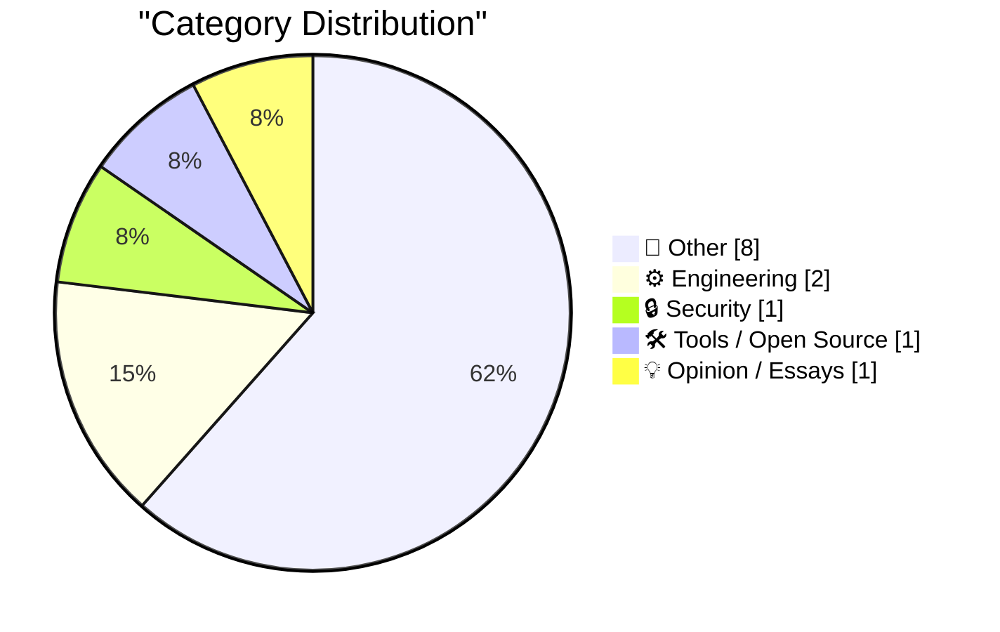
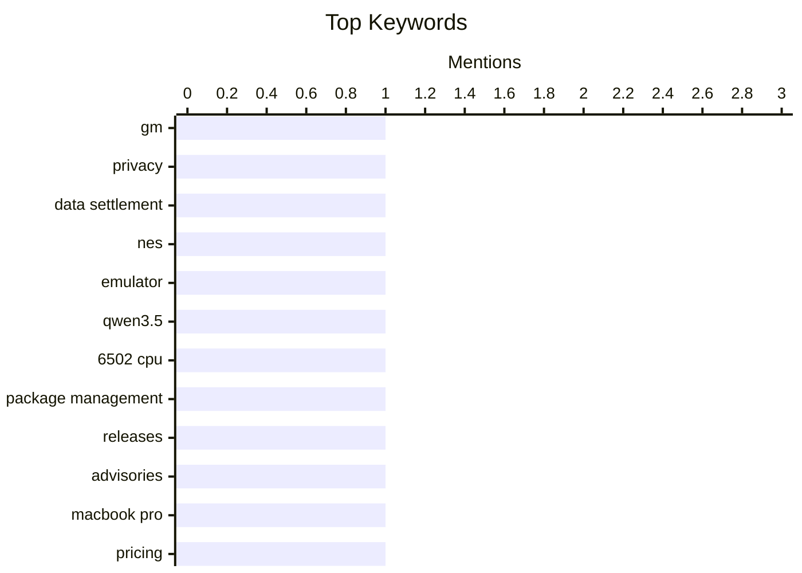

## Today's Highlights
Today's Highlights: Privacy concerns take center stage as General Motors faces a hefty $220 million settlement for mishandling driver data, highlighting the ongoing scrutiny of tech companies' ethical practices. Meanwhile, the tech landscape continues to evolve, with new developments in package management and the latest MacBook Pro configurations, reflecting a dynamic shift in consumer technology. As the job market adapts, discussions around affordable education in tech signal a potential transformation in workforce readiness for the future.
---
## Must Read Today
1. **GM to Pay $220 Million After Betraying Their Own Drivers’ Privacy**
[GM to Pay $220 Million After Betraying Their Own Drivers’ Privacy](https://www.reuters.com/business/autos-transportation/gm-pay-220-million-settle-allegations-it-violated-consumers-privacy-2026-10-29/) — daringfireball.net · 20h ago · 🔒 Security
> General Motors has agreed to pay $220 million to settle allegations of illegally selling drivers’ private behavior and location data. The settlement addresses claims from 35 US states and the District of Columbia regarding GM's Smart Driver program, which enrolled millions of drivers from 2016 onwards. The data was sold to brokers, who then provided it to insurers, potentially affecting insurance rates. This case highlights significant privacy concerns in the automotive industry. The main takeaway is the importance of consumer data protection and the consequences of failing to uphold privacy standards.
💡 **Why read it**: This article is worth reading for its insights into the implications of data privacy violations in the automotive sector and the legal repercussions faced by major corporations.
🏷️ GM, privacy, data settlement
2. **dbreunig/nesformer**
[dbreunig/nesformer](https://simonwillison.net/2026/Oct/30/nesformer/) — simonwillison.net · 16h ago · ⚙️ Engineering
> The article discusses the creation of an emulator for the Nintendo Entertainment System (NES) integrated into the weights of the Qwen3.5-4B model. Developed by Drew Breunig, this emulator allows users to play NES ROMs, such as Super Mario Bros, albeit at a slow pace. The project showcases innovative use of AI models for retro gaming emulation, blending classic gaming with modern technology. The main conclusion is that this integration represents a novel intersection of AI and gaming, expanding the capabilities of AI models.
💡 **Why read it**: This article is worth reading for those interested in the innovative applications of AI in gaming and the technical details behind integrating emulators into AI models.
🏷️ NES, emulator, Qwen3.5, 6502 CPU
3. **This Week in Package Management: 31 October 2026**
[This Week in Package Management: 31 October 2026](https://nesbitt.io/2026/10/31/this-week-in-package-management.html) — nesbitt.io · 4h ago · 🛠 Tools / Open Source
> This article provides a roundup of recent developments in the package management ecosystem, including new releases, advisories, and significant articles. It highlights updates from various package managers and trends affecting software distribution. The content serves as a valuable resource for developers and system administrators to stay informed about the latest changes and best practices in package management. The main takeaway is the importance of keeping up with package management updates to ensure software security and efficiency.
💡 **Why read it**: This article is worth reading for professionals in software development and IT who need to stay updated on package management trends and releases.
🏷️ package management, releases, advisories
---
## Data Overview
| Sources Scanned | Articles Fetched | Time Window | Selected |
|:---:|:---:|:---:|:---:|
| 88/92 | 2639 -> 13 | 24h | **13** |
### Category Distribution

### Top Keywords

<details>
<summary>Plain Text Keyword Chart (Terminal Friendly)</summary>
```
gm                 │ ████████████████████ 1
privacy            │ ████████████████████ 1
data settlement    │ ████████████████████ 1
nes                │ ████████████████████ 1
emulator           │ ████████████████████ 1
qwen3.5            │ ████████████████████ 1
6502 cpu           │ ████████████████████ 1
package management │ ████████████████████ 1
releases           │ ████████████████████ 1
advisories         │ ████████████████████ 1
```
</details>
### Topic Tags
**gm**(1) · **privacy**(1) · **data settlement**(1) · nes(1) · emulator(1) · qwen3.5(1) · 6502 cpu(1) · package management(1) · releases(1) · advisories(1) · macbook pro(1) · pricing(1) · configurations(1) · college(1) · education(1) · computer science(1) · easter eggs(1) · ipod(1) · apple music(1) · reading list(1)
---
## Other
### 1. The Only Good Easter Eggs Are Whole-Assed Easter Eggs
[The Only Good Easter Eggs Are Whole-Assed Easter Eggs](https://unsung.aresluna.org/apples-ipod-recreation/) — **daringfireball.net** · 20h ago · ⭐ 12/30
> The article analyzes a well-crafted easter egg recreation of the original iPod found on Apple Music’s website. It praises the attention to detail in the design, including accurate typography, haptic feedback, and functional features that mirror the original device. The author argues that this easter egg stands out due to its quality and thoroughness, making it an interesting case study. The main conclusion is that high-quality easter eggs can enhance user experience and engagement.
🏷️ Easter eggs, iPod, Apple Music
---
### 2. Reading List 10/31/26
[Reading List 10/31/26](https://www.construction-physics.com/p/reading-list-103126) — **construction-physics.com** · 1h ago · ⭐ 11/30
> This article presents a curated reading list covering various topics, including space fiber optic cable manufacturing, nuclear district heating, and China's advancements in space technology. It serves as a resource for readers interested in the latest developments in engineering and technology. The diverse range of subjects reflects current trends and innovations in multiple fields. The main takeaway is the importance of staying informed about advancements that could shape future technologies.
🏷️ reading list, space, nuclear
---
### 3. Sponsorship Openings for Daring Fireball (Including The Talk Show)
[Sponsorship Openings for Daring Fireball (Including The Talk Show)](https://daringfireball.net/feeds/sponsors/) — **daringfireball.net** · 15h ago · ⭐ 9/30
> The article discusses current sponsorship opportunities for Daring Fireball, noting a brisk sales pace for advertising slots. It highlights that the next opening is in late December, with Q1 2027 already filling up. The author invites potential sponsors with relevant products or services to reach out, especially for immediate openings. The main conclusion is that timely engagement can benefit sponsors looking to reach a targeted audience interested in quality and design.
🏷️ sponsorship, advertising, Daring Fireball
---
### 4. Gig Review: The Witcher in Concert ★★★★☆
[Gig Review: The Witcher in Concert ★★★★☆](https://shkspr.mobi/blog/2026/10/gig-review-the-witcher-in-concert/) — **shkspr.mobi** · 1h ago · ⭐ 9/30
> The article reviews a live concert performance of 'The Witcher,' which combines orchestral music with the video game experience. The author shares their enthusiasm for the unique format, having previously enjoyed similar events. The concert aims to enhance the emotional impact of the game through live music, creating a memorable experience for attendees. The main takeaway is that live orchestral performances can significantly elevate the enjoyment of video game narratives.
🏷️ concert, Witcher, music
---
### 5. Robert Caro – The master biographer reflects at 91
[Robert Caro – The master biographer reflects at 91](https://www.dwarkesh.com/p/robert-caro) — **dwarkesh.com** · 21h ago · ⭐ 9/30
> The article features reflections from renowned biographer Robert Caro as he discusses his extensive writing career and the challenges of editing his work. Caro emphasizes the importance of the material that is often cut from his biographies, suggesting that it holds significant value. His insights provide a glimpse into the meticulous process of biographical writing and the dedication required to capture a subject's essence. The main conclusion is that the craft of biography writing is deeply nuanced and requires careful consideration of what to include and exclude.
🏷️ biography, Robert Caro, writing
---
### 6. This Week on The Analog Antiquarian
[This Week on The Analog Antiquarian](https://www.filfre.net/2026/10/this-week-on-the-analog-antiquarian/) — **filfre.net** · 20h ago · ⭐ 7/30
> The article discusses various topics related to analog technology and its enthusiasts. It highlights recent developments, including new releases of vintage equipment and community events celebrating analog culture. The author emphasizes the ongoing relevance of analog technology in a digital age, showcasing its unique charm and appeal. The main takeaway is that analog technology continues to thrive and attract a dedicated following despite the prevalence of digital alternatives.
🏷️ analog, London, history
---
### 7. Johnston’s Electric Trains, St. Louis
[Johnston’s Electric Trains, St. Louis](https://dfarq.homeip.net/johnstons-electric-trains-st-louis/?utm_source=rss&#038;utm_medium=rss&#038;utm_campaign=johnstons-electric-trains-st-louis) — **dfarq.homeip.net** · 2h ago · ⭐ 7/30
> The article recounts the history of Johnston’s Electric Train Shop, a family-owned business in St. Louis that operated for about 50 years. It details the shop's role as the first hobby store in the area specializing in electric trains, serving as a community hub for enthusiasts. The narrative includes insights into the shop's impact on local hobbyists and its legacy in the model train community. The conclusion underscores the importance of such local businesses in preserving niche hobbies and fostering community engagement.
🏷️ trains, St. Louis, hobby shop
---
### 8. Patrick Stewart Dies at 86
[Patrick Stewart Dies at 86](https://www.hollywoodreporter.com/movies/movie-news/patrick-stewart-dead-star-trek-x-men-1236742932/) — **daringfireball.net** · 21h ago · ⭐ 6/30
> The article reports on the death of Patrick Stewart, a renowned actor known for his roles in 'Star Trek' and 'X-Men,' who passed away at the age of 86. It details his transition from a Shakespearean actor to a sci-fi icon and notes his struggle with Alzheimer's disease and Lewy body dementia. The piece reflects on his contributions to the arts and the impact he had on both theater and film. The main conclusion is that Stewart's legacy will endure through his iconic performances and the characters he brought to life.
🏷️ Patrick Stewart, obituary, actor
---
## Engineering
### 9. dbreunig/nesformer
[dbreunig/nesformer](https://simonwillison.net/2026/Oct/30/nesformer/) — **simonwillison.net** · 16h ago · ⭐ 24/30
> The article discusses the creation of an emulator for the Nintendo Entertainment System (NES) integrated into the weights of the Qwen3.5-4B model. Developed by Drew Breunig, this emulator allows users to play NES ROMs, such as Super Mario Bros, albeit at a slow pace. The project showcases innovative use of AI models for retro gaming emulation, blending classic gaming with modern technology. The main conclusion is that this integration represents a novel intersection of AI and gaming, expanding the capabilities of AI models.
🏷️ NES, emulator, Qwen3.5, 6502 CPU
---
### 10. ★ MacBook Pro Pricing and Configurations for M6, M5 Pro, and M5 Max
[★ MacBook Pro Pricing and Configurations for M6, M5 Pro, and M5 Max](https://daringfireball.net/2026/10/macbook_pro_pricing_and_configurations_for_m6_m5_pro_and_m5_max) — **daringfireball.net** · 16h ago · ⭐ 15/30
> The article organizes the pricing and configuration options for the latest MacBook Pro models featuring M6, M5 Pro, and M5 Max chips. It presents a comprehensive table that details various configurations, helping potential buyers make informed decisions. The author aims to provide clarity on the options available before sharing a more in-depth analysis of the redesigned hardware and display features. The main conclusion is that having a consolidated view of configurations aids consumers in navigating their purchasing choices.
🏷️ MacBook Pro, pricing, configurations
---
## Security
### 11. GM to Pay $220 Million After Betraying Their Own Drivers’ Privacy
[GM to Pay $220 Million After Betraying Their Own Drivers’ Privacy](https://www.reuters.com/business/autos-transportation/gm-pay-220-million-settle-allegations-it-violated-consumers-privacy-2026-10-29/) — **daringfireball.net** · 20h ago · ⭐ 27/30
> General Motors has agreed to pay $220 million to settle allegations of illegally selling drivers’ private behavior and location data. The settlement addresses claims from 35 US states and the District of Columbia regarding GM's Smart Driver program, which enrolled millions of drivers from 2016 onwards. The data was sold to brokers, who then provided it to insurers, potentially affecting insurance rates. This case highlights significant privacy concerns in the automotive industry. The main takeaway is the importance of consumer data protection and the consequences of failing to uphold privacy standards.
🏷️ GM, privacy, data settlement
---
## Tools / Open Source
### 12. This Week in Package Management: 31 October 2026
[This Week in Package Management: 31 October 2026](https://nesbitt.io/2026/10/31/this-week-in-package-management.html) — **nesbitt.io** · 4h ago · ⭐ 20/30
> This article provides a roundup of recent developments in the package management ecosystem, including new releases, advisories, and significant articles. It highlights updates from various package managers and trends affecting software distribution. The content serves as a valuable resource for developers and system administrators to stay informed about the latest changes and best practices in package management. The main takeaway is the importance of keeping up with package management updates to ensure software security and efficiency.
🏷️ package management, releases, advisories
---
## Opinion / Essays
### 13. College will only cost $20 a month
[College will only cost $20 a month](https://idiallo.com/blog/college-will-cost-20-dollars) — **idiallo.com** · 14h ago · ⭐ 15/30
> The article reflects on the changing landscape of tech job opportunities for recent computer science graduates, highlighting a stark contrast from the hiring boom of 2020-2022. The author expresses concern about the lack of job openings as these graduates prepare to enter the workforce, which could lead to disappointment. It emphasizes the need for realistic expectations in the current job market. The main takeaway is the importance of adaptability and awareness of market trends for students entering the tech field.
🏷️ college, education, computer science
---
*Generated at 2026-10-31 14:00 | Scanned 88 sources -> 2639 articles -> selected 13*
*Based on the [Hacker News Popularity Contest 2025](https://refactoringenglish.com/tools/hn-popularity/) RSS source list recommended by [Andrej Karpathy](https://x.com/karpathy)*
*Produced by Dongdianr AI. Follow the same-name WeChat public account for more AI practical tips 💡*
