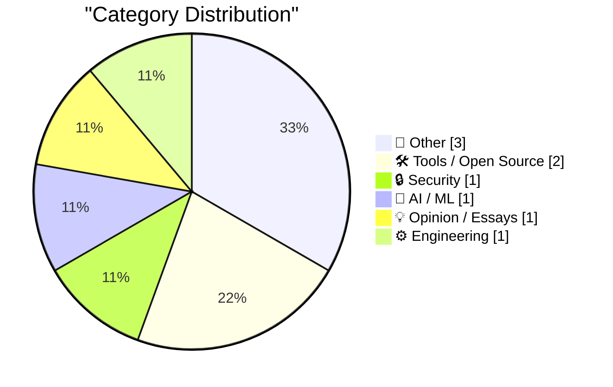
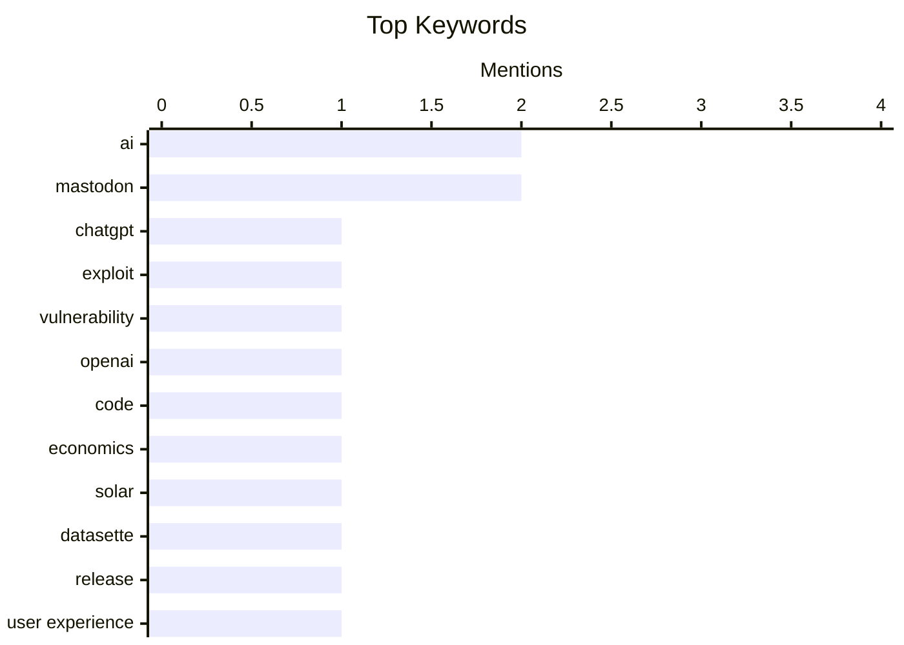

## Today's Highlights
Today's highlights reveal a growing focus on security vulnerabilities in AI applications, exemplified by a recent exploit in ChatGPT accounts. Additionally, the integration of AI in various sectors, such as coding and renewable energy, is gaining momentum, showcasing its potential to drive economic advancements. Meanwhile, the evolving landscape of social media, particularly with platforms like Mastodon, continues to spark discussions on reputation management and user experience.
---
## Must Read Today
1. **How We Took Over ChatGPT Accounts**
[How We Took Over ChatGPT Accounts](https://simonwillison.net/2026/Oct/31/how-we-took-over-chatgpt-accounts/) — simonwillison.net · 14h ago · 🔒 Security
> The article discusses a security exploit discovered in ChatGPT's implementation of the artifacts pattern, which OpenAI refers to as HTML previews. The authors detail how they were able to manipulate these previews to take control of ChatGPT accounts, highlighting the vulnerabilities in the system's design. They emphasize the importance of addressing these security gaps to protect user accounts and data. The main takeaway is that even advanced AI systems like ChatGPT can have critical security flaws that need urgent attention.
💡 **Why read it**: This article is worth reading for its insights into a significant security vulnerability in a widely used AI platform, demonstrating the potential risks associated with interactive web applications.
🏷️ ChatGPT, exploit, vulnerability, OpenAI
2. **Weekly Update 528: Reading AI-generated Code & the Economics of Solar**
[Weekly Update 528: Reading AI-generated Code & the Economics of Solar](https://www.troyhunt.com/weekly-update-528/) — troyhunt.com · 6h ago · 🤖 AI / ML
> This weekly update discusses the intersection of AI-generated code and the economics of solar energy, coinciding with recent headlines about Proton's CEO's management style. The author reflects on the implications of AI in software development and the ongoing debates surrounding its impact on the tech industry. The conclusion emphasizes the need for thoughtful leadership in navigating the challenges posed by AI technologies.
💡 **Why read it**: It's a timely exploration of the implications of AI in both coding and renewable energy sectors, offering insights into current industry trends.
🏷️ AI, code, economics, solar
3. **datasette-llm 0.1a9**
[datasette-llm 0.1a9](https://simonwillison.net/2026/Oct/31/datasette-llm/) — simonwillison.net · 15h ago · 🛠 Tools / Open Source
> The article announces the release of datasette-llm version 0.1a9, which includes a user experience improvement by automatically selecting the default model for the Datasette Agent. This update enhances the integration of the LLM plugin, streamlining the user experience for developers. The main takeaway is that this minor update significantly improves usability for those utilizing Datasette in their projects.
💡 **Why read it**: Developers using Datasette will find this update valuable as it simplifies the setup process for integrating LLM capabilities.
🏷️ Datasette, release, user experience, upgrade
---
## Data Overview
| Sources Scanned | Articles Fetched | Time Window | Selected |
|:---:|:---:|:---:|:---:|
| 87/92 | 2625 -> 9 | 24h | **9** |
### Category Distribution

### Top Keywords

<details>
<summary>Plain Text Keyword Chart (Terminal Friendly)</summary>
```
ai            │ ████████████████████ 2
mastodon      │ ████████████████████ 2
chatgpt       │ ██████████░░░░░░░░░░ 1
exploit       │ ██████████░░░░░░░░░░ 1
vulnerability │ ██████████░░░░░░░░░░ 1
openai        │ ██████████░░░░░░░░░░ 1
code          │ ██████████░░░░░░░░░░ 1
economics     │ ██████████░░░░░░░░░░ 1
solar         │ ██████████░░░░░░░░░░ 1
datasette     │ ██████████░░░░░░░░░░ 1
```
</details>
### Topic Tags
**ai**(2) · **mastodon**(2) · **chatgpt**(1) · exploit(1) · vulnerability(1) · openai(1) · code(1) · economics(1) · solar(1) · datasette(1) · release(1) · user experience(1) · upgrade(1) · bot(1) · ios shortcuts(1) · automation(1) · reputation(1) · tech(1) · projects(1) · career(1)
---
## Other
### 1. 10 Years on Mastodon
[10 Years on Mastodon](https://shkspr.mobi/blog/2026/11/10-years-on-mastodon/) — **shkspr.mobi** · 1h ago · ⭐ 12/30
> The article reflects on the author's decade-long experience with the Mastodon social network, highlighting its resilience compared to other fleeting platforms. It discusses the evolution of user interactions and the unique community aspects that have developed over the years. The conclusion celebrates the longevity of Mastodon as a viable alternative to mainstream social networks.
🏷️ Mastodon, social network, reflection, anniversary
---
### 2. Pluralistic: Formalities (31 Oct 2026)
[Pluralistic: Formalities (31 Oct 2026)](https://pluralistic.net/2026/10/31/burn-berne/) — **pluralistic.net** · 22h ago · ⭐ 9/30
> This article presents a collection of links and commentary on various topics, including AI and copyright issues, showcasing the evolving landscape of digital rights. It emphasizes the need for ongoing discussions about the implications of technology on society and legal frameworks. The main takeaway is the importance of staying informed about the intersections of technology, law, and ethics.
🏷️ AI, copyright, news, links
---
### 3. Report from the Vatican
[Report from the Vatican](https://garymarcus.substack.com/p/report-from-the-vatican) — **garymarcus.substack.com** · 22h ago · ⭐ 4/30
> The article recounts the author's meeting with Pope Leo XIV, sharing insights from this unique encounter. It reflects on the significance of the meeting in the context of contemporary issues faced by the Church and society. The conclusion highlights the importance of dialogue between faith and modern challenges.
🏷️ Vatican, Pope, meeting, report
---
## Tools / Open Source
### 4. datasette-llm 0.1a9
[datasette-llm 0.1a9](https://simonwillison.net/2026/Oct/31/datasette-llm/) — **simonwillison.net** · 15h ago · ⭐ 20/30
> The article announces the release of datasette-llm version 0.1a9, which includes a user experience improvement by automatically selecting the default model for the Datasette Agent. This update enhances the integration of the LLM plugin, streamlining the user experience for developers. The main takeaway is that this minor update significantly improves usability for those utilizing Datasette in their projects.
🏷️ Datasette, release, user experience, upgrade
---
### 5. A Mastodon bot powered by iOS Shortcuts
[A Mastodon bot powered by iOS Shortcuts](https://evanhahn.com/mastodon-bot-with-ios-shortcuts/) — **evanhahn.com** · 3h ago · ⭐ 16/30
> The article describes how the author created a Mastodon bot named Ulrira, which posts quotes from 'The Legend of Zelda: Link’s Awakening' using iOS Shortcuts instead of a server. This approach leverages the capabilities of iOS automation to manage social media interactions efficiently. The main conclusion is that iOS Shortcuts can effectively replace traditional server setups for simple bot functionalities.
🏷️ Mastodon, bot, iOS Shortcuts, automation
---
## Security
### 6. How We Took Over ChatGPT Accounts
[How We Took Over ChatGPT Accounts](https://simonwillison.net/2026/Oct/31/how-we-took-over-chatgpt-accounts/) — **simonwillison.net** · 14h ago · ⭐ 26/30
> The article discusses a security exploit discovered in ChatGPT's implementation of the artifacts pattern, which OpenAI refers to as HTML previews. The authors detail how they were able to manipulate these previews to take control of ChatGPT accounts, highlighting the vulnerabilities in the system's design. They emphasize the importance of addressing these security gaps to protect user accounts and data. The main takeaway is that even advanced AI systems like ChatGPT can have critical security flaws that need urgent attention.
🏷️ ChatGPT, exploit, vulnerability, OpenAI
---
## AI / ML
### 7. Weekly Update 528: Reading AI-generated Code & the Economics of Solar
[Weekly Update 528: Reading AI-generated Code & the Economics of Solar](https://www.troyhunt.com/weekly-update-528/) — **troyhunt.com** · 6h ago · ⭐ 21/30
> This weekly update discusses the intersection of AI-generated code and the economics of solar energy, coinciding with recent headlines about Proton's CEO's management style. The author reflects on the implications of AI in software development and the ongoing debates surrounding its impact on the tech industry. The conclusion emphasizes the need for thoughtful leadership in navigating the challenges posed by AI technologies.
🏷️ AI, code, economics, solar
---
## Opinion / Essays
### 8. Fast and slow ways to improve your reputation
[Fast and slow ways to improve your reputation](https://seangoedecke.com/how-to-get-assigned-interesting-work/) — **seangoedecke.com** · 14h ago · ⭐ 15/30
> This article addresses the paradox of building a reputation in tech, where one needs a good reputation to be assigned important projects, yet must work on significant projects to gain that reputation. The author provides strategies for engineers to navigate this challenge and highlights the importance of visibility and networking. The conclusion emphasizes that proactive efforts can help overcome initial barriers to gaining recognition in the tech industry.
🏷️ reputation, tech, projects, career
---
## Engineering
### 9. IBM PC/XT drives stuck in the bay? How to free them
[IBM PC/XT drives stuck in the bay? How to free them](https://dfarq.homeip.net/ibm-pc-xt-drives-stuck-in-the-bay-how-to-free-them/?utm_source=rss&#038;utm_medium=rss&#038;utm_campaign=ibm-pc-xt-drives-stuck-in-the-bay-how-to-free-them) — **dfarq.homeip.net** · 2h ago · ⭐ 13/30
> The article provides a practical guide for removing stuck floppy drives from IBM PC/XT models, specifically the 5160. It explains the common issue of drives getting stuck even after removing visible screws and offers step-by-step instructions to resolve the problem. The main takeaway is that with the right approach, users can successfully free their drives without damaging the hardware.
🏷️ IBM, PC/XT, floppy drive, repair
---
*Generated at 2026-11-01 14:01 | Scanned 87 sources -> 2625 articles -> selected 9*
*Based on the [Hacker News Popularity Contest 2025](https://refactoringenglish.com/tools/hn-popularity/) RSS source list recommended by [Andrej Karpathy](https://x.com/karpathy)*
*Produced by Dongdianr AI. Follow the same-name WeChat public account for more AI practical tips 💡*
