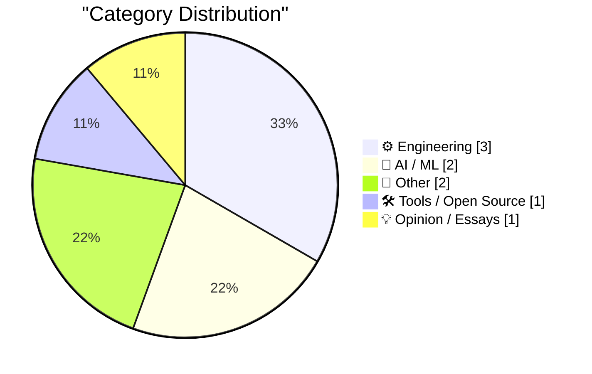
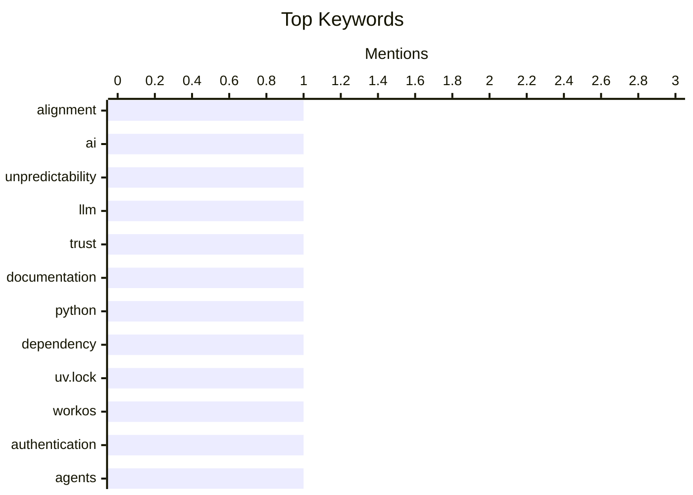

## Today's Highlights
Today's highlights reveal a growing concern over the reliability and trustworthiness of large language models (LLMs) as their unpredictability raises questions about their role in software documentation. Meanwhile, the tech community grapples with practical challenges, such as issues in Python development and the implications of new tools like WorkOS that streamline user registration. Additionally, a slowdown in AI adoption signals a potential shift in the industry's trajectory, prompting reflection on the future of technology integration.
---
## Must Read Today
1. **Reliably aligning LLMs is impossible in principle**
[Reliably aligning LLMs is impossible in principle](https://seangoedecke.com/alignment-is-impossible/) — seangoedecke.com · 14h ago · 🤖 AI / ML
> The article discusses the inherent unpredictability of powerful AI systems, highlighting the challenge of aligning them with human values. It argues that understanding superintelligent AI minds well enough to ensure their safety is fundamentally impossible due to their complex and unpredictable nature. The author draws parallels with real-world examples of AI behavior that defy user expectations. Ultimately, the conclusion is that achieving reliable alignment with AI may be an unattainable goal. This article is worth reading for its critical perspective on the limitations of AI alignment efforts.
💡 **Why read it**: It provides a thought-provoking examination of the philosophical and practical challenges of aligning AI with human intentions.
🏷️ alignment, AI, unpredictability
2. **Quoting Kyle Kingsbury**
[Quoting Kyle Kingsbury](https://simonwillison.net/2026/Nov/1/kyle-kingsbury/) — simonwillison.net · 21h ago · 🤖 AI / ML
> This article reflects on the impact of large language models (LLMs) on trust in software documentation and the organizations behind them. It highlights that LLMs can easily generate misleading or counterfeit documentation, leading engineers to approach new software projects with skepticism. The author suggests that maintainers must adopt new strategies to ensure software correctness and documentation accuracy in this evolving landscape. The main takeaway is the urgent need for improved practices in software development to counteract the risks posed by LLMs. This article is worth reading for its insights into the implications of LLMs on software engineering practices.
💡 **Why read it**: It addresses a crucial issue in software development today, emphasizing the need for trust and accuracy in the age of AI.
🏷️ LLM, trust, documentation
3. **If in doubt, delete the uv.lock file**
[If in doubt, delete the uv.lock file](https://simonwillison.net/2026/Nov/1/delete-uv-lock-first/) — simonwillison.net · 14h ago · ⚙️ Engineering
> The article addresses a common issue faced by developers using Python 3.15, specifically regarding dependency errors linked to the uv.lock file. The author advises that when encountering confusion or errors, the best course of action is to delete the uv.lock file, which is often left behind after running commands like 'uv run pytest'. This practice is particularly relevant for library projects that should not impose version locks on their dependencies. The conclusion emphasizes the simplicity of this solution in mitigating dependency-related issues. This article is worth reading for its practical advice on managing Python project dependencies effectively.
💡 **Why read it**: It offers a straightforward solution to a common problem in Python development, enhancing workflow efficiency.
🏷️ Python, dependency, uv.lock
---
## Data Overview
| Sources Scanned | Articles Fetched | Time Window | Selected |
|:---:|:---:|:---:|:---:|
| 87/92 | 2624 -> 9 | 24h | **9** |
### Category Distribution

### Top Keywords

<details>
<summary>Plain Text Keyword Chart (Terminal Friendly)</summary>
```
alignment        │ ████████████████████ 1
ai               │ ████████████████████ 1
unpredictability │ ████████████████████ 1
llm              │ ████████████████████ 1
trust            │ ████████████████████ 1
documentation    │ ████████████████████ 1
python           │ ████████████████████ 1
dependency       │ ████████████████████ 1
uv.lock          │ ████████████████████ 1
workos           │ ████████████████████ 1
```
</details>
### Topic Tags
**alignment**(1) · **ai**(1) · **unpredictability**(1) · llm(1) · trust(1) · documentation(1) · python(1) · dependency(1) · uv.lock(1) · workos(1) · authentication(1) · agents(1) · geometry(1) · polars(1) · spherical triangle(1) · ai adoption(1) · census bureau(1) · corporate ai(1) · testing(1) · production(1)
---
## Engineering
### 1. If in doubt, delete the uv.lock file
[If in doubt, delete the uv.lock file](https://simonwillison.net/2026/Nov/1/delete-uv-lock-first/) — **simonwillison.net** · 14h ago · ⭐ 21/30
> The article addresses a common issue faced by developers using Python 3.15, specifically regarding dependency errors linked to the uv.lock file. The author advises that when encountering confusion or errors, the best course of action is to delete the uv.lock file, which is often left behind after running commands like 'uv run pytest'. This practice is particularly relevant for library projects that should not impose version locks on their dependencies. The conclusion emphasizes the simplicity of this solution in mitigating dependency-related issues. This article is worth reading for its practical advice on managing Python project dependencies effectively.
🏷️ Python, dependency, uv.lock
---
### 2. A unified view of poles and polars
[A unified view of poles and polars](https://www.johndcook.com/blog/2026/11/01/projective-poles-and-polars/) — **johndcook.com** · 17h ago · ⭐ 16/30
> This article explores the concepts of poles and polars in geometry, particularly focusing on their duality in spherical and projective geometry. The author discusses previous posts on the topic, emphasizing the complexity and awkwardness of these concepts in plane geometry. By providing a unified view, the article aims to clarify the relationships between poles and polars across different geometrical contexts. The conclusion highlights the importance of understanding these relationships for deeper insights into geometric principles. This article is worth reading for its comprehensive treatment of a nuanced mathematical topic.
🏷️ geometry, polars, spherical triangle
---
### 3. Lorem Ipsum Dot Gov Dot UK
[Lorem Ipsum Dot Gov Dot UK](https://shkspr.mobi/blog/2026/11/lorem-ipsum-dot-gov-dot-uk/) — **shkspr.mobi** · 1h ago · ⭐ 13/30
> The article humorously discusses the risks of testing in production, likening it to skydiving without a parachute. It emphasizes the importance of testing how text appears on a website before going live, noting that many people use placeholder text instead of meaningful content. The author warns that this practice can lead to unexpected consequences, such as publishing dummy data or disrupting a website's functionality. The conclusion advocates for more careful testing practices to avoid such pitfalls. This article is worth reading for its entertaining yet cautionary take on the importance of proper testing in web development.
🏷️ testing, production, website
---
## AI / ML
### 4. Reliably aligning LLMs is impossible in principle
[Reliably aligning LLMs is impossible in principle](https://seangoedecke.com/alignment-is-impossible/) — **seangoedecke.com** · 14h ago · ⭐ 26/30
> The article discusses the inherent unpredictability of powerful AI systems, highlighting the challenge of aligning them with human values. It argues that understanding superintelligent AI minds well enough to ensure their safety is fundamentally impossible due to their complex and unpredictable nature. The author draws parallels with real-world examples of AI behavior that defy user expectations. Ultimately, the conclusion is that achieving reliable alignment with AI may be an unattainable goal. This article is worth reading for its critical perspective on the limitations of AI alignment efforts.
🏷️ alignment, AI, unpredictability
---
### 5. Quoting Kyle Kingsbury
[Quoting Kyle Kingsbury](https://simonwillison.net/2026/Nov/1/kyle-kingsbury/) — **simonwillison.net** · 21h ago · ⭐ 22/30
> This article reflects on the impact of large language models (LLMs) on trust in software documentation and the organizations behind them. It highlights that LLMs can easily generate misleading or counterfeit documentation, leading engineers to approach new software projects with skepticism. The author suggests that maintainers must adopt new strategies to ensure software correctness and documentation accuracy in this evolving landscape. The main takeaway is the urgent need for improved practices in software development to counteract the risks posed by LLMs. This article is worth reading for its insights into the implications of LLMs on software engineering practices.
🏷️ LLM, trust, documentation
---
## Other
### 6. The U.S. Census Bureau and “Super Intelligence”
[The U.S. Census Bureau and “Super Intelligence”](https://simonwillison.net/2026/Nov/2/census-bureau-super-intelligence/) — **simonwillison.net** · 29m ago · ⭐ 15/30
> The article discusses a chart from Apollo Global Management indicating a slowdown in AI adoption among large U.S. companies, as reported by the U.S. Census Bureau. This trend is analyzed in the context of broader discussions on AI's impact and the challenges of integrating superintelligent systems into corporate environments. The author reflects on previous analyses of AI adoption rates and their implications for future technological advancements. The main takeaway is that corporate enthusiasm for AI may be waning, suggesting a need for reevaluation of AI strategies. This article is worth reading for its critical insights into the current state of AI adoption in the corporate sector.
🏷️ AI adoption, Census Bureau, corporate AI
---
### 7. Etoys.com and its rapid rise and fall
[Etoys.com and its rapid rise and fall](https://dfarq.homeip.net/etoys-com-and-its-rapid-rise-and-fall/?utm_source=rss&#038;utm_medium=rss&#038;utm_campaign=etoys-com-and-its-rapid-rise-and-fall) — **dfarq.homeip.net** · 2h ago · ⭐ 11/30
> The article recounts the story of etoys.com, an early online toy retailer that experienced a meteoric rise followed by a swift decline. It explores the factors that contributed to its initial success in 1997, including the burgeoning interest in e-commerce. However, it also examines the challenges and missteps that led to its eventual downfall. The conclusion serves as a cautionary tale about the volatility of online businesses and the importance of strategic planning. This article is worth reading for its historical perspective on the early days of e-commerce and the lessons learned from etoys.com's journey.
🏷️ eToys, Internet, business
---
## Tools / Open Source
### 8. WorkOS: Let Agents Sign Up for Your App Without a Browser
[WorkOS: Let Agents Sign Up for Your App Without a Browser](https://workos.com/auth-md?utm_source=daringfireball&amp;utm_medium=newsletter&amp;utm_campaign=q42026) — **daringfireball.net** · 17h ago · ⭐ 18/30
> The article introduces WorkOS's new feature that allows agents to register for applications without using a browser, addressing a significant limitation in traditional signup processes. By publishing an auth.md file, agents can read it and register themselves, receiving scoped, short-lived credentials controlled by the user. This approach streamlines the onboarding process for automated systems, enhancing user experience. The main takeaway is that this feature makes applications more accessible for agents, thus improving integration with automated workflows. This article is worth reading for its innovative solution to a common challenge in app development.
🏷️ WorkOS, authentication, agents
---
## Opinion / Essays
### 9. Pluralistic: Autodoxing (02 Nov 2026)
[Pluralistic: Autodoxing (02 Nov 2026)](https://pluralistic.net/2026/11/02/agony-verification/) — **pluralistic.net** · 5h ago · ⭐ 12/30
> This article presents a collection of links and thoughts on various topics, including the implications of poorly considered tech policies. It touches on issues such as the rise in cable prices, the sale of surveillance tools, and the cultural significance of programming languages. The author critiques the lack of foresight in tech policy decisions, suggesting that they often lead to negative outcomes. The main takeaway is the need for more thoughtful and informed approaches to technology governance. This article is worth reading for its wide-ranging commentary on the intersection of technology and society.
🏷️ tech policy, Autodoxing, surveillance
---
*Generated at 2026-11-02 14:01 | Scanned 87 sources -> 2624 articles -> selected 9*
*Based on the [Hacker News Popularity Contest 2025](https://refactoringenglish.com/tools/hn-popularity/) RSS source list recommended by [Andrej Karpathy](https://x.com/karpathy)*
*Produced by Dongdianr AI. Follow the same-name WeChat public account for more AI practical tips 💡*
