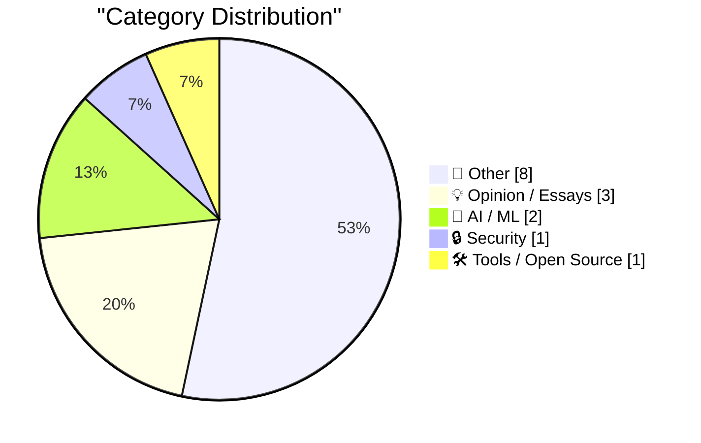
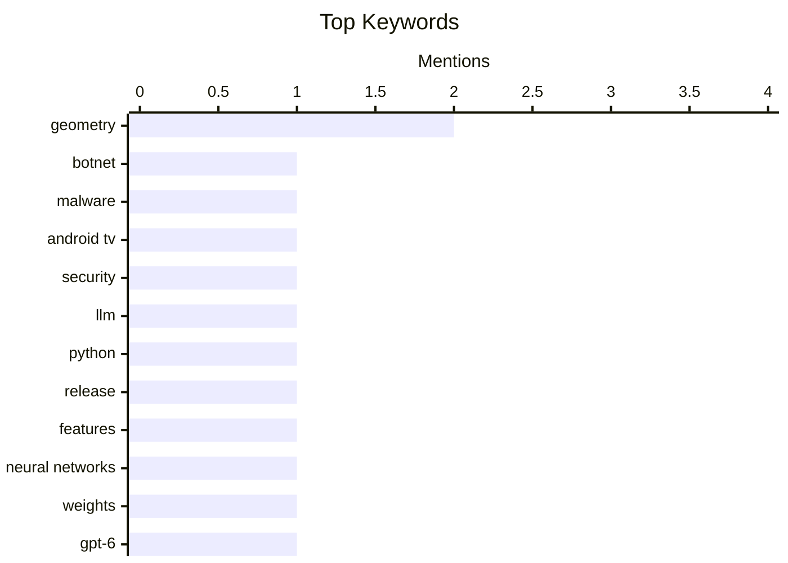

## Today's Highlights
Today's Highlights: A significant collaboration among tech firms has led to the dismantling of a massive botnet, showcasing the ongoing battle against cyber threats. Meanwhile, the latest advancements in AI are sparking debates about the limitations of large language models and the concept of AI resistance, as experts urge caution in their deployment. In the business realm, Apple's record fourth-quarter earnings underscore the tech giant's resilience and growth amidst a shifting economic landscape.
---
## Must Read Today
1. **Tech Firms Dismantle Botnet That Turned 1.3M TV Boxes Into Proxies**
[Tech Firms Dismantle Botnet That Turned 1.3M TV Boxes Into Proxies](https://krebsonsecurity.com/2026/11/tech-firms-dismantle-botnet-that-turned-1-3m-tv-boxes-into-proxies/) — krebsonsecurity.com · 11h ago · 🔒 Security
> A collaborative effort by tech firms, including Google, has successfully dismantled a botnet comprised of over 1.3 million compromised Android TV set-top boxes. This botnet was exploiting users' internet connections for advertising fraud and was linked to more than 10 million additional compromised devices, including IoT products. The takedown highlights the vulnerabilities present in consumer electronics and the ongoing battle against cybercrime. The operation underscores the importance of industry collaboration in addressing large-scale security threats.
💡 **Why read it**: This article provides insight into a significant cybersecurity operation that reveals the scale of IoT vulnerabilities and the collaborative efforts required to combat such threats.
🏷️ botnet, malware, Android TV, security
2. **llm 0.37**
[llm 0.37](https://simonwillison.net/2026/Nov/2/llm/) — simonwillison.net · 14h ago · 🤖 AI / ML
> The latest release of the LLM CLI tool and Python library, version 0.37, introduces numerous features and fixes accumulated over two months. Key additions include support for models like 'gpt-6.1-sol' and 'gpt-6.1-terra', along with a new command for configuring OpenAI-compatible models. This update enhances the tool's capabilities for developers working with large language models. The release reflects ongoing improvements in usability and functionality for LLM users.
💡 **Why read it**: This article is essential for developers interested in the latest advancements in LLM tools, showcasing new features that can enhance their projects.
🏷️ LLM, Python, release, features
3. **LLMs are not superhuman at reading and writing neural network weights**
[LLMs are not superhuman at reading and writing neural network weights](https://seangoedecke.com/llms-are-not-superhuman-at-reading-and-writing-neural-network-weights/) — seangoedecke.com · 14h ago · 🤖 AI / ML
> A recent paper challenges the notion that large language models (LLMs) like GPT-6 Astra can directly manipulate neural network weights in a superhuman manner. The study reveals that while Astra can interact with small neural networks effectively, it does not surpass human or traditional algorithmic capabilities. This finding emphasizes the limitations of LLMs in understanding and working with neural network architectures. Ultimately, it calls for a more nuanced view of LLM capabilities in AI research.
💡 **Why read it**: This article is worth reading for those interested in the limitations and capabilities of LLMs, providing a critical perspective on their role in AI development.
🏷️ neural networks, weights, GPT-6, research
---
## Data Overview
| Sources Scanned | Articles Fetched | Time Window | Selected |
|:---:|:---:|:---:|:---:|
| 86/92 | 2611 -> 18 | 24h | **15** |
### Category Distribution

### Top Keywords

<details>
<summary>Plain Text Keyword Chart (Terminal Friendly)</summary>
```
geometry        │ ████████████████████ 2
botnet          │ ██████████░░░░░░░░░░ 1
malware         │ ██████████░░░░░░░░░░ 1
android tv      │ ██████████░░░░░░░░░░ 1
security        │ ██████████░░░░░░░░░░ 1
llm             │ ██████████░░░░░░░░░░ 1
python          │ ██████████░░░░░░░░░░ 1
release         │ ██████████░░░░░░░░░░ 1
features        │ ██████████░░░░░░░░░░ 1
neural networks │ ██████████░░░░░░░░░░ 1
```
</details>
### Topic Tags
**geometry**(2) · **botnet**(1) · **malware**(1) · android tv(1) · security(1) · llm(1) · python(1) · release(1) · features(1) · neural networks(1) · weights(1) · gpt-6(1) · research(1) · ai(1) · resistance(1) · ethics(1) · technology(1) · apple(1) · earnings(1) · revenue(1)
---
## Other
### 1. Apple Announces Record $114.5B Fourth-Quarter Results
[Apple Announces Record $114.5B Fourth-Quarter Results](https://sixcolors.com/post/2026/11/apple-announces-record-114-5b-fourth-quarter-results/) — **daringfireball.net** · 13h ago · ⭐ 17/30
> Apple reported a record fourth-quarter revenue of $114.5 billion, marking a 12% increase from the previous year. Notable revenue growth was seen in iPhone sales (up 17.5%) and Mac sales (up 23.7%), while wearables and iPad sales experienced declines of 7.9% and 10.4%, respectively. This financial performance highlights Apple's resilience and strong demand for its flagship products. The results underscore the company's ability to navigate market challenges effectively.
🏷️ Apple, earnings, revenue, financial results
---
### 2. I discovered a sound that leaks your exact location (and it's everywhere) - YouTube
[I discovered a sound that leaks your exact location (and it's everywhere) - YouTube](https://simonwillison.net/2026/Nov/3/a-sound-that-leaks-your-exact-location/) — **simonwillison.net** · 8h ago · ⭐ 15/30
> The article discusses a unique OSINT technique demonstrated by Colsto, which uses background noise from videos to pinpoint exact locations. By analyzing the Doppler curves of planes in the audio track and cross-referencing with ADS-B data, the method reveals the video's geographical context. This innovative approach showcases the potential of sound analysis in location tracking. The findings raise concerns about privacy and the implications of such techniques in surveillance.
🏷️ OSINT, location, sound, privacy
---
### 3. How a programming might reinvent the projective plane
[How a programming might reinvent the projective plane](https://www.johndcook.com/blog/2026/11/03/hack-to-rigor/) — **johndcook.com** · 3h ago · ⭐ 15/30
> The article presents a programming hack that could lead to a rigorous definition of the projective plane by adding 'points at infinity' to the Euclidean plane. This approach addresses exceptional cases in geometric constructions, enhancing the understanding of projective geometry. The discussion illustrates the interplay between programming and mathematical concepts, suggesting new avenues for exploration in geometry. The insights could inspire further research in mathematical definitions and applications.
🏷️ projective plane, programming, geometry
---
### 4. Euclidean, Spherical, and Projective Geometry
[Euclidean, Spherical, and Projective Geometry](https://www.johndcook.com/blog/2026/11/03/spherical-and-projective-geometry/) — **johndcook.com** · 1h ago · ⭐ 14/30
> The article explores the relationships between Euclidean, spherical, and projective geometries, emphasizing their interconnectedness. It revisits the foundational principles of Euclidean geometry and introduces concepts from non-Euclidean geometry to illustrate their relevance. By examining these geometrical frameworks, the piece provides insights into their applications and theoretical implications. The discussion enhances the reader's understanding of geometric concepts and their evolution.
🏷️ geometry, Euclidean, spherical
---
### 5. Making peace with the projective plane
[Making peace with the projective plane](https://www.johndcook.com/blog/2026/11/02/projective-plane/) — **johndcook.com** · 23h ago · ⭐ 13/30
> The article discusses the projective plane and its significance in mathematics, particularly in relation to homogeneous coordinates. The author reflects on how these concepts were initially perceived as abstract but later recognized as natural frameworks for understanding geometry. Key insights include the connection between projective space and real-world applications, emphasizing its utility in various mathematical fields. Ultimately, the piece advocates for a deeper appreciation of projective geometry as a foundational element in advanced mathematics.
🏷️ projective space, coordinates, abstractions
---
### 6. How to install an app on your Commodore 64
[How to install an app on your Commodore 64](https://anildash.com/2026/10/08/install-an-app-commodore-64/) — **anildash.com** · 12h ago · ⭐ 11/30
> The article provides a nostalgic guide on installing programs on a Commodore 64, reflecting the computing practices of the 1980s. It details the process of obtaining software from magazines like COMPUTE!’s Gazette and RUN, highlighting the limited distribution channels available at the time. The author emphasizes the need for patience and resourcefulness in navigating the installation process. This piece serves as a historical snapshot of early computing culture and the challenges faced by users.
🏷️ Commodore 64, install, programs
---
### 7. October sponsors-only newsletter
[October sponsors-only newsletter](https://simonwillison.net/2026/Nov/3/october-newsletter/) — **simonwillison.net** · 8h ago · ⭐ 9/30
> The October newsletter from Simon Willison covers several key topics relevant to sponsors, including developments in vibe game development and the ongoing 'vulnerability apocalypse.' It also discusses recent releases of large language models (LLMs) and offers insights into API credits for high-tier subscriptions. The newsletter serves as a resource for sponsors to stay informed about critical trends and updates in technology and development. The main conclusion is that the landscape of software and security is rapidly evolving, necessitating ongoing engagement.
🏷️ newsletter, sponsorship, updates
---
### 8. Charles Tandy, the mastermind behind Radio Shack
[Charles Tandy, the mastermind behind Radio Shack](https://dfarq.homeip.net/charles-tandy-the-mastermind-behind-radio-shack/?utm_source=rss&#038;utm_medium=rss&#038;utm_campaign=charles-tandy-the-mastermind-behind-radio-shack) — **dfarq.homeip.net** · 2h ago · ⭐ 9/30
> The article explores the life and contributions of Charles Tandy, the influential figure behind the Tandy Corporation and Radio Shack. It outlines his role in expanding retail operations and shaping the electronics industry during his tenure. Key achievements include the establishment of Radio Shack as a leading retailer of consumer electronics. The piece concludes by recognizing Tandy's lasting impact on the retail landscape and his legacy in the tech community.
🏷️ Charles Tandy, Radio Shack, history
---
## Opinion / Essays
### 9. Just a little AI resistance, as a treat
[Just a little AI resistance, as a treat](https://shkspr.mobi/blog/2026/11/just-a-little-ai-resistance-as-a-treat/) — **shkspr.mobi** · 1h ago · ⭐ 18/30
> The article discusses the concept of AI resistance, highlighted by Professor Kate Devlin's AI Resist List, which aims to critique poor implementations of AI. The author shares personal experiences of contacting companies like Ocado regarding issues with malformed calendar invites, emphasizing the need for accountability in AI applications. This initiative seeks to foster discussions around ethical AI usage and consumer rights. The piece advocates for proactive engagement in addressing AI-related problems.
🏷️ AI, resistance, ethics, technology
---
### 10. Audience capture
[Audience capture](https://seangoedecke.com/audience-capture/) — **seangoedecke.com** · 14h ago · ⭐ 16/30
> The article explores the phenomenon of audience capture, where writers feel pressured to cater to engagement metrics that can distort their authentic voice. The author reflects on the challenges of maintaining integrity while striving for higher engagement in online writing. This discussion highlights the tension between creative expression and audience expectations in the digital age. Ultimately, it calls for a balance between engagement and authenticity in content creation.
🏷️ audience capture, writing, engagement
---
### 11. Prove you are not a child
[Prove you are not a child](https://idiallo.com/blog/prove-you-are-not-a-child) — **idiallo.com** · 14h ago · ⭐ 13/30
> The article argues for banning social media for children while expressing concerns about the enforcement methods required to differentiate age groups. The author highlights the risks associated with personal data collection in the current digital landscape. This discussion raises important questions about privacy, data ethics, and the implications of social media on youth. The piece advocates for a reevaluation of social media's role in society, particularly concerning children's safety.
🏷️ social media, children, enforcement, ban
---
## AI / ML
### 12. llm 0.37
[llm 0.37](https://simonwillison.net/2026/Nov/2/llm/) — **simonwillison.net** · 14h ago · ⭐ 26/30
> The latest release of the LLM CLI tool and Python library, version 0.37, introduces numerous features and fixes accumulated over two months. Key additions include support for models like 'gpt-6.1-sol' and 'gpt-6.1-terra', along with a new command for configuring OpenAI-compatible models. This update enhances the tool's capabilities for developers working with large language models. The release reflects ongoing improvements in usability and functionality for LLM users.
🏷️ LLM, Python, release, features
---
### 13. LLMs are not superhuman at reading and writing neural network weights
[LLMs are not superhuman at reading and writing neural network weights](https://seangoedecke.com/llms-are-not-superhuman-at-reading-and-writing-neural-network-weights/) — **seangoedecke.com** · 14h ago · ⭐ 22/30
> A recent paper challenges the notion that large language models (LLMs) like GPT-6 Astra can directly manipulate neural network weights in a superhuman manner. The study reveals that while Astra can interact with small neural networks effectively, it does not surpass human or traditional algorithmic capabilities. This finding emphasizes the limitations of LLMs in understanding and working with neural network architectures. Ultimately, it calls for a more nuanced view of LLM capabilities in AI research.
🏷️ neural networks, weights, GPT-6, research
---
## Security
### 14. Tech Firms Dismantle Botnet That Turned 1.3M TV Boxes Into Proxies
[Tech Firms Dismantle Botnet That Turned 1.3M TV Boxes Into Proxies](https://krebsonsecurity.com/2026/11/tech-firms-dismantle-botnet-that-turned-1-3m-tv-boxes-into-proxies/) — **krebsonsecurity.com** · 11h ago · ⭐ 29/30
> A collaborative effort by tech firms, including Google, has successfully dismantled a botnet comprised of over 1.3 million compromised Android TV set-top boxes. This botnet was exploiting users' internet connections for advertising fraud and was linked to more than 10 million additional compromised devices, including IoT products. The takedown highlights the vulnerabilities present in consumer electronics and the ongoing battle against cybercrime. The operation underscores the importance of industry collaboration in addressing large-scale security threats.
🏷️ botnet, malware, Android TV, security
---
## Tools / Open Source
### 15. [Sponsor] OurCal
[[Sponsor] OurCal](https://ourcal.com/?utm_source=daringfireball&amp;utm_medium=sponsorship&amp;utm_content=rssitem) — **daringfireball.net** · 15h ago · ⭐ 11/30
> OurCal addresses the communication gap in shared calendars by integrating group chat functionalities with calendar management. The application automatically posts changes to a group chat, ensuring that all members are updated in real-time. It is built using native SwiftUI for Apple platforms and features end-to-end encryption certified by France’s cybersecurity agency. The main takeaway is that OurCal enhances scheduling efficiency while prioritizing user privacy and security.
🏷️ calendar, messaging, scheduling, encryption
---
*Generated at 2026-11-03 14:01 | Scanned 86 sources -> 2611 articles -> selected 15*
*Based on the [Hacker News Popularity Contest 2025](https://refactoringenglish.com/tools/hn-popularity/) RSS source list recommended by [Andrej Karpathy](https://x.com/karpathy)*
*Produced by Dongdianr AI. Follow the same-name WeChat public account for more AI practical tips 💡*
