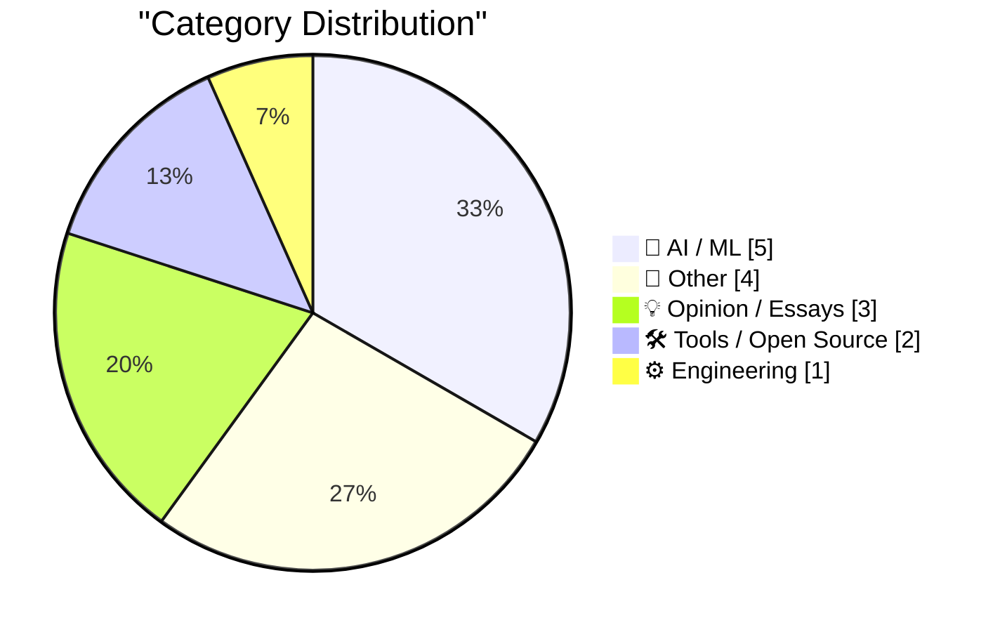
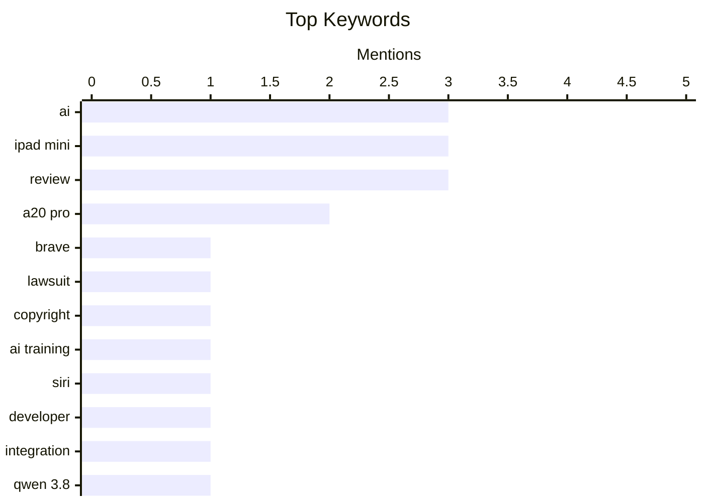

## Today's Highlights
Today's highlights showcase the escalating tensions between AI technology and copyright laws, as major publications like The New York Times take legal action against companies like Brave for allegedly profiting from scraped content. Meanwhile, Apple is making strides in AI integration by opening Siri to developers, reflecting a broader trend of tech companies embracing AI capabilities in their products. Additionally, the conversation around AI's impact on everyday applications continues to evolve, with critiques emerging about its influence on personal data management and content creation.
---
## Must Read Today
1. **The New York Times (et al.) Sues Brave for Copyright Infringement, Selling Scraped Content to AI Companies for Model Training**
[The New York Times (et al.) Sues Brave for Copyright Infringement, Selling Scraped Content to AI Companies for Model Training](https://www.theverge.com/tech/1024588/brave-lawsuit-ai-scraping-new-york-times) — daringfireball.net · 22h ago · 🤖 AI / ML
> The New York Times and several other publications have filed lawsuits against Brave Software for allegedly scraping their content to train AI models and allowing users to bypass paywalls. The complaint highlights that Brave has monetized its scraped index by providing AI companies with paid access to real-time data from these publications. This legal action raises significant questions about copyright infringement and the ethics of using scraped content for AI training. The outcome of this lawsuit could set important precedents regarding content ownership and AI training practices.
💡 **Why read it**: This article is worth reading for insights into the evolving legal landscape surrounding AI and copyright issues.
🏷️ Brave, lawsuit, copyright, AI training
2. **Apple Begins Opening Siri AI to Developers**
[Apple Begins Opening Siri AI to Developers](https://developer.apple.com/news/?id=gdk2umrf) — daringfireball.net · 14h ago · 🤖 AI / ML
> Apple has launched a Developer Preview for Siri AI integration with the release of iOS 27.3, iPadOS 27.3, macOS 27.3, and visionOS 27.3 betas. This new feature allows developers to create apps that can directly interact with Siri, enhancing user engagement and service delivery. The initiative represents a significant step in expanding Siri's capabilities and fostering a more interactive ecosystem for developers. This move could lead to innovative applications and improved user experiences across Apple devices.
💡 **Why read it**: This article is essential for developers interested in leveraging Siri AI to enhance their applications.
🏷️ Siri, developer, integration, AI
3. **Qwen 3.8 27B on my laptop can interpret model weights, too**
[Qwen 3.8 27B on my laptop can interpret model weights, too](https://simonwillison.net/2026/Nov/3/qwen-can-interpret-model-weights/) — simonwillison.net · 21h ago · 🤖 AI / ML
> A recent blog post discusses the capabilities of frontier models like GPT-6 Astra, which can interpret and modify the raw weights of machine learning models. This finding suggests that such models can directly interact with neural network weights, allowing for innovative applications in machine learning. The implications of this research could revolutionize how developers approach model training and manipulation. Understanding these capabilities is crucial for those working in AI and machine learning fields.
💡 **Why read it**: This article is worth reading for its groundbreaking insights into model manipulation capabilities in AI.
🏷️ Qwen 3.8, model weights, neural networks, weight-space programming
---
## Data Overview
| Sources Scanned | Articles Fetched | Time Window | Selected |
|:---:|:---:|:---:|:---:|
| 87/92 | 2626 -> 20 | 24h | **15** |
### Category Distribution

### Top Keywords

<details>
<summary>Plain Text Keyword Chart (Terminal Friendly)</summary>
```
ai          │ ████████████████████ 3
ipad mini   │ ████████████████████ 3
review      │ ████████████████████ 3
a20 pro     │ █████████████░░░░░░░ 2
brave       │ ███████░░░░░░░░░░░░░ 1
lawsuit     │ ███████░░░░░░░░░░░░░ 1
copyright   │ ███████░░░░░░░░░░░░░ 1
ai training │ ███████░░░░░░░░░░░░░ 1
siri        │ ███████░░░░░░░░░░░░░ 1
developer   │ ███████░░░░░░░░░░░░░ 1
```
</details>
### Topic Tags
**ai**(3) · **ipad mini**(3) · **review**(3) · a20 pro(2) · brave(1) · lawsuit(1) · copyright(1) · ai training(1) · siri(1) · developer(1) · integration(1) · qwen 3.8(1) · model weights(1) · neural networks(1) · weight-space programming(1) · safari(1) · beta(1) · vertical tabs(1) · dark mode(1) · database(1)
---
## AI / ML
### 1. The New York Times (et al.) Sues Brave for Copyright Infringement, Selling Scraped Content to AI Companies for Model Training
[The New York Times (et al.) Sues Brave for Copyright Infringement, Selling Scraped Content to AI Companies for Model Training](https://www.theverge.com/tech/1024588/brave-lawsuit-ai-scraping-new-york-times) — **daringfireball.net** · 22h ago · ⭐ 27/30
> The New York Times and several other publications have filed lawsuits against Brave Software for allegedly scraping their content to train AI models and allowing users to bypass paywalls. The complaint highlights that Brave has monetized its scraped index by providing AI companies with paid access to real-time data from these publications. This legal action raises significant questions about copyright infringement and the ethics of using scraped content for AI training. The outcome of this lawsuit could set important precedents regarding content ownership and AI training practices.
🏷️ Brave, lawsuit, copyright, AI training
---
### 2. Apple Begins Opening Siri AI to Developers
[Apple Begins Opening Siri AI to Developers](https://developer.apple.com/news/?id=gdk2umrf) — **daringfireball.net** · 14h ago · ⭐ 26/30
> Apple has launched a Developer Preview for Siri AI integration with the release of iOS 27.3, iPadOS 27.3, macOS 27.3, and visionOS 27.3 betas. This new feature allows developers to create apps that can directly interact with Siri, enhancing user engagement and service delivery. The initiative represents a significant step in expanding Siri's capabilities and fostering a more interactive ecosystem for developers. This move could lead to innovative applications and improved user experiences across Apple devices.
🏷️ Siri, developer, integration, AI
---
### 3. Qwen 3.8 27B on my laptop can interpret model weights, too
[Qwen 3.8 27B on my laptop can interpret model weights, too](https://simonwillison.net/2026/Nov/3/qwen-can-interpret-model-weights/) — **simonwillison.net** · 21h ago · ⭐ 24/30
> A recent blog post discusses the capabilities of frontier models like GPT-6 Astra, which can interpret and modify the raw weights of machine learning models. This finding suggests that such models can directly interact with neural network weights, allowing for innovative applications in machine learning. The implications of this research could revolutionize how developers approach model training and manipulation. Understanding these capabilities is crucial for those working in AI and machine learning fields.
🏷️ Qwen 3.8, model weights, neural networks, weight-space programming
---
### 4. Pluralistic: The AI fatfinger economy has come for my receipts app (04 Nov 2026)
[Pluralistic: The AI fatfinger economy has come for my receipts app (04 Nov 2026)](https://pluralistic.net/2026/11/04/genius-scan-is-neither/) — **pluralistic.net** · 2h ago · ⭐ 21/30
> The article critiques the increasing reliance on AI in everyday applications, particularly in a receipts app where useful functions are being replaced by ineffective AI features. It highlights the frustration users experience as AI tools often fail to deliver practical solutions. This commentary reflects broader concerns about the impact of AI on software usability and user experience. The discussion raises important questions about the balance between AI integration and maintaining functional application design.
🏷️ AI, economy, apps
---
### 5. Pluralistic: Separable (03 Nov 2026)
[Pluralistic: Separable (03 Nov 2026)](https://pluralistic.net/2026/11/03/nobody-is-home/) — **pluralistic.net** · 23h ago · ⭐ 21/30
> The article discusses the implications of AI's ability to create content independently of human creators, leading to a separation of art from its creators. It examines the philosophical and ethical concerns surrounding this phenomenon, particularly in relation to copyright and the value of human creativity. The piece argues for the need to address these issues as AI continues to evolve and impact various fields. This exploration is crucial for understanding the future landscape of creative industries.
🏷️ AI, creativity, art
---
## Other
### 6. iPad Mini (A20 Pro) Review Roundup
[iPad Mini (A20 Pro) Review Roundup](https://www.techmeme.com/261103/p15#a261103p15) — **daringfireball.net** · 14h ago · ⭐ 15/30
> The article discusses various reviews of the new iPad Mini featuring the A20 Pro chip. Reviewers note the acoustic display technology, which directs sound from the front panel, offering a slightly improved audio experience while maintaining ruggedness. However, the lack of a 120Hz refresh rate is a significant drawback for many, with some reviewers expressing disappointment over the display's limitations. Overall, the iPad Mini is seen as a solid device but not without its flaws.
🏷️ iPad Mini, review, Acoustic Display, A20 Pro
---
### 7. MKBHD on the New A20 Pro iPad Mini
[MKBHD on the New A20 Pro iPad Mini](https://www.youtube.com/watch?v=g6Die8gVFn0) — **daringfireball.net** · 14h ago · ⭐ 15/30
> Marques Brownlee reviews the new A20 Pro iPad Mini, focusing on its color options and acoustic display. He describes the colors as 'annoyingly, slightly not black and slightly not white' and appreciates the acoustic display's potential for future devices. However, he criticizes the device for lacking a 120Hz display and notes that high volume levels can cause the iPad to shake. The review emphasizes the device's mixed attributes, balancing innovation with some disappointing features.
🏷️ MKBHD, iPad Mini, A20 Pro, review
---
### 8. Fraction comparison trick revisited
[Fraction comparison trick revisited](https://www.johndcook.com/blog/2026/11/03/fraction-comparison-trick-revisited/) — **johndcook.com** · 23h ago · ⭐ 15/30
> The article revisits a mathematical result regarding the comparison of fractions, stating that a/b is usually greater than c/d when a + d exceeds b + c, with a probability of 11/12. The author explains how this can be rigorously proven by selecting integers randomly and analyzing the limit as N approaches infinity. This exploration of probability and fraction comparison offers a deeper understanding of mathematical relationships. The main conclusion is that this fraction comparison trick holds true under specific conditions.
🏷️ mathematics, fractions, probability
---
### 9. Chance Miller Reviews the New A20 Pro iPad Mini
[Chance Miller Reviews the New A20 Pro iPad Mini](https://9to5mac.com/2026/11/03/new-ipad-mini-a20-pro-review/) — **daringfireball.net** · 23h ago · ⭐ 14/30
> Chance Miller reviews the new A20 Pro iPad Mini, highlighting its OLED screen's faster pixel response time compared to the previous LCD model. However, he expresses frustration over the device's lack of ProMotion technology, which limits the refresh rate to 60Hz. Despite the improvements in pixel response, the absence of a higher refresh rate is seen as a significant drawback. The review concludes that while the iPad Mini has advancements, it misses the mark in certain key areas.
🏷️ iPad Mini, ProMotion, 60Hz, review
---
## Opinion / Essays
### 10. New Article, Annual LFP Charity Discount
[New Article, Annual LFP Charity Discount](https://buttondown.com/hillelwayne/archive/new-article-annual-lfp-charity-discount/) — **buttondown.com/hillelwayne** · 19h ago · ⭐ 18/30
> The article announces a new blog post discussing the merits of Deterministic Simulation Testing compared to Formal Methods, highlighting the trade-offs between input coverage and code fidelity. It emphasizes the importance of understanding these methodologies for effective software testing. The insights provided can help developers make informed decisions about testing strategies. This discussion is particularly relevant for those involved in software quality assurance.
🏷️ testing, simulation, formal methods
---
### 11. Apple’s New iPhone Release Schedule Seems to Pay Off
[Apple’s New iPhone Release Schedule Seems to Pay Off](https://x.com/asymco/status/2117379158087278697) — **daringfireball.net** · 23h ago · ⭐ 17/30
> Apple's strategic decision to delay the iPhone 18 release has resulted in a 17% increase in iPhone sales, despite not launching new models in the previous quarter. The Pro and Pro Max models have significantly outperformed expectations, indicating strong consumer demand. This approach demonstrates the effectiveness of Apple's release strategy in maximizing sales and market impact. The results suggest that timing and product positioning are critical for success in the competitive smartphone market.
🏷️ iPhone, sales growth, release schedule, financial results
---
### 12. Steve Jobs on His Final Quarterly Analyst Call: ‘We Think the Open Versus Closed Argument Is Just a Smokescreen’
[Steve Jobs on His Final Quarterly Analyst Call: ‘We Think the Open Versus Closed Argument Is Just a Smokescreen’](https://www.macworld.com/article/208438/jobs_transcript.html) — **daringfireball.net** · 22h ago · ⭐ 15/30
> This article presents Steve Jobs's remarks from his last quarterly analyst call, where he critiques the open versus closed systems debate. He argues that open systems do not always prevail, citing Microsoft’s failed 'Plays For Sure' strategy as an example. Jobs emphasizes that the conversation around openness is often a distraction from the real issues at hand. The takeaway is that the effectiveness of a system is not solely determined by its openness or closedness.
🏷️ Steve Jobs, analyst call, open vs closed, philosophy
---
## Tools / Open Source
### 13. Safari 27.3 Beta Adds Vertical Tabs and Adaptive Dark Mode
[Safari 27.3 Beta Adds Vertical Tabs and Adaptive Dark Mode](https://www.macrumors.com/2026/11/03/ios-27-3-safari/) — **daringfireball.net** · 18h ago · ⭐ 24/30
> The latest updates to Safari in iOS 27.3, iPadOS 27.3, and macOS Golden Gate 27.3 introduce a Vertical Tabs layout and Adaptive Dark Mode. The Vertical Tabs feature allows users to manage tabs more efficiently by displaying them on the left side of the screen, which is particularly beneficial for larger displays. These enhancements aim to improve user experience and accessibility across Apple devices. The updates reflect Apple's commitment to continuously enhancing its browser functionality.
🏷️ Safari, beta, vertical tabs, dark mode
---
### 14. This Week in Source Control: 4 November 2026
[This Week in Source Control: 4 November 2026](https://nesbitt.io/2026/11/04/this-week-in-source-control.html) — **nesbitt.io** · 4h ago · ⭐ 18/30
> The article provides a roundup of recent releases, advisories, and articles related to version control and software forges. It highlights key updates and trends in source control tools that are essential for developers. By summarizing these developments, the article serves as a valuable resource for staying informed about the latest in version control technology. Keeping abreast of these changes is vital for developers to maintain efficient workflows.
🏷️ version control, releases, advisories
---
## Engineering
### 15. How do you implement a random-access database when you don’t have random-access external storage?
[How do you implement a random-access database when you don’t have random-access external storage?](https://devblogs.microsoft.com/oldnewthing/20261103-00/?p=112825/) — **devblogs.microsoft.com/oldnewthing** · 23h ago · ⭐ 24/30
> The article explores the implementation of a random-access database entirely in memory when external random-access storage is unavailable. It discusses the design choices and trade-offs involved in this approach, emphasizing the importance of memory management and data structure optimization. This method can provide high-speed access to data, making it suitable for specific applications. Understanding this implementation can benefit developers facing storage limitations.
🏷️ database, memory, storage
---
*Generated at 2026-11-04 14:01 | Scanned 87 sources -> 2626 articles -> selected 15*
*Based on the [Hacker News Popularity Contest 2025](https://refactoringenglish.com/tools/hn-popularity/) RSS source list recommended by [Andrej Karpathy](https://x.com/karpathy)*
*Produced by Dongdianr AI. Follow the same-name WeChat public account for more AI practical tips 💡*
