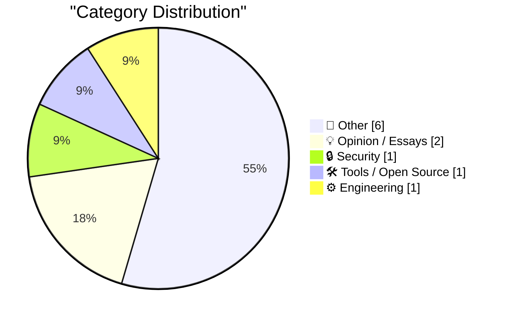
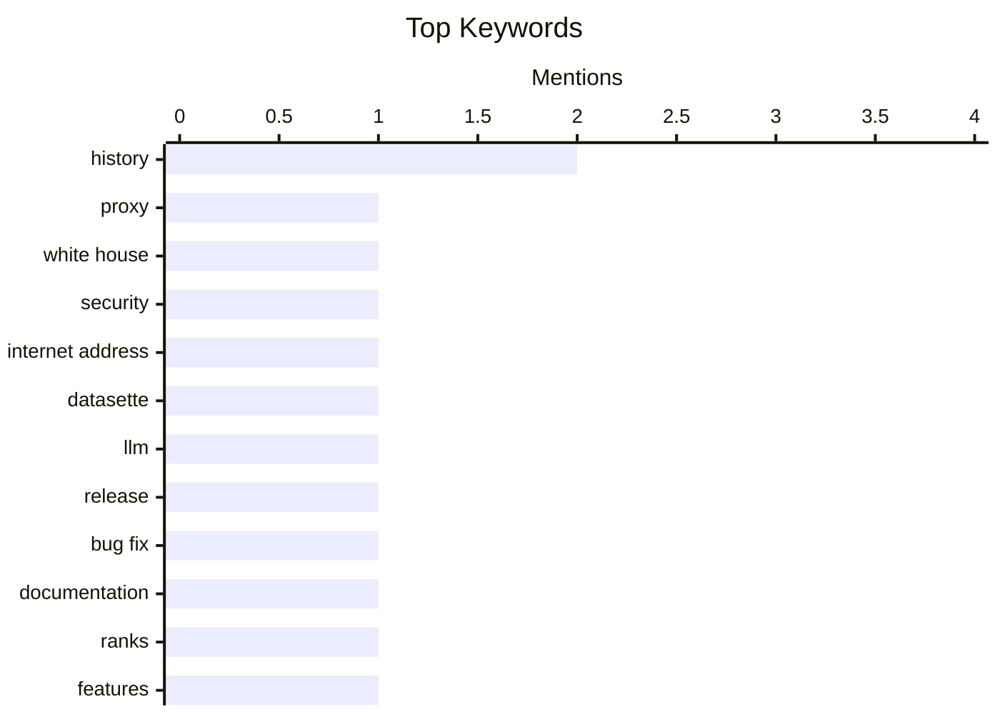

## Today's Highlights
Today's Highlights: Security concerns are rising as the use of residential proxy services by White House staff raises alarms about potential vulnerabilities. Meanwhile, the tech community is buzzing with the release of datasette-llm 0.1a10, which aims to enhance functionality by addressing critical bugs. Additionally, ongoing debates about the implications of CDA 230 are spotlighting the precarious future of smaller online communities in an increasingly monopolized digital landscape.
---
## Must Read Today
1. **Want to Rent an Internet Address at the White House?**
[Want to Rent an Internet Address at the White House?](https://krebsonsecurity.com/2026/11/want-to-rent-an-internet-address-at-the-white-house/) — krebsonsecurity.com · 9h ago · 🔒 Security
> The article discusses the security risks posed by White House staff using residential proxy services, which can expose their internet addresses for rent. Notably, one of these services is linked to a Russian company whose founder was involved in cyberattacks on U.S. election systems in 2016. This raises concerns about potential vulnerabilities and misuse of sensitive information. The main takeaway is that the use of such proxy services by government employees could lead to significant security breaches.
💡 **Why read it**: This article is worth reading for its insights into the security implications of proxy services used by government staff, highlighting a critical vulnerability in national security.
🏷️ proxy, White House, security, internet address
2. **datasette-llm 0.1a10**
[datasette-llm 0.1a10](https://simonwillison.net/2026/Nov/4/datasette-llm/) — simonwillison.net · 22h ago · 🛠 Tools / Open Source
> The article announces the release of datasette-llm version 0.1a10, which addresses a bug affecting the demo site agent.datasette.io. This bug prevented the correct restriction of available LLM models to those specified in the configuration. The update enhances the functionality and reliability of the tool for users working with large language models.
💡 **Why read it**: This article is essential for developers using datasette-llm, as it details a critical bug fix that improves model management in the application.
🏷️ datasette, LLM, release, bug fix
3. **There are things with ranks, but it’s not always clear what the ranks mean**
[There are things with ranks, but it’s not always clear what the ranks mean](https://devblogs.microsoft.com/oldnewthing/20261104-00/?p=112830/) — devblogs.microsoft.com/oldnewthing · 23h ago · ⚙️ Engineering
> The article critiques the clarity of documentation related to features that utilize ranking systems, noting that authors often assume readers understand the context. This lack of clarity can lead to confusion among users who are unfamiliar with the system. The conclusion emphasizes the need for better documentation practices to ensure that all users can effectively understand and utilize the features.
💡 **Why read it**: This article is valuable for anyone involved in technical writing or documentation, as it highlights common pitfalls and the importance of clarity in conveying complex information.
🏷️ documentation, ranks, features
---
## Data Overview
| Sources Scanned | Articles Fetched | Time Window | Selected |
|:---:|:---:|:---:|:---:|
| 87/92 | 2626 -> 11 | 24h | **11** |
### Category Distribution

### Top Keywords

<details>
<summary>Plain Text Keyword Chart (Terminal Friendly)</summary>
```
history          │ ████████████████████ 2
proxy            │ ██████████░░░░░░░░░░ 1
white house      │ ██████████░░░░░░░░░░ 1
security         │ ██████████░░░░░░░░░░ 1
internet address │ ██████████░░░░░░░░░░ 1
datasette        │ ██████████░░░░░░░░░░ 1
llm              │ ██████████░░░░░░░░░░ 1
release          │ ██████████░░░░░░░░░░ 1
bug fix          │ ██████████░░░░░░░░░░ 1
documentation    │ ██████████░░░░░░░░░░ 1
```
</details>
### Topic Tags
**history**(2) · **proxy**(1) · **white house**(1) · security(1) · internet address(1) · datasette(1) · llm(1) · release(1) · bug fix(1) · documentation(1) · ranks(1) · features(1) · cda 230(1) · facebook(1) · internet(1) · legal threats(1) · demo(1) · steve jobs(1) · touchscreen(1) · macbook(1)
---
## Other
### 1. ‘Political Reckoning Shatters Trump’s Grip on Washington’
[‘Political Reckoning Shatters Trump’s Grip on Washington’](https://www.wsj.com/politics/elections/a-political-reckoning-shatters-trumps-grip-on-washington-bd3c7705?st=xABDit) — **daringfireball.net** · 23h ago · ⭐ 12/30
> The article reports on a significant political shift following recent elections, highlighting the rapid loss of support for President Trump among Republicans. It notes that this shift represents one of the most decisive repudiations of a sitting president in modern American history. The conclusion suggests that Trump's political influence is waning, indicating a potential realignment within the Republican Party.
🏷️ political, Trump, Washington, Republicans
---
### 2. Gadget Review: Tozo NC9 Pro Bluetooth Headphones ★★★★⯪
[Gadget Review: Tozo NC9 Pro Bluetooth Headphones ★★★★⯪](https://shkspr.mobi/blog/2026/11/gadget-review-tozo-nc9-pro-bluetooth-headphones/) — **shkspr.mobi** · 1h ago · ⭐ 10/30
> The review covers the Tozo NC9 Pro Bluetooth headphones, noting that while the sound quality and noise cancellation are commendable, the standout feature is the innovative charging case. The headphones offer standard battery life and performance, but the case adds a unique aspect to the user experience. The overall impression is positive, highlighting a balance between functionality and design.
🏷️ headphones, review, Bluetooth, noise cancelling
---
### 3. Micron Computers’ rise and fall
[Micron Computers’ rise and fall](https://dfarq.homeip.net/micron-computers-rise-and-fall/?utm_source=rss&#038;utm_medium=rss&#038;utm_campaign=micron-computers-rise-and-fall) — **dfarq.homeip.net** · 2h ago · ⭐ 10/30
> The article chronicles the history of Micron Computers, a venture by Micron Technology to market PCs, which initially succeeded after its launch in 1995 but ultimately ceased operations in 2008. It discusses the challenges faced by the company in a competitive market and the factors that led to its decline. The main conclusion is that despite early success, the inability to adapt to market changes contributed to its downfall.
🏷️ Micron, computers, rise and fall, history
---
### 4. This Election Will Not Look Surprising in History
[This Election Will Not Look Surprising in History](https://apple.news/Afq6SKrYkTcCEHrCEQmxm5A?web_embed_link=aHR0cHM6Ly9uZXdzLWFzc2V0cy5hcHBsZS5jb20vZW1iZWRzLzY2ZDQzYzg0LTMyMWYtNGQ0Ny05Mzk4LWE3NjE3NDgwZWE2Yi9pbmRleC5odG1sI2NvbnRleHQ9TU9EQUwmc3RpY2t5PWZhbHNlJmVmZmVjdD1ub25lJmxpZ2h0X2JnX2NvbG9yPWU5ZWNmMiZkYXJrX2JnX2NvbG9yPTJkM2Q1NCZzY29wZT11cyZvcmlnaW49c2hhcnJvdyZsaXZlYWN0aXZpdGllcz10cnVlJm5mZl9jaWQ9NTZjMjQ1OTQtNDIxNC00NDM0LTlhNTgtNWE1YTIxM2ZkMTBi) — **daringfireball.net** · 22h ago · ⭐ 9/30
> The article reflects on the historical context of the recent election, suggesting that the outcomes will not be surprising when viewed through the lens of past political trends. It references notable figures and their changing positions within the Republican Party, illustrating the evolving political landscape. The conclusion emphasizes the importance of historical perspective in understanding current events.
🏷️ election, history, politics
---
### 5. How to install an app on your Commodore 64
[How to install an app on your Commodore 64](https://anildash.com/2026/10/08/install-an-app-commodore-64/) — **anildash.com** · 14h ago · ⭐ 9/30
> The article serves as a nostalgic guide for installing programs on a Commodore 64, detailing the limited options available in 1986, such as obtaining software from magazines. It outlines the steps required to set up the computer for new programs, reflecting the era's computing culture. The main takeaway is a reminder of the simplicity and challenges of early personal computing.
🏷️ Commodore 64, programs, installation, vintage
---
### 6. Quasi-logarithmic kitchen timer
[Quasi-logarithmic kitchen timer](https://blog.coredump.cx/p/quasi-logarithmic-kitchen-timer) — **lcamtuf.substack.com** · 12h ago · ⭐ 7/30
> Like some of you, we have several kitchen appliances with integrated digital timers.
🏷️ kitchen, timer, appliances
---
## Opinion / Essays
### 7. Pluralistic: Without CDA 230, Facebook will own the internet forever (05 Nov 2026)
[Pluralistic: Without CDA 230, Facebook will own the internet forever (05 Nov 2026)](https://pluralistic.net/2026/11/05/see-you-in-court/) — **pluralistic.net** · 5h ago · ⭐ 13/30
> The article argues that without the protections of CDA 230, smaller online communities face significant legal threats that could allow larger platforms like Facebook to dominate the internet. It discusses the implications of potential legal changes on community management and the survival of diverse online spaces. The main takeaway is that the future of the internet hinges on maintaining these legal protections to foster a competitive landscape.
🏷️ CDA 230, Facebook, internet, legal threats
---
### 8. “It Gives Great Demo”
[“It Gives Great Demo”](https://blog.jim-nielsen.com/2026/it-gives-great-demo/) — **blog.jim-nielsen.com** · 19h ago · ⭐ 13/30
> The article reflects on Steve Jobs' insights regarding touchscreen MacBooks, emphasizing that while they may look appealing in demonstrations, they are impractical for extended use. Jobs' user testing revealed that vertical touch surfaces lead to fatigue, making them less effective for real-world applications. The conclusion reinforces the importance of user experience over aesthetic appeal in product design.
🏷️ demo, Steve Jobs, touchscreen, MacBook
---
## Security
### 9. Want to Rent an Internet Address at the White House?
[Want to Rent an Internet Address at the White House?](https://krebsonsecurity.com/2026/11/want-to-rent-an-internet-address-at-the-white-house/) — **krebsonsecurity.com** · 9h ago · ⭐ 27/30
> The article discusses the security risks posed by White House staff using residential proxy services, which can expose their internet addresses for rent. Notably, one of these services is linked to a Russian company whose founder was involved in cyberattacks on U.S. election systems in 2016. This raises concerns about potential vulnerabilities and misuse of sensitive information. The main takeaway is that the use of such proxy services by government employees could lead to significant security breaches.
🏷️ proxy, White House, security, internet address
---
## Tools / Open Source
### 10. datasette-llm 0.1a10
[datasette-llm 0.1a10](https://simonwillison.net/2026/Nov/4/datasette-llm/) — **simonwillison.net** · 22h ago · ⭐ 24/30
> The article announces the release of datasette-llm version 0.1a10, which addresses a bug affecting the demo site agent.datasette.io. This bug prevented the correct restriction of available LLM models to those specified in the configuration. The update enhances the functionality and reliability of the tool for users working with large language models.
🏷️ datasette, LLM, release, bug fix
---
## Engineering
### 11. There are things with ranks, but it’s not always clear what the ranks mean
[There are things with ranks, but it’s not always clear what the ranks mean](https://devblogs.microsoft.com/oldnewthing/20261104-00/?p=112830/) — **devblogs.microsoft.com/oldnewthing** · 23h ago · ⭐ 16/30
> The article critiques the clarity of documentation related to features that utilize ranking systems, noting that authors often assume readers understand the context. This lack of clarity can lead to confusion among users who are unfamiliar with the system. The conclusion emphasizes the need for better documentation practices to ensure that all users can effectively understand and utilize the features.
🏷️ documentation, ranks, features
---
*Generated at 2026-11-05 14:01 | Scanned 87 sources -> 2626 articles -> selected 11*
*Based on the [Hacker News Popularity Contest 2025](https://refactoringenglish.com/tools/hn-popularity/) RSS source list recommended by [Andrej Karpathy](https://x.com/karpathy)*
*Produced by Dongdianr AI. Follow the same-name WeChat public account for more AI practical tips 💡*
