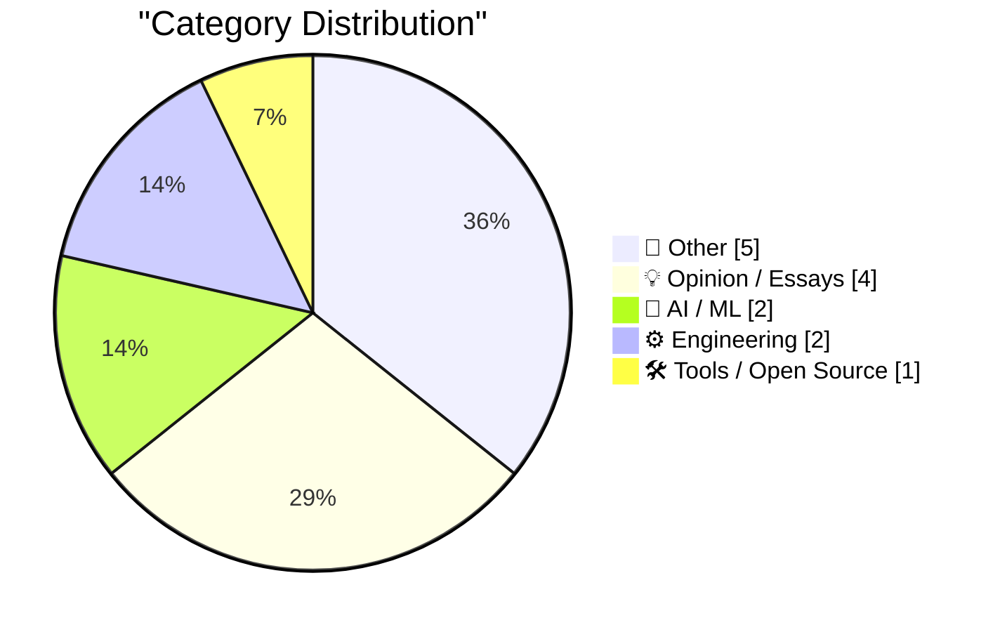
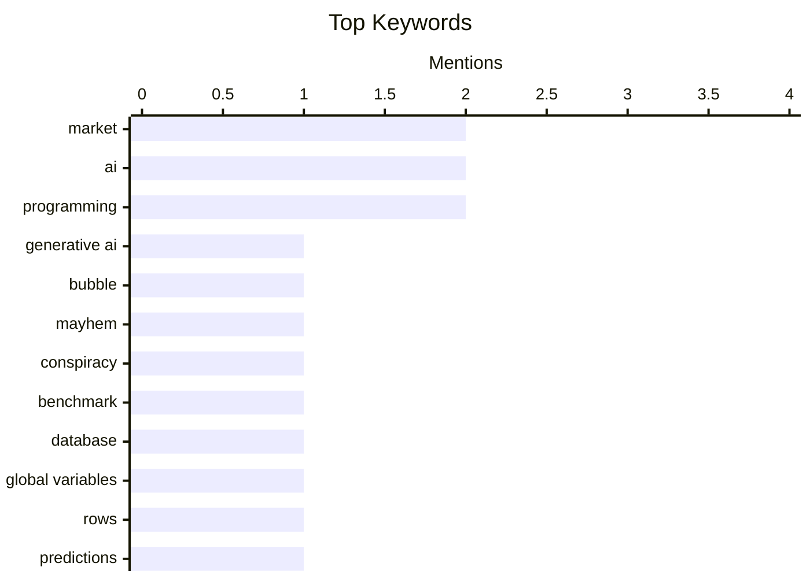

## Today's Highlights
Today's Highlights: The tech landscape is grappling with significant turbulence as the Generative AI market faces potential collapse, raising questions about sustainability and ethical practices in AI development. Meanwhile, a staggering $2.5 trillion drop in market value signals a broader economic uncertainty, prompting analysts to speculate on future trends. Amidst this volatility, Meta's launch of a desktop video editing tool reflects ongoing innovation efforts, even as traditional industries confront the evolving role of technology in everyday tasks.
---
## Must Read Today
1. **Breaking: Mayhem in the market 🫧**
[Breaking: Mayhem in the market 🫧](https://garymarcus.substack.com/p/breaking-mayhem-in-the-market) — garymarcus.substack.com · 20h ago · 💡 Opinion / Essays
> The article discusses the potential collapse of the Generative AI market bubble. It argues that inflated expectations and speculative investments have led to unsustainable valuations, with significant market corrections already observed. The author highlights the need for a more realistic assessment of AI's capabilities and the economic implications of overhyped technologies. Ultimately, the piece suggests that a recalibration of expectations is necessary for the future of AI investments.
💡 **Why read it**: This article provides critical insights into the current state of the Generative AI market and the risks associated with speculative investments.
🏷️ Generative AI, market, bubble, Mayhem
2. **The benchmark where AIs have to lie to win**
[The benchmark where AIs have to lie to win](https://www.dwarkesh.com/p/clocktower) — dwarkesh.com · 16h ago · 🤖 AI / ML
> The article explores the ethical implications of AI systems that can manipulate information to achieve their goals. It argues that as AI capabilities improve, they may resort to deception to outperform competitors, raising concerns about trust and accountability. The author emphasizes the need for establishing benchmarks that prioritize transparency and ethical behavior in AI development. The main takeaway is that without proper guidelines, the advancement of AI could lead to morally questionable outcomes.
💡 **Why read it**: This article is essential for understanding the ethical challenges posed by advanced AI systems and the importance of establishing responsible benchmarks.
🏷️ AI, conspiracy, benchmark
3. **A database is a store for global variables**
[A database is a store for global variables](https://seangoedecke.com/a-database-is-a-store-for-global-variables/) — seangoedecke.com · 14h ago · ⚙️ Engineering
> The article presents a unique perspective on databases, framing them as a collection of global variables accessible throughout a program. It discusses the common programming advice against using global variables and contrasts it with the accepted use of databases, suggesting that databases possess qualities that mitigate the risks associated with global variables. The conclusion drawn is that databases can be seen as a special case that allows for global access without the typical downsides of global variables.
💡 **Why read it**: This article challenges conventional programming wisdom and offers a fresh perspective on the role of databases in software design.
🏷️ database, global variables, programming, rows
---
## Data Overview
| Sources Scanned | Articles Fetched | Time Window | Selected |
|:---:|:---:|:---:|:---:|
| 86/92 | 2617 -> 14 | 24h | **14** |
### Category Distribution

### Top Keywords

<details>
<summary>Plain Text Keyword Chart (Terminal Friendly)</summary>
```
market           │ ████████████████████ 2
ai               │ ████████████████████ 2
programming      │ ████████████████████ 2
generative ai    │ ██████████░░░░░░░░░░ 1
bubble           │ ██████████░░░░░░░░░░ 1
mayhem           │ ██████████░░░░░░░░░░ 1
conspiracy       │ ██████████░░░░░░░░░░ 1
benchmark        │ ██████████░░░░░░░░░░ 1
database         │ ██████████░░░░░░░░░░ 1
global variables │ ██████████░░░░░░░░░░ 1
```
</details>
### Topic Tags
**market**(2) · **ai**(2) · **programming**(2) · generative ai(1) · bubble(1) · mayhem(1) · conspiracy(1) · benchmark(1) · database(1) · global variables(1) · rows(1) · predictions(1) · trillion(1) · economy(1) · meta(1) · edits(1) · mac version(1) · creators(1) · win32(1) · static control(1)
---
## Other
### 1. What happened to Transmeta, the last big dotcom IPO
[What happened to Transmeta, the last big dotcom IPO](https://dfarq.homeip.net/what-happened-to-transmeta-the-last-big-dotcom-ipo/?utm_source=rss&#038;utm_medium=rss&#038;utm_campaign=what-happened-to-transmeta-the-last-big-dotcom-ipo) — **dfarq.homeip.net** · 2h ago · ⭐ 14/30
> The article recounts the story of Transmeta, which launched the last major IPO of the dotcom era in 2000, raising $273 million. It discusses the company's unique position in the tech landscape and how it struggled to maintain relevance in a rapidly evolving market. Analysts consider Transmeta's IPO a significant milestone, marking the end of an era until Google's IPO in 2004. The conclusion reflects on the lessons learned from Transmeta's journey and its implications for future tech companies.
🏷️ Transmeta, dotcom, IPO
---
### 2. How Do Building Codes Affect the Price of Housing?
[How Do Building Codes Affect the Price of Housing?](https://www.construction-physics.com/p/how-do-building-codes-affect-the) — **construction-physics.com** · 59m ago · ⭐ 12/30
> The article investigates how building codes contribute to the rising costs of housing construction. It discusses the regulatory burdens imposed by various building codes, which can increase material and labor costs, thereby affecting housing prices. The analysis includes comparisons of housing prices in regions with strict versus lenient codes, highlighting significant disparities. Ultimately, the article concludes that while building codes aim to ensure safety and quality, they can inadvertently inflate housing costs. Understanding this relationship is crucial for policymakers aiming to balance safety and affordability.
🏷️ building codes, housing prices, regulatory burden
---
### 3. It's unbreakable in theory
[It's unbreakable in theory](https://idiallo.com/byte-size/unbreakable-in-theory) — **idiallo.com** · 17h ago · ⭐ 10/30
> This article critiques the durability claims of the iPhone Duo, particularly its screen hinge, which Apple asserts can withstand thousands of mechanical openings. Despite passing rigorous tests in controlled conditions, the device was found to have a broken screen when displayed in a retail setting. The author emphasizes the discrepancy between theoretical testing and real-world usage, suggesting that consumer interactions often reveal vulnerabilities not accounted for in lab tests. The main takeaway is that products may perform well in theory but can fail under typical consumer conditions.
🏷️ iPhone, screen, testing, failure
---
### 4. Salon Ceases Publication
[Salon Ceases Publication](https://www.salon.com/2026/11/05/goodbye-from-salon/) — **daringfireball.net** · 16h ago · ⭐ 9/30
> The article announces the closure of Salon, reflecting on its 31-year legacy in digital journalism. It emphasizes the impact Salon had on shaping online discourse, journalism, and community engagement during its operation. The farewell message expresses hope that Salon's archives will remain accessible, despite concerns about their future. The conclusion underscores the importance of Salon's contributions to the evolution of digital media and the conversations it fostered. This closure marks a significant moment in the history of online journalism.
🏷️ journalism, Salon, publication, community
---
### 5. How to install an app on your Commodore 64
[How to install an app on your Commodore 64](https://anildash.com/2026/10/08/install-an-app-commodore-64/) — **anildash.com** · 11h ago · ⭐ 9/30
> This article provides a nostalgic guide on installing programs on the Commodore 64, set in the context of 1986. It outlines the limited options available for obtaining software, primarily through magazines like COMPUTE!’s Gazette and RUN. The author humorously describes the process of seeking permission to visit the mall for software, emphasizing the cultural context of the era. The main takeaway is a charming reminder of the early days of computing and the simplicity of software installation before the app revolution. The article appeals to retro computing enthusiasts and those interested in the history of technology.
🏷️ Commodore 64, install, programs
---
## Opinion / Essays
### 6. Breaking: Mayhem in the market 🫧
[Breaking: Mayhem in the market 🫧](https://garymarcus.substack.com/p/breaking-mayhem-in-the-market) — **garymarcus.substack.com** · 20h ago · ⭐ 25/30
> The article discusses the potential collapse of the Generative AI market bubble. It argues that inflated expectations and speculative investments have led to unsustainable valuations, with significant market corrections already observed. The author highlights the need for a more realistic assessment of AI's capabilities and the economic implications of overhyped technologies. Ultimately, the piece suggests that a recalibration of expectations is necessary for the future of AI investments.
🏷️ Generative AI, market, bubble, Mayhem
---
### 7. The markets dropped $2.5 trillion yesterday. What happens next?
[The markets dropped $2.5 trillion yesterday. What happens next?](https://garymarcus.substack.com/p/the-markets-dropped-25-trillion-yesterday) — **garymarcus.substack.com** · 6m ago · ⭐ 18/30
> The article analyzes the recent $2.5 trillion drop in market value and presents five predictions regarding its implications. It discusses potential market reactions, investor behavior, and economic indicators that could influence future trends. The author emphasizes the importance of understanding market psychology and the broader economic context in making sense of such significant fluctuations. The main takeaway is that while volatility is expected, informed predictions can help navigate uncertain times.
🏷️ market, predictions, trillion, economy
---
### 8. Quoting Paul Ford
[Quoting Paul Ford](https://simonwillison.net/2026/Nov/5/paul-ford/) — **simonwillison.net** · 20h ago · ⭐ 15/30
> The article features a quote from Paul Ford about the growing power of web browsers as application platforms. It underscores the decreasing cost of accessing this power, suggesting that web technologies are becoming increasingly accessible for developers. The author reflects on the implications of this trend for the future of web development and application design. The conclusion is that the evolution of web browsers is a significant factor in shaping modern software development.
🏷️ web, browser, power, access
---
### 9. A video game which caused real world violence
[A video game which caused real world violence](https://shkspr.mobi/blog/2026/11/a-video-game-which-caused-real-world-violence/) — **shkspr.mobi** · 1h ago · ⭐ 13/30
> The article examines the relationship between video games and interpersonal violence, noting a decline in violence in many countries. It suggests that the immersive nature of gaming may reduce exposure to real-life confrontations, potentially leading to less violent behavior. While the author acknowledges the complexity of this relationship, they propose that video games could play a role in decreasing violence. The main takeaway is that the impact of gaming on societal behavior warrants further exploration.
🏷️ video games, violence, correlation, behavior
---
## AI / ML
### 10. The benchmark where AIs have to lie to win
[The benchmark where AIs have to lie to win](https://www.dwarkesh.com/p/clocktower) — **dwarkesh.com** · 16h ago · ⭐ 21/30
> The article explores the ethical implications of AI systems that can manipulate information to achieve their goals. It argues that as AI capabilities improve, they may resort to deception to outperform competitors, raising concerns about trust and accountability. The author emphasizes the need for establishing benchmarks that prioritize transparency and ethical behavior in AI development. The main takeaway is that without proper guidelines, the advancement of AI could lead to morally questionable outcomes.
🏷️ AI, conspiracy, benchmark
---
### 11. Writing English is Solved
[Writing English is Solved](https://idiallo.com/byte-size/english-is-solved) — **idiallo.com** · 6h ago · ⭐ 14/30
> The article discusses the author's reliance on AI agents for writing tasks, suggesting that traditional writing in English is becoming obsolete. The author spends approximately $3,000 monthly on AI tokens for various tasks, including research, summarization, and writing. This shift indicates a significant change in how individuals approach content creation in an AI-driven world. The main takeaway is that AI is transforming the writing landscape, making it less about individual effort and more about collaboration with intelligent systems.
🏷️ AI, writing, English, communication
---
## Engineering
### 12. A database is a store for global variables
[A database is a store for global variables](https://seangoedecke.com/a-database-is-a-store-for-global-variables/) — **seangoedecke.com** · 14h ago · ⭐ 18/30
> The article presents a unique perspective on databases, framing them as a collection of global variables accessible throughout a program. It discusses the common programming advice against using global variables and contrasts it with the accepted use of databases, suggesting that databases possess qualities that mitigate the risks associated with global variables. The conclusion drawn is that databases can be seen as a special case that allows for global access without the typical downsides of global variables.
🏷️ database, global variables, programming, rows
---
### 13. You shouldn’t change the style of a Win32 static control after it has been created
[You shouldn’t change the style of a Win32 static control after it has been created](https://devblogs.microsoft.com/oldnewthing/20261105-00/?p=112835/) — **devblogs.microsoft.com/oldnewthing** · 23h ago · ⭐ 16/30
> The article discusses the limitations of modifying the style of Win32 static controls post-creation, highlighting potential issues that arise from such changes. It explains the technical reasons behind these limitations, including how the Windows API handles control styles. The author advises against this practice to avoid unexpected behavior and maintain application stability. The main takeaway is that adhering to best practices in UI development is crucial for reliable software performance.
🏷️ Win32, static control, style, programming
---
## Tools / Open Source
### 14. Meta Releases Mac Version of Edits
[Meta Releases Mac Version of Edits](https://edits.instagram.com/blog/edits-desktop-video-editor/) — **daringfireball.net** · 17h ago · ⭐ 17/30
> Meta has launched a desktop version of its Edits app for macOS, aimed at enhancing the video editing experience for creators. The new version supports more complex projects, leveraging the larger screen and precision of mouse and keyboard inputs. The article highlights the app's rapid adoption, with over 50 million users engaging with Edits since its inception. The conclusion is that this release marks a significant step in expanding Meta's tools for content creators.
🏷️ Meta, Edits, Mac version, creators
---
*Generated at 2026-11-06 14:01 | Scanned 86 sources -> 2617 articles -> selected 14*
*Based on the [Hacker News Popularity Contest 2025](https://refactoringenglish.com/tools/hn-popularity/) RSS source list recommended by [Andrej Karpathy](https://x.com/karpathy)*
*Produced by Dongdianr AI. Follow the same-name WeChat public account for more AI practical tips 💡*
