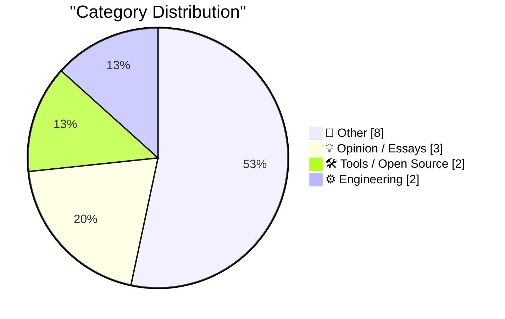
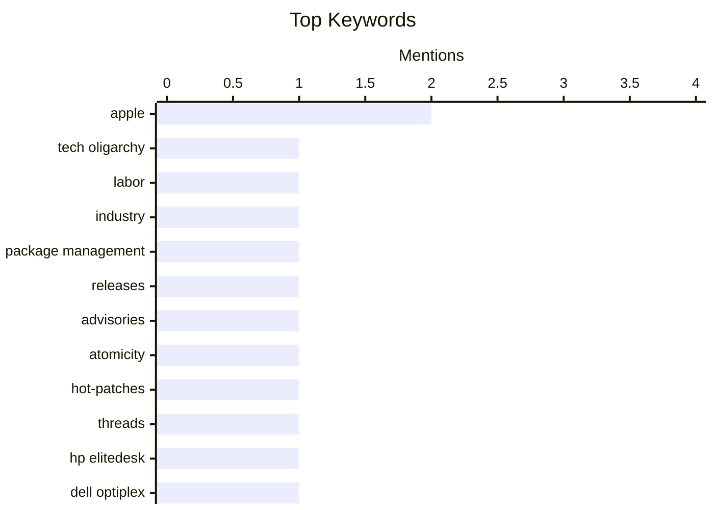

## Today's Highlights
Today's Highlights: The tech landscape is increasingly grappling with the implications of oligopolistic power structures, prompting calls for new labor frameworks to address these challenges. Meanwhile, the evolution of software development tools, particularly in package management and static site generators, reflects a growing complexity in the ecosystem, as developers navigate both innovation and legacy systems. Additionally, the recent unveiling of new MacBook Pros at Apple's event signals a continued push for cutting-edge technology in consumer electronics.
---
## Must Read Today
1. **Pluralistic: JS Tan and Clarissa Redwine's "Against Tech Oligarchy" (07 Nov 2026)**
[Pluralistic: JS Tan and Clarissa Redwine's "Against Tech Oligarchy" (07 Nov 2026)](https://pluralistic.net/2026/11/07/aeiou-but-sometimes-why/) — pluralistic.net · 57m ago · 💡 Opinion / Essays
> The article discusses the challenges posed by tech oligarchies and the need for a new labor framework in the tech industry. JS Tan and Clarissa Redwine argue that current labor practices are inadequate, leading to exploitation and enshittification of the workforce. They propose innovative strategies to empower workers and reshape the industry landscape. The main takeaway is that a collective approach is essential to counteract the dominance of tech giants and improve labor conditions.
💡 **Why read it**: This article is worth reading for its insightful critique of tech oligarchies and its proposals for empowering workers in a rapidly evolving industry.
🏷️ tech oligarchy, labor, industry
2. **This Week in Package Management: 7 November 2026**
[This Week in Package Management: 7 November 2026](https://nesbitt.io/2026/11/07/this-week-in-package-management.html) — nesbitt.io · 4h ago · 🛠 Tools / Open Source
> This article provides a roundup of recent developments in the package management ecosystem. It covers new releases, advisories, and significant articles that highlight trends and challenges in package management. Key updates include enhancements in popular package managers and discussions on security vulnerabilities. The conclusion emphasizes the importance of staying informed to effectively manage software dependencies.
💡 **Why read it**: It's a valuable resource for developers and system administrators looking to keep up with the latest in package management.
🏷️ package management, releases, advisories
3. **Why are we all worked up about atomicity when applying hot-patches if we can just suspend all the threads?**
[Why are we all worked up about atomicity when applying hot-patches if we can just suspend all the threads?](https://devblogs.microsoft.com/oldnewthing/20261106-00/?p=112838/) — devblogs.microsoft.com/oldnewthing · 23h ago · ⚙️ Engineering
> The article explores the complexities of applying hot-patches in software systems, particularly focusing on atomicity and thread suspension. It argues that simply suspending threads does not account for all potential sources of change, which can lead to inconsistencies. The author emphasizes the need for a deeper understanding of atomic operations during hot-patching to ensure system reliability. Ultimately, the takeaway is that thread suspension alone is insufficient for safe hot-patching.
💡 **Why read it**: This article is essential for software engineers interested in the intricacies of hot-patching and maintaining system integrity.
🏷️ atomicity, hot-patches, threads
---
## Data Overview
| Sources Scanned | Articles Fetched | Time Window | Selected |
|:---:|:---:|:---:|:---:|
| 86/92 | 2618 -> 15 | 24h | **15** |
### Category Distribution

### Top Keywords

<details>
<summary>Plain Text Keyword Chart (Terminal Friendly)</summary>
```
apple              │ ████████████████████ 2
tech oligarchy     │ ██████████░░░░░░░░░░ 1
labor              │ ██████████░░░░░░░░░░ 1
industry           │ ██████████░░░░░░░░░░ 1
package management │ ██████████░░░░░░░░░░ 1
releases           │ ██████████░░░░░░░░░░ 1
advisories         │ ██████████░░░░░░░░░░ 1
atomicity          │ ██████████░░░░░░░░░░ 1
hot-patches        │ ██████████░░░░░░░░░░ 1
threads            │ ██████████░░░░░░░░░░ 1
```
</details>
### Topic Tags
**apple**(2) · **tech oligarchy**(1) · **labor**(1) · industry(1) · package management(1) · releases(1) · advisories(1) · atomicity(1) · hot-patches(1) · threads(1) · hp elitedesk(1) · dell optiplex(1) · pc upgrade(1) · hardware(1) · macbook pro(1) · event(1) · design(1) · teamwork(1) · engineers(1) · static site(1)
---
## Other
### 1. ★ Touch and Glow
[★ Touch and Glow](https://daringfireball.net/2026/11/touch_and_glow) — **daringfireball.net** · 18h ago · ⭐ 17/30
> This article reviews Apple's recent 'Pro and Tell' event, focusing on the new MacBook Pros featuring PROLED XDR displays. It discusses the advancements in display technology and their implications for users and developers. The author also reflects on the current state of the Macintosh platform and its future direction. The conclusion suggests that these innovations could significantly enhance user experience and productivity.
🏷️ Apple, MacBook Pro, event
---
### 2. Deus Ex
[Deus Ex](https://www.filfre.net/2026/11/deus-ex/) — **filfre.net** · 22h ago · ⭐ 15/30
> This article reflects on the legacy of the video game Deus Ex and its lead writer, Warren Spector. It discusses the game's impact on narrative design and player choice in gaming. The author explores how a shift in focus could still lead to a future reminiscent of the game's themes. The main conclusion is that the principles of Deus Ex remain relevant in today's gaming landscape.
🏷️ Warren Spector, Deus Ex, gaming, narrative
---
### 3. Apple Support: ‘About the Illuminated Apple Logo on MacBook Pro With PROLED XDR Display’
[Apple Support: ‘About the Illuminated Apple Logo on MacBook Pro With PROLED XDR Display’](https://support.apple.com/en-us/149248) — **daringfireball.net** · 22h ago · ⭐ 14/30
> This support article provides instructions for toggling the illumination of the Apple logo on MacBook Pro models with PROLED XDR displays. It details the Terminal commands required to enable or disable the logo's backlight. The article serves as a practical guide for users looking to customize their device's appearance. The main takeaway is that users have control over this aesthetic feature through simple command-line inputs.
🏷️ Apple, Terminal, logo
---
### 4. Book Review: When the Dust Settles - Stories of Love, Loss and Hope from an Expert in Disaster by Lucy Easthope ★★★★★
[Book Review: When the Dust Settles - Stories of Love, Loss and Hope from an Expert in Disaster by Lucy Easthope ★★★★★](https://shkspr.mobi/blog/2026/11/book-review-when-the-dust-settles-stories-of-love-loss-and-hope-from-an-expert-in-disaster-by-lucy-easthope/) — **shkspr.mobi** · 1h ago · ⭐ 9/30
> The book addresses the complex interplay between personal experiences and disaster management. Lucy Easthope shares her autobiographical narrative, intertwining her professional insights on disaster planning with her personal struggles, emphasizing that emotional contexts are crucial in understanding disasters. The author argues that a dispassionate approach to disaster management is inadequate, as human experiences shape responses to crises. The main takeaway is that effective disaster planning must incorporate the emotional and personal dimensions of those affected.
🏷️ disaster, planning, personal
---
### 5. The President is Coping Well
[The President is Coping Well](https://www.wsj.com/politics/policy/trump-signs-proclamation-he-says-will-protect-oval-office-from-major-changes-93f3285b) — **daringfireball.net** · 23h ago · ⭐ 6/30
> The article discusses President Trump's proclamation aimed at designating the Oval Office and Cabinet Room as federal landmarks. This move is intended to prevent future presidents from making significant alterations to these iconic spaces. Trump emphasized that the designation would protect these rooms from being 'taken down, destroyed, touched or anything else.' The conclusion drawn is that this proclamation reflects Trump's desire to preserve the historical integrity of the White House.
🏷️ Trump, Oval Office, proclamation
---
### 6. Reading List 11/7/2026
[Reading List 11/7/2026](https://www.construction-physics.com/p/reading-list-1172026) — **construction-physics.com** · 37m ago · ⭐ 6/30
> The article presents a curated reading list covering various current issues affecting the construction industry. Topics include Florida's property tax rollback, anticipated shortages of printed circuit boards (PCBs), the discontinuation of Tesla's Cybertruck, and the stagnation in carbon storage advancements. Each topic highlights significant trends and challenges facing the industry today. The main conclusion is that these issues are critical for stakeholders to understand in order to navigate the evolving landscape of construction and technology.
🏷️ property tax, PCB shortages, Tesla, carbon storage
---
### 7. Premium: Fault Lines
[Premium: Fault Lines](https://www.wheresyoured.at/premium-fault-lines/) — **wheresyoured.at** · 21h ago · ⭐ 4/30
> The article reflects on a recent political event that brought a sense of hope amidst a challenging political climate. The author shares personal sentiments about the uplifting nature of the event, contrasting it with the prevailing negativity experienced over the past two years. This narrative suggests that moments of optimism can emerge even in difficult times, highlighting the resilience of the community. The takeaway is that hope can be a powerful motivator for change in a politically charged environment.
🏷️ politics, hope, grim, land-locked
---
### 8. Marx diesel freight train set 9613
[Marx diesel freight train set 9613](https://dfarq.homeip.net/marx-diesel-freight-train-set-9613/?utm_source=rss&#038;utm_medium=rss&#038;utm_campaign=marx-diesel-freight-train-set-9613) — **dfarq.homeip.net** · 2h ago · ⭐ 4/30
> The article provides a detailed overview of the Marx diesel freight train set number 9613, produced in the early 1950s. This electric train set features twin diesel locomotives pulling 7-inch freight cars and was marketed through Montgomery Ward. It is noted for its aesthetic appeal and serves as a prime example of post-war tin lithography. The main conclusion is that this train set represents a significant piece of toy history and craftsmanship from that era.
🏷️ Marx diesel, train set, 1950s, collectibles
---
## Opinion / Essays
### 9. Pluralistic: JS Tan and Clarissa Redwine's "Against Tech Oligarchy" (07 Nov 2026)
[Pluralistic: JS Tan and Clarissa Redwine's "Against Tech Oligarchy" (07 Nov 2026)](https://pluralistic.net/2026/11/07/aeiou-but-sometimes-why/) — **pluralistic.net** · 57m ago · ⭐ 22/30
> The article discusses the challenges posed by tech oligarchies and the need for a new labor framework in the tech industry. JS Tan and Clarissa Redwine argue that current labor practices are inadequate, leading to exploitation and enshittification of the workforce. They propose innovative strategies to empower workers and reshape the industry landscape. The main takeaway is that a collective approach is essential to counteract the dominance of tech giants and improve labor conditions.
🏷️ tech oligarchy, labor, industry
---
### 10. Working with designers
[Working with designers](https://seangoedecke.com/working-with-designers/) — **seangoedecke.com** · 14h ago · ⭐ 16/30
> The article discusses the author's experiences collaborating with designers, highlighting the cultural differences between designers and engineers. It points out the challenges of having multiple designers on a team and critiques the concept of design systems. The author shares personal insights on the complexities of design roles within engineering teams. The main takeaway is that effective collaboration requires understanding and navigating these cultural differences.
🏷️ design, teamwork, engineers
---
### 11. Quoting Nilay Patel
[Quoting Nilay Patel](https://simonwillison.net/2026/Nov/6/nilay-patel/) — **simonwillison.net** · 20h ago · ⭐ 11/30
> This article features quotes from Nilay Patel discussing the current state of tech products and their market viability. Patel critiques the quality of products being offered and the disconnect between consumer needs and corporate offerings. He emphasizes that many tech solutions, particularly in AI, are not yet meeting user expectations. The conclusion highlights the urgency for companies to improve product quality to remain competitive.
🏷️ AI, data center, deep fake
---
## Tools / Open Source
### 12. This Week in Package Management: 7 November 2026
[This Week in Package Management: 7 November 2026](https://nesbitt.io/2026/11/07/this-week-in-package-management.html) — **nesbitt.io** · 4h ago · ⭐ 21/30
> This article provides a roundup of recent developments in the package management ecosystem. It covers new releases, advisories, and significant articles that highlight trends and challenges in package management. Key updates include enhancements in popular package managers and discussions on security vulnerabilities. The conclusion emphasizes the importance of staying informed to effectively manage software dependencies.
🏷️ package management, releases, advisories
---
### 13. Static site generators are weird
[Static site generators are weird](https://evanhahn.com/static-site-generators-are-weird/) — **evanhahn.com** · 21h ago · ⭐ 16/30
> The article examines the quirks and complexities of static site generators (SSGs) like Jekyll, Gatsby, and Hugo. The author argues that while SSGs offer benefits such as speed and security, they often require users to adapt to their unique workflows. Specific challenges include learning proprietary syntax and managing build processes. The conclusion emphasizes the need for a more intuitive approach to SSGs to broaden their accessibility.
🏷️ static site, generators, performance
---
## Engineering
### 14. Why are we all worked up about atomicity when applying hot-patches if we can just suspend all the threads?
[Why are we all worked up about atomicity when applying hot-patches if we can just suspend all the threads?](https://devblogs.microsoft.com/oldnewthing/20261106-00/?p=112838/) — **devblogs.microsoft.com/oldnewthing** · 23h ago · ⭐ 19/30
> The article explores the complexities of applying hot-patches in software systems, particularly focusing on atomicity and thread suspension. It argues that simply suspending threads does not account for all potential sources of change, which can lead to inconsistencies. The author emphasizes the need for a deeper understanding of atomic operations during hot-patching to ensure system reliability. Ultimately, the takeaway is that thread suspension alone is insufficient for safe hot-patching.
🏷️ atomicity, hot-patches, threads
---
### 15. Upgrade diary: HP Elitedesk 800 G4
[Upgrade diary: HP Elitedesk 800 G4](https://dfarq.homeip.net/upgrade-diary-hp-elitedesk-800-g4/?utm_source=rss&#038;utm_medium=rss&#038;utm_campaign=upgrade-diary-hp-elitedesk-800-g4) — **dfarq.homeip.net** · 2h ago · ⭐ 18/30
> This article chronicles the author's experience upgrading an HP Elitedesk 800 G4, comparing it to the more commonly discussed Dell Optiplex series. It highlights the advantages of the Elitedesk, such as better availability and performance, while also noting some drawbacks. The author provides specific upgrade details and performance metrics, making it a practical guide for potential buyers. The main conclusion is that the HP Elitedesk is a strong contender in the business PC market.
🏷️ HP Elitedesk, Dell Optiplex, PC upgrade, hardware
---
*Generated at 2026-11-07 14:01 | Scanned 86 sources -> 2618 articles -> selected 15*
*Based on the [Hacker News Popularity Contest 2025](https://refactoringenglish.com/tools/hn-popularity/) RSS source list recommended by [Andrej Karpathy](https://x.com/karpathy)*
*Produced by Dongdianr AI. Follow the same-name WeChat public account for more AI practical tips 💡*
