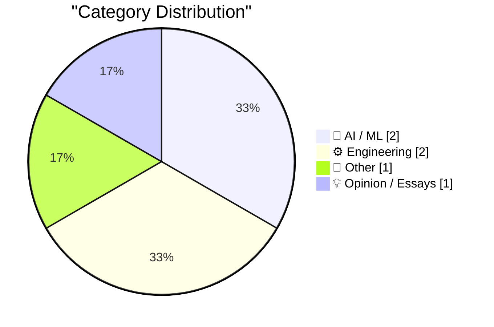
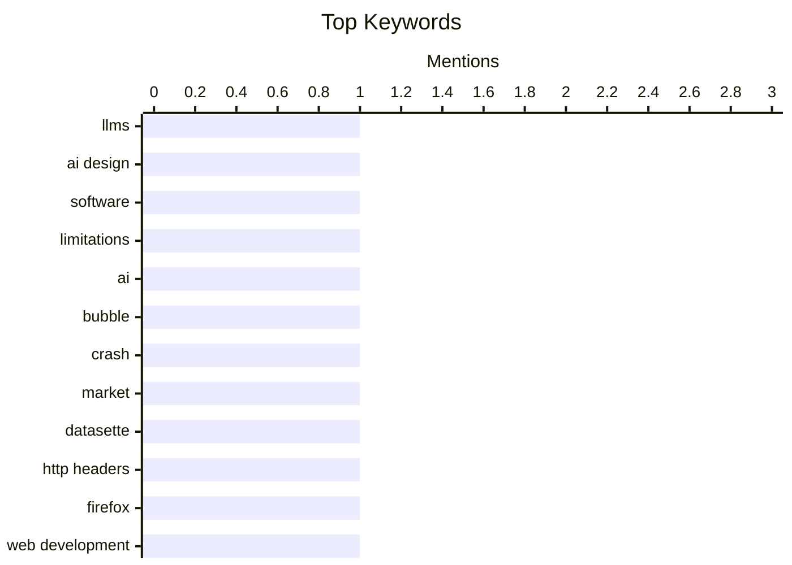

## Today's Highlights
Today's Highlights: The AI landscape is facing scrutiny as experts question the reliability of large language models in designing effective systems, while concerns about the overall stability of the industry emerge. Meanwhile, engineering challenges persist, as seen in the issues with legacy RAM technology and modern web practices, highlighting the ongoing need for innovation and adaptation in both hardware and software.
---
## Must Read Today
1. **LLMs are terrible at designing AI systems**
[LLMs are terrible at designing AI systems](https://seangoedecke.com/llms-are-terrible-at-designing-ai-systems/) — seangoedecke.com · 14h ago · 🤖 AI / ML
> The article discusses the limitations of large language models (LLMs) in designing AI systems. It argues that while LLMs can generate conventional software code, they struggle with AI-specific design challenges, often leading to flawed outputs. The author highlights the symbolic reasoning aspect that LLMs fail to grasp, which is crucial for effective AI system design. Ultimately, the conclusion is that LLMs are not yet reliable tools for creating AI systems, necessitating human oversight and expertise.
💡 **Why read it**: This article is worth reading for its critical examination of LLM capabilities, particularly in the context of AI system design.
🏷️ LLMs, AI design, software, limitations
2. **Is AI crashing?**
[Is AI crashing?](https://dfarq.homeip.net/is-ai-crashing/?utm_source=rss&#038;utm_medium=rss&#038;utm_campaign=is-ai-crashing) — dfarq.homeip.net · 2h ago · 🤖 AI / ML
> The article speculates on the current state of the AI industry as of November 2027, questioning whether the AI bubble has burst. It draws parallels to the dotcom crash, reflecting on the uncertainty surrounding AI's future. The author emphasizes the importance of documenting these trends to better understand the industry's trajectory. The main takeaway is that while the future of AI remains uncertain, historical context can provide valuable insights.
💡 **Why read it**: This article is worth reading for its timely analysis of the AI industry's potential downturn and its historical comparisons.
🏷️ AI, bubble, crash, market
3. **datasette #3046: Don't serve link: rel=next HTTP headers to Firefox for HTML pages**
[datasette #3046: Don't serve link: rel=next HTTP headers to Firefox for HTML pages](https://simonwillison.net/2026/Nov/7/link-rel-next/) — simonwillison.net · 14h ago · ⚙️ Engineering
> The article addresses an issue with Datasette where serving 'link: rel=next' HTTP headers to Firefox causes unintended HTTP prefetching of subsequent pages. The author identifies this behavior through analysis of the Firefox network panel and suggests that it can lead to performance inefficiencies. The conclusion is that developers should avoid serving these headers to improve user experience on Firefox. This highlights the importance of understanding browser-specific behaviors in web development.
💡 **Why read it**: This article is worth reading for developers interested in optimizing web applications and understanding browser interactions.
🏷️ Datasette, HTTP headers, Firefox, web development
---
## Data Overview
| Sources Scanned | Articles Fetched | Time Window | Selected |
|:---:|:---:|:---:|:---:|
| 86/92 | 2619 -> 6 | 24h | **6** |
### Category Distribution

### Top Keywords

<details>
<summary>Plain Text Keyword Chart (Terminal Friendly)</summary>
```
llms         │ ████████████████████ 1
ai design    │ ████████████████████ 1
software     │ ████████████████████ 1
limitations  │ ████████████████████ 1
ai           │ ████████████████████ 1
bubble       │ ████████████████████ 1
crash        │ ████████████████████ 1
market       │ ████████████████████ 1
datasette    │ ████████████████████ 1
http headers │ ████████████████████ 1
```
</details>
### Topic Tags
**llms**(1) · **ai design**(1) · **software**(1) · limitations(1) · ai(1) · bubble(1) · crash(1) · market(1) · datasette(1) · http headers(1) · firefox(1) · web development(1) · micron(1) · ram(1) · repair(1) · vintage(1) · macbook pro(1) · proled(1) · technology(1) · podcast(1)
---
## AI / ML
### 1. LLMs are terrible at designing AI systems
[LLMs are terrible at designing AI systems](https://seangoedecke.com/llms-are-terrible-at-designing-ai-systems/) — **seangoedecke.com** · 14h ago · ⭐ 25/30
> The article discusses the limitations of large language models (LLMs) in designing AI systems. It argues that while LLMs can generate conventional software code, they struggle with AI-specific design challenges, often leading to flawed outputs. The author highlights the symbolic reasoning aspect that LLMs fail to grasp, which is crucial for effective AI system design. Ultimately, the conclusion is that LLMs are not yet reliable tools for creating AI systems, necessitating human oversight and expertise.
🏷️ LLMs, AI design, software, limitations
---
### 2. Is AI crashing?
[Is AI crashing?](https://dfarq.homeip.net/is-ai-crashing/?utm_source=rss&#038;utm_medium=rss&#038;utm_campaign=is-ai-crashing) — **dfarq.homeip.net** · 2h ago · ⭐ 20/30
> The article speculates on the current state of the AI industry as of November 2027, questioning whether the AI bubble has burst. It draws parallels to the dotcom crash, reflecting on the uncertainty surrounding AI's future. The author emphasizes the importance of documenting these trends to better understand the industry's trajectory. The main takeaway is that while the future of AI remains uncertain, historical context can provide valuable insights.
🏷️ AI, bubble, crash, market
---
## Engineering
### 3. datasette #3046: Don't serve link: rel=next HTTP headers to Firefox for HTML pages
[datasette #3046: Don't serve link: rel=next HTTP headers to Firefox for HTML pages](https://simonwillison.net/2026/Nov/7/link-rel-next/) — **simonwillison.net** · 14h ago · ⭐ 18/30
> The article addresses an issue with Datasette where serving 'link: rel=next' HTTP headers to Firefox causes unintended HTTP prefetching of subsequent pages. The author identifies this behavior through analysis of the Firefox network panel and suggests that it can lead to performance inefficiencies. The conclusion is that developers should avoid serving these headers to improve user experience on Firefox. This highlights the importance of understanding browser-specific behaviors in web development.
🏷️ Datasette, HTTP headers, Firefox, web development
---
### 4. The problem with Micron MT 4264 RAM
[The problem with Micron MT 4264 RAM](https://dfarq.homeip.net/the-problem-with-micron-mt-4264-ram/?utm_source=rss&#038;utm_medium=rss&#038;utm_campaign=the-problem-with-micron-mt-4264-ram) — **dfarq.homeip.net** · 2h ago · ⭐ 16/30
> The article explores the reliability issues associated with Micron MT 4264 RAM chips used in 1980s computers. It notes that these chips are frequently the source of failures in vintage systems, impacting repair outcomes. The author shares anecdotal evidence from YouTube repair videos to illustrate the prevalence of this problem. The main conclusion is that the MT 4264 RAM is a notorious weak point in retro computing, which enthusiasts should be aware of.
🏷️ Micron, RAM, repair, vintage
---
## Other
### 5. Yours Truly on Full Stack Creator, Talking About the New MacBook Pros With PROLED XDR Displays
[Yours Truly on Full Stack Creator, Talking About the New MacBook Pros With PROLED XDR Displays](https://www.youtube.com/watch?v=f2GZtWuUPl0) — **daringfireball.net** · 16h ago · ⭐ 15/30
> In this video discussion, the author shares insights on the new MacBook Pros featuring PROLED XDR displays. The conversation highlights the excitement around the capabilities of these laptops and their appeal to creators. Additionally, there is a nostalgic mention of Ricoh's GR line of cameras, connecting past and present technology. The takeaway is that the new MacBook Pros represent a significant advancement in performance and display technology for creative professionals.
🏷️ MacBook Pro, PROLED, technology, podcast
---
## Opinion / Essays
### 6. Some thoughts on restaurant menu QR codes
[Some thoughts on restaurant menu QR codes](https://shkspr.mobi/blog/2026/11/some-thoughts-on-restaurant-menu-qr-codes/) — **shkspr.mobi** · 1h ago · ⭐ 9/30
> The article expresses frustration with the increasing use of QR codes for restaurant menus, contrasting them with traditional physical menus. The author critiques the reliance on technology, particularly in the context of customer experience and convenience. It emphasizes a desire for tangible items, like traditional keys, over digital alternatives. The conclusion is that while technology has its place, there is still value in maintaining traditional practices for customer satisfaction.
🏷️ QR codes, restaurant, hotels, keys
---
*Generated at 2026-11-08 14:01 | Scanned 86 sources -> 2619 articles -> selected 6*
*Based on the [Hacker News Popularity Contest 2025](https://refactoringenglish.com/tools/hn-popularity/) RSS source list recommended by [Andrej Karpathy](https://x.com/karpathy)*
*Produced by Dongdianr AI. Follow the same-name WeChat public account for more AI practical tips 💡*
