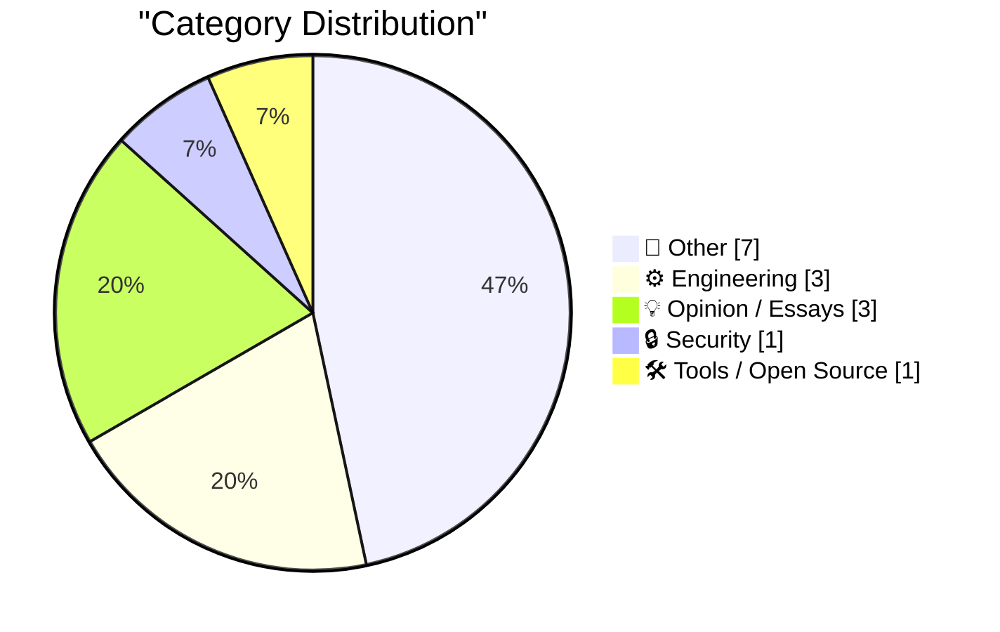
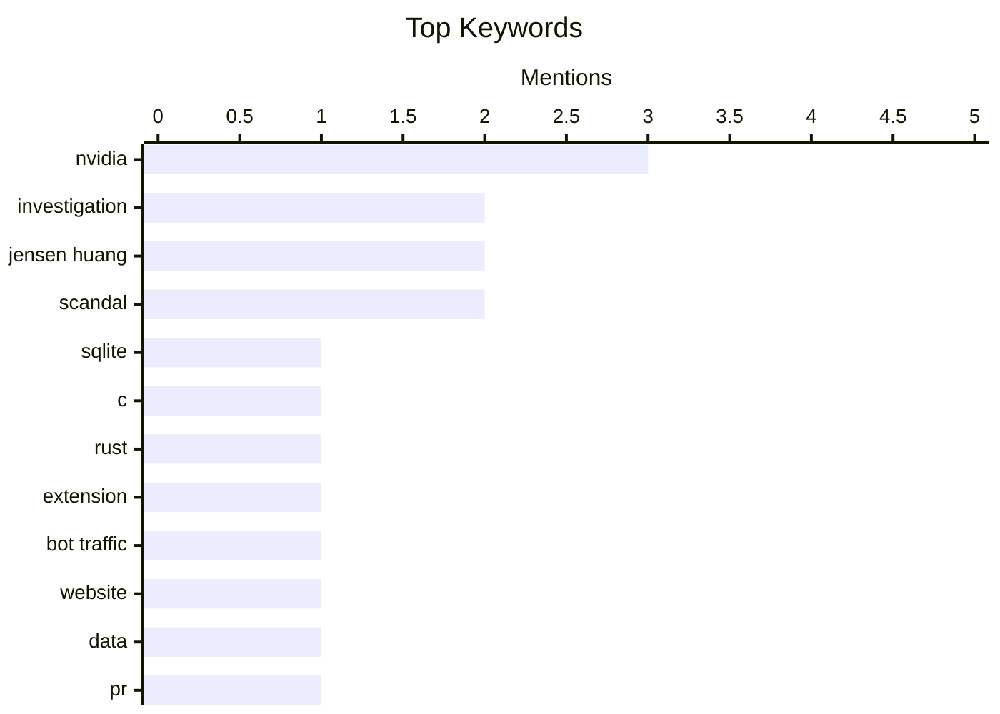

## Today's Highlights
Today's Highlights: The tech landscape is buzzing with innovation and security concerns, as developers explore new tools like the SQLite extension for number parsing while also tackling the persistent issue of bot traffic with effective mitigation strategies. Meanwhile, the ongoing scrutiny of Nvidia's CEO highlights the intersection of personal and professional integrity in the tech industry, raising questions about trust and accountability in leadership.
---
## Must Read Today
1. **parse_number() as a SQLite extension: C vs Rust**
[parse_number() as a SQLite extension: C vs Rust](https://simonwillison.net/2026/Nov/8/sqlite-parse-number-c-vs-rust/) — simonwillison.net · 15h ago · ⚙️ Engineering
> The article explores the development of a SQLite extension that implements a `parse_number()` function to convert formatted strings into numeric values. The author compares the implementation in C and Rust, highlighting the ease of use and performance differences between the two languages. Key findings indicate that while C offers lower-level control, Rust provides safety features that can prevent common programming errors. The conclusion emphasizes that Rust's advantages may outweigh C's performance benefits for this specific use case.
💡 **Why read it**: This article is worth reading for developers interested in SQLite extensions and the comparative strengths of C and Rust in practical applications.
🏷️ SQLite, C, Rust, extension
2. **Blunt Banhammer Blocks Basic Bots Ballistically**
[Blunt Banhammer Blocks Basic Bots Ballistically](https://shkspr.mobi/blog/2026/11/blunt-banhammer-blocks-basic-bots-ballistically/) — shkspr.mobi · 1h ago · 🔒 Security
> The author discusses a method that successfully reduced bot traffic to their website by over 80% using a simple trap mechanism. This approach was implemented on OpenBenches.org, which had previously experienced excessive data transfer due to AI bots. The article details the effectiveness of the trap in blocking unwanted bot activity without impacting legitimate users. The main takeaway is that straightforward solutions can significantly mitigate bot traffic issues.
💡 **Why read it**: This article is valuable for web developers and site administrators looking for effective strategies to combat bot traffic.
🏷️ bot traffic, website, data
3. **Hide your slop PR descriptions behind <details><summary>**
[Hide your slop PR descriptions behind <details><summary>](https://simonwillison.net/2026/Nov/9/details-summary/) — simonwillison.net · 9h ago · ⚙️ Engineering
> The article addresses the challenge of overly detailed pull request (PR) descriptions generated by coding agents like Claude Code or Codex. The author suggests using HTML's `<details><summary>` tags to hide less relevant information, making PRs cleaner and more manageable. This technique allows developers to focus on essential changes while still providing access to additional context if needed. The conclusion advocates for balancing detail and clarity in PR documentation.
💡 **Why read it**: This article is worth reading for developers seeking to improve their PR management and documentation practices.
🏷️ PR, Claude Code, development
---
## Data Overview
| Sources Scanned | Articles Fetched | Time Window | Selected |
|:---:|:---:|:---:|:---:|
| 87/92 | 2644 -> 16 | 24h | **15** |
### Category Distribution

### Top Keywords

<details>
<summary>Plain Text Keyword Chart (Terminal Friendly)</summary>
```
nvidia        │ ████████████████████ 3
investigation │ █████████████░░░░░░░ 2
jensen huang  │ █████████████░░░░░░░ 2
scandal       │ █████████████░░░░░░░ 2
sqlite        │ ███████░░░░░░░░░░░░░ 1
c             │ ███████░░░░░░░░░░░░░ 1
rust          │ ███████░░░░░░░░░░░░░ 1
extension     │ ███████░░░░░░░░░░░░░ 1
bot traffic   │ ███████░░░░░░░░░░░░░ 1
website       │ ███████░░░░░░░░░░░░░ 1
```
</details>
### Topic Tags
**nvidia**(3) · **investigation**(2) · **jensen huang**(2) · scandal(2) · sqlite(1) · c(1) · rust(1) · extension(1) · bot traffic(1) · website(1) · data(1) · pr(1) · claude code(1) · development(1) · reverse engineering(1) · logic chip(1) · ic(1) · curl(1) · openssl(1) · php(1)
---
## Other
### 1. Nvidia CEO Jensen Huang Was Banging a Chinese Spy, Who Was Feeding Information Back to Beijing
[Nvidia CEO Jensen Huang Was Banging a Chinese Spy, Who Was Feeding Information Back to Beijing](https://www.nytimes.com/2026/11/08/technology/nvidia-investigation-jensen-huang-china.html?unlocked_article_code=1.O1E.Soow.6UjrM7Ch-C8L) — **daringfireball.net** · 16h ago · ⭐ 17/30
> The article reports on an investigation into Nvidia CEO Jensen Huang, who admitted to a relationship with a business executive identified as a Chinese spy. This relationship raised concerns for U.S. intelligence, as she allegedly relayed sensitive information to Beijing. The investigation highlights the potential risks associated with corporate leadership and espionage. The conclusion underscores the serious implications of personal relationships in high-stakes business environments.
🏷️ Nvidia, spy, investigation
---
### 2. Jensen Huang Betrayed Nvidia, Not Just His Family
[Jensen Huang Betrayed Nvidia, Not Just His Family](https://www.nytimes.com/2026/11/06/us/politics/chinese-spy-agency-nvidia-jensen-huang.html?unlocked_article_code=1.O1E.DRyO.9mNcxhaxhtlI) — **daringfireball.net** · 14h ago · ⭐ 16/30
> The article delves into the implications of Jensen Huang's relationship with a Chinese spy, emphasizing the potential risks to Nvidia and its operations. It discusses how the company maintains that it does not share classified information and highlights the competitive landscape with domestic alternatives in China. The piece raises questions about trust and security in corporate leadership. The conclusion stresses the broader consequences of personal actions on corporate integrity.
🏷️ Nvidia, Jensen Huang, investigation
---
### 3. Jensen is cooked
[Jensen is cooked](https://garymarcus.substack.com/p/jensen-is-cooked) — **garymarcus.substack.com** · 1h ago · ⭐ 16/30
> The article provides a critical analysis of Jensen Huang's situation following revelations about his relationship with a Chinese spy. It argues that the evidence left behind compromises his position and credibility within Nvidia. The author suggests that the fallout from this incident will have lasting repercussions for Huang's career and the company. The main conclusion is that personal indiscretions can have severe professional consequences.
🏷️ Jensen Huang, affair, scandal
---
### 4. The Huang Affair: What did they know and when did they know it?
[The Huang Affair: What did they know and when did they know it?](https://garymarcus.substack.com/p/the-huang-affair-what-did-they-know) — **garymarcus.substack.com** · 11h ago · ⭐ 16/30
> The article discusses the Huang Affair, a controversy surrounding the knowledge and actions of key individuals in the tech industry regarding AI developments. It examines the timeline of events and the implications of what was known about AI capabilities and risks at various points. The author highlights the lack of transparency and accountability in the tech community, suggesting that this could have serious consequences for society. Ultimately, the piece calls for greater responsibility and ethical considerations in AI development.
🏷️ Huang Affair, Nvidia, scandal
---
### 5. Finite Projective Planes
[Finite Projective Planes](https://www.johndcook.com/blog/2026/11/08/finite-geometries/) — **johndcook.com** · 14h ago · ⭐ 13/30
> The article explores the concept of finite projective planes, a seemingly paradoxical idea in geometry where finite models satisfy certain axioms. It outlines the fundamental properties of projective planes, such as the unique line through any two distinct points. The author delves into the implications of these geometries in mathematical theory and their applications. The conclusion emphasizes the significance of finite geometries in expanding our understanding of mathematical frameworks.
🏷️ geometry, finite, projective
---
### 6. Silicon Graphics founded November 9, 1981
[Silicon Graphics founded November 9, 1981](https://dfarq.homeip.net/silicon-graphics-founded-november-9-1981/?utm_source=rss&#038;utm_medium=rss&#038;utm_campaign=silicon-graphics-founded-november-9-1981) — **dfarq.homeip.net** · 2h ago · ⭐ 12/30
> This article commemorates the founding of Silicon Graphics on November 9, 1981, a pivotal moment in computing history. It highlights the company's innovative Unix workstations, particularly the Indy and O2 models, which utilized MIPS RISC microprocessors and the IRIX operating system. The author reflects on the aesthetic and functional design of SGI's products, noting their impact on the industry. The main takeaway is the lasting legacy of Silicon Graphics in shaping high-performance computing.
🏷️ Silicon Graphics, Unix, workstations
---
### 7. Pluralistic: America cannot undo Trumpism (09 Nov 2026)
[Pluralistic: America cannot undo Trumpism (09 Nov 2026)](https://pluralistic.net/2026/11/09/brunch-is-canceled-forever/) — **pluralistic.net** · 5h ago · ⭐ 9/30
> The article discusses the enduring influence of Trumpism in American politics and society, suggesting that the only way to move forward is to confront its realities. It presents various cultural and political references that illustrate the pervasive nature of this ideology. The author argues that acknowledging and addressing the implications of Trumpism is crucial for progress. The conclusion emphasizes the necessity of grappling with these issues rather than attempting to erase them.
🏷️ Trumpism, politics, society
---
## Engineering
### 8. parse_number() as a SQLite extension: C vs Rust
[parse_number() as a SQLite extension: C vs Rust](https://simonwillison.net/2026/Nov/8/sqlite-parse-number-c-vs-rust/) — **simonwillison.net** · 15h ago · ⭐ 23/30
> The article explores the development of a SQLite extension that implements a `parse_number()` function to convert formatted strings into numeric values. The author compares the implementation in C and Rust, highlighting the ease of use and performance differences between the two languages. Key findings indicate that while C offers lower-level control, Rust provides safety features that can prevent common programming errors. The conclusion emphasizes that Rust's advantages may outweigh C's performance benefits for this specific use case.
🏷️ SQLite, C, Rust, extension
---
### 9. Hide your slop PR descriptions behind <details><summary>
[Hide your slop PR descriptions behind <details><summary>](https://simonwillison.net/2026/Nov/9/details-summary/) — **simonwillison.net** · 9h ago · ⭐ 20/30
> The article addresses the challenge of overly detailed pull request (PR) descriptions generated by coding agents like Claude Code or Codex. The author suggests using HTML's `<details><summary>` tags to hide less relevant information, making PRs cleaner and more manageable. This technique allows developers to focus on essential changes while still providing access to additional context if needed. The conclusion advocates for balancing detail and clarity in PR documentation.
🏷️ PR, Claude Code, development
---
### 10. Reverse engineering a vintage diode-transistor logic chip
[Reverse engineering a vintage diode-transistor logic chip](http://www.righto.com/feeds/7533579802505281921/comments/default) — **righto.com** · 21h ago · ⭐ 18/30
> The article chronicles the reverse engineering of a vintage diode-transistor logic (DTL) chip, specifically the ST680A from 1965. The author, CuriousMarc, details the process of identifying the chip and analyzing its internal structure under a microscope, revealing that it implements four NAND gates. This exploration highlights the historical significance of DTL technology in early computing. The main conclusion is that understanding these vintage components provides valuable insights into the evolution of digital logic design.
🏷️ reverse engineering, logic chip, IC
---
## Opinion / Essays
### 11. Addition By Subtraction
[Addition By Subtraction](https://blog.jim-nielsen.com/2026/addition-by-subtraction/) — **blog.jim-nielsen.com** · 19h ago · ⭐ 18/30
> The author reflects on the benefits of removing unnecessary functionality from their icon gallery websites, leading to a more streamlined user experience. By eliminating the option to view icons in multiple pixel dimensions, the site has become simpler and more focused. This decision aligns with the principle that sometimes less is more in design and functionality. The main takeaway is that strategic reduction can enhance overall site quality.
🏷️ functionality, simplicity, design
---
### 12. Yak-Shaving Overload
[Yak-Shaving Overload](https://feed.tedium.co/link/15204/17518143/yak-shaving-ai-mental-health-effects) — **tedium.co** · 11h ago · ⭐ 17/30
> The article discusses the phenomenon of 'yak shaving,' where one gets sidetracked by tangential tasks while trying to complete a primary objective. The author shares a personal experience involving a forgotten Linux tablet that led to a series of unnecessary technical distractions. This exploration raises awareness of how such rabbit holes can affect productivity and mental health. The main takeaway is the importance of staying focused on core tasks to avoid overwhelming distractions.
🏷️ yak-shaving, Linux, AI
---
### 13. The Web Is More Than Enough, by Paul Ford
[The Web Is More Than Enough, by Paul Ford](https://simonwillison.net/2026/Nov/9/hn-50421091/) — **simonwillison.net** · 9h ago · ⭐ 15/30
> In this article, Paul Ford argues that the web provides more than sufficient tools and resources for creativity and innovation. He emphasizes the power of web technologies like Three.js, showcasing a personal project involving a Nudibranch-themed Faberge Egg as an example of what can be achieved. Ford's perspective challenges the notion that new platforms are necessary for artistic expression, reinforcing the idea that existing web tools are adequate. The main takeaway is that the web is a rich environment for creativity without needing constant new technologies.
🏷️ web, commentary, perspective
---
## Security
### 14. Blunt Banhammer Blocks Basic Bots Ballistically
[Blunt Banhammer Blocks Basic Bots Ballistically](https://shkspr.mobi/blog/2026/11/blunt-banhammer-blocks-basic-bots-ballistically/) — **shkspr.mobi** · 1h ago · ⭐ 21/30
> The author discusses a method that successfully reduced bot traffic to their website by over 80% using a simple trap mechanism. This approach was implemented on OpenBenches.org, which had previously experienced excessive data transfer due to AI bots. The article details the effectiveness of the trap in blocking unwanted bot activity without impacting legitimate users. The main takeaway is that straightforward solutions can significantly mitigate bot traffic issues.
🏷️ bot traffic, website, data
---
## Tools / Open Source
### 15. Introducing Ninety
[Introducing Ninety](https://nesbitt.io/2026/11/09/introducing-ninety.html) — **nesbitt.io** · 2h ago · ⭐ 18/30
> The article introduces a new trading platform called Ninety, which supports various tools including curl, OpenSSL, lodash, and PHP. The platform aims to streamline trading processes for developers and enhance integration capabilities. Key features include a focus on security and ease of use for developers familiar with these tools. The conclusion emphasizes Ninety's potential to simplify trading operations in a developer-friendly environment.
🏷️ curl, OpenSSL, PHP
---
*Generated at 2026-11-09 14:01 | Scanned 87 sources -> 2644 articles -> selected 15*
*Based on the [Hacker News Popularity Contest 2025](https://refactoringenglish.com/tools/hn-popularity/) RSS source list recommended by [Andrej Karpathy](https://x.com/karpathy)*
*Produced by Dongdianr AI. Follow the same-name WeChat public account for more AI practical tips 💡*
