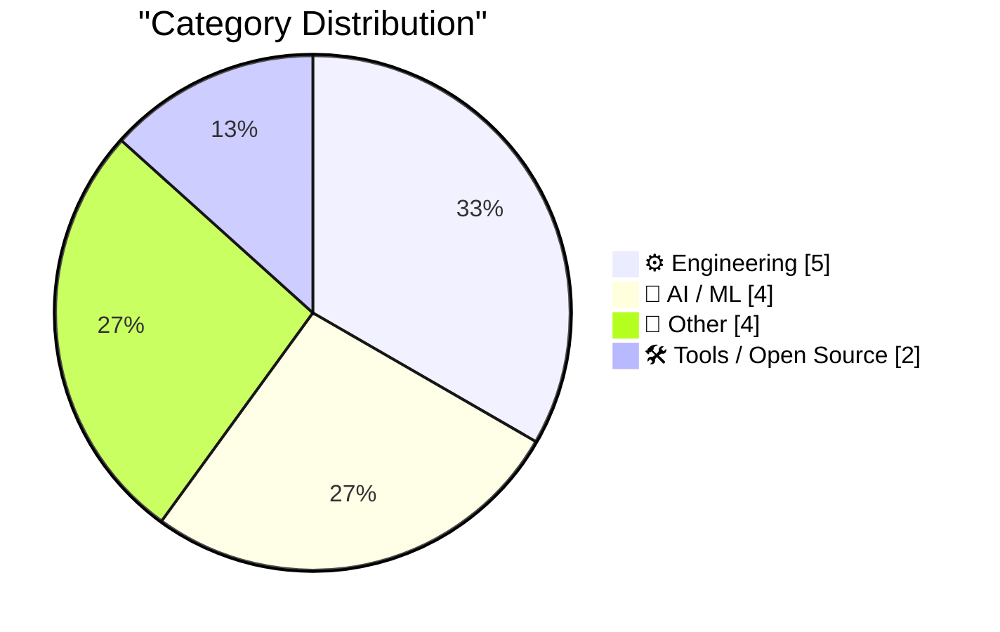
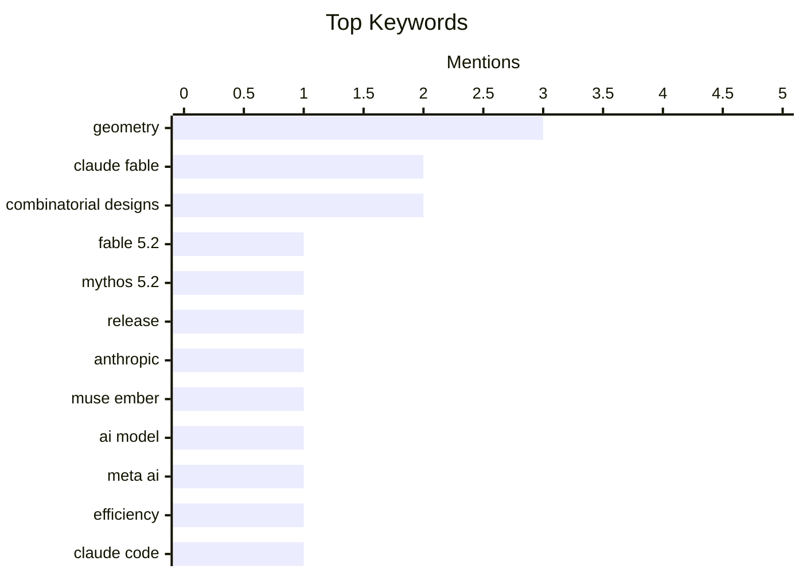

## Today's Highlights
Today's highlights showcase a significant push towards efficiency and innovation in AI models, with Anthropic and Meta AI unveiling updates and new models designed for complex reasoning and streamlined performance. Additionally, the exploration of token usage in AI applications like Claude Code emphasizes the growing need for clarity in resource management as these technologies evolve. Meanwhile, tools like WorkOS Airlock are emerging to enhance agent permissions, reflecting a broader trend towards more controlled and secure AI interactions.
---
## Must Read Today
1. **llm-anthropic 0.31**
[llm-anthropic 0.31](https://simonwillison.net/2026/Nov/9/llm-anthropic/) — simonwillison.net · 14h ago · 🤖 AI / ML
> Anthropic has released version 0.31 of llm-anthropic, which includes significant updates to their models Fable 5.2 and Mythos 5.2. Notably, Fable 5.2 has achieved the top rank on Artificial Analysis and claims to have solved two open problems in black hole physics, showcasing its advanced capabilities. The internal benchmarks indicate substantial improvements in performance metrics compared to previous versions. This release highlights Anthropic's commitment to pushing the boundaries of AI research and application. The main takeaway is that Fable 5.2 represents a significant advancement in LLM technology with practical implications in scientific domains.
💡 **Why read it**: This article is worth reading for insights into the latest advancements in LLM technology and their implications for scientific research.
🏷️ Fable 5.2, Mythos 5.2, release, Anthropic
2. **Introducing Our Smallest, Most Efficient Model: Muse Ember**
[Introducing Our Smallest, Most Efficient Model: Muse Ember](https://simonwillison.net/2026/Nov/10/muse-ember/) — simonwillison.net · 6h ago · 🤖 AI / ML
> Meta AI has introduced Muse Ember, their smallest and most efficient model tailored for complex reasoning tasks. Designed to handle tool calls, coding subtasks, and long document parsing, Muse Ember aims to optimize performance in environments requiring frequent interactions with various tools. The model's efficiency is emphasized, making it suitable for applications that demand quick and reliable responses. The main conclusion is that Muse Ember sets a new standard for compact yet powerful AI models in the industry.
💡 **Why read it**: This article is essential for understanding the evolution of AI models towards greater efficiency and their practical applications.
🏷️ Muse Ember, AI model, Meta AI, efficiency
3. **Claude Code token cost explorer**
[Claude Code token cost explorer](https://entropicthoughts.com/claude-code-token-cost-explorer) — entropicthoughts.com · 15h ago · 🤖 AI / ML
> The article discusses challenges in diagnosing token usage in Claude Code when incorporating subagents into the workflow. Existing tools like ccusage and claude-agent-ledger were found inadequate for providing detailed breakdowns of token usage across subagents. The author developed a custom solution to optimize token usage more effectively, demonstrating the need for tailored tools in complex LLM environments. The key takeaway is that specialized tools are necessary for efficient management of token costs in multi-agent systems.
💡 **Why read it**: This article is valuable for LLM developers looking to optimize token usage and improve workflow efficiency.
🏷️ Claude Code, token cost, subagents
---
## Data Overview
| Sources Scanned | Articles Fetched | Time Window | Selected |
|:---:|:---:|:---:|:---:|
| 86/92 | 2618 -> 21 | 24h | **15** |
### Category Distribution

### Top Keywords

<details>
<summary>Plain Text Keyword Chart (Terminal Friendly)</summary>
```
geometry              │ ████████████████████ 3
claude fable          │ █████████████░░░░░░░ 2
combinatorial designs │ █████████████░░░░░░░ 2
fable 5.2             │ ███████░░░░░░░░░░░░░ 1
mythos 5.2            │ ███████░░░░░░░░░░░░░ 1
release               │ ███████░░░░░░░░░░░░░ 1
anthropic             │ ███████░░░░░░░░░░░░░ 1
muse ember            │ ███████░░░░░░░░░░░░░ 1
ai model              │ ███████░░░░░░░░░░░░░ 1
meta ai               │ ███████░░░░░░░░░░░░░ 1
```
</details>
### Topic Tags
**geometry**(3) · **claude fable**(2) · **combinatorial designs**(2) · fable 5.2(1) · mythos 5.2(1) · release(1) · anthropic(1) · muse ember(1) · ai model(1) · meta ai(1) · efficiency(1) · claude code(1) · token cost(1) · subagents(1) · prompting(1) · ai(1) · coding tasks(1) · workos(1) · agents(1) · tools(1)
---
## Engineering
### 1. If the Windows Update hot patcher checks that the function hasn’t already been patched, does that mean you can’t install two hot-patches?
[If the Windows Update hot patcher checks that the function hasn’t already been patched, does that mean you can’t install two hot-patches?](https://devblogs.microsoft.com/oldnewthing/20261109-00/?p=112841/) — **devblogs.microsoft.com/oldnewthing** · 23h ago · ⭐ 15/30
> The article addresses a technical question regarding the Windows Update hot patching system and its checks for previously patched functions. It explores the implications of these checks on the installation of multiple hot patches, providing insights into the design of the patching process. The discussion highlights the complexities involved in maintaining system integrity while applying updates. The main conclusion is that understanding these mechanisms is essential for effective system maintenance.
🏷️ Windows Update, hot patch, function
---
### 2. Combinatorial designs
[Combinatorial designs](https://www.johndcook.com/blog/2026/11/09/combinatorial-designs/) — **johndcook.com** · 12h ago · ⭐ 15/30
> This article builds on previous discussions about finite geometry, introducing the concept of combinatorial designs. It defines Steiner triple systems and explains their significance in combinatorial mathematics. The post connects theoretical concepts with practical applications, illustrating the relevance of combinatorial designs in various fields. The main takeaway is that combinatorial designs are foundational in understanding complex mathematical structures.
🏷️ combinatorial designs, finite geometry, Steiner systems
---
### 3. Steiner Systems
[Steiner Systems](https://www.johndcook.com/blog/2026/11/09/steiner-systems/) — **johndcook.com** · 20h ago · ⭐ 15/30
> The article focuses on Steiner systems, specifically Steiner triple systems (STS), which are collections of three-element subsets of a set. It explains the properties of STS(n) and provides examples, emphasizing their role in finite projective geometry. The discussion highlights the mathematical elegance and utility of these systems in combinatorial design theory. The main conclusion is that Steiner systems are crucial for understanding the interplay between combinatorics and geometry.
🏷️ Steiner triples, combinatorial designs, geometry
---
### 4. Finite hyperbolic planes
[Finite hyperbolic planes](https://www.johndcook.com/blog/2026/11/09/finite-hyperbolic-planes/) — **johndcook.com** · 23h ago · ⭐ 15/30
> The article explores the properties of finite hyperbolic planes, which differ significantly from Euclidean geometry, particularly regarding parallel lines. In hyperbolic geometry, through a point not on a given line, there are infinitely many lines that can be drawn parallel to the original line. The author discusses the implications of these properties on geometric constructions and the nature of parallelism in finite settings. The main takeaway is that finite hyperbolic planes provide a rich area for mathematical exploration, challenging traditional notions of geometry.
🏷️ hyperbolic planes, geometry, Euclid
---
### 5. Finite Affine Planes
[Finite Affine Planes](https://www.johndcook.com/blog/2026/11/09/finite-affine-planes/) — **johndcook.com** · 23h ago · ⭐ 15/30
> This article examines finite affine planes, a structure that retains incidence properties from Euclidean geometry while discarding metric properties. The author contrasts affine planes with projective and hyperbolic planes, emphasizing their unique characteristics and applications. Key findings include how affine planes maintain parallelism without the complications of distance. The conclusion highlights the significance of affine planes in understanding geometric relationships and their foundational role in various mathematical contexts.
🏷️ affine planes, geometry, incidence
---
## AI / ML
### 6. llm-anthropic 0.31
[llm-anthropic 0.31](https://simonwillison.net/2026/Nov/9/llm-anthropic/) — **simonwillison.net** · 14h ago · ⭐ 27/30
> Anthropic has released version 0.31 of llm-anthropic, which includes significant updates to their models Fable 5.2 and Mythos 5.2. Notably, Fable 5.2 has achieved the top rank on Artificial Analysis and claims to have solved two open problems in black hole physics, showcasing its advanced capabilities. The internal benchmarks indicate substantial improvements in performance metrics compared to previous versions. This release highlights Anthropic's commitment to pushing the boundaries of AI research and application. The main takeaway is that Fable 5.2 represents a significant advancement in LLM technology with practical implications in scientific domains.
🏷️ Fable 5.2, Mythos 5.2, release, Anthropic
---
### 7. Introducing Our Smallest, Most Efficient Model: Muse Ember
[Introducing Our Smallest, Most Efficient Model: Muse Ember](https://simonwillison.net/2026/Nov/10/muse-ember/) — **simonwillison.net** · 6h ago · ⭐ 24/30
> Meta AI has introduced Muse Ember, their smallest and most efficient model tailored for complex reasoning tasks. Designed to handle tool calls, coding subtasks, and long document parsing, Muse Ember aims to optimize performance in environments requiring frequent interactions with various tools. The model's efficiency is emphasized, making it suitable for applications that demand quick and reliable responses. The main conclusion is that Muse Ember sets a new standard for compact yet powerful AI models in the industry.
🏷️ Muse Ember, AI model, Meta AI, efficiency
---
### 8. Claude Code token cost explorer
[Claude Code token cost explorer](https://entropicthoughts.com/claude-code-token-cost-explorer) — **entropicthoughts.com** · 15h ago · ⭐ 24/30
> The article discusses challenges in diagnosing token usage in Claude Code when incorporating subagents into the workflow. Existing tools like ccusage and claude-agent-ledger were found inadequate for providing detailed breakdowns of token usage across subagents. The author developed a custom solution to optimize token usage more effectively, demonstrating the need for tailored tools in complex LLM environments. The key takeaway is that specialized tools are necessary for efficient management of token costs in multi-agent systems.
🏷️ Claude Code, token cost, subagents
---
### 9. Quoting Prompting Claude Fable 5.2
[Quoting Prompting Claude Fable 5.2](https://simonwillison.net/2026/Nov/10/prompting-claude-fable-52/) — **simonwillison.net** · 8h ago · ⭐ 21/30
> The article explores how Claude Fable 5.2 responds to prompts regarding code ownership, revealing its behavior in coding tasks. Tests showed that when ownership was not specified, the model tended to add to existing code structures, even if it repeated code. This behavior highlights the importance of prompt engineering in guiding model responses effectively. The main conclusion is that understanding and crafting prompts is crucial for achieving desired outcomes in AI coding tasks.
🏷️ Claude Fable, prompting, AI, coding tasks
---
## Other
### 10. Bloomberg Was Onto Megaspeed’s Game a Year Ago
[Bloomberg Was Onto Megaspeed’s Game a Year Ago](https://www.bloomberg.com/news/features/2025-12-22/nvidia-partner-megaspeed-draws-china-chip-smuggling-concerns-in-us) — **daringfireball.net** · 14h ago · ⭐ 16/30
> The article investigates Megaspeed International Pte., a rapidly growing AI firm that has become the largest buyer of Nvidia chips in Southeast Asia. It highlights concerns regarding potential chip smuggling and the company's swift rise from obscurity to prominence within three years. The report underscores the competitive dynamics in the AI and chip markets, particularly in relation to geopolitical tensions. The main conclusion is that Megaspeed's trajectory reflects broader trends and challenges in the tech industry.
🏷️ Megaspeed, AI firm, Bloomberg, attention
---
### 11. Weekly Update 529: Kids Social Media Bans (and Everything Else)
[Weekly Update 529: Kids Social Media Bans (and Everything Else)](https://www.troyhunt.com/weekly-update-529/) — **troyhunt.com** · 13h ago · ⭐ 15/30
> The article discusses the ongoing debate about social media access for children, criticizing the simplistic approach of delaying access until age 16. The author argues that the real issue lies in the enforcement of these regulations and the responsibilities of policymakers. Key points include the lack of understanding among leaders about the complexities of social media and youth engagement. The main takeaway is that effective regulation requires a nuanced understanding of technology and its societal impact.
🏷️ social media, kids, responsibility, laws
---
### 12. Short-Seller Culper Research Published Information on Jensen Huang’s Affair Back in May
[Short-Seller Culper Research Published Information on Jensen Huang’s Affair Back in May](https://culperresearch.com/wp-content/uploads/2026/05/Culper_NVDA_5-13-2026.pdf) — **daringfireball.net** · 17h ago · ⭐ 13/30
> The article reviews a report by Culper Research alleging that Nvidia's business in China was significantly impacted by U.S. trade restrictions, contrary to Nvidia's claims of zero revenue from China. The report suggests that over 20% of Nvidia's FY 2026 compute revenues were still derived from China through illegal GPU diversion and intermediaries. This raises questions about the transparency of Nvidia's financial disclosures and the broader implications for the tech industry. The conclusion emphasizes the need for scrutiny in corporate claims regarding international revenue.
🏷️ Nvidia, China, short-seller, report
---
### 13. Locating the source of a mysterious beep with Claude
[Locating the source of a mysterious beep with Claude](https://simonwillison.net/2026/Nov/9/mysterious-beeps/) — **simonwillison.net** · 14h ago · ⭐ 12/30
> The article describes a personal challenge of locating an intermittent beeping sound in a cluttered room, leading to the development of a software tool called Beep Locator. This tool utilizes triangulation techniques to identify the source of the sound without needing to unpack numerous boxes. The author shares insights into the technical implementation of the software and its effectiveness in solving the problem. The main takeaway is that innovative software solutions can simplify everyday challenges in unexpected ways.
🏷️ beep, mystery, house, frustration
---
## Tools / Open Source
### 14. [Sponsor] WorkOS: Let Agents Use Your Tools Without Giving Them Free Rein
[[Sponsor] WorkOS: Let Agents Use Your Tools Without Giving Them Free Rein](https://www.workos.com/airlock?utm_source=daringfireball&amp;utm_medium=newsletter&amp;utm_campaign=q42026) — **daringfireball.net** · 9h ago · ⭐ 19/30
> WorkOS Airlock provides a solution for managing agent permissions by allowing task-specific calls that are checked against predefined policies. This approach ensures that each action taken by an agent is either approved, denied, or escalated for human review, enhancing security and control. By logging every decision, the system offers transparency and accountability in agent operations. The main takeaway is that WorkOS Airlock enables safer and more efficient use of automated agents in various tasks.
🏷️ WorkOS, agents, tools, permissions
---
### 15. Yonkers Rises
[Yonkers Rises](https://simonwillison.net/2026/Nov/10/yonkers-rises/) — **simonwillison.net** · 10h ago · ⭐ 15/30
> The article describes an exploration of Yonkers, utilizing Claude Fable 5.2's capabilities for 3D modeling and animation. The author prompted the model to create a visual representation of Yonkers, demonstrating the model's proficiency in handling geographic and spatial data. This application showcases the potential of AI in enhancing our understanding of locations through interactive media. The main takeaway is that AI can significantly enrich geographic learning experiences.
🏷️ Yonkers, 3D modeling, Claude Fable, location
---
*Generated at 2026-11-10 14:01 | Scanned 86 sources -> 2618 articles -> selected 15*
*Based on the [Hacker News Popularity Contest 2025](https://refactoringenglish.com/tools/hn-popularity/) RSS source list recommended by [Andrej Karpathy](https://x.com/karpathy)*
*Produced by Dongdianr AI. Follow the same-name WeChat public account for more AI practical tips 💡*
