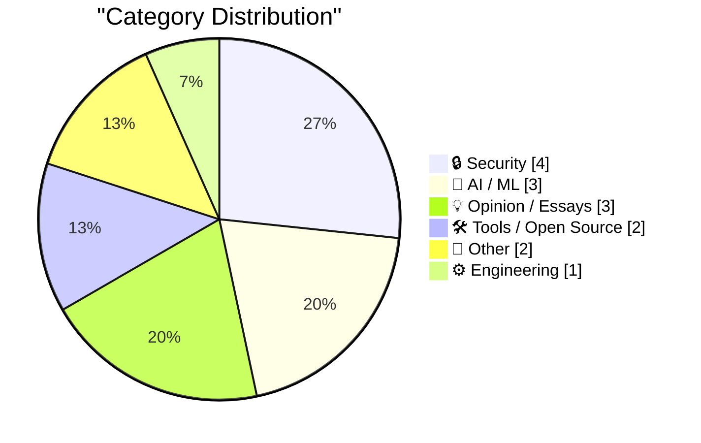
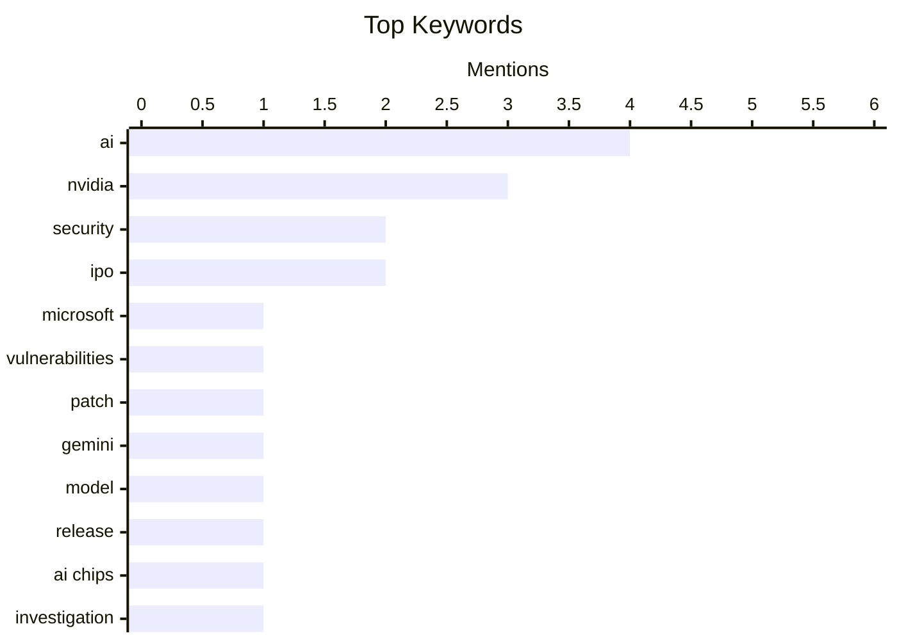

## Today's Highlights
Today's highlights reveal a dual focus on security and the evolving landscape of artificial intelligence. Microsoft has made headlines by addressing nearly 1,100 vulnerabilities, underscoring the ongoing battle against cyber threats. Meanwhile, the AI sector is buzzing with the release of llm-gemini 0.36 and discussions around the implications of corporate influence in regulatory investigations, highlighting the intersection of technology and governance. As privacy concerns grow, updates like Safari's Global Privacy Control feature reflect a broader trend towards enhancing user protection in the digital age.
---
## Must Read Today
1. **Microsoft Fixes Nearly 1,100 Security Vulnerabilities**
[Microsoft Fixes Nearly 1,100 Security Vulnerabilities](https://krebsonsecurity.com/2026/11/microsoft-fixes-nearly-1100-security-vulnerabilities/) — krebsonsecurity.com · 16h ago · 🔒 Security
> Microsoft has released a significant patch addressing nearly 1,100 security vulnerabilities in its Windows operating systems and supported software. This month's Patch Tuesday includes fixes for 63 critical flaws, notably a zero-day vulnerability in Microsoft Outlook. The updates are part of a broader trend, with other major software companies like Adobe, Apple, Google, and Mozilla also issuing important security updates. The key takeaway is the urgency for users to apply these patches to protect against potential exploits.
💡 **Why read it**: This article highlights a critical security update that users must be aware of to safeguard their systems.
🏷️ Microsoft, security, vulnerabilities, patch
2. **llm-gemini 0.36**
[llm-gemini 0.36](https://simonwillison.net/2026/Nov/10/llm-gemini/) — simonwillison.net · 17h ago · 🤖 AI / ML
> The article discusses the release of llm-gemini version 0.36, which coincides with the public availability of Gemini 4 Carbon, a model designed for cyber defenders. This version enhances capabilities for users by integrating advanced AI functionalities. The key takeaway is that this release marks a significant step forward in AI tools available for cybersecurity applications.
💡 **Why read it**: This article is valuable for those interested in the latest advancements in AI tools for cybersecurity.
🏷️ Gemini, AI, model, release
3. **U.S. Commerce Dept. Inquiry Into Megaspeed Was Halted After Nvidia Name-Dropped Trump Appointee**
[U.S. Commerce Dept. Inquiry Into Megaspeed Was Halted After Nvidia Name-Dropped Trump Appointee](https://www.nytimes.com/2026/11/09/business/economy/nvidia-megaspeed-investigation-huang.html?unlocked_article_code=1.PVE.GxBL.iBpBoc8Y4tnb) — daringfireball.net · 23h ago · 🤖 AI / ML
> The article reveals that a U.S. Commerce Department investigation into Megaspeed, suspected of smuggling Nvidia AI chips to China, was abruptly halted. The investigation was complicated by the involvement of a Trump appointee, raising concerns about political interference. The main conclusion is that the intersection of technology and politics can significantly impact national security investigations.
💡 **Why read it**: This article provides insight into the complex relationship between technology companies and government investigations.
🏷️ Nvidia, AI chips, investigation
---
## Data Overview
| Sources Scanned | Articles Fetched | Time Window | Selected |
|:---:|:---:|:---:|:---:|
| 87/92 | 2635 -> 28 | 24h | **15** |
### Category Distribution

### Top Keywords

<details>
<summary>Plain Text Keyword Chart (Terminal Friendly)</summary>
```
ai              │ ████████████████████ 4
nvidia          │ ███████████████░░░░░ 3
security        │ ██████████░░░░░░░░░░ 2
ipo             │ ██████████░░░░░░░░░░ 2
microsoft       │ █████░░░░░░░░░░░░░░░ 1
vulnerabilities │ █████░░░░░░░░░░░░░░░ 1
patch           │ █████░░░░░░░░░░░░░░░ 1
gemini          │ █████░░░░░░░░░░░░░░░ 1
model           │ █████░░░░░░░░░░░░░░░ 1
release         │ █████░░░░░░░░░░░░░░░ 1
```
</details>
### Topic Tags
**ai**(4) · **nvidia**(3) · **security**(2) · ipo(2) · microsoft(1) · vulnerabilities(1) · patch(1) · gemini(1) · model(1) · release(1) · ai chips(1) · investigation(1) · surveillance(1) · european court(1) · human rights(1) · source control(1) · releases(1) · advisories(1) · website(1) · ai tools(1)
---
## Security
### 1. Microsoft Fixes Nearly 1,100 Security Vulnerabilities
[Microsoft Fixes Nearly 1,100 Security Vulnerabilities](https://krebsonsecurity.com/2026/11/microsoft-fixes-nearly-1100-security-vulnerabilities/) — **krebsonsecurity.com** · 16h ago · ⭐ 29/30
> Microsoft has released a significant patch addressing nearly 1,100 security vulnerabilities in its Windows operating systems and supported software. This month's Patch Tuesday includes fixes for 63 critical flaws, notably a zero-day vulnerability in Microsoft Outlook. The updates are part of a broader trend, with other major software companies like Adobe, Apple, Google, and Mozilla also issuing important security updates. The key takeaway is the urgency for users to apply these patches to protect against potential exploits.
🏷️ Microsoft, security, vulnerabilities, patch
---
### 2. Revisiting Leander v Sweden and Big Brother Watch
[Revisiting Leander v Sweden and Big Brother Watch](https://berthub.eu/articles/posts/revisiting-leander-and-big-brother/) — **berthub.eu** · 18h ago · ⭐ 24/30
> The article examines the implications of recent European Court of Human Rights rulings on bulk surveillance in light of evolving cybersecurity and AI technologies. It argues that these legal precedents may influence future assessments of signals intelligence (SIGINT) and data collection practices. The main takeaway is the need for ongoing scrutiny of surveillance measures to ensure they align with human rights standards.
🏷️ surveillance, European Court, human rights
---
### 3. Safari 27.3 Adds Support for Global Privacy Control
[Safari 27.3 Adds Support for Global Privacy Control](https://pxlnv.com/linklog/safari-global-privacy-control/) — **daringfireball.net** · 23h ago · ⭐ 18/30
> The article discusses the new features in Safari's OS 27.3 update, particularly the addition of Global Privacy Control (GPC). This standard aims to enhance user privacy by allowing a single indication of tracking preferences, potentially reducing cookie consent banners. The main conclusion is that GPC represents a significant step forward in user privacy rights on the web.
🏷️ Safari, privacy, update, control
---
### 4. Finally, Payment by Bank Transfer Comes to Have I Been Pwned
[Finally, Payment by Bank Transfer Comes to Have I Been Pwned](https://www.troyhunt.com/finally-payment-by-bank-transfer-comes-to-have-i-been-pwned/) — **troyhunt.com** · 17h ago · ⭐ 18/30
> The article announces the introduction of bank transfer payment options for the Have I Been Pwned service, addressing a long-standing user request. It highlights the challenges of payment processing and the need for secure transactions in the context of data breaches. The author discusses the technical implementation of this feature, ensuring it aligns with user security and privacy standards. The conclusion emphasizes the importance of user convenience while maintaining robust security measures. This development marks a significant enhancement in user experience for the service.
🏷️ payment, Have I Been Pwned, security
---
## AI / ML
### 5. llm-gemini 0.36
[llm-gemini 0.36](https://simonwillison.net/2026/Nov/10/llm-gemini/) — **simonwillison.net** · 17h ago · ⭐ 24/30
> The article discusses the release of llm-gemini version 0.36, which coincides with the public availability of Gemini 4 Carbon, a model designed for cyber defenders. This version enhances capabilities for users by integrating advanced AI functionalities. The key takeaway is that this release marks a significant step forward in AI tools available for cybersecurity applications.
🏷️ Gemini, AI, model, release
---
### 6. U.S. Commerce Dept. Inquiry Into Megaspeed Was Halted After Nvidia Name-Dropped Trump Appointee
[U.S. Commerce Dept. Inquiry Into Megaspeed Was Halted After Nvidia Name-Dropped Trump Appointee](https://www.nytimes.com/2026/11/09/business/economy/nvidia-megaspeed-investigation-huang.html?unlocked_article_code=1.PVE.GxBL.iBpBoc8Y4tnb) — **daringfireball.net** · 23h ago · ⭐ 24/30
> The article reveals that a U.S. Commerce Department investigation into Megaspeed, suspected of smuggling Nvidia AI chips to China, was abruptly halted. The investigation was complicated by the involvement of a Trump appointee, raising concerns about political interference. The main conclusion is that the intersection of technology and politics can significantly impact national security investigations.
🏷️ Nvidia, AI chips, investigation
---
### 7. Ms. Bashkansky, Please Do Not Build The Torment Nexus
[Ms. Bashkansky, Please Do Not Build The Torment Nexus](https://jyn.dev/ms-bashkansky-please-do-not-build-the-torment-nexus/) — **jyn.dev** · 14h ago · ⭐ 18/30
> The article discusses the ethical implications of developing AI that can read minds, termed the 'Torment Nexus.' It argues that such technology poses significant risks to privacy and mental autonomy, potentially leading to severe societal consequences. The author emphasizes the importance of considering the moral responsibilities of AI developers and advocates for stringent regulations. Ultimately, the piece warns against the normalization of invasive technologies that could exploit human thoughts. The takeaway is a call for caution in AI advancements that infringe on personal freedoms.
🏷️ AI, ethics, mind reading
---
## Opinion / Essays
### 8. Glue work is still harmful in the age of AI
[Glue work is still harmful in the age of AI](https://seangoedecke.com/glue-work-is-still-harmful-in-the-age-of-ai/) — **seangoedecke.com** · 14h ago · ⭐ 18/30
> The article critiques the concept of 'glue work,' which refers to tasks that support engineering efforts but are often unrewarded. It argues that even with the rise of AI in coding, glue work remains detrimental to productivity and innovation. The main takeaway is that organizations should strive to eliminate such work to foster a healthier engineering environment.
🏷️ glue work, AI, engineering, productivity
---
### 9. Just say no to Anthropic’s IPO
[Just say no to Anthropic’s IPO](https://garymarcus.substack.com/p/just-say-no-to-anthropics-ipo) — **garymarcus.substack.com** · 23h ago · ⭐ 18/30
> The article presents a critical perspective on Anthropic's initial public offering (IPO), arguing against investment in the company. It highlights concerns regarding the company's long-term viability and ethical implications of its AI technologies. The main takeaway is that potential investors should carefully consider the risks associated with Anthropic before making investment decisions.
🏷️ Anthropic, IPO, investment
---
### 10. Gary Marcus: ‘Just Say No to Anthropic’s IPO’
[Gary Marcus: ‘Just Say No to Anthropic’s IPO’](https://garymarcus.substack.com/p/just-say-no-to-anthropics-ipo?r=3k69a0) — **daringfireball.net** · 15h ago · ⭐ 15/30
> Gary Marcus critiques Anthropic's impending IPO, arguing that the company faces unsustainable financial pressures in a competitive AI market. He points out that the need for increasing capital to achieve marginal improvements raises concerns about the viability of their business model. Marcus asserts that there is no significant competitive advantage ('moat') for AI models, predicting potential failure for both the IPO and the company itself. The main takeaway is a cautionary stance on investing in AI ventures that lack solid foundations. This analysis provides a sobering view of the AI industry's financial landscape.
🏷️ IPO, AI, capital, market
---
## Tools / Open Source
### 11. This Week in Source Control: 11 November 2026
[This Week in Source Control: 11 November 2026](https://nesbitt.io/2026/11/11/this-week-in-source-control.html) — **nesbitt.io** · 4h ago · ⭐ 21/30
> This article provides a roundup of recent releases, advisories, and discussions in the version control and software forges community. It highlights key updates and trends affecting source control practices. The main conclusion is that staying informed about these developments is essential for developers to maintain effective version control workflows.
🏷️ source control, releases, advisories
---
### 12. Making a Website in 2026
[Making a Website in 2026](https://blog.jim-nielsen.com/2026/making-websites-in-2026/) — **blog.jim-nielsen.com** · 19h ago · ⭐ 21/30
> The article discusses the process of creating a website using various AI tools, as documented by Pete Millspaugh. It emphasizes the evolving landscape of web development and the potential for AI to streamline the process. The key takeaway is that AI is transforming how websites are built, making it more accessible for non-technical users.
🏷️ website, AI tools, 2026
---
## Other
### 13. Bloomberg: ‘Nvidia Intervened in U.S. Probe of Megaspeed Chip Smuggling’
[Bloomberg: ‘Nvidia Intervened in U.S. Probe of Megaspeed Chip Smuggling’](https://www.bloomberg.com/news/articles/2026-11-09/nvidia-intervened-in-us-probe-of-megaspeed-chip-smuggling) — **daringfireball.net** · 20h ago · ⭐ 19/30
> The article details Nvidia's involvement in a U.S. investigation into Megaspeed, which was suspected of smuggling AI chips to China. Despite initial cooperation, Nvidia provided incomplete information to the Bureau of Industry and Security (BIS), raising questions about transparency. The main conclusion is that corporate influence can complicate regulatory oversight in critical technology sectors.
🏷️ Nvidia, probe, chip, smuggling
---
### 14. ‘A Scandal at the Center of the Economy’
[‘A Scandal at the Center of the Economy’](https://www.theatlantic.com/technology/2026/11/jensen-huang-chinese-spy/689357/?gift=aQyUJR7AIw1mJWdQ6Ed6yPI8n1FlV88MR9f9IZruvFA&amp;) — **daringfireball.net** · 23h ago · ⭐ 15/30
> The article explores the controversy surrounding Nvidia CEO Jensen Huang's relationship with a Chinese businesswoman linked to Beijing's Ministry of State Security. It highlights the apparent indifference from key figures in Silicon Valley and Washington, D.C., regarding the implications of this relationship for national security and corporate governance. The author reflects on the broader societal impacts of such scandals in the tech industry, questioning the accountability of leaders. The conclusion suggests a need for greater scrutiny of personal conduct in high-stakes business environments. This piece raises important questions about ethics in technology leadership.
🏷️ Nvidia, scandal, Silicon Valley
---
## Engineering
### 15. Monads in Lean
[Monads in Lean](https://eli.thegreenplace.net/2026/monads-in-lean/) — **eli.thegreenplace.net** · 10h ago · ⭐ 18/30
> This article provides a tutorial on implementing monads in Lean 4, a functional programming language. It illustrates the concept through a motivating example of evaluating expressions, demonstrating how monads can manage side effects in a pure functional context. The author explains the syntax and semantics of monads, comparing them to similar constructs in Haskell and OCaml. The main conclusion is that understanding monads is essential for effective programming in Lean, particularly for handling complex computations. Readers will gain practical insights into functional programming principles.
🏷️ monads, Lean, functional programming
---
*Generated at 2026-11-11 14:01 | Scanned 87 sources -> 2635 articles -> selected 15*
*Based on the [Hacker News Popularity Contest 2025](https://refactoringenglish.com/tools/hn-popularity/) RSS source list recommended by [Andrej Karpathy](https://x.com/karpathy)*
*Produced by Dongdianr AI. Follow the same-name WeChat public account for more AI practical tips 💡*
