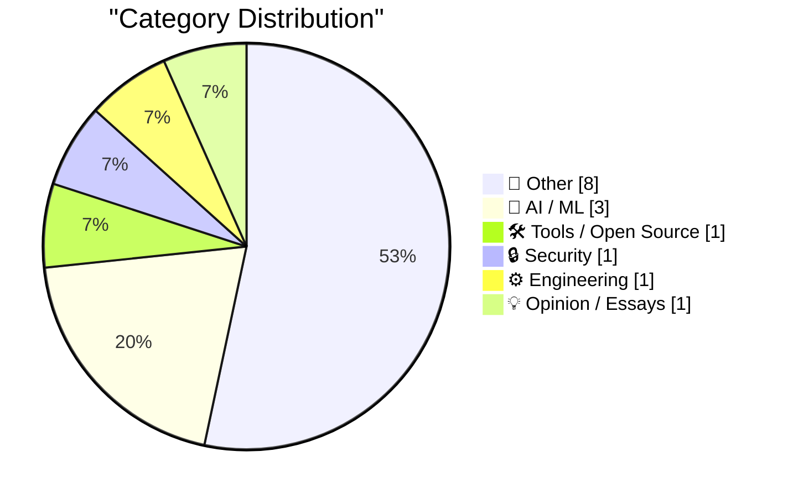
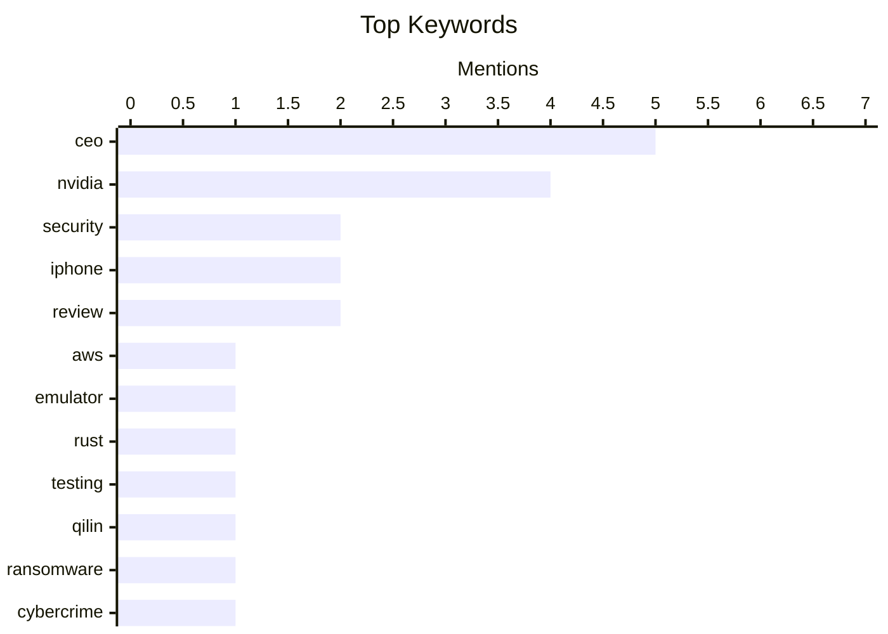

## Today's Highlights
Today's highlights showcase a dynamic intersection of technology and security, with AWS launching a local emulator for developers and Google unveiling its Gemini Decisions API to enhance AI capabilities. Meanwhile, the rise of ransomware, exemplified by the Qilin group, underscores the growing cybersecurity threats organizations face. Additionally, the ongoing discourse around AI's impact on productivity raises questions about the balance between technological advancement and human workload.
---
## Must Read Today
1. **aws-emulator**
[aws-emulator](https://simonwillison.net/2026/Nov/11/aws-emulator/) — simonwillison.net · 16h ago · 🛠 Tools / Open Source
> AWS has released an official emulator that allows developers to test against local clones of its various services without needing a paid API key. The emulator is built in Rust and has seen rapid development, with 29,684 commits in its first three weeks. This tool significantly streamlines the testing process for developers by providing a cost-effective way to simulate AWS services locally. The main takeaway is that this emulator enhances accessibility and efficiency for developers working with AWS services.
💡 **Why read it**: This article is worth reading for developers looking for efficient ways to test AWS services without incurring costs.
🏷️ AWS, emulator, Rust, testing
2. **Who Runs the Ransomware Group Qilin?**
[Who Runs the Ransomware Group Qilin?](https://krebsonsecurity.com/2026/11/who-runs-the-ransomware-group-qilin/) — krebsonsecurity.com · 19h ago · 🔒 Security
> The ransomware group Qilin has become the most active affiliate program, targeting at least 365 organizations in the last three months. Investigations suggest that the group's administrator is a 36-year-old man from St. Petersburg, Russia, who has made notable operational security mistakes over the years. These missteps provide insights into the group's structure and vulnerabilities. The article concludes that understanding the human element behind such cybercrime can help in developing better countermeasures.
💡 **Why read it**: This article is essential for cybersecurity professionals interested in the operational dynamics of ransomware groups.
🏷️ Qilin, ransomware, cybercrime, security
3. **Gemini Decisions API**
[Gemini Decisions API](https://simonwillison.net/2026/Nov/11/gemini-decisions-api/) — simonwillison.net · 15h ago · 🤖 AI / ML
> Google has launched the Gemini Decisions API, which is similar to existing models like Jev and OpenAI's decision-making tools. This API supports three types of inquiries: yes/no, choice, and rubric-scoring, making it versatile for various applications. The introduction of this API highlights Google's commitment to enhancing decision-making capabilities in AI. The main takeaway is that Gemini Decisions API expands the options available for developers working with decision models.
💡 **Why read it**: This article is valuable for developers seeking to integrate advanced decision-making capabilities into their applications.
🏷️ Gemini, API, Google, decisions
---
## Data Overview
| Sources Scanned | Articles Fetched | Time Window | Selected |
|:---:|:---:|:---:|:---:|
| 87/92 | 2635 -> 23 | 24h | **15** |
### Category Distribution

### Top Keywords

<details>
<summary>Plain Text Keyword Chart (Terminal Friendly)</summary>
```
ceo      │ ████████████████████ 5
nvidia   │ ████████████████░░░░ 4
security │ ████████░░░░░░░░░░░░ 2
iphone   │ ████████░░░░░░░░░░░░ 2
review   │ ████████░░░░░░░░░░░░ 2
aws      │ ████░░░░░░░░░░░░░░░░ 1
emulator │ ████░░░░░░░░░░░░░░░░ 1
rust     │ ████░░░░░░░░░░░░░░░░ 1
testing  │ ████░░░░░░░░░░░░░░░░ 1
qilin    │ ████░░░░░░░░░░░░░░░░ 1
```
</details>
### Topic Tags
**ceo**(5) · **nvidia**(4) · **security**(2) · iphone(2) · review(2) · aws(1) · emulator(1) · rust(1) · testing(1) · qilin(1) · ransomware(1) · cybercrime(1) · gemini(1) · api(1) · google(1) · decisions(1) · llm(1) · release(1) · update(1) · anthropic(1)
---
## Other
### 1. Anthropic's IPO roadshow video
[Anthropic's IPO roadshow video](https://simonwillison.net/2026/Nov/11/anthropic-ipo-roadshow/) — **simonwillison.net** · 22h ago · ⭐ 21/30
> Anthropic has initiated its IPO roadshow, revealing insights into its business operations through a newly released video. Notably, co-founder Tom Brown discusses the company's approach to computing, detailing their use of AWS Trainium, Google TPUs, NVIDIA GPUs, and AMD GPUs for training and serving their AI models. This information sheds light on the technical infrastructure that supports their AI initiatives. The key takeaway is that understanding Anthropic's computational strategy can provide valuable context for its market positioning.
🏷️ Anthropic, IPO, video, business
---
### 2. Austin Mann’s iPhone Duo Review
[Austin Mann’s iPhone Duo Review](https://www.austinmann.com/trek/iphone-duo) — **daringfireball.net** · 18h ago · ⭐ 19/30
> Austin Mann reviews the iPhone Duo, initially skeptical about its folding design but ultimately impressed by its capabilities. The iPhone 18 Pro is noted as the most powerful camera in Apple's lineup, while the Duo excels in the surrounding processes of photography, such as planning, editing, and sharing. Mann's experience suggests that the Duo offers unique advantages for users who prioritize these aspects. The main takeaway is that the iPhone Duo redefines user experience in mobile photography.
🏷️ iPhone, review, folding, device
---
### 3. Quinn Nelson: ‘The iPhone Duo Doesn’t Feel Like an iPhone’
[Quinn Nelson: ‘The iPhone Duo Doesn’t Feel Like an iPhone’](https://www.youtube.com/watch?v=cxjdVVVryC4) — **daringfireball.net** · 19h ago · ⭐ 16/30
> Quinn Nelson offers a candid review of the iPhone Duo, expressing that it feels distinct from traditional iPhones. The review highlights the unique features and user experience of the Duo, suggesting it caters to a different audience than standard iPhones. This perspective provides a nuanced understanding of how the Duo fits into Apple's product lineup. The main takeaway is that the iPhone Duo represents a shift in design philosophy for Apple.
🏷️ iPhone, Duo, review, feedback
---
### 4. Browse tools.simonwillison.net by tag
[Browse tools.simonwillison.net by tag](https://simonwillison.net/2026/Nov/11/tools-tags/) — **simonwillison.net** · 19h ago · ⭐ 15/30
> The article discusses the author's need for a more efficient way to browse a collection of 244 tools categorized by 'vibe'. To address this, the author utilized Fable 5.2 credits and implemented tree-sitter, a parsing library, to analyze the JavaScript APIs and libraries associated with each tool. This technical approach enhances the organization and accessibility of the tools, making it easier for users to find relevant resources. The main takeaway is the effective use of tree-sitter to improve tool categorization and browsing experience.
🏷️ tools, browsing, collection, tags
---
### 5. Semafor: ‘Nvidia Board Preparing to Oust CEO Jensen Huang, Name Interim CEO’
[Semafor: ‘Nvidia Board Preparing to Oust CEO Jensen Huang, Name Interim CEO’](https://www.semafor.com/article/11/11/2026/nvidia-board-preparing-to-oust-ceo-huang-wsj) — **daringfireball.net** · 9h ago · ⭐ 15/30
> The article reports that Nvidia's board is considering the ousting of CEO Jensen Huang, with Chief Financial Officer Colette Kress as a potential interim replacement. This decision follows revelations of Huang's extramarital affairs, which have raised concerns among board members. The situation highlights the board's urgent response to internal and external pressures regarding leadership integrity. The main conclusion is that Nvidia is at a critical juncture, potentially leading to significant changes in its executive leadership.
🏷️ Nvidia, CEO, board, management
---
### 6. Nvidia Working With Outside Firm to Identify CEO Candidates
[Nvidia Working With Outside Firm to Identify CEO Candidates](https://www.bloomberg.com/news/articles/2026-11-11/nvidia-working-with-outside-firm-to-identify-ceo-candidates) — **daringfireball.net** · 10h ago · ⭐ 15/30
> Nvidia's board is collaborating with an external firm to find potential successors for CEO Jensen Huang amid allegations of multiple extramarital affairs. Reports suggest that the board is considering appointing a temporary chief while searching for a permanent replacement. This move indicates the board's proactive approach to addressing leadership issues and maintaining company stability. The key takeaway is that Nvidia is taking significant steps to reassess its leadership amid serious allegations.
🏷️ Nvidia, CEO, candidates, search
---
### 7. WSJ: ‘Nvidia Is Preparing to Oust CEO Jensen Huang’
[WSJ: ‘Nvidia Is Preparing to Oust CEO Jensen Huang’](https://www.wsj.com/business/nvidia-is-preparing-to-oust-nvidia-ceo-jensen-huang-30f421ad?st=S84MQZ) — **daringfireball.net** · 10h ago · ⭐ 15/30
> The Wall Street Journal reports that Nvidia's board is preparing to remove CEO Jensen Huang due to allegations of two extramarital affairs, including one with a suspected Chinese spy. The board is expected to convene soon to discuss Huang's future, reflecting the gravity of the situation. This development underscores the potential impact of personal misconduct on corporate governance and leadership stability. The main conclusion is that Nvidia is facing a pivotal moment that could reshape its executive landscape.
🏷️ Nvidia, CEO, oust, affairs
---
### 8. Jensen Huang Was Banging an Nvidia Vice President Too
[Jensen Huang Was Banging an Nvidia Vice President Too](https://www.nytimes.com/2026/11/11/technology/jensen-huang-nvidia-affair.html?unlocked_article_code=1.P1E.pIe6.C65KRlbTa4MW) — **daringfireball.net** · 10h ago · ⭐ 15/30
> The New York Times reveals that Jensen Huang, Nvidia's CEO, is under investigation for an affair with an employee, in addition to a relationship with a suspected Chinese spy. The article details the implications of these relationships for Huang's leadership and the company's reputation. This situation raises questions about the impact of personal conduct on corporate governance and employee dynamics. The main takeaway is that Huang's actions could lead to significant consequences for Nvidia's leadership structure.
🏷️ Nvidia, CEO, affair, investigation
---
## AI / ML
### 9. Gemini Decisions API
[Gemini Decisions API](https://simonwillison.net/2026/Nov/11/gemini-decisions-api/) — **simonwillison.net** · 15h ago · ⭐ 24/30
> Google has launched the Gemini Decisions API, which is similar to existing models like Jev and OpenAI's decision-making tools. This API supports three types of inquiries: yes/no, choice, and rubric-scoring, making it versatile for various applications. The introduction of this API highlights Google's commitment to enhancing decision-making capabilities in AI. The main takeaway is that Gemini Decisions API expands the options available for developers working with decision models.
🏷️ Gemini, API, Google, decisions
---
### 10. llm 0.37.2
[llm 0.37.2](https://simonwillison.net/2026/Nov/11/llm/) — **simonwillison.net** · 20h ago · ⭐ 21/30
> The release of LLM version 0.37.2 addresses critical security vulnerabilities identified in previous versions. The updates include fixes for two specific security advisories, enhancing the overall safety of the library. This release emphasizes the importance of maintaining security in software development, particularly in libraries that handle sensitive data. The main conclusion is that regular updates and security patches are vital for protecting users.
🏷️ LLM, release, security, update
---
### 11. Why Am I So Tired If AI Is Doing All the Work?
[Why Am I So Tired If AI Is Doing All the Work?](https://terriblesoftware.org/2026/11/11/why-am-i-so-tired-if-ai-is-doing-all-the-work/) — **terriblesoftware.org** · 19h ago · ⭐ 21/30
> The article explores the paradox of increased workload despite the rise of AI, emphasizing that while AI can automate tasks, the need for human oversight and review remains. This ongoing requirement for attention and decision-making leads to fatigue among workers. The main conclusion is that AI's efficiency does not eliminate the cognitive load on individuals, highlighting the need for balance in AI integration. The article encourages readers to reflect on their work processes in the age of AI.
🏷️ AI, workload, productivity, fatigue
---
## Tools / Open Source
### 12. aws-emulator
[aws-emulator](https://simonwillison.net/2026/Nov/11/aws-emulator/) — **simonwillison.net** · 16h ago · ⭐ 27/30
> AWS has released an official emulator that allows developers to test against local clones of its various services without needing a paid API key. The emulator is built in Rust and has seen rapid development, with 29,684 commits in its first three weeks. This tool significantly streamlines the testing process for developers by providing a cost-effective way to simulate AWS services locally. The main takeaway is that this emulator enhances accessibility and efficiency for developers working with AWS services.
🏷️ AWS, emulator, Rust, testing
---
## Security
### 13. Who Runs the Ransomware Group Qilin?
[Who Runs the Ransomware Group Qilin?](https://krebsonsecurity.com/2026/11/who-runs-the-ransomware-group-qilin/) — **krebsonsecurity.com** · 19h ago · ⭐ 27/30
> The ransomware group Qilin has become the most active affiliate program, targeting at least 365 organizations in the last three months. Investigations suggest that the group's administrator is a 36-year-old man from St. Petersburg, Russia, who has made notable operational security mistakes over the years. These missteps provide insights into the group's structure and vulnerabilities. The article concludes that understanding the human element behind such cybercrime can help in developing better countermeasures.
🏷️ Qilin, ransomware, cybercrime, security
---
## Engineering
### 14. Technology as a Search Problem
[Technology as a Search Problem](https://www.construction-physics.com/p/technology-as-a-search-problem) — **construction-physics.com** · 59m ago · ⭐ 19/30
> The article delves into the nature of technological progress, framing it as a search problem where new technologies emerge and evolve over time. It discusses the mechanisms behind innovation and how technologies improve through iterative processes. Understanding this framework can help researchers and practitioners navigate the complexities of technological development. The main conclusion is that recognizing technology as a search problem can inform better strategies for fostering innovation.
🏷️ technology, progress, research, innovation
---
## Opinion / Essays
### 15. Breaking: Eli Lilly CEO becomes latest to push back on Dario Amodei’s ludicrous, Elizabeth Holmes-like medical claims
[Breaking: Eli Lilly CEO becomes latest to push back on Dario Amodei’s ludicrous, Elizabeth Holmes-like medical claims](https://garymarcus.substack.com/p/breaking-eli-lilly-ceo-becomes-latest) — **garymarcus.substack.com** · 1h ago · ⭐ 16/30
> The article reports on Eli Lilly's CEO challenging the medical claims made by Dario Amodei, drawing parallels to the controversial claims of Elizabeth Holmes. This pushback highlights the scrutiny and skepticism surrounding ambitious medical technologies and their promises. The discussion underscores the importance of accountability in the biotech industry. The main conclusion is that such challenges are crucial for maintaining integrity in medical advancements.
🏷️ Eli Lilly, CEO, medical claims, Dario Amodei
---
*Generated at 2026-11-12 14:01 | Scanned 87 sources -> 2635 articles -> selected 15*
*Based on the [Hacker News Popularity Contest 2025](https://refactoringenglish.com/tools/hn-popularity/) RSS source list recommended by [Andrej Karpathy](https://x.com/karpathy)*
*Produced by Dongdianr AI. Follow the same-name WeChat public account for more AI practical tips 💡*
