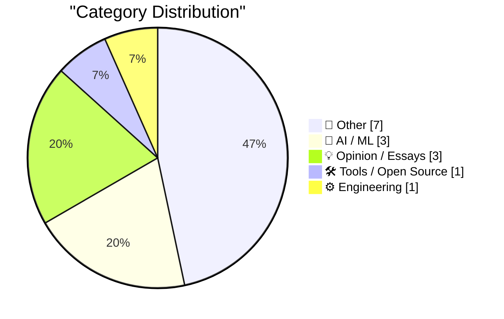
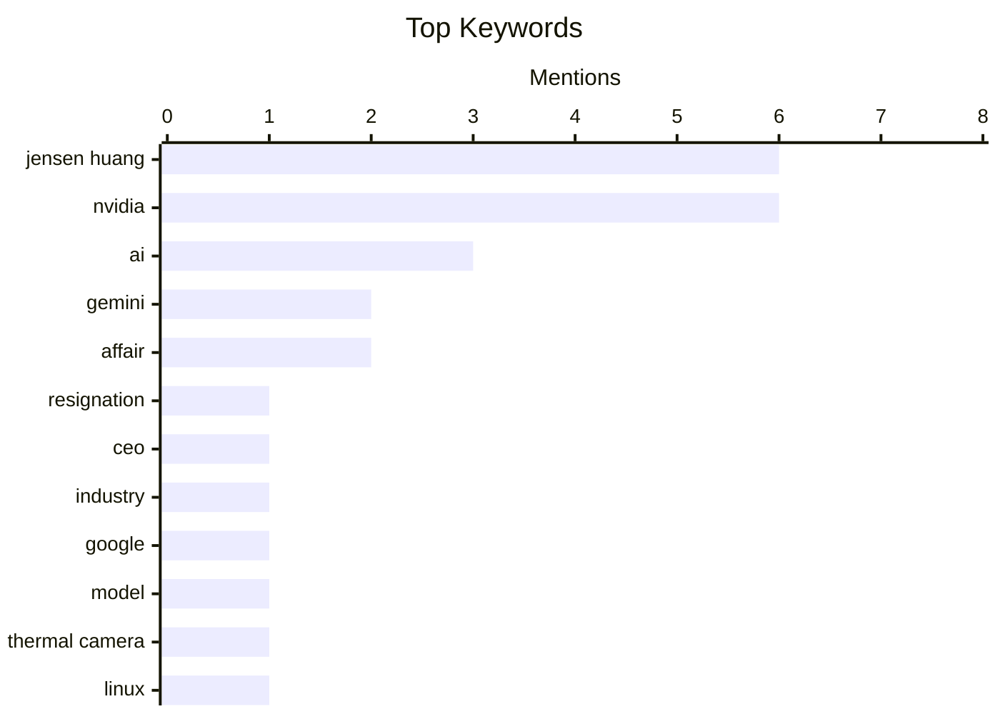

## Today's Highlights
Today's highlights reveal significant shifts in the tech landscape, particularly with Jensen Huang's resignation from Nvidia, which raises questions about the company's future direction amid a rapidly evolving AI industry. Meanwhile, Google has introduced its most affordable AI model yet, Gemini 4 Hydrogen, signaling a competitive push in accessible AI solutions for businesses. These developments underscore a broader trend of leadership changes and innovation in artificial intelligence, as companies navigate the complexities of the market.
---
## Must Read Today
1. **Jensen Huang Resigns From Nvidia**
[Jensen Huang Resigns From Nvidia](https://nvidianews.nvidia.com/news/nvidia-announces-ceo-transition) — daringfireball.net · 22h ago · 📝 Other
> Jensen Huang has resigned as President and CEO of Nvidia, with Colette Kress stepping in as Interim CEO. The resignation is effective immediately, and Kress will maintain her role as CFO during this transition. This leadership change raises questions about Nvidia's future direction, especially in the competitive AI industry. The board is in search of a permanent successor to lead the company forward.
💡 **Why read it**: This article provides crucial insights into a significant leadership change at Nvidia, impacting the company's strategic direction in the AI sector.
🏷️ Jensen Huang, resignation, Nvidia, CEO
2. **Jensen Huang resigns.**
[Jensen Huang resigns.](https://garymarcus.substack.com/p/jensen-huang-resigns) — garymarcus.substack.com · 23h ago · 🤖 AI / ML
> Jensen Huang's resignation from Nvidia introduces uncertainty for the company and the broader AI industry. The article discusses the implications of this leadership change, particularly in the context of Nvidia's competitive position in AI technology. It highlights concerns about the future direction of the company without Huang's vision. The piece emphasizes the potential challenges Nvidia may face in maintaining its market leadership.
💡 **Why read it**: This article explores the ramifications of Huang's resignation, making it essential for understanding the future landscape of the AI industry.
🏷️ Nvidia, Jensen Huang, AI, industry
3. **llm-gemini 0.37**
[llm-gemini 0.37](https://simonwillison.net/2026/Nov/12/llm-gemini/) — simonwillison.net · 15h ago · 🤖 AI / ML
> Google has launched Gemini 4 Hydrogen, the most affordable model in the Gemini 4 family, which has sparked confusion regarding its pricing compared to larger models like Carbon and Argon. The article discusses the features and pricing strategy of Gemini 4 Hydrogen, noting its competitive position despite being the lowest cost option. The author expresses a need for clarity in the pricing structure of the Gemini models. This launch could influence purchasing decisions in the AI model market.
💡 **Why read it**: This article provides a detailed overview of the latest Gemini model, essential for anyone interested in AI model pricing and features.
🏷️ Gemini, AI, Google, model
---
## Data Overview
| Sources Scanned | Articles Fetched | Time Window | Selected |
|:---:|:---:|:---:|:---:|
| 86/92 | 2620 -> 17 | 24h | **15** |
### Category Distribution

### Top Keywords

<details>
<summary>Plain Text Keyword Chart (Terminal Friendly)</summary>
```
jensen huang │ ████████████████████ 6
nvidia       │ ████████████████████ 6
ai           │ ██████████░░░░░░░░░░ 3
gemini       │ ███████░░░░░░░░░░░░░ 2
affair       │ ███████░░░░░░░░░░░░░ 2
resignation  │ ███░░░░░░░░░░░░░░░░░ 1
ceo          │ ███░░░░░░░░░░░░░░░░░ 1
industry     │ ███░░░░░░░░░░░░░░░░░ 1
google       │ ███░░░░░░░░░░░░░░░░░ 1
model        │ ███░░░░░░░░░░░░░░░░░ 1
```
</details>
### Topic Tags
**jensen huang**(6) · **nvidia**(6) · **ai**(3) · gemini(2) · affair(2) · resignation(1) · ceo(1) · industry(1) · google(1) · model(1) · thermal camera(1) · linux(1) · review(1) · electronics(1) · congress(1) · testify(1) · claude(1) · opus(1) · co_await(1) · c++(1)
---
## Other
### 1. Jensen Huang Resigns From Nvidia
[Jensen Huang Resigns From Nvidia](https://nvidianews.nvidia.com/news/nvidia-announces-ceo-transition) — **daringfireball.net** · 22h ago · ⭐ 26/30
> Jensen Huang has resigned as President and CEO of Nvidia, with Colette Kress stepping in as Interim CEO. The resignation is effective immediately, and Kress will maintain her role as CFO during this transition. This leadership change raises questions about Nvidia's future direction, especially in the competitive AI industry. The board is in search of a permanent successor to lead the company forward.
🏷️ Jensen Huang, resignation, Nvidia, CEO
---
### 2. Jensen Huang Agrees to Testify Before Congress, But Not Publicly (Yet)
[Jensen Huang Agrees to Testify Before Congress, But Not Publicly (Yet)](https://techcrunch.com/2026/11/12/jensen-huang-agrees-to-testify-before-congress/) — **daringfireball.net** · 16h ago · ⭐ 18/30
> Jensen Huang has agreed to testify before Congress following his resignation from Nvidia amid allegations of an affair and potential espionage. His testimony is scheduled before Thanksgiving, as lawmakers threatened to subpoena him. The article discusses the implications of his testimony for Nvidia and the ongoing investigations into the company's practices. Huang's willingness to testify could impact public perception and regulatory scrutiny of Nvidia.
🏷️ Jensen Huang, Congress, testify, Nvidia
---
### 3. Long permutations and long cycles
[Long permutations and long cycles](https://www.johndcook.com/blog/2026/11/13/long-cycles/) — **johndcook.com** · 2h ago · ⭐ 15/30
> The article explores the mathematical concept of permutations, specifically focusing on the behavior of long cycles within a permutation. It discusses how permutations rearrange elements and the eventual repetition of arrangements, using examples like a deck of cards. The author delves into the implications of these cycles for understanding combinatorial structures. This exploration of permutations is valuable for mathematicians and enthusiasts alike.
🏷️ permutations, cycles, mathematics, combinatorics
---
### 4. Ira Velinsky, industrial designer for Commodore and Atari
[Ira Velinsky, industrial designer for Commodore and Atari](https://dfarq.homeip.net/ira-velinsky-industrial-designer-of-the-commodore-64/?utm_source=rss&#038;utm_medium=rss&#038;utm_campaign=ira-velinsky-industrial-designer-of-the-commodore-64) — **dfarq.homeip.net** · 2h ago · ⭐ 10/30
> The article profiles Ira Velinsky, an influential industrial designer known for his work with Commodore and Atari during the 1980s. He is credited with designing the iconic 'Porsche PET' cases and the Commodore TED machines, showcasing his impact on the aesthetics of early personal computers. Velinsky's contributions are significant in understanding the evolution of computer design in that era. The article highlights the importance of industrial design in technology and its lasting influence.
🏷️ Ira Velinsky, Commodore, Atari, design
---
### 5. Scott Colom Flips Mississippi
[Scott Colom Flips Mississippi](https://talkingpointsmemo.com/live-blog/new-congress-gets-underway-with-hegseth-impeachment-effort) — **daringfireball.net** · 16h ago · ⭐ 8/30
> Scott Colom's victory over incumbent Senator Cindy Hyde-Smith marks a significant political shift in Mississippi, as he becomes the first Democrat in the Senate from the state since 1982 and the first Black senator in nearly 150 years. The article emphasizes the historical context of this election, noting that Mississippi has the highest percentage of Black citizens in the US at 38%. Colom's win is a pivotal moment for representation and reflects changing political dynamics in the state. The main conclusion is that this election could signal a broader shift in Mississippi's political landscape.
🏷️ Mississippi, election, Senate, Colom
---
### 6. And Every New Boy That You Meet / He Doesn’t Know the Real Surprise
[And Every New Boy That You Meet / He Doesn’t Know the Real Surprise](https://www.wsj.com/tech/ai/a-mystery-businessman-introduced-jensen-huang-to-his-paramourher-husband-1ec3b581?st=yBFeMY) — **daringfireball.net** · 17h ago · ⭐ 8/30
> The article reveals the complex personal life of Jensen Huang, CEO of Nvidia, detailing his introduction to Alice Huang by her husband, Kang Wei, a businessman with ties to China. The narrative explores the dynamics of their relationship, which reportedly continued for two years with Kang's apparent acceptance. This personal drama intertwines with Huang's professional life, raising questions about the implications of such relationships in high-stakes corporate environments. The main takeaway is the potential risks and controversies that can arise from personal relationships in leadership roles.
🏷️ Jensen Huang, affair, Nvidia, Alice Huang
---
### 7. Reuters Raises the Jensen Huang Affair Tally to Three
[Reuters Raises the Jensen Huang Affair Tally to Three](https://www.reuters.com/technology/former-nvidia-ceo-huang-had-relationship-with-second-employee-sources-say-2026-11-12/) — **daringfireball.net** · 17h ago · ⭐ 8/30
> Reuters reports that Jensen Huang, the ousted CEO of Nvidia, had intimate relationships with multiple employees, including Alice Huang and Kimberly Powell, leading to his resignation. The article highlights concerns regarding Alice Huang's potential connections to espionage, adding a layer of complexity to the situation. This revelation raises questions about corporate governance and the impact of personal relationships on business decisions. The conclusion emphasizes the need for transparency and ethical standards in corporate leadership.
🏷️ Jensen Huang, affair, Nvidia, employee
---
## AI / ML
### 8. Jensen Huang resigns.
[Jensen Huang resigns.](https://garymarcus.substack.com/p/jensen-huang-resigns) — **garymarcus.substack.com** · 23h ago · ⭐ 26/30
> Jensen Huang's resignation from Nvidia introduces uncertainty for the company and the broader AI industry. The article discusses the implications of this leadership change, particularly in the context of Nvidia's competitive position in AI technology. It highlights concerns about the future direction of the company without Huang's vision. The piece emphasizes the potential challenges Nvidia may face in maintaining its market leadership.
🏷️ Nvidia, Jensen Huang, AI, industry
---
### 9. llm-gemini 0.37
[llm-gemini 0.37](https://simonwillison.net/2026/Nov/12/llm-gemini/) — **simonwillison.net** · 15h ago · ⭐ 24/30
> Google has launched Gemini 4 Hydrogen, the most affordable model in the Gemini 4 family, which has sparked confusion regarding its pricing compared to larger models like Carbon and Argon. The article discusses the features and pricing strategy of Gemini 4 Hydrogen, noting its competitive position despite being the lowest cost option. The author expresses a need for clarity in the pricing structure of the Gemini models. This launch could influence purchasing decisions in the AI model market.
🏷️ Gemini, AI, Google, model
---
### 10. So you want to buy AI for your company
[So you want to buy AI for your company](https://idiallo.com/byte-size/buying-ai-for-your-company) — **idiallo.com** · 13h ago · ⭐ 18/30
> The article provides guidance on selecting AI models for businesses, comparing options like Gemini 4 Hydrogen, Claude Sonnet 5.5, and Opus 5.2 based on their performance metrics. It highlights benchmark scores, with Opus at 94.8 and Mythos at 96.1, to help companies make informed decisions. The discussion emphasizes the importance of aligning AI capabilities with specific business needs. This resource is particularly useful for companies looking to integrate AI solutions effectively.
🏷️ AI, Gemini, Claude, Opus
---
## Opinion / Essays
### 11. Jensen Huang’s Advice to His Successor: ‘They’ll Just Have to Reshape the Company’
[Jensen Huang’s Advice to His Successor: ‘They’ll Just Have to Reshape the Company’](https://www.ycombinator.com/library/Tq-jensen-huang-the-mindset-that-built-nvidia) — **daringfireball.net** · 22h ago · ⭐ 15/30
> In a recent interview, Jensen Huang shared insights on Nvidia's organizational structure and the need for adaptability in leadership. He emphasized the importance of building a company culture that allows for innovation and change, particularly in the absence of conventional management techniques. Huang's advice to his successor focuses on reshaping the company to maintain its competitive edge. This perspective is critical for understanding Nvidia's future direction.
🏷️ Jensen Huang, successor, Nvidia, advice
---
### 12. Pluralistic: Uber's labor crash (12 Nov 2026)
[Pluralistic: Uber's labor crash (12 Nov 2026)](https://pluralistic.net/2026/11/12/starvation-wages/) — **pluralistic.net** · 17h ago · ⭐ 15/30
> The article discusses the economic challenges faced by Uber, highlighting the unsustainable nature of replacing human labor with automation. It critiques the company's labor practices and the impact on workers, emphasizing the need for a balanced approach to technology and employment. The discussion includes broader implications for the gig economy and labor rights. This analysis is crucial for understanding the future of work in the context of technological advancement.
🏷️ Uber, labor, automation, robots
---
### 13. First Strike
[First Strike](https://geohot.github.io//blog/jekyll/update/2026/11/13/first-strike.html) — **geohot.github.io** · 22h ago · ⭐ 15/30
> The article discusses the looming energy disparity between China and the US, predicting that China will have ten times the electricity capacity of the US in the next decade. It proposes a strategic approach for the US to counter this trend by selling AI chips to China and using the profits to invest in solar panel and battery manufacturing. This strategy aims to rapidly enhance the US's electricity capacity and sustainability. The main takeaway is that the US must adapt its geopolitical strategies in light of China's growing energy dominance.
🏷️ China, electricity, geopolitics, strategy
---
## Tools / Open Source
### 14. Gadget Review: Thermal Master P3 Lite - and Linux Instructions ★★★★⯪
[Gadget Review: Thermal Master P3 Lite - and Linux Instructions ★★★★⯪](https://shkspr.mobi/blog/2026/11/gadget-review-thermal-master-p3-lite-p2-max-and-linux-instructions/) — **shkspr.mobi** · 1h ago · ⭐ 22/30
> The Thermal Master P3 Lite thermal camera features a detachable macro lens, making it versatile for various applications, from detecting leaks to examining electronic components. The review compares it to previous models like the P3 and T2 Max, highlighting its strengths and weaknesses. The author provides Linux instructions for users, enhancing the product's accessibility. Overall, the P3 Lite is praised for its functionality and ease of use.
🏷️ thermal camera, Linux, review, electronics
---
## Engineering
### 15. How can I pass more than one parameter to co_await?
[How can I pass more than one parameter to co_await?](https://devblogs.microsoft.com/oldnewthing/20261112-00/?p=112851/) — **devblogs.microsoft.com/oldnewthing** · 23h ago · ⭐ 16/30
> The article addresses the limitation of the co_await operator, which traditionally accepts only one parameter, discussing potential workarounds for passing multiple parameters. It explores the implications of this limitation on asynchronous programming in C++. The author provides technical insights and examples to illustrate the challenges and solutions. Understanding these nuances can enhance developers' ability to utilize co_await effectively.
🏷️ co_await, C++, parameters, async
---
*Generated at 2026-11-13 14:01 | Scanned 86 sources -> 2620 articles -> selected 15*
*Based on the [Hacker News Popularity Contest 2025](https://refactoringenglish.com/tools/hn-popularity/) RSS source list recommended by [Andrej Karpathy](https://x.com/karpathy)*
*Produced by Dongdianr AI. Follow the same-name WeChat public account for more AI practical tips 💡*
