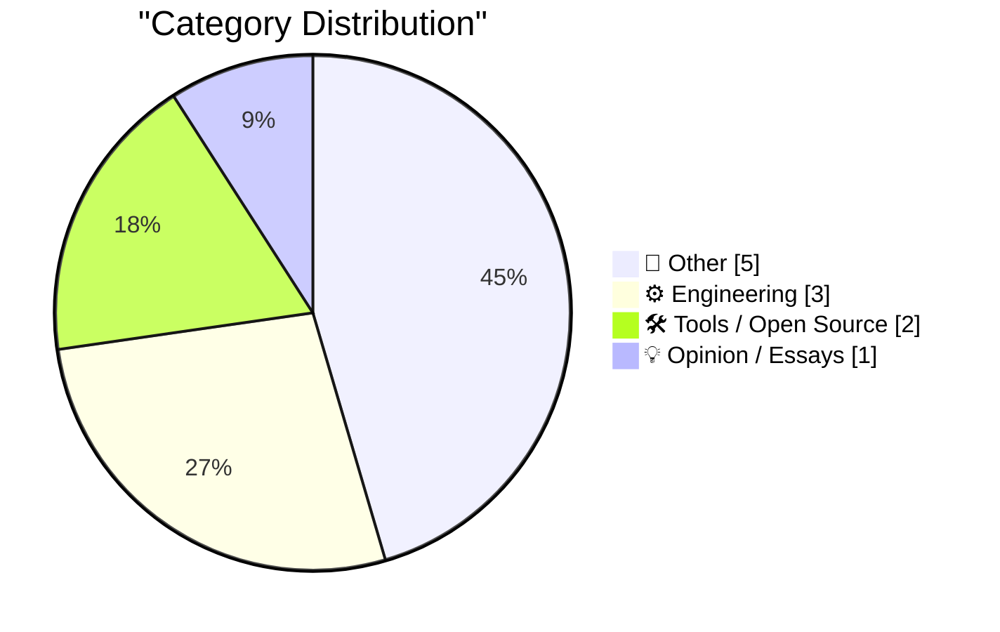
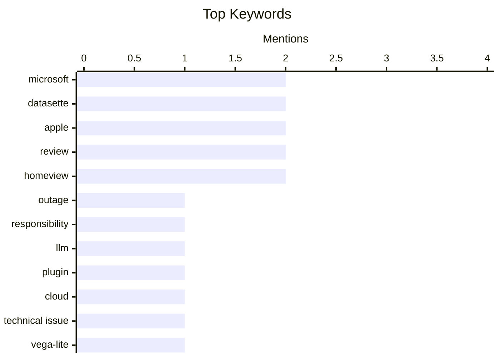

## Today's Highlights
Today's Highlights: The tech landscape is buzzing with advancements in operational resilience and data visualization tools, as seen in the latest releases of the datasette plugins. Meanwhile, Microsoft has clarified that a recent cloud outage stemmed from a technical glitch rather than cyber threats or AI issues, underscoring the ongoing challenges in cloud infrastructure reliability. As companies navigate these complexities, the importance of balancing innovation with operational friction remains a key theme.
---
## Must Read Today
1. **Ops needs friction**
[Ops needs friction](https://www.jeffgeerling.com/blog/2026/ops-needs-friction/) — jeffgeerling.com · 21h ago · ⚙️ Engineering
> The article discusses the importance of operational friction in preventing outages and improving system resilience. It reflects on recent high-profile outages, such as Microsoft's, and emphasizes that a strong operational mindset can mitigate risks. The author argues that friction in operations can lead to better decision-making and more robust systems. Ultimately, the takeaway is that embracing operational challenges can enhance overall service reliability.
💡 **Why read it**: This article is worth reading for its insights into how operational friction can be leveraged to improve system resilience and prevent outages.
🏷️ Microsoft, outage, responsibility
2. **datasette-llm 0.1a11**
[datasette-llm 0.1a11](https://simonwillison.net/2026/Nov/14/datasette-llm/) — simonwillison.net · 14h ago · 🛠 Tools / Open Source
> This article announces the release of datasette-llm 0.1a11, a plugin for Datasette that facilitates the integration of large language models (LLMs) with other Datasette plugins. The new version adds support for OpenAI-compatible endpoints, allowing users to configure Datasette to utilize LLMs hosted on various platforms. The main conclusion is that this release enhances the versatility of Datasette in leveraging LLMs for data interaction.
💡 **Why read it**: It's a must-read for developers interested in extending Datasette's capabilities with LLMs, especially with the new OpenAI endpoint support.
🏷️ datasette, LLM, plugin
3. **Microsoft Says Cloud Outage Was ‘Not Related to Cyber or AI / Agents’**
[Microsoft Says Cloud Outage Was ‘Not Related to Cyber or AI / Agents’](https://x.com/microsoft/status/2121282013600907325) — daringfireball.net · 22h ago · ⚙️ Engineering
> Microsoft addressed a recent cloud outage, clarifying that it was caused by a technical issue during a network capacity upgrade, not related to cyber threats or AI. The company is actively working to restore services to affected customers and regions. The key takeaway is that the outage stemmed from internal technical changes rather than external cyber incidents.
💡 **Why read it**: This article provides clarity on the nature of the outage, which is crucial for understanding the reliability of cloud services.
🏷️ Microsoft, cloud, technical issue
---
## Data Overview
| Sources Scanned | Articles Fetched | Time Window | Selected |
|:---:|:---:|:---:|:---:|
| 86/92 | 2621 -> 11 | 24h | **11** |
### Category Distribution

### Top Keywords

<details>
<summary>Plain Text Keyword Chart (Terminal Friendly)</summary>
```
microsoft      │ ████████████████████ 2
datasette      │ ████████████████████ 2
apple          │ ████████████████████ 2
review         │ ████████████████████ 2
homeview       │ ████████████████████ 2
outage         │ ██████████░░░░░░░░░░ 1
responsibility │ ██████████░░░░░░░░░░ 1
llm            │ ██████████░░░░░░░░░░ 1
plugin         │ ██████████░░░░░░░░░░ 1
cloud          │ ██████████░░░░░░░░░░ 1
```
</details>
### Topic Tags
**microsoft**(2) · **datasette**(2) · **apple**(2) · review(2) · homeview(2) · outage(1) · responsibility(1) · llm(1) · plugin(1) · cloud(1) · technical issue(1) · vega-lite(1) · charts(1) · polynomial(1) · erdős(1) · mathematics(1) · nvidia(1) · leadership(1) · electricity(1) · pricing(1)
---
## Other
### 1. Variable Electricity Pricing - the Highs and the Lows
[Variable Electricity Pricing - the Highs and the Lows](https://shkspr.mobi/blog/2026/11/variable-electricity-pricing-the-highs-and-the-lows/) — **shkspr.mobi** · 1h ago · ⭐ 12/30
> The article discusses the author's experience with Octopus Energy's variable pricing model, which allows for fluctuating electricity rates based on demand. The author highlights a day when they were paid to use electricity, showcasing the benefits of smart-meter technology. The conclusion emphasizes the potential advantages of variable pricing for consumers and energy management.
🏷️ electricity, pricing, smart-meter
---
### 2. Joanna Stern Reviews the HomeView
[Joanna Stern Reviews the HomeView](https://www.youtube.com/watch?v=yVTcVtLn2o4) — **daringfireball.net** · 20h ago · ⭐ 9/30
> Joanna Stern provides a humorous and informative review of the HomeView, highlighting its engaging features and usability. She emphasizes the product's strengths while also pointing out areas for improvement. The main takeaway is that while the HomeView has great potential, it still requires refinement to fully meet user expectations.
🏷️ review, humor, HomeView
---
### 3. Jason Snell’s HomeView Review
[Jason Snell’s HomeView Review](https://sixcolors.com/post/2026/11/homeview-review-a-late-arrival-with-promise-but-still-showing-some-seams/) — **daringfireball.net** · 20h ago · ⭐ 9/30
> Jason Snell reviews the HomeView, noting its solid hardware and enjoyable screen experience. However, he critiques the software interface for being a confusing mix of Apple product designs. The conclusion suggests that while the HomeView shows promise, it needs further development to enhance user experience.
🏷️ review, HomeView, Apple
---
### 4. Date codes on cardboard boxes
[Date codes on cardboard boxes](https://dfarq.homeip.net/date-codes-on-cardboard-boxes/?utm_source=rss&#038;utm_medium=rss&#038;utm_campaign=date-codes-on-cardboard-boxes) — **dfarq.homeip.net** · 1h ago · ⭐ 9/30
> The article explains how to decipher date codes found on cardboard boxes to determine the manufacturing date of items. It discusses the variability of date codes and the challenges in identifying them without the original packaging. The main conclusion is that understanding these codes can help consumers track product freshness and history.
🏷️ date codes, cardboard, manufacturing
---
### 5. Reading List 11/14/2026
[Reading List 11/14/2026](https://www.construction-physics.com/p/reading-list-11142026) — **construction-physics.com** · 21h ago · ⭐ 6/30
> A Brooklyn building collapse, BAAJA’s odds of passing, reusing old memory in new phones, a nationwide aircraft ground stop, and more.
🏷️ reading list, construction, news
---
## Engineering
### 6. Ops needs friction
[Ops needs friction](https://www.jeffgeerling.com/blog/2026/ops-needs-friction/) — **jeffgeerling.com** · 21h ago · ⭐ 24/30
> The article discusses the importance of operational friction in preventing outages and improving system resilience. It reflects on recent high-profile outages, such as Microsoft's, and emphasizes that a strong operational mindset can mitigate risks. The author argues that friction in operations can lead to better decision-making and more robust systems. Ultimately, the takeaway is that embracing operational challenges can enhance overall service reliability.
🏷️ Microsoft, outage, responsibility
---
### 7. Microsoft Says Cloud Outage Was ‘Not Related to Cyber or AI / Agents’
[Microsoft Says Cloud Outage Was ‘Not Related to Cyber or AI / Agents’](https://x.com/microsoft/status/2121282013600907325) — **daringfireball.net** · 22h ago · ⭐ 21/30
> Microsoft addressed a recent cloud outage, clarifying that it was caused by a technical issue during a network capacity upgrade, not related to cyber threats or AI. The company is actively working to restore services to affected customers and regions. The key takeaway is that the outage stemmed from internal technical changes rather than external cyber incidents.
🏷️ Microsoft, cloud, technical issue
---
### 8. The longest polynomial level set
[The longest polynomial level set](https://www.johndcook.com/blog/2026/11/14/erdos-lemniscate/) — **johndcook.com** · 22h ago · ⭐ 16/30
> This article explores Erdős's conjecture regarding the maximum length of the curve defined by the polynomial level set |p(z)| = 1 for monic polynomials. Recent proof by Teng Zhang confirms that the maximum length is achieved by the polynomial p(z) = z^n - 1. The conclusion emphasizes the significance of this result in understanding polynomial behavior in complex analysis.
🏷️ polynomial, Erdős, mathematics
---
## Tools / Open Source
### 9. datasette-llm 0.1a11
[datasette-llm 0.1a11](https://simonwillison.net/2026/Nov/14/datasette-llm/) — **simonwillison.net** · 14h ago · ⭐ 21/30
> This article announces the release of datasette-llm 0.1a11, a plugin for Datasette that facilitates the integration of large language models (LLMs) with other Datasette plugins. The new version adds support for OpenAI-compatible endpoints, allowing users to configure Datasette to utilize LLMs hosted on various platforms. The main conclusion is that this release enhances the versatility of Datasette in leveraging LLMs for data interaction.
🏷️ datasette, LLM, plugin
---
### 10. datasette-vega 0.7
[datasette-vega 0.7](https://simonwillison.net/2026/Nov/14/datasette-vega/) — **simonwillison.net** · 20h ago · ⭐ 18/30
> The article announces the release of datasette-vega 0.7, a plugin for rendering charts using Vega-Lite with Datasette. This update improves compatibility with the latest Datasette alphas and includes cosmetic tweaks for better user experience. The main conclusion is that this release revitalizes a long-neglected plugin, enhancing its functionality for data visualization.
🏷️ datasette, Vega-Lite, charts
---
## Opinion / Essays
### 11. Patrick McGee on Johny Srouji and Nvidia
[Patrick McGee on Johny Srouji and Nvidia](https://x.com/patrickmcgee_/status/2120799867140550999) — **daringfireball.net** · 20h ago · ⭐ 15/30
> Patrick McGee speculates on the potential appointment of Johny Srouji, Apple's hardware chief, to lead Nvidia, citing his ambition and competence. He suggests that Srouji has reached his peak at Apple and would be a strong candidate for Nvidia's leadership. The main takeaway is that Srouji's leadership could significantly impact Nvidia's future direction.
🏷️ Nvidia, leadership, Apple
---
*Generated at 2026-11-15 14:01 | Scanned 86 sources -> 2621 articles -> selected 11*
*Based on the [Hacker News Popularity Contest 2025](https://refactoringenglish.com/tools/hn-popularity/) RSS source list recommended by [Andrej Karpathy](https://x.com/karpathy)*
*Produced by Dongdianr AI. Follow the same-name WeChat public account for more AI practical tips 💡*
