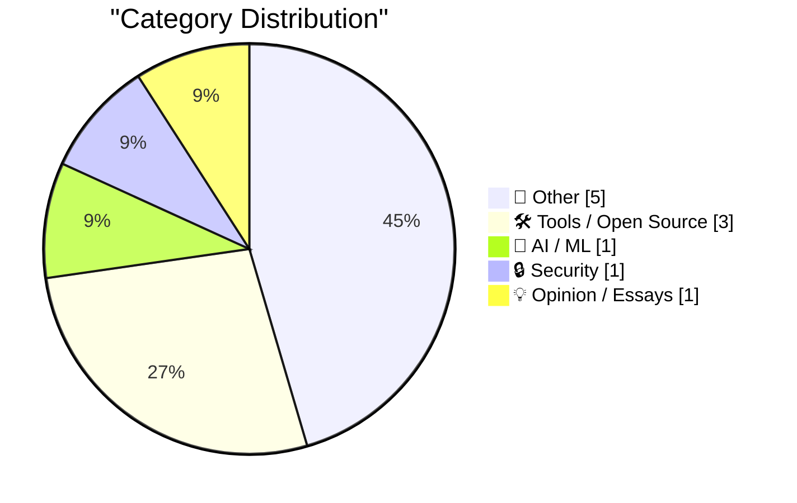
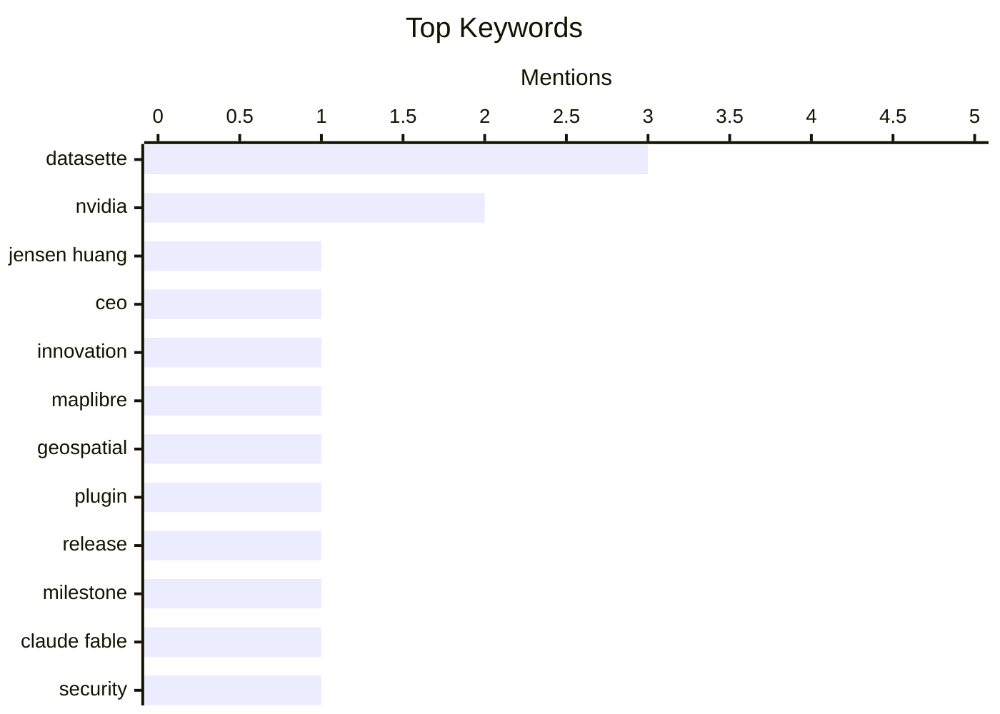

## Today's Highlights
Today's highlights reveal a landscape of innovation and uncertainty in the tech world. Nvidia grapples with leadership changes that could reshape its future, while the Datasette platform continues to evolve with new geospatial capabilities and critical security updates. Additionally, the emergence of controlled access tools like WorkOS Airlock reflects a growing emphasis on security and efficiency in tech applications.
---
## Must Read Today
1. **What’s Next For Nvidia?**
[What’s Next For Nvidia?](https://steveblank.com/2026/11/15/whats-next-for-nvidia/) — steveblank.com · 15h ago · 🤖 AI / ML
> Nvidia faces uncertainty following the resignation of its co-founder and CEO, Jensen Huang, after 33 years. The article discusses the potential risks of losing a visionary leader, highlighting that companies often struggle to innovate without such figures. It suggests that Nvidia may rely on its existing brand strength and market position but warns that this could lead to stagnation. The main takeaway is that Nvidia's future success is at risk without Huang's leadership and vision.
💡 **Why read it**: This article provides insights into the challenges faced by companies after the departure of key leaders, particularly in the tech industry.
🏷️ Nvidia, Jensen Huang, CEO, innovation
2. **datasette-maplibre 0.1a0**
[datasette-maplibre 0.1a0](https://simonwillison.net/2026/Nov/15/datasette-maplibre/) — simonwillison.net · 14h ago · 🛠 Tools / Open Source
> The release of datasette-maplibre 0.1a0 introduces a new geospatial plugin for Datasette, integrating MapLibre GL with OpenFreeMap. This plugin allows users to create interactive maps using free vector map data, enhancing the geospatial capabilities of Datasette. The article emphasizes the importance of community contributions and encourages support for developers like Zsolt Ero. Overall, this release marks a significant step forward in Datasette's geospatial functionality.
💡 **Why read it**: This article is valuable for developers interested in enhancing their Datasette projects with geospatial features.
🏷️ Datasette, MapLibre, geospatial, plugin
3. **datasette 1.0a43**
[datasette 1.0a43](https://simonwillison.net/2026/Nov/15/datasette/) — simonwillison.net · 14h ago · 🛠 Tools / Open Source
> The release of datasette 1.0a43 focuses on advancing towards the 1.0 milestone, which is currently 53% complete. A key feature in this version is the introduction of streaming support for output renderers, which improves performance and user experience. The article highlights the ongoing development efforts and the importance of community feedback in shaping the final release. The main conclusion is that this update brings Datasette closer to its stable 1.0 release.
💡 **Why read it**: This article is essential for users tracking the progress of Datasette and its upcoming features.
🏷️ Datasette, release, milestone, Claude Fable
---
## Data Overview
| Sources Scanned | Articles Fetched | Time Window | Selected |
|:---:|:---:|:---:|:---:|
| 87/92 | 2646 -> 11 | 24h | **11** |
### Category Distribution

### Top Keywords

<details>
<summary>Plain Text Keyword Chart (Terminal Friendly)</summary>
```
datasette    │ ████████████████████ 3
nvidia       │ █████████████░░░░░░░ 2
jensen huang │ ███████░░░░░░░░░░░░░ 1
ceo          │ ███████░░░░░░░░░░░░░ 1
innovation   │ ███████░░░░░░░░░░░░░ 1
maplibre     │ ███████░░░░░░░░░░░░░ 1
geospatial   │ ███████░░░░░░░░░░░░░ 1
plugin       │ ███████░░░░░░░░░░░░░ 1
release      │ ███████░░░░░░░░░░░░░ 1
milestone    │ ███████░░░░░░░░░░░░░ 1
```
</details>
### Topic Tags
**datasette**(3) · **nvidia**(2) · **jensen huang**(1) · ceo(1) · innovation(1) · maplibre(1) · geospatial(1) · plugin(1) · release(1) · milestone(1) · claude fable(1) · security(1) · fix(1) · database(1) · ai(1) · david sacks(1) · scandal(1) · workos(1) · agents(1) · tools(1)
---
## Other
### 1. Weekly Update 530: Email Dependencies & Apps
[Weekly Update 530: Email Dependencies & Apps](https://www.troyhunt.com/weekly-update-530/) — **troyhunt.com** · 6h ago · ⭐ 15/30
> The article reflects on the reliability of email as a utility, comparing it to essential services like water and power. It discusses the expectations users have regarding email availability and the implications of outages. The piece emphasizes the critical role of email in modern communication and the challenges faced by providers. The main conclusion is that email remains a fundamental service that users take for granted.
---
### 2. Orbital footnote
[Orbital footnote](https://www.johndcook.com/blog/2026/11/15/orbital-footnote/) — **johndcook.com** · 11h ago · ⭐ 13/30
> The article serves as a follow-up to a previous post about the newly discovered dwarf planet candidate, ED138, which has an orbital period of 281.1 years and is located 46 times farther from the sun than Earth. It discusses the implications of these findings in relation to Kepler's third law of planetary motion. The main takeaway is that new discoveries in astronomy continue to challenge and expand our understanding of celestial mechanics.
🏷️ dwarf planet, orbit, Kepler, astronomy
---
### 3. The rise and fall of Syquest
[The rise and fall of Syquest](https://dfarq.homeip.net/the-rise-and-fall-of-syquest/?utm_source=rss&#038;utm_medium=rss&#038;utm_campaign=the-rise-and-fall-of-syquest) — **dfarq.homeip.net** · 2h ago · ⭐ 13/30
> The article chronicles the history of Syquest, a company known for its removable hard drives, which were innovative at their peak but have since become obsolete. It explores the reasons behind Syquest's decline, particularly the rise of high-capacity USB flash drives that rendered its products unnecessary. The main conclusion is that technological advancements can quickly render once-prominent solutions obsolete.
🏷️ Syquest, hard drives, technology, history
---
### 4. People will lose their jobs over GTA 6
[People will lose their jobs over GTA 6](https://idiallo.com/blog/losing-your-job-over-a-video-game) — **idiallo.com** · 13h ago · ⭐ 11/30
> The article discusses the anticipation surrounding the release of GTA 6 and the cultural impact of gaming on work-life balance. It humorously notes how many fans are planning to take time off to play the game, reflecting on the series' significant influence on players. The main takeaway is that gaming culture can lead to real-world consequences, such as job absences, highlighting the deep engagement of fans with game franchises.
🏷️ GTA 6, gaming, jobs, humor
---
### 5. Gig Review: ABBA Voyage ★★★★☆
[Gig Review: ABBA Voyage ★★★★☆](https://shkspr.mobi/blog/2026/11/gig-review-abba-voyage/) — **shkspr.mobi** · 1h ago · ⭐ 6/30
> During our recent visit to Stockholm, we went to the ABBA museum. Although they're obviously a cultural juggernaut, I wouldn't exactly describe myself as a fan of the group. Their songs are great, but
🏷️ ABBA, museum, Stockholm, culture
---
## Tools / Open Source
### 6. datasette-maplibre 0.1a0
[datasette-maplibre 0.1a0](https://simonwillison.net/2026/Nov/15/datasette-maplibre/) — **simonwillison.net** · 14h ago · ⭐ 21/30
> The release of datasette-maplibre 0.1a0 introduces a new geospatial plugin for Datasette, integrating MapLibre GL with OpenFreeMap. This plugin allows users to create interactive maps using free vector map data, enhancing the geospatial capabilities of Datasette. The article emphasizes the importance of community contributions and encourages support for developers like Zsolt Ero. Overall, this release marks a significant step forward in Datasette's geospatial functionality.
🏷️ Datasette, MapLibre, geospatial, plugin
---
### 7. datasette 1.0a43
[datasette 1.0a43](https://simonwillison.net/2026/Nov/15/datasette/) — **simonwillison.net** · 14h ago · ⭐ 21/30
> The release of datasette 1.0a43 focuses on advancing towards the 1.0 milestone, which is currently 53% complete. A key feature in this version is the introduction of streaming support for output renderers, which improves performance and user experience. The article highlights the ongoing development efforts and the importance of community feedback in shaping the final release. The main conclusion is that this update brings Datasette closer to its stable 1.0 release.
🏷️ Datasette, release, milestone, Claude Fable
---
### 8. WorkOS: Let Agents Use Your Tools Without Giving Them Free Rein
[WorkOS: Let Agents Use Your Tools Without Giving Them Free Rein](https://www.workos.com/airlock?utm_source=daringfireball&amp;utm_medium=newsletter&amp;utm_campaign=q42026) — **daringfireball.net** · 22h ago · ⭐ 15/30
> WorkOS Airlock allows agents to perform tasks with controlled access to tools, ensuring that each action aligns with predefined intents. This system logs all decisions, whether actions are allowed, denied, or require human approval. The approach addresses the challenge of managing agent permissions dynamically based on task requirements. The main takeaway is that Airlock enhances security and oversight in agent operations.
🏷️ WorkOS, agents, tools, automation
---
## AI / ML
### 9. What’s Next For Nvidia?
[What’s Next For Nvidia?](https://steveblank.com/2026/11/15/whats-next-for-nvidia/) — **steveblank.com** · 15h ago · ⭐ 27/30
> Nvidia faces uncertainty following the resignation of its co-founder and CEO, Jensen Huang, after 33 years. The article discusses the potential risks of losing a visionary leader, highlighting that companies often struggle to innovate without such figures. It suggests that Nvidia may rely on its existing brand strength and market position but warns that this could lead to stagnation. The main takeaway is that Nvidia's future success is at risk without Huang's leadership and vision.
🏷️ Nvidia, Jensen Huang, CEO, innovation
---
## Security
### 10. datasette 0.65.6
[datasette 0.65.6](https://simonwillison.net/2026/Nov/15/datasette-2/) — **simonwillison.net** · 14h ago · ⭐ 18/30
> The release of datasette 0.65.6 includes a critical security fix that addresses a vulnerability related to database access. Specifically, it prevents unauthorized downloads of databases registered with differing routes from their names. This update underscores the importance of security in database management and the need for continuous improvements. The main takeaway is that maintaining security is a priority in the ongoing development of Datasette.
🏷️ Datasette, security, fix, database
---
## Opinion / Essays
### 11. The Legion of PCAST
[The Legion of PCAST](https://www.whitehouse.gov/ostp/presidents-council-of-advisors-on-science-and-technology/) — **daringfireball.net** · 20h ago · ⭐ 17/30
> The article discusses David Sacks' role as co-chair of the President’s Council of Advisors on Science and Technology (PCAST) amidst the Nvidia controversy. It highlights the potential implications for the AI sector if the Nvidia situation escalates, particularly concerning Sacks' previous position as an 'AI czar.' The piece reflects on the intersection of technology leadership and governmental advisory roles. The main conclusion is that leadership changes can significantly impact the direction of technology policy.
🏷️ AI, David Sacks, Nvidia, scandal
---
*Generated at 2026-11-16 14:01 | Scanned 87 sources -> 2646 articles -> selected 11*
*Based on the [Hacker News Popularity Contest 2025](https://refactoringenglish.com/tools/hn-popularity/) RSS source list recommended by [Andrej Karpathy](https://x.com/karpathy)*
*Produced by Dongdianr AI. Follow the same-name WeChat public account for more AI practical tips 💡*
