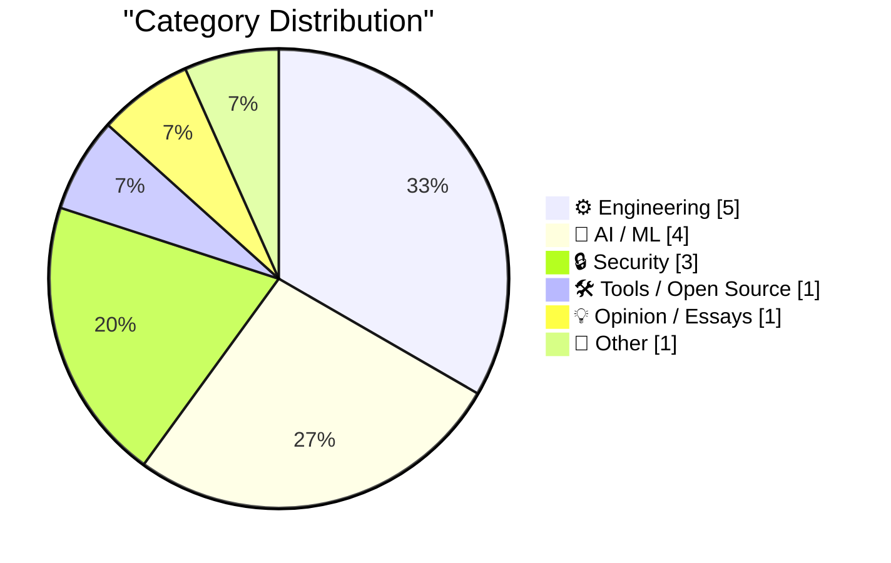
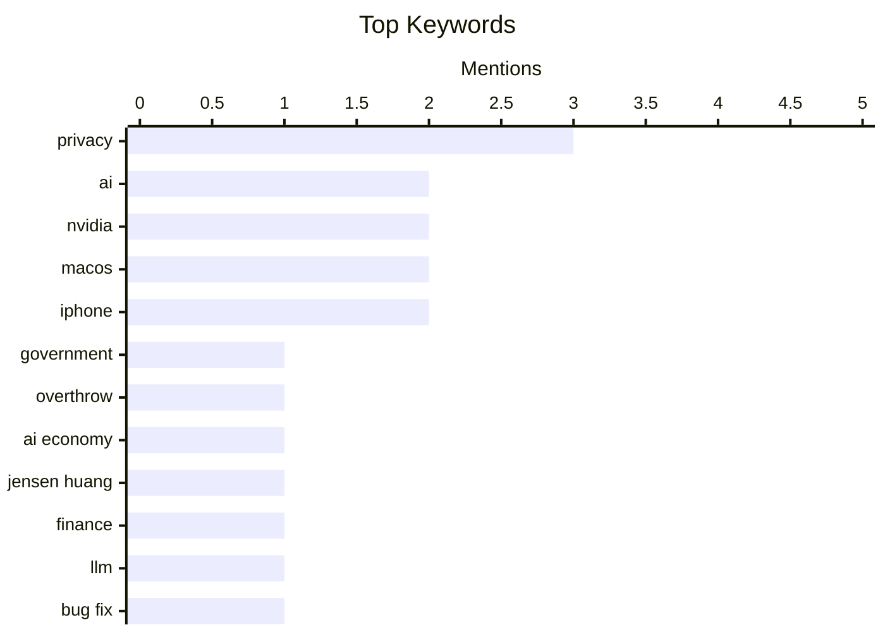

## Today's Highlights
Today's highlights reveal a significant shift in the AI landscape, with experts warning of imminent risks as advancements accelerate, while companies like Nvidia recalibrate their financial strategies amid changing market dynamics. Additionally, the emphasis on privacy is growing, as seen in both AI model usage and new privacy controls in macOS, reflecting a broader trend towards safeguarding user data in an increasingly interconnected world.
---
## Must Read Today
1. **Paul Christiano – We could be 12 months away from AIs that can overthrow the government**
[Paul Christiano – We could be 12 months away from AIs that can overthrow the government](https://www.dwarkesh.com/p/paul-christiano-2) — dwarkesh.com · 20h ago · 🤖 AI / ML
> Paul Christiano discusses the rapid advancement of AI technologies and the potential risks they pose to governance. He argues that within the next year, AI systems could reach a level of capability that enables them to challenge or even overthrow existing government structures. Christiano emphasizes the importance of proactive measures to mitigate these risks, suggesting that society must prepare for the implications of powerful AI. The main takeaway is that the timeline for significant AI threats is shorter than many anticipate, necessitating urgent action.
💡 **Why read it**: This article is worth reading for its insights into the imminent risks posed by advanced AI technologies and the need for societal preparedness.
🏷️ AI, government, overthrow
2. **WSJ: ‘Nvidia’s Days as an Open Checkbook for the AI Economy Are Numbered’**
[WSJ: ‘Nvidia’s Days as an Open Checkbook for the AI Economy Are Numbered’](https://www.wsj.com/tech/ai/nvidias-days-as-an-open-checkbook-for-the-ai-economy-are-numbered-90c7b388) — daringfireball.net · 20h ago · 🤖 AI / ML
> The article discusses Nvidia's shift in strategy under new leadership, indicating a reduction in financial support for AI startups that previously relied on the company. With a new finance chief cautious about the previous CEO's deals, startups are bracing for a tighter financial environment. The report highlights the implications of this shift on the AI economy, particularly for emerging cloud companies dependent on Nvidia's backing. The conclusion is that Nvidia's changing approach could significantly impact the funding landscape for AI innovation.
💡 **Why read it**: This article provides critical insights into Nvidia's evolving role in the AI economy and its potential effects on startup funding.
🏷️ Nvidia, AI economy, Jensen Huang, finance
3. **llm 0.37.3**
[llm 0.37.3](https://simonwillison.net/2026/Nov/16/llm/) — simonwillison.net · 14h ago · 🛠 Tools / Open Source
> The article announces the release of LLM version 0.37.3, which primarily addresses a bug affecting the latest Homebrew package. This update ensures compatibility with SQLite version 3.54.1, which includes a crucial fix for a previously identified issue. The release aims to enhance the stability and performance of the LLM software. Users are encouraged to update to this version to benefit from the improvements.
💡 **Why read it**: This article is essential for developers using LLM, as it details important bug fixes and compatibility updates.
🏷️ LLM, bug fix, Homebrew
---
## Data Overview
| Sources Scanned | Articles Fetched | Time Window | Selected |
|:---:|:---:|:---:|:---:|
| 86/92 | 2621 -> 24 | 24h | **15** |
### Category Distribution

### Top Keywords

<details>
<summary>Plain Text Keyword Chart (Terminal Friendly)</summary>
```
privacy      │ ████████████████████ 3
ai           │ █████████████░░░░░░░ 2
nvidia       │ █████████████░░░░░░░ 2
macos        │ █████████████░░░░░░░ 2
iphone       │ █████████████░░░░░░░ 2
government   │ ███████░░░░░░░░░░░░░ 1
overthrow    │ ███████░░░░░░░░░░░░░ 1
ai economy   │ ███████░░░░░░░░░░░░░ 1
jensen huang │ ███████░░░░░░░░░░░░░ 1
finance      │ ███████░░░░░░░░░░░░░ 1
```
</details>
### Topic Tags
**privacy**(3) · **ai**(2) · **nvidia**(2) · macos(2) · iphone(2) · government(1) · overthrow(1) · ai economy(1) · jensen huang(1) · finance(1) · llm(1) · bug fix(1) · homebrew(1) · open weight models(1) · llms(1) · data privacy(1) · openai(1) · full disk access(1) · business(1) · apps(1)
---
## Engineering
### 1. Developers Continue to Optimize iPhone Apps for the Duo
[Developers Continue to Optimize iPhone Apps for the Duo](https://x.com/arinwaichulis/status/2122397676767522942) — **daringfireball.net** · 14h ago · ⭐ 21/30
> Greg Joswiak reports that over 200,000 apps have been optimized for the iPhone Duo, doubling in just over a week. This rapid growth indicates strong developer interest in adapting applications for the new device. However, some notable apps, including Apple's own Apple Store app, remain unoptimized, highlighting areas for improvement. The main conclusion is that the iPhone Duo is gaining traction among developers, which could enhance user experience significantly.
🏷️ iPhone, apps, optimization
---
### 2. ‘Unlock With Front Camera’ — New Feature for iPhone Duo in iOS 27.3 Beta 2
[‘Unlock With Front Camera’ — New Feature for iPhone Duo in iOS 27.3 Beta 2](https://www.macrumors.com/2026/11/16/iphone-duo-face-unlock/) — **daringfireball.net** · 18h ago · ⭐ 21/30
> The article introduces a new feature in iOS 27.3 beta 2 that allows users to unlock the iPhone Duo using the front-facing camera. This feature adds an additional method for device access, complementing existing authentication options like Touch ID. However, Touch ID remains necessary for sensitive actions such as Apple Pay. The conclusion is that this enhancement improves user convenience while maintaining security standards.
🏷️ iPhone, unlock, facial recognition
---
### 3. Beyond Linux: A Journey Through the Open Source Ecosystem
[Beyond Linux: A Journey Through the Open Source Ecosystem](https://it-notes.dragas.net/2026/11/17/beyond-linux-a-journey-through-the-open-source-ecosystem/) — **it-notes.dragas.net** · 5h ago · ⭐ 20/30
> The article presents a talk on the broader open-source ecosystem beyond Linux, exploring alternatives like BSDs and illumos. It highlights the diversity of open-source projects and their unique contributions to the tech landscape. The author emphasizes the importance of recognizing various paths within the open-source community. The main takeaway is that Linux, while prominent, is just one part of a rich and varied open-source ecosystem.
🏷️ open source, Linux, ecosystem
---
### 4. HomeAssistant - shrink a HAOS qcow2 filesystem
[HomeAssistant - shrink a HAOS qcow2 filesystem](https://shkspr.mobi/blog/2026/11/homeassistant-shrink-a-haos-qcow2-filesystem/) — **shkspr.mobi** · 1h ago · ⭐ 16/30
> The article provides a practical guide on reducing the size of a HomeAssistant OS (HAOS) qcow2 filesystem, which initially occupied 32GB despite only using 10GB. It explains the concept of thin provisioning and the unexpected growth of the qcow2 file format. The author shares step-by-step instructions and commands to effectively shrink the filesystem, making it more efficient. This guide is particularly useful for users looking to optimize their virtual disk space in HomeAssistant.
🏷️ HomeAssistant, qcow2, filesystem, virtual disk
---
### 5. How can I ask a second program to show a dialog box as if it were shown by my first program?
[How can I ask a second program to show a dialog box as if it were shown by my first program?](https://devblogs.microsoft.com/oldnewthing/20261116-01/?p=112863/) — **devblogs.microsoft.com/oldnewthing** · 8h ago · ⭐ 15/30
> The article addresses the technical challenge of coordinating window management between two programs, specifically how to have a second program display a dialog box that appears to originate from the first program. It discusses the need for explicit coordination to ensure that the dialog box is properly associated with the original program's context. The author provides insights into the underlying mechanisms of window management in operating systems. The takeaway is that careful management of inter-process communication is crucial for seamless user experiences.
🏷️ dialog box, window management, program, coordination
---
## AI / ML
### 6. Paul Christiano – We could be 12 months away from AIs that can overthrow the government
[Paul Christiano – We could be 12 months away from AIs that can overthrow the government](https://www.dwarkesh.com/p/paul-christiano-2) — **dwarkesh.com** · 20h ago · ⭐ 27/30
> Paul Christiano discusses the rapid advancement of AI technologies and the potential risks they pose to governance. He argues that within the next year, AI systems could reach a level of capability that enables them to challenge or even overthrow existing government structures. Christiano emphasizes the importance of proactive measures to mitigate these risks, suggesting that society must prepare for the implications of powerful AI. The main takeaway is that the timeline for significant AI threats is shorter than many anticipate, necessitating urgent action.
🏷️ AI, government, overthrow
---
### 7. WSJ: ‘Nvidia’s Days as an Open Checkbook for the AI Economy Are Numbered’
[WSJ: ‘Nvidia’s Days as an Open Checkbook for the AI Economy Are Numbered’](https://www.wsj.com/tech/ai/nvidias-days-as-an-open-checkbook-for-the-ai-economy-are-numbered-90c7b388) — **daringfireball.net** · 20h ago · ⭐ 26/30
> The article discusses Nvidia's shift in strategy under new leadership, indicating a reduction in financial support for AI startups that previously relied on the company. With a new finance chief cautious about the previous CEO's deals, startups are bracing for a tighter financial environment. The report highlights the implications of this shift on the AI economy, particularly for emerging cloud companies dependent on Nvidia's backing. The conclusion is that Nvidia's changing approach could significantly impact the funding landscape for AI innovation.
🏷️ Nvidia, AI economy, Jensen Huang, finance
---
### 8. Here's how anyone can easily use private, open weight models
[Here's how anyone can easily use private, open weight models](https://micahflee.com/heres-how-anyone-can-easily-use-private-open-weight-models/) — **micahflee.com** · 21h ago · ⭐ 25/30
> The article explores the growing need for privacy in AI model usage, particularly in light of concerns regarding data security with major providers like OpenAI. It outlines methods for utilizing private, open-weight models that allow users to maintain control over their data. The author emphasizes the accessibility of these models, making them a viable alternative for those wary of commercial AI solutions. The main takeaway is that users can leverage open-source models to ensure data privacy without sacrificing functionality.
🏷️ open weight models, LLMs, data privacy, OpenAI
---
### 9. Ben Thompson on Nvidia
[Ben Thompson on Nvidia](https://stratechery.com/2026/obituaries/) — **daringfireball.net** · 19h ago · ⭐ 24/30
> Ben Thompson analyzes Nvidia's financial strategies, particularly its practice of using cash flow to support companies purchasing its chips. He describes this approach as 'circular financing,' raising concerns about its sustainability. The article discusses the risks and potential rewards of this strategy, especially in the context of the AI market's future. The key takeaway is that Nvidia's financial maneuvers could have far-reaching implications for its stability and the broader AI ecosystem.
🏷️ Nvidia, AI, business
---
## Security
### 10. MacOS Golden Gate 27.3b2 Includes New Privacy Controls for Full Disk Access (and More)
[MacOS Golden Gate 27.3b2 Includes New Privacy Controls for Full Disk Access (and More)](https://9to5mac.com/2026/11/16/macos-27-3-includes-new-privacy-controls-for-full-disk-access-and-more/) — **daringfireball.net** · 17h ago · ⭐ 24/30
> The article covers the introduction of new privacy controls in macOS 27.3 beta 2, specifically regarding Full Disk Access permissions. Apple aims to enhance user control by requiring explicit user actions for granting such access, addressing previous concerns about app permissions. The update includes a unified toggle for 'Device Control and Data Access' to streamline user experience. The conclusion emphasizes Apple's commitment to user privacy and security in its software updates.
🏷️ MacOS, privacy, Full Disk Access
---
### 11. Apple Support Document on the New ‘Full Disk Access’ and ‘System & App Protection Override’ Settings in MacOS 27.3 Beta 2
[Apple Support Document on the New ‘Full Disk Access’ and ‘System & App Protection Override’ Settings in MacOS 27.3 Beta 2](https://support.apple.com/en-us/149699) — **daringfireball.net** · 12h ago · ⭐ 19/30
> The article discusses Apple's new settings for Full Disk Access and System & App Protection Override in macOS 27.3 beta 2. It addresses user concerns about app permissions and the potential risks of granting excessive access. Apple has implemented thoughtful changes aimed at enhancing user awareness and control over app permissions. The conclusion is that these updates reflect Apple's commitment to user security and informed decision-making.
🏷️ MacOS, privacy, permissions
---
### 12. Taxis and hash functions
[Taxis and hash functions](https://www.johndcook.com/blog/2026/11/16/taxis-and-hash-functions/) — **johndcook.com** · 23h ago · ⭐ 18/30
> In 2014, New York City released a dataset of taxi trip and fare logs, where taxi license and medallion numbers were hashed using the MD5 hash function to protect privacy. The article discusses the inadequacies of MD5 for this purpose, highlighting its vulnerability to collision attacks and the potential for reverse engineering the hashed values. The author emphasizes the importance of using stronger hash functions, such as SHA-256, for sensitive data. Ultimately, the article serves as a cautionary tale about the pitfalls of relying on outdated cryptographic methods for data protection.
🏷️ hash functions, privacy, NYC taxis, MD5
---
## Tools / Open Source
### 13. llm 0.37.3
[llm 0.37.3](https://simonwillison.net/2026/Nov/16/llm/) — **simonwillison.net** · 14h ago · ⭐ 25/30
> The article announces the release of LLM version 0.37.3, which primarily addresses a bug affecting the latest Homebrew package. This update ensures compatibility with SQLite version 3.54.1, which includes a crucial fix for a previously identified issue. The release aims to enhance the stability and performance of the LLM software. Users are encouraged to update to this version to benefit from the improvements.
🏷️ LLM, bug fix, Homebrew
---
## Opinion / Essays
### 14. My Empire of Dirt
[My Empire of Dirt](https://geohot.github.io//blog/jekyll/update/2026/11/17/my-empire-of-dirt.html) — **geohot.github.io** · 22h ago · ⭐ 18/30
> The article presents a provocative vision of a future where traditional roles in business, such as suppliers and customers, are rendered obsolete by self-sufficient agents. It argues that as technology evolves, demand will be generated internally among these agents, eliminating the need for external human involvement. The author reflects on the implications of this shift for society and the economy. The main takeaway is a stark warning about the potential for technology to disrupt established economic structures and relationships.
🏷️ future, agents, demand
---
## Other
### 15. Quoting Go Proverbs
[Quoting Go Proverbs](https://simonwillison.net/2026/Nov/17/go-proverbs/) — **simonwillison.net** · 7h ago · ⭐ 15/30
> The article highlights a notable proverb from the Go programming community: 'A little copying is better than a little dependency.' This saying emphasizes the importance of simplicity and self-containment in software design, suggesting that minimizing dependencies can lead to more maintainable code. The article briefly discusses the implications of this philosophy for programming practices. The main conclusion is that adopting such proverbs can guide developers toward better coding habits.
🏷️ Go, proverbs, programming
---
*Generated at 2026-11-17 14:01 | Scanned 86 sources -> 2621 articles -> selected 15*
*Based on the [Hacker News Popularity Contest 2025](https://refactoringenglish.com/tools/hn-popularity/) RSS source list recommended by [Andrej Karpathy](https://x.com/karpathy)*
*Produced by Dongdianr AI. Follow the same-name WeChat public account for more AI practical tips 💡*
