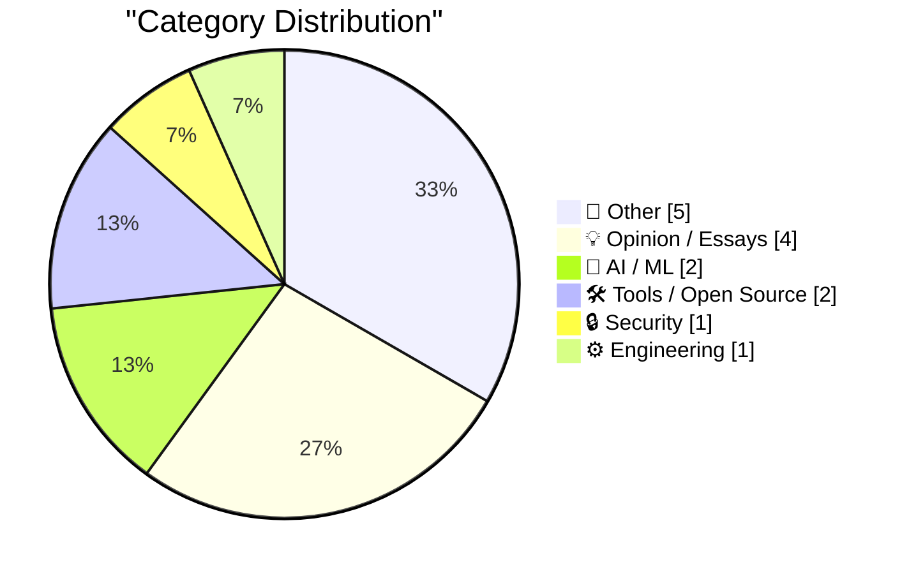
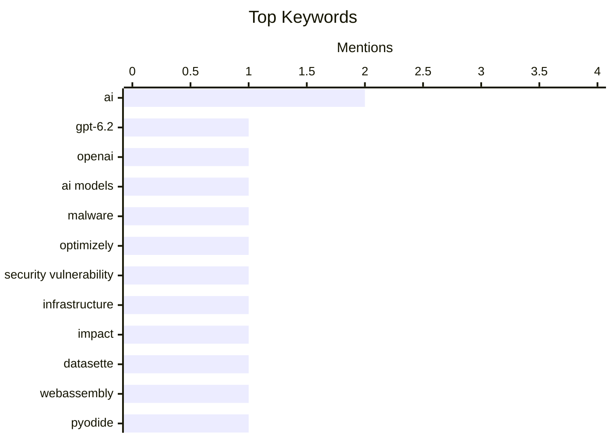

## Today's Highlights
Today's Highlights: The tech landscape is buzzing with advancements in AI, as OpenAI unveils its latest models, GPT-6.2 Astra and Sol, catering to both complex and everyday tasks. Meanwhile, security concerns are rising with reports of malware being tested on major websites through vulnerabilities in popular platforms like Optimizely. Additionally, the ongoing challenges of America's infrastructure are being exacerbated by technological factors, highlighting the urgent need for innovative solutions.
---
## Must Read Today
1. **GPT‑6.2 Astra and GPT‑6.2 Sol**
[GPT‑6.2 Astra and GPT‑6.2 Sol](https://simonwillison.net/2026/Nov/17/gpt62-astra-and-sol/) — simonwillison.net · 15h ago · 🤖 AI / ML
> OpenAI has introduced two new models: GPT-6.2 Astra for complex projects and GPT-6.2 Sol for everyday tasks, available via API as gpt-6.2-astra and gpt-6.2-sol. Astra is designed for high-performance applications, while Sol emphasizes efficiency and versatility. The release coincides with the launch of LLM version 0.38, enhancing the capabilities of these models. The main takeaway is that these models cater to different user needs, providing tailored solutions for various applications.
💡 **Why read it**: This article is worth reading for insights into the latest advancements in AI model capabilities and their practical applications.
🏷️ GPT-6.2, OpenAI, AI models
2. **Attackers Used Optimizely to A/B Test Malware on Top Websites**
[Attackers Used Optimizely to A/B Test Malware on Top Websites](https://krebsonsecurity.com/2026/11/attackers-used-optimizely-to-a-b-test-malware-on-top-websites/) — krebsonsecurity.com · 11h ago · 🔒 Security
> A security vulnerability in Optimizely allowed attackers to inject malware into at least 178 major websites, including BBC and CNN, over a 24-hour period. This incident highlights the lack of strict security measures on popular sites, which facilitated the silent distribution of data-stealing software. The key finding emphasizes the need for improved security protocols to prevent such exploitation. The main conclusion is that reliance on third-party services can introduce significant vulnerabilities.
💡 **Why read it**: This article is essential for understanding the implications of third-party service vulnerabilities on web security.
🏷️ malware, Optimizely, security vulnerability
3. **Wake up! America’s infrastructure is melting. And AI appears to be partly responsible.**
[Wake up! America’s infrastructure is melting. And AI appears to be partly responsible.](https://garymarcus.substack.com/p/wake-up-americas-infrastructure-is) — garymarcus.substack.com · 23h ago · 🤖 AI / ML
> The article discusses the deteriorating state of America's infrastructure, attributing part of the blame to AI technologies. It highlights how hundreds of companies have been affected, indicating a systemic issue that requires urgent attention. The author argues for a reevaluation of how AI is integrated into infrastructure management. The main takeaway is that AI's role in infrastructure could lead to significant challenges if not addressed properly.
💡 **Why read it**: This article is worth reading for its critical perspective on the intersection of AI and infrastructure management.
🏷️ infrastructure, AI, impact
---
## Data Overview
| Sources Scanned | Articles Fetched | Time Window | Selected |
|:---:|:---:|:---:|:---:|
| 86/92 | 2621 -> 15 | 24h | **15** |
### Category Distribution

### Top Keywords

<details>
<summary>Plain Text Keyword Chart (Terminal Friendly)</summary>
```
ai                     │ ████████████████████ 2
gpt-6.2                │ ██████████░░░░░░░░░░ 1
openai                 │ ██████████░░░░░░░░░░ 1
ai models              │ ██████████░░░░░░░░░░ 1
malware                │ ██████████░░░░░░░░░░ 1
optimizely             │ ██████████░░░░░░░░░░ 1
security vulnerability │ ██████████░░░░░░░░░░ 1
infrastructure         │ ██████████░░░░░░░░░░ 1
impact                 │ ██████████░░░░░░░░░░ 1
datasette              │ ██████████░░░░░░░░░░ 1
```
</details>
### Topic Tags
**ai**(2) · **gpt-6.2**(1) · **openai**(1) · ai models(1) · malware(1) · optimizely(1) · security vulnerability(1) · infrastructure(1) · impact(1) · datasette(1) · webassembly(1) · pyodide(1) · apple(1) · icloud(1) · service issues(1) · source control(1) · version control(1) · releases(1) · advisories(1) · sandbox(1)
---
## Other
### 1. Apple’s Cloud Services Are Having a Bad Day, Including Their Status Page
[Apple’s Cloud Services Are Having a Bad Day, Including Their Status Page](https://www.macrumors.com/2026/11/17/apple-accounts-experiencing-issues/) — **daringfireball.net** · 19h ago · ⭐ 21/30
> Apple's cloud services, including iCloud and Apple Accounts, are currently experiencing widespread issues, as reported by users and reflected on Apple's System Status page. Problems include syncing failures in apps like Photos and Notes, particularly for users on beta versions. The situation underscores the fragility of cloud services and their impact on user experience. The main takeaway is that even established platforms can face significant outages that disrupt functionality.
🏷️ Apple, iCloud, service issues
---
### 2. SetShot 1.0 (and a Personal Tale of Defaults System Spelunking)
[SetShot 1.0 (and a Personal Tale of Defaults System Spelunking)](https://tidbits.com/2026/11/13/setshot-1-0-tracks-even-more-macos-settings/) — **daringfireball.net** · 19h ago · ⭐ 15/30
> SetShot 1.0 is a new Mac utility designed to track changes in macOS settings during system updates, developed by the author in response to concerns about unexpected changes. The application aims to provide transparency and control over system settings, which can often be altered without user knowledge. The key finding is that while the app has not yet caught Apple altering settings, it serves as a proactive tool for users. The main conclusion is that user awareness of system changes is essential for maintaining control.
🏷️ Mac app, defaults, system settings
---
### 3. In the Microsoft employee price list, why did the BASIC compiler cost less than the BASIC interpreter?
[In the Microsoft employee price list, why did the BASIC compiler cost less than the BASIC interpreter?](https://devblogs.microsoft.com/oldnewthing/20261117-00/?p=112866/) — **devblogs.microsoft.com/oldnewthing** · 23h ago · ⭐ 12/30
> The article delves into the pricing structure of Microsoft's BASIC products, explaining why the compiler was priced lower than the interpreter. It provides historical context and insights into the company's pricing strategies. The discussion highlights the complexities of software pricing and its implications for product development. The main takeaway is that pricing decisions are often influenced by various market and technical factors.
🏷️ Microsoft, pricing, BASIC
---
### 4. Are vibe-coded games making me a substance dualist?
[Are vibe-coded games making me a substance dualist?](https://rakhim.exotext.com/are-vibe-coded-games-making-me-a-substance-dualist) — **rakhim.exotext.com** · 14h ago · ⭐ 9/30
> The article reflects on the emotional and philosophical impact of vibe-coded video games, particularly how they evoke feelings of the uncanny valley. The author argues that these games create an experience that feels 'almost human' yet lacks a certain depth, leading to a sense of soullessness. This exploration raises questions about the nature of art and humanity in the context of AI-generated content. The conclusion suggests that the absence of a 'soul' in these games profoundly affects the player's experience.
🏷️ video games, vibe-coded, human, uncanny valley
---
### 5. Push button telephones introduced November 18, 1963
[Push button telephones introduced November 18, 1963](https://dfarq.homeip.net/push-button-telephones-introduced-november-18-1963/?utm_source=rss&#038;utm_medium=rss&#038;utm_campaign=push-button-telephones-introduced-november-18-1963) — **dfarq.homeip.net** · 2h ago · ⭐ 5/30
> The article commemorates the introduction of push-button telephones on November 18, 1963, marking a significant technological advancement from rotary dialing. It discusses the operational differences between rotary and touch-tone phones, highlighting the ease of use and efficiency of the new technology. The introduction of push-button phones revolutionized communication by simplifying the dialing process. The main takeaway is the historical significance of this innovation in shaping modern telecommunication.
🏷️ push button, telephone, history, 1963
---
## Opinion / Essays
### 6. The NVIDIA Bubble
[The NVIDIA Bubble](https://www.wheresyoured.at/the-nvidia-bubble/) — **wheresyoured.at** · 22h ago · ⭐ 15/30
> The article discusses the financial dynamics surrounding NVIDIA, particularly in the context of AI investments and market speculation. It analyzes the potential risks and rewards associated with the company's stock performance and the broader implications for the tech industry. The insights provided are crucial for investors and tech enthusiasts looking to understand market trends. The main conclusion is that the current hype around NVIDIA may not be sustainable in the long term.
🏷️ NVIDIA, finances, AI, bubble
---
### 7. My Empire of Sunshine and Roses
[My Empire of Sunshine and Roses](https://geohot.github.io//blog/jekyll/update/2026/11/18/my-empire-of-sunshine-and-roses.html) — **geohot.github.io** · 22h ago · ⭐ 10/30
> The article explores the concept of differential history and the challenges of credit assignment in measuring one's impact on the world. It argues that true change should be evaluated through counterfactuals, considering how history would differ in the absence of an individual. The author emphasizes the complexity of attributing accomplishments and the adversarial noise that complicates this process. Ultimately, the takeaway is that understanding one's influence requires a deeper analysis beyond mere accolades.
🏷️ differential history, credit assignment, world change, adversarial noise
---
### 8. Pluralistic: Enshittifiers groom us for scammers (18 Nov 2026)
[Pluralistic: Enshittifiers groom us for scammers (18 Nov 2026)](https://pluralistic.net/2026/11/18/malice-v-incompetence/) — **pluralistic.net** · 5h ago · ⭐ 9/30
> The article discusses how the blurring lines between scams and poor business practices enable scammers to thrive. It highlights that as it becomes harder to distinguish between legitimate businesses and scams, consumers are increasingly vulnerable. The author uses various examples to illustrate the pervasive nature of this issue and its implications for consumer trust. The main conclusion is that the current landscape fosters an environment where scams can flourish due to the normalization of shoddy business practices.
🏷️ scammers, business practices, culture
---
### 9. Once More Unto The Breach - Another Year In Review
[Once More Unto The Breach - Another Year In Review](https://shkspr.mobi/blog/2026/11/once-more-unto-the-breach-another-year-in-review/) — **shkspr.mobi** · 1h ago · ⭐ 6/30
> The author reflects on their life after leaving a traditional job to pursue Financial Independence, Retire Early (FIRE) principles. They share experiences of relaxation, travel, and social engagements over the past year, contrasting their current lifestyle with previous work commitments. The narrative provides insights into the joys and challenges of living a more liberated life. Ultimately, the piece conveys a sense of contentment and fulfillment in pursuing personal dreams.
🏷️ year in review, personal reflection, FIRE
---
## AI / ML
### 10. GPT‑6.2 Astra and GPT‑6.2 Sol
[GPT‑6.2 Astra and GPT‑6.2 Sol](https://simonwillison.net/2026/Nov/17/gpt62-astra-and-sol/) — **simonwillison.net** · 15h ago · ⭐ 29/30
> OpenAI has introduced two new models: GPT-6.2 Astra for complex projects and GPT-6.2 Sol for everyday tasks, available via API as gpt-6.2-astra and gpt-6.2-sol. Astra is designed for high-performance applications, while Sol emphasizes efficiency and versatility. The release coincides with the launch of LLM version 0.38, enhancing the capabilities of these models. The main takeaway is that these models cater to different user needs, providing tailored solutions for various applications.
🏷️ GPT-6.2, OpenAI, AI models
---
### 11. Wake up! America’s infrastructure is melting. And AI appears to be partly responsible.
[Wake up! America’s infrastructure is melting. And AI appears to be partly responsible.](https://garymarcus.substack.com/p/wake-up-americas-infrastructure-is) — **garymarcus.substack.com** · 23h ago · ⭐ 24/30
> The article discusses the deteriorating state of America's infrastructure, attributing part of the blame to AI technologies. It highlights how hundreds of companies have been affected, indicating a systemic issue that requires urgent attention. The author argues for a reevaluation of how AI is integrated into infrastructure management. The main takeaway is that AI's role in infrastructure could lead to significant challenges if not addressed properly.
🏷️ infrastructure, AI, impact
---
## Tools / Open Source
### 12. Running the full server-side Datasette Python app in the browser with service workers and Pyodide
[Running the full server-side Datasette Python app in the browser with service workers and Pyodide](https://simonwillison.net/2026/Nov/17/datasette-lite/) — **simonwillison.net** · 21h ago · ⭐ 21/30
> The author has successfully ported the Datasette Python application to run in the browser using WebAssembly and Pyodide, creating Datasette Lite. This version utilizes service workers to closely mimic the functionality of the server-side application, allowing users to interact with it directly in their browsers. The technical achievement demonstrates the potential for running complex applications client-side without server dependencies. The main conclusion is that this approach significantly enhances accessibility and user experience.
🏷️ Datasette, WebAssembly, Pyodide
---
### 13. This Week in Source Control: 18 November 2026
[This Week in Source Control: 18 November 2026](https://nesbitt.io/2026/11/18/this-week-in-source-control.html) — **nesbitt.io** · 4h ago · ⭐ 21/30
> This article provides a roundup of recent releases, advisories, and articles related to version control systems and forges. It covers significant updates and trends in the source control landscape, offering insights into tools and practices that are shaping the industry. The compilation serves as a valuable resource for developers looking to stay informed about the latest developments in source control. The main conclusion is that keeping up with these updates is crucial for effective version management.
🏷️ source control, version control, releases, advisories
---
## Security
### 14. Attackers Used Optimizely to A/B Test Malware on Top Websites
[Attackers Used Optimizely to A/B Test Malware on Top Websites](https://krebsonsecurity.com/2026/11/attackers-used-optimizely-to-a-b-test-malware-on-top-websites/) — **krebsonsecurity.com** · 11h ago · ⭐ 27/30
> A security vulnerability in Optimizely allowed attackers to inject malware into at least 178 major websites, including BBC and CNN, over a 24-hour period. This incident highlights the lack of strict security measures on popular sites, which facilitated the silent distribution of data-stealing software. The key finding emphasizes the need for improved security protocols to prevent such exploitation. The main conclusion is that reliance on third-party services can introduce significant vulnerabilities.
🏷️ malware, Optimizely, security vulnerability
---
## Engineering
### 15. External sandboxes for coding agents
[External sandboxes for coding agents](https://simonwillison.net/2026/Nov/17/external-sandboxes-for-coding-agents/) — **simonwillison.net** · 15h ago · ⭐ 20/30
> The article explores innovative methods for sandboxing code executed by agents to enhance safety against mistakes and prompt injection attacks. The author collaborated with Prime Radiant to develop these external sandboxes, focusing on local model testing without risking harmful actions on machines. The findings emphasize the importance of secure environments for AI experimentation. The main takeaway is that effective sandboxing can mitigate risks associated with running potentially harmful code.
🏷️ sandbox, coding agents, safety
---
*Generated at 2026-11-18 14:01 | Scanned 86 sources -> 2621 articles -> selected 15*
*Based on the [Hacker News Popularity Contest 2025](https://refactoringenglish.com/tools/hn-popularity/) RSS source list recommended by [Andrej Karpathy](https://x.com/karpathy)*
*Produced by Dongdianr AI. Follow the same-name WeChat public account for more AI practical tips 💡*
