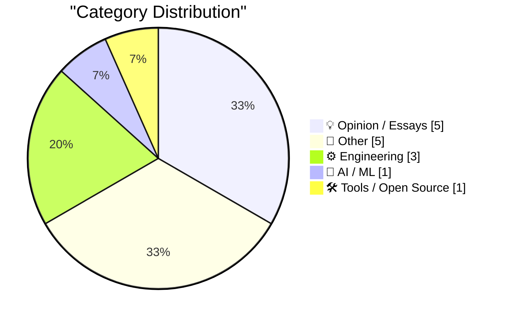
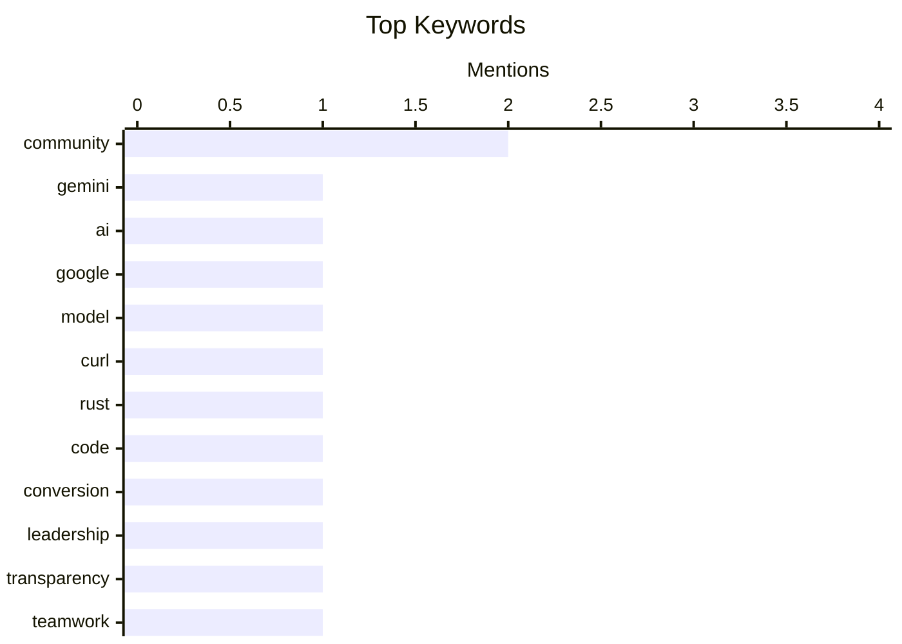

## Today's Highlights
Today's Highlights: The tech landscape is buzzing with significant shifts as Google's Gemini 4 Neon complicates AI pricing structures, while a notable push towards Rust programming is evident with the conversion of extensive C code. Meanwhile, the venture capital scene is under scrutiny, with calls for New York investors to seek validation beyond Silicon Valley. As the Python Software Foundation ramps up its end-of-year fundraising efforts, the community reflects on the evolving dynamics of tech investment and development.
---
## Must Read Today
1. **llm-gemini 0.38**
[llm-gemini 0.38](https://simonwillison.net/2026/Nov/18/llm-gemini/) — simonwillison.net · 14h ago · 🤖 AI / ML
> Google's introduction of Gemini 4 Neon has complicated the already confusing pricing structure of the Gemini 4 series. The article discusses how the new release has led to further ambiguity in costs and highlights the challenges users face in understanding the pricing model. The author emphasizes that the changes in pricing may deter potential users due to the lack of clarity. Overall, the article serves as a critical examination of the implications of Gemini 4 Neon on user experience and decision-making.
💡 **Why read it**: This article is worth reading for insights into the evolving pricing strategies of AI models and their impact on user adoption.
🏷️ Gemini, AI, Google, model
2. **Quoting Daniel Stenberg**
[Quoting Daniel Stenberg](https://simonwillison.net/2026/Nov/18/daniel-stenberg/) — simonwillison.net · 22h ago · ⚙️ Engineering
> Daniel Stenberg discusses the conversion of 185,000 lines of C code into 340,000 lines of Rust code, highlighting the ongoing improvements to the curl project during this process. Over three weeks, the team merged more than 300 commits, including 200 bug fixes and several vulnerability patches, demonstrating the project's active development. The article underscores the balance between rewriting code in a new language and maintaining ongoing project enhancements. It concludes that while the Rust rewrites are significant, they do not encompass the full scope of improvements made to curl.
💡 **Why read it**: This article is valuable for understanding the complexities of language migration in software projects and the importance of continuous development.
🏷️ curl, Rust, code, conversion
3. **Unburden yourself of the backlog**
[Unburden yourself of the backlog](https://entropicthoughts.com/unburden-yourself-of-the-backlog) — entropicthoughts.com · 15h ago · 💡 Opinion / Essays
> David Marquet shares insights from his experience as a submarine commander, where he adopted a transparent leadership style to compensate for his lack of technical knowledge. This approach led to significant performance improvements compared to traditional Navy leadership styles. Marquet's findings suggest that empowering team members through transparency can enhance overall effectiveness and decision-making. The main takeaway is that leadership styles that prioritize openness can lead to better organizational outcomes.
💡 **Why read it**: This article is worth reading for leaders seeking innovative strategies to enhance team performance and engagement.
🏷️ leadership, transparency, teamwork
---
## Data Overview
| Sources Scanned | Articles Fetched | Time Window | Selected |
|:---:|:---:|:---:|:---:|
| 86/92 | 2622 -> 17 | 24h | **15** |
### Category Distribution

### Top Keywords

<details>
<summary>Plain Text Keyword Chart (Terminal Friendly)</summary>
```
community  │ ████████████████████ 2
gemini     │ ██████████░░░░░░░░░░ 1
ai         │ ██████████░░░░░░░░░░ 1
google     │ ██████████░░░░░░░░░░ 1
model      │ ██████████░░░░░░░░░░ 1
curl       │ ██████████░░░░░░░░░░ 1
rust       │ ██████████░░░░░░░░░░ 1
code       │ ██████████░░░░░░░░░░ 1
conversion │ ██████████░░░░░░░░░░ 1
leadership │ ██████████░░░░░░░░░░ 1
```
</details>
### Topic Tags
**community**(2) · **gemini**(1) · **ai**(1) · google(1) · model(1) · curl(1) · rust(1) · code(1) · conversion(1) · leadership(1) · transparency(1) · teamwork(1) · datasette(1) · plugin(1) · streaming(1) · release(1) · anthropic(1) · ipo(1) · investors(1) · society(1)
---
## Opinion / Essays
### 1. Unburden yourself of the backlog
[Unburden yourself of the backlog](https://entropicthoughts.com/unburden-yourself-of-the-backlog) — **entropicthoughts.com** · 15h ago · ⭐ 19/30
> David Marquet shares insights from his experience as a submarine commander, where he adopted a transparent leadership style to compensate for his lack of technical knowledge. This approach led to significant performance improvements compared to traditional Navy leadership styles. Marquet's findings suggest that empowering team members through transparency can enhance overall effectiveness and decision-making. The main takeaway is that leadership styles that prioritize openness can lead to better organizational outcomes.
🏷️ leadership, transparency, teamwork
---
### 2. Is Anthropic’s IPO a bad bet, both for investors and society?
[Is Anthropic’s IPO a bad bet, both for investors and society?](https://garymarcus.substack.com/p/is-anthropics-ipo-a-bad-bet-both) — **garymarcus.substack.com** · 16h ago · ⭐ 18/30
> The article critically examines the implications of Anthropic's IPO, questioning whether it represents a sound investment for stakeholders and society at large. It highlights potential risks and ethical considerations that may be overlooked in the bullish narrative surrounding the IPO. The author argues that the focus on short-term gains could overshadow long-term societal impacts. Ultimately, the article calls for a more nuanced understanding of the consequences of AI investments.
🏷️ Anthropic, IPO, investors, society
---
### 3. NYC’s venture capitalists need to love themselves
[NYC’s venture capitalists need to love themselves](https://anildash.com/2026/11/03/nyc-venture-capitalists-love-themselves/) — **anildash.com** · 10h ago · ⭐ 16/30
> The article critiques New York City venture capitalists for seeking validation from Silicon Valley, suggesting that this behavior undermines their own self-worth and the local tech community. The author argues that NYC investors should embrace their unique values and strengths instead of conforming to external pressures. This reflection on self-esteem in the investment community highlights the need for a more authentic approach to fostering innovation. The conclusion encourages NYC investors to prioritize their identity and contributions to the tech ecosystem.
🏷️ venture capital, self-esteem, tech community
---
### 4. SO Is Back! No, Not Stack Overflow, but Its Spirit
[SO Is Back! No, Not Stack Overflow, but Its Spirit](https://idiallo.com/byte-size/stackoverflow-is-back-in-spirit) — **idiallo.com** · 6h ago · ⭐ 14/30
> The article discusses the decline of Stack Overflow's effectiveness due to users' frustrations with question closures and the rise of LLMs providing answers. It highlights how LLMs have taken over the role of answering programming queries, often with more relevance and immediacy than the community-driven platform. However, it notes that LLMs can also falter, leaving users in a lurch when they fail to provide satisfactory responses. The main takeaway is that while LLMs have filled a gap left by Stack Overflow, they are not a perfect substitute. 
🏷️ Stack Overflow, questions, community, feedback
---
### 5. ★ The 50-Yard Line
[★ The 50-Yard Line](https://daringfireball.net/2026/11/the_50-yard_line) — **daringfireball.net** · 17h ago · ⭐ 9/30
> The article explores the political positioning of CEOs, suggesting they often remain neutral, or 'close to the 50-yard line,' to avoid backlash regardless of political shifts. This strategy allows them to maintain stability and adaptability in changing political climates. The main takeaway is that this cautious approach helps CEOs navigate the complexities of corporate governance and public perception.
🏷️ CEOs, politics, strategy, business
---
## Other
### 6. The PSF end-of-year fundraiser
[The PSF end-of-year fundraiser](https://simonwillison.net/2026/Nov/18/psf-end-of-year-fundraiser/) — **simonwillison.net** · 23h ago · ⭐ 16/30
> The Python Software Foundation (PSF) has launched its end-of-year fundraiser to support Python development and community initiatives. The article emphasizes the importance of donations from companies and individuals who benefit from Python. It outlines the PSF's role in maintaining Python's intellectual property, operating PyPI, and sponsoring community events. The main conclusion is a call to action for the community to contribute to the sustainability of Python's ecosystem.
🏷️ fundraiser, Python, community, PSF
---
### 7. Jensen Huang Tweets
[Jensen Huang Tweets](https://x.com/JensenHuang/status/2122726005219737649) — **daringfireball.net** · 22h ago · ⭐ 15/30
> Jensen Huang's tweet reflects on the strong support he has received from NVIDIA employees and stakeholders calling for his return as CEO. He acknowledges the complex challenges NVIDIA faces in technology, market dynamics, and competition. Huang's message underscores the significance of leadership continuity in navigating these complexities. The main takeaway is the critical role of leadership in maintaining stakeholder confidence during turbulent times.
🏷️ Nvidia, CEO, Jensen Huang, earnings
---
### 8. Supersequences and Superpermutations
[Supersequences and Superpermutations](https://www.johndcook.com/blog/2026/11/18/supersequences/) — **johndcook.com** · 13h ago · ⭐ 15/30
> The article explores the concept of universal words, which contain every permutation of their alphabet as a subsequence. It defines supersequences and superpermutations, illustrating how certain strings can encompass all permutations of a set of characters. The discussion includes mathematical implications and examples, emphasizing the complexity of finding such sequences. The conclusion highlights the intriguing nature of these concepts in combinatorial mathematics.
🏷️ supersequences, permutations, combinatorics
---
### 9. Email Dumpster Diving
[Email Dumpster Diving](https://blog.jim-nielsen.com/2026/email-dumpster-diving/) — **blog.jim-nielsen.com** · 19h ago · ⭐ 9/30
> The author shares a personal anecdote about exploring the Spam folder in their email for amusement. This 'email dumpster diving' is portrayed as a quirky hobby that offers unexpected finds, akin to searching for a 'needle in a haystack.' The conclusion reflects on the psychological aspects of this behavior, suggesting it may stem from a desire for novelty or excitement.
🏷️ email, spam, phishing
---
### 10. Tandy 1000 models
[Tandy 1000 models](https://dfarq.homeip.net/tandy-1000-models/?utm_source=rss&#038;utm_medium=rss&#038;utm_campaign=tandy-1000-models) — **dfarq.homeip.net** · 2h ago · ⭐ 9/30
> The article provides a historical overview of the Tandy 1000 series, which was aimed at the home and education markets, following Tandy's earlier Tandy 2000 model. It details the development and features of the Tandy 1000, highlighting its significance in the IBM PC compatible market. The main takeaway is the Tandy 1000's role in popularizing personal computing during the early 1980s.
🏷️ Tandy 1000, PC, history
---
## Engineering
### 11. Quoting Daniel Stenberg
[Quoting Daniel Stenberg](https://simonwillison.net/2026/Nov/18/daniel-stenberg/) — **simonwillison.net** · 22h ago · ⭐ 19/30
> Daniel Stenberg discusses the conversion of 185,000 lines of C code into 340,000 lines of Rust code, highlighting the ongoing improvements to the curl project during this process. Over three weeks, the team merged more than 300 commits, including 200 bug fixes and several vulnerability patches, demonstrating the project's active development. The article underscores the balance between rewriting code in a new language and maintaining ongoing project enhancements. It concludes that while the Rust rewrites are significant, they do not encompass the full scope of improvements made to curl.
🏷️ curl, Rust, code, conversion
---
### 12. Inside PyPy: first contact with RPython
[Inside PyPy: first contact with RPython](https://bernsteinbear.com/blog/inside-pypy-first-contact-with-rpython/?utm_source=rss) — **bernsteinbear.com** · 14h ago · ⭐ 15/30
> The author shares their journey of wanting to implement a programming language and the challenges faced in finding a suitable implementation language. They discuss the decision to modify an existing implementation instead of creating a new one from scratch. The article reflects on the complexities and considerations involved in language design and implementation. The main conclusion emphasizes the importance of practical approaches in programming language development.
🏷️ PyPy, RPython, programming language
---
### 13. If the Windows documentation doesn’t list a particular technology as supporting an operation, does that mean that it doesn’t support it?
[If the Windows documentation doesn’t list a particular technology as supporting an operation, does that mean that it doesn’t support it?](https://devblogs.microsoft.com/oldnewthing/20261118-00/?p=112870/) — **devblogs.microsoft.com/oldnewthing** · 23h ago · ⭐ 13/30
> The post addresses the ambiguity in Windows documentation regarding third-party network protocols and their support for various operations. It emphasizes that just because a technology isn't explicitly mentioned in the documentation, it doesn't necessarily mean it lacks support; rather, the documentation may not cover all capabilities. The conclusion stresses the importance of testing and community feedback in understanding the full scope of Windows' compatibility with third-party technologies.
🏷️ Windows, documentation, protocols, support
---
## AI / ML
### 14. llm-gemini 0.38
[llm-gemini 0.38](https://simonwillison.net/2026/Nov/18/llm-gemini/) — **simonwillison.net** · 14h ago · ⭐ 27/30
> Google's introduction of Gemini 4 Neon has complicated the already confusing pricing structure of the Gemini 4 series. The article discusses how the new release has led to further ambiguity in costs and highlights the challenges users face in understanding the pricing model. The author emphasizes that the changes in pricing may deter potential users due to the lack of clarity. Overall, the article serves as a critical examination of the implications of Gemini 4 Neon on user experience and decision-making.
🏷️ Gemini, AI, Google, model
---
## Tools / Open Source
### 15. datasette-arrows 0.1a0
[datasette-arrows 0.1a0](https://simonwillison.net/2026/Nov/18/datasette-arrows/) — **simonwillison.net** · 20h ago · ⭐ 18/30
> The release of datasette-arrows 0.1a0 introduces streaming export formats for the Datasette platform, allowing users to export large datasets without loading them entirely into memory. This feature builds on the capabilities added in Datasette 1.0a43, which supports streaming CSV and TSV formats. The technical approach enables efficient handling of millions of data lines, making it a significant enhancement for users dealing with large datasets. The conclusion emphasizes the importance of these streaming capabilities for data management and accessibility.
🏷️ Datasette, plugin, streaming, release
---
*Generated at 2026-11-19 14:01 | Scanned 86 sources -> 2622 articles -> selected 15*
*Based on the [Hacker News Popularity Contest 2025](https://refactoringenglish.com/tools/hn-popularity/) RSS source list recommended by [Andrej Karpathy](https://x.com/karpathy)*
*Produced by Dongdianr AI. Follow the same-name WeChat public account for more AI practical tips 💡*
