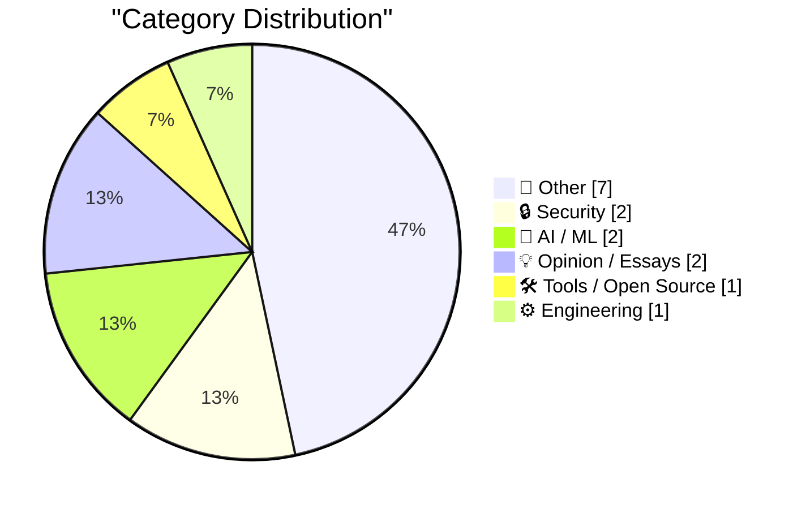
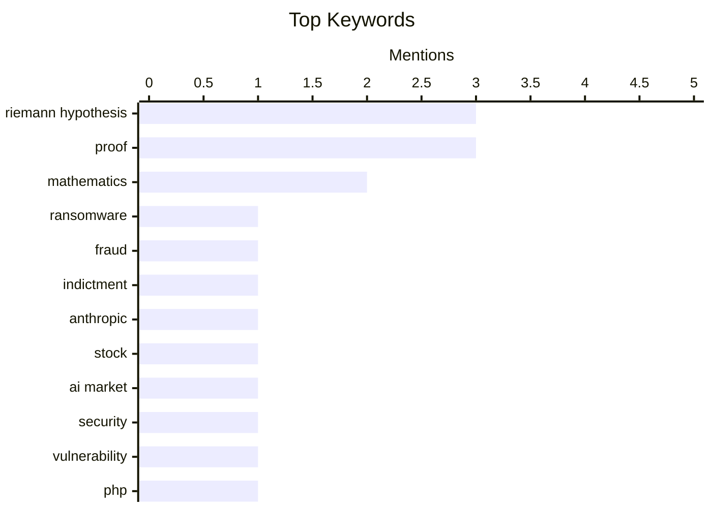

## Today's Highlights
Today's highlights reveal a turbulent landscape in technology, with significant legal repercussions in cybersecurity as a CTO faces indictment for wire fraud amid rising ransomware threats. Meanwhile, the AI sector is grappling with a dramatic stock decline, reflecting broader economic uncertainties and challenges in the industry. Additionally, ongoing discussions about patch management underscore persistent vulnerabilities in computer security, highlighting the urgent need for improved practices in the face of evolving threats.
---
## Must Read Today
1. **CTO of ‘RansomwareHelp’ Indicted for Wire Fraud**
[CTO of ‘RansomwareHelp’ Indicted for Wire Fraud](https://krebsonsecurity.com/2026/11/cto-of-ransomwarehelp-indicted-for-wire-fraud/) — krebsonsecurity.com · 13h ago · 🔒 Security
> The CTO of ransomwarehelp.com has been indicted for wire fraud after an FBI sting revealed that the company misrepresented its services. Instead of using advanced cryptographic tools to decrypt data, the company was simply paying attackers for decryption keys and charging victims a markup for services not rendered. This case highlights the risks associated with ransomware recovery services and the potential for fraudulent practices in the industry. The main takeaway is the importance of verifying the legitimacy of companies claiming to assist with ransomware recovery.
💡 **Why read it**: This article is worth reading as it exposes fraudulent practices in the ransomware recovery industry and emphasizes the need for consumer vigilance.
🏷️ ransomware, fraud, indictment
2. **Breaking: Anthropic stock is crashing, and AI stocks have lost over 50% in 5 months.**
[Breaking: Anthropic stock is crashing, and AI stocks have lost over 50% in 5 months.](https://garymarcus.substack.com/p/breaking-anthropic-stock-is-crashing) — garymarcus.substack.com · 23h ago · 🤖 AI / ML
> Anthropic's stock is experiencing a significant decline, with a nearly 10% drop anticipated at the market's opening. This downturn is part of a broader trend where AI stocks have lost over 50% of their value in the past five months. The article discusses the implications of this crash for the AI sector and investor sentiment. The main conclusion is that the AI market is currently facing substantial volatility and uncertainty.
💡 **Why read it**: This article provides timely insights into the financial health of AI companies, crucial for investors and industry watchers.
🏷️ Anthropic, stock, AI market
3. **Why Johnny Can’t Patch**
[Why Johnny Can’t Patch](https://dfarq.homeip.net/why-johnny-cant-patch-2/?utm_source=rss&#038;utm_medium=rss&#038;utm_campaign=why-johnny-cant-patch-2) — dfarq.homeip.net · 15h ago · 🔒 Security
> The article discusses the challenges faced in computer security, particularly regarding patch management. It highlights a recent high-profile vulnerability in PHP and the ongoing difficulties users encounter in applying patches effectively. The author argues that user behavior and system complexity contribute significantly to patching failures. The key takeaway is the need for improved strategies and tools to facilitate timely patching in software systems.
💡 **Why read it**: This article is essential for understanding the complexities of software patch management and the implications for security.
🏷️ security, vulnerability, PHP
---
## Data Overview
| Sources Scanned | Articles Fetched | Time Window | Selected |
|:---:|:---:|:---:|:---:|
| 86/92 | 2622 -> 15 | 24h | **15** |
### Category Distribution

### Top Keywords

<details>
<summary>Plain Text Keyword Chart (Terminal Friendly)</summary>
```
riemann hypothesis │ ████████████████████ 3
proof              │ ████████████████████ 3
mathematics        │ █████████████░░░░░░░ 2
ransomware         │ ███████░░░░░░░░░░░░░ 1
fraud              │ ███████░░░░░░░░░░░░░ 1
indictment         │ ███████░░░░░░░░░░░░░ 1
anthropic          │ ███████░░░░░░░░░░░░░ 1
stock              │ ███████░░░░░░░░░░░░░ 1
ai market          │ ███████░░░░░░░░░░░░░ 1
security           │ ███████░░░░░░░░░░░░░ 1
```
</details>
### Topic Tags
**riemann hypothesis**(3) · **proof**(3) · **mathematics**(2) · ransomware(1) · fraud(1) · indictment(1) · anthropic(1) · stock(1) · ai market(1) · security(1) · vulnerability(1) · php(1) · llm(1) · caching(1) · inference(1) · ai(1) · copyright(1) · metadata(1) · licensing(1) · package management(1)
---
## Other
### 1. What is the Generalized Riemann Hypothesis?
[What is the Generalized Riemann Hypothesis?](https://www.johndcook.com/blog/2026/11/20/grh/) — **johndcook.com** · 10h ago · ⭐ 18/30
> The article discusses the recent announcements of two proofs for the Generalized Riemann Hypothesis (GRH), one generated by AI and the other by a human. It explains the significance of the GRH, which generalizes the Riemann Hypothesis concerning the zeros of the Riemann zeta function. The implications of these proofs could reshape understanding in number theory and complex analysis. The main conclusion is that the pursuit of such profound mathematical truths continues to evolve with advancements in AI.
🏷️ Riemann Hypothesis, AI, proof
---
### 2. Relicensing to CC BY-SA and making it visible in Schema metadata
[Relicensing to CC BY-SA and making it visible in Schema metadata](https://shkspr.mobi/blog/2026/11/relicensing-to-cc-by-sa-and-making-it-visible-in-schema-metadata/) — **shkspr.mobi** · 1h ago · ⭐ 15/30
> The article addresses how to clearly communicate the copyright license of blog posts, specifically through Schema metadata. It discusses the importance of using the 'rel' attribute in the HTML <head> section to indicate licensing information. The author emphasizes that transparency in copyright is crucial for both human readers and automated systems. The main takeaway is that proper metadata can enhance the visibility and understanding of copyright terms.
🏷️ copyright, metadata, licensing
---
### 3. Diablo II
[Diablo II](https://www.filfre.net/2026/11/diablo-ii/) — **filfre.net** · 20h ago · ⭐ 10/30
> The article narrates the evolution of the Diablo series, focusing on Diablo II's gameplay mechanics and character progression. It describes how players engage in defeating enemies while pursuing overarching and sub-goals within the game. The author highlights the simplicity and straightforwardness of the game design, making it accessible to players. The main takeaway is that Diablo II successfully combines depth and simplicity, contributing to its enduring popularity.
🏷️ Diablo II, gaming, story
---
### 4. What three-bolt mount means on a garbage disposal
[What three-bolt mount means on a garbage disposal](https://dfarq.homeip.net/what-three-bolt-mount-means-on-a-garbage-disposal/?utm_source=rss&#038;utm_medium=rss&#038;utm_campaign=what-three-bolt-mount-means-on-a-garbage-disposal) — **dfarq.homeip.net** · 2h ago · ⭐ 10/30
> The article explains the significance of a three-bolt mount in garbage disposals, particularly regarding retrofitting. It details how this mounting system allows for easier installation and compatibility with existing setups, which can be a concern for homeowners replacing old units. The author emphasizes that understanding this feature can simplify the replacement process and enhance user experience. Overall, the three-bolt mount is presented as a practical solution for efficient disposal installation.
🏷️ garbage disposal, mount, retrofit
---
### 5. Quoting Ravi Vakil
[Quoting Ravi Vakil](https://simonwillison.net/2026/Nov/20/ravi-vakil/) — **simonwillison.net** · 18h ago · ⭐ 9/30
> This article discusses a proposed proof of the Generalized Riemann Hypothesis by Alessandro Masullo, which has been under scrutiny by Brian Conrad. The collaborative effort emphasizes a human-driven approach, with no AI involvement, and aims to refine the proof before a public announcement. The ongoing feedback process highlights the importance of peer review in mathematical research. The article suggests that the proof is promising and could lead to significant advancements in number theory.
🏷️ Riemann Hypothesis, mathematics, proof
---
### 6. Quoting Levent Alpöge
[Quoting Levent Alpöge](https://simonwillison.net/2026/Nov/20/levent-alpoge/) — **simonwillison.net** · 21h ago · ⭐ 9/30
> Levent Alpöge claims to have discovered a proof of the Riemann Hypothesis, extending it to the Generalized Riemann Hypothesis. He notes that the method used is robust enough to potentially address the Extended Riemann Hypothesis as well. The article highlights the formalization of arguments without assumptions, indicating a rigorous approach to the proof. Alpöge's insights reflect a significant development in the mathematical community's pursuit of resolving these longstanding conjectures.
🏷️ Riemann Hypothesis, proof, mathematics
---
### 7. Reading List 11/21/2026
[Reading List 11/21/2026](https://www.construction-physics.com/p/reading-list-11212026) — **construction-physics.com** · 57m ago · ⭐ 6/30
> This reading list compiles various topics including BAAJA, rayon for missiles, US gas consumption, and the concept of Cyberarmageddon. Each entry provides a brief overview of its relevance and importance in current discussions. The list serves as a resource for those interested in diverse fields ranging from materials science to energy consumption and cybersecurity. It encourages readers to explore these subjects further for a broader understanding of contemporary issues.
🏷️ construction, reading list, gas consumption
---
## Security
### 8. CTO of ‘RansomwareHelp’ Indicted for Wire Fraud
[CTO of ‘RansomwareHelp’ Indicted for Wire Fraud](https://krebsonsecurity.com/2026/11/cto-of-ransomwarehelp-indicted-for-wire-fraud/) — **krebsonsecurity.com** · 13h ago · ⭐ 27/30
> The CTO of ransomwarehelp.com has been indicted for wire fraud after an FBI sting revealed that the company misrepresented its services. Instead of using advanced cryptographic tools to decrypt data, the company was simply paying attackers for decryption keys and charging victims a markup for services not rendered. This case highlights the risks associated with ransomware recovery services and the potential for fraudulent practices in the industry. The main takeaway is the importance of verifying the legitimacy of companies claiming to assist with ransomware recovery.
🏷️ ransomware, fraud, indictment
---
### 9. Why Johnny Can’t Patch
[Why Johnny Can’t Patch](https://dfarq.homeip.net/why-johnny-cant-patch-2/?utm_source=rss&#038;utm_medium=rss&#038;utm_campaign=why-johnny-cant-patch-2) — **dfarq.homeip.net** · 15h ago · ⭐ 24/30
> The article discusses the challenges faced in computer security, particularly regarding patch management. It highlights a recent high-profile vulnerability in PHP and the ongoing difficulties users encounter in applying patches effectively. The author argues that user behavior and system complexity contribute significantly to patching failures. The key takeaway is the need for improved strategies and tools to facilitate timely patching in software systems.
🏷️ security, vulnerability, PHP
---
## AI / ML
### 10. Breaking: Anthropic stock is crashing, and AI stocks have lost over 50% in 5 months.
[Breaking: Anthropic stock is crashing, and AI stocks have lost over 50% in 5 months.](https://garymarcus.substack.com/p/breaking-anthropic-stock-is-crashing) — **garymarcus.substack.com** · 23h ago · ⭐ 24/30
> Anthropic's stock is experiencing a significant decline, with a nearly 10% drop anticipated at the market's opening. This downturn is part of a broader trend where AI stocks have lost over 50% of their value in the past five months. The article discusses the implications of this crash for the AI sector and investor sentiment. The main conclusion is that the AI market is currently facing substantial volatility and uncertainty.
🏷️ Anthropic, stock, AI market
---
### 11. Why output caching doesn't work
[Why output caching doesn't work](https://seangoedecke.com/why-output-caching-doesnt-work/) — **seangoedecke.com** · 14h ago · ⭐ 23/30
> The article examines the economics of LLM inference and the role of caching in optimizing performance. It argues against the practice of caching model outputs, explaining that it does not yield the expected efficiency gains and can complicate the inference process. The author provides insights into the nuances of caching model inputs versus outputs, concluding that caching outputs may not be beneficial. The main takeaway is that careful consideration is needed when implementing caching strategies in LLM applications.
🏷️ LLM, caching, inference
---
## Opinion / Essays
### 12. Premium: Bursting Bubbles
[Premium: Bursting Bubbles](https://www.wheresyoured.at/premium-bursting-bubbles/) — **wheresyoured.at** · 21h ago · ⭐ 13/30
> The article explores the cyclical nature of economic bubbles, emphasizing their destructive impact on society and wealth distribution. It argues that while some individuals may profit from these bubbles, the majority suffer from the consequences. The author discusses the psychological and economic factors that contribute to bubble formation and bursts. The main takeaway is the need for awareness and caution in financial investments to mitigate risks associated with bubbles.
🏷️ bubbles, economy, wealth
---
### 13. The Talk Show: ‘A Whoopsie Treason’
[The Talk Show: ‘A Whoopsie Treason’](https://daringfireball.net/thetalkshow/2026/11/20/ep-457) — **daringfireball.net** · 14h ago · ⭐ 12/30
> This episode features discussions on various tech topics, including Nvidia's controversies, new product launches like the iPad Mini, and celebrity news related to the James Bond franchise. The hosts provide commentary on the implications of these developments in the tech industry. The episode highlights the intersection of technology and popular culture. The main conclusion is that tech news continues to evolve rapidly, influencing both industry and consumer behavior.
🏷️ Nvidia, iPad Mini, tech news
---
## Tools / Open Source
### 14. This Week in Package Management: 21 November 2026
[This Week in Package Management: 21 November 2026](https://nesbitt.io/2026/11/21/this-week-in-package-management.html) — **nesbitt.io** · 4h ago · ⭐ 15/30
> This article provides a roundup of recent releases, advisories, and developments in the package management ecosystem. It highlights key updates and changes across various package managers, offering insights into trends and challenges in the field. The author emphasizes the importance of staying informed about package management to ensure security and efficiency in software development. The main conclusion is that continuous monitoring of package management updates is essential for developers.
🏷️ package management, releases, advisories
---
## Engineering
### 15. Another failed attempt to get the icon for the icon for the .. parent folder
[Another failed attempt to get the icon for the icon for the .. parent folder](https://devblogs.microsoft.com/oldnewthing/20261120-00/?p=112883/) — **devblogs.microsoft.com/oldnewthing** · 23h ago · ⭐ 6/30
> The article recounts a technical issue encountered while trying to generate an icon for the parent folder in a software context. It discusses the challenges of path generation that leads to invalid results, highlighting the complexities involved in file system navigation. The author reflects on the implications of such failures in software development and user experience. Ultimately, it serves as a reminder of the intricacies of coding and the importance of robust error handling.
🏷️ icon, folder, path
---
*Generated at 2026-11-21 14:01 | Scanned 86 sources -> 2622 articles -> selected 15*
*Based on the [Hacker News Popularity Contest 2025](https://refactoringenglish.com/tools/hn-popularity/) RSS source list recommended by [Andrej Karpathy](https://x.com/karpathy)*
*Produced by Dongdianr AI. Follow the same-name WeChat public account for more AI practical tips 💡*
