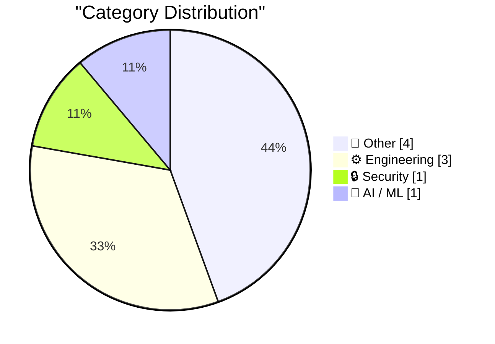
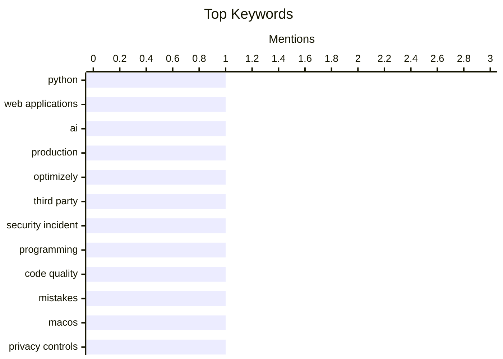

## Today's Highlights
Today's highlights reveal a growing focus on optimizing software deployment and enhancing security measures in the tech landscape. Innovations like AI-assisted server deployment are streamlining processes, while discussions around third-party dependencies emphasize the need for accountability in software development. Additionally, new privacy controls in MacOS and updated usage limits for AI features reflect a broader trend towards prioritizing user privacy and data management.
---
## Must Read Today
1. **Muru**
[Muru](https://simonwillison.net/2026/Nov/21/muru/) — simonwillison.net · 14h ago · ⚙️ Engineering
> Muru is an AI-assisted Rust server designed to optimize the deployment of ASGI and WSGI Python applications. Developed by Graham Dumpleton, who has extensive experience with mod_wsgi, Muru aims to enhance both development and production environments for Python web apps. The server incorporates advanced features to streamline application performance and management. The main takeaway is that Muru represents a significant advancement in the way Python applications can be served, leveraging modern technology for improved efficiency.
💡 **Why read it**: This article is worth reading for developers interested in cutting-edge tools for deploying Python web applications.
🏷️ Python, web applications, AI, production
2. **Weekly Update 531: Optimizely. Script Dependencies & Third Parties**
[Weekly Update 531: Optimizely. Script Dependencies & Third Parties](https://www.troyhunt.com/weekly-update-531/) — troyhunt.com · 8h ago · 🔒 Security
> The article discusses the implications of third-party dependencies in software accountability, particularly in the context of security incidents. It argues that referring to incidents as being the responsibility of third parties can deflect accountability from the primary organization. The author emphasizes the importance of maintaining responsibility for security, regardless of external dependencies. Ultimately, the piece underscores the need for transparency and accountability in software development.
💡 **Why read it**: This article is crucial for understanding the complexities of accountability in software security and the role of third-party services.
🏷️ Optimizely, third party, security incident
3. **To code well, avoid blunders**
[To code well, avoid blunders](https://seangoedecke.com/to-code-well-avoid-blunders/) — seangoedecke.com · 14h ago · ⚙️ Engineering
> The article posits that the key to writing good code lies in avoiding catastrophic mistakes rather than seeking brilliance. It draws parallels with other disciplines, such as chess, where minimizing errors can lead to success. The author emphasizes that focusing on error prevention is more effective than chasing innovative solutions. The main conclusion is that a disciplined approach to coding can significantly enhance overall software quality.
💡 **Why read it**: This article offers valuable insights into effective coding practices that can help developers improve their skills.
🏷️ programming, code quality, mistakes
---
## Data Overview
| Sources Scanned | Articles Fetched | Time Window | Selected |
|:---:|:---:|:---:|:---:|
| 83/92 | 2510 -> 9 | 24h | **9** |
### Category Distribution

### Top Keywords

<details>
<summary>Plain Text Keyword Chart (Terminal Friendly)</summary>
```
python            │ ████████████████████ 1
web applications  │ ████████████████████ 1
ai                │ ████████████████████ 1
production        │ ████████████████████ 1
optimizely        │ ████████████████████ 1
third party       │ ████████████████████ 1
security incident │ ████████████████████ 1
programming       │ ████████████████████ 1
code quality      │ ████████████████████ 1
mistakes          │ ████████████████████ 1
```
</details>
### Topic Tags
**python**(1) · **web applications**(1) · **ai**(1) · production(1) · optimizely(1) · third party(1) · security incident(1) · programming(1) · code quality(1) · mistakes(1) · macos(1) · privacy controls(1) · apple(1) · fourier transform(1) · dft(1) · signal processing(1) · siri(1) · apple intelligence(1) · icloud+(1) · public health(1)
---
## Other
### 1. ★ A Week With the New Privacy Controls in MacOS 27.3 Beta 2
[★ A Week With the New Privacy Controls in MacOS 27.3 Beta 2](https://daringfireball.net/2026/11/a_week_with_the_new_privacy_controls_in_macos_273) — **daringfireball.net** · 17h ago · ⭐ 19/30
> The article reviews the new privacy controls introduced in MacOS 27.3 Beta 2, highlighting features like Full Disk Access. While the new controls are generally positive, the author criticizes the persistent menu bar indicator for apps that control other applications. The review suggests that while Apple is making strides in user privacy, there are still areas needing improvement. The conclusion is that the new privacy features are a step forward, but usability issues remain.
🏷️ MacOS, privacy controls, Apple
---
### 2. The U.S. — Utterly Predictably — Has Lost Measles Elimination Status Under Trump and RFK Jr.
[The U.S. — Utterly Predictably — Has Lost Measles Elimination Status Under Trump and RFK Jr.](https://www.wsj.com/health/measles-is-back-it-will-take-years-to-eliminate-it-again-9971736e?st=GKiu3E) — **daringfireball.net** · 19h ago · ⭐ 11/30
> The article discusses the U.S.'s loss of measles elimination status, attributing it to decreased vaccination rates and public health policy failures. It references insights from epidemiologists who estimate that regaining this status could take up to five years if proactive measures are implemented. The author stresses the importance of government involvement in vaccination efforts to reverse this trend. The main takeaway is that without significant policy changes, the path to regaining measles elimination status will be long and challenging.
🏷️ public health, measles, status
---
### 3. Mouse for Tandy 1000
[Mouse for Tandy 1000](https://dfarq.homeip.net/mouse-for-tandy-1000/?utm_source=rss&#038;utm_medium=rss&#038;utm_campaign=mouse-for-tandy-1000) — **dfarq.homeip.net** · 2h ago · ⭐ 10/30
> The article explores the appropriate mouse options for the Tandy 1000, noting that the TRS-80 color mouse was originally designed for it but may not be the best choice. It discusses alternative mice that can enhance the user experience with the Tandy 1000. The author provides insights into compatibility and performance considerations when selecting a mouse for this vintage computer. The conclusion is that users have viable alternatives that may offer better functionality than the original mouse.
🏷️ Tandy 1000, mouse, retro computing
---
### 4. I don't enjoy being pampered
[I don't enjoy being pampered](https://shkspr.mobi/blog/2026/11/i-dont-enjoy-being-pampered/) — **shkspr.mobi** · 1h ago · ⭐ 5/30
> The article recounts the author's experience at a barber shop during a holiday in Vilnius, where they received an unexpectedly elaborate grooming treatment. The author reflects on their discomfort with the pampering process, which included steaming and brushing. This personal narrative highlights the contrast between the author's preferences and the typical expectations of a luxury grooming experience. The main takeaway is that not everyone appreciates the same level of indulgence in personal care.
🏷️ barber, holiday, personal experience
---
## Engineering
### 5. Muru
[Muru](https://simonwillison.net/2026/Nov/21/muru/) — **simonwillison.net** · 14h ago · ⭐ 24/30
> Muru is an AI-assisted Rust server designed to optimize the deployment of ASGI and WSGI Python applications. Developed by Graham Dumpleton, who has extensive experience with mod_wsgi, Muru aims to enhance both development and production environments for Python web apps. The server incorporates advanced features to streamline application performance and management. The main takeaway is that Muru represents a significant advancement in the way Python applications can be served, leveraging modern technology for improved efficiency.
🏷️ Python, web applications, AI, production
---
### 6. To code well, avoid blunders
[To code well, avoid blunders](https://seangoedecke.com/to-code-well-avoid-blunders/) — **seangoedecke.com** · 14h ago · ⭐ 22/30
> The article posits that the key to writing good code lies in avoiding catastrophic mistakes rather than seeking brilliance. It draws parallels with other disciplines, such as chess, where minimizing errors can lead to success. The author emphasizes that focusing on error prevention is more effective than chasing innovative solutions. The main conclusion is that a disciplined approach to coding can significantly enhance overall software quality.
🏷️ programming, code quality, mistakes
---
### 7. Notes on the discrete Fourier transform (DFT)
[Notes on the discrete Fourier transform (DFT)](https://eli.thegreenplace.net/2026/notes-on-the-discrete-fourier-transform-dft/) — **eli.thegreenplace.net** · 15h ago · ⭐ 18/30
> This article provides an overview of the Discrete Fourier Transform (DFT) and its applications in digital signal processing. It builds on previous discussions of the Discrete-Time Fourier Series (DTFS) and Transform (DTFT), focusing on how DFT is used to analyze finite-duration discrete signals. The author explains the mathematical foundations and practical implications of DFT in real-world applications. The main takeaway is that understanding DFT is crucial for effective signal processing in various digital applications.
🏷️ Fourier transform, DFT, signal processing
---
## Security
### 8. Weekly Update 531: Optimizely. Script Dependencies & Third Parties
[Weekly Update 531: Optimizely. Script Dependencies & Third Parties](https://www.troyhunt.com/weekly-update-531/) — **troyhunt.com** · 8h ago · ⭐ 23/30
> The article discusses the implications of third-party dependencies in software accountability, particularly in the context of security incidents. It argues that referring to incidents as being the responsibility of third parties can deflect accountability from the primary organization. The author emphasizes the importance of maintaining responsibility for security, regardless of external dependencies. Ultimately, the piece underscores the need for transparency and accountability in software development.
🏷️ Optimizely, third party, security incident
---
## AI / ML
### 9. Apple Documents Extra Apple Intelligence Usage Limits Per iCloud+ Paid Tier
[Apple Documents Extra Apple Intelligence Usage Limits Per iCloud+ Paid Tier](https://support.apple.com/en-us/127901) — **daringfireball.net** · 19h ago · ⭐ 16/30
> The article outlines the new usage limits for Siri AI and Apple Intelligence features available to iCloud+ subscribers starting with the 27.3 release. It details how certain advanced features, such as intelligent photo editing tools, will be restricted based on the user's subscription tier. The document emphasizes that while basic features remain free, enhanced capabilities require a paid plan. The conclusion is that Apple's tiered approach to AI features reflects a growing trend towards monetizing advanced functionalities.
🏷️ Siri, Apple Intelligence, iCloud+
---
*Generated at 2026-11-22 14:01 | Scanned 83 sources -> 2510 articles -> selected 9*
*Based on the [Hacker News Popularity Contest 2025](https://refactoringenglish.com/tools/hn-popularity/) RSS source list recommended by [Andrej Karpathy](https://x.com/karpathy)*
*Produced by Dongdianr AI. Follow the same-name WeChat public account for more AI practical tips 💡*
