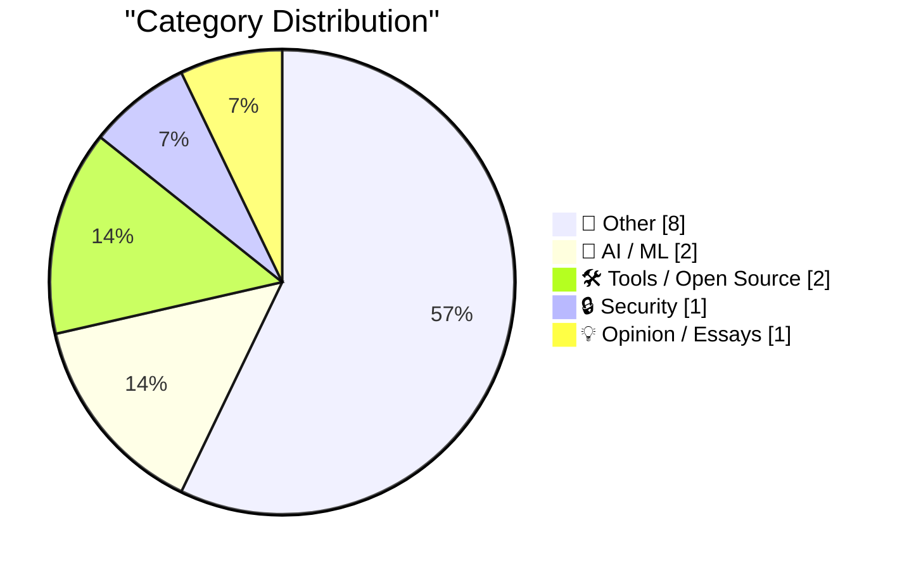
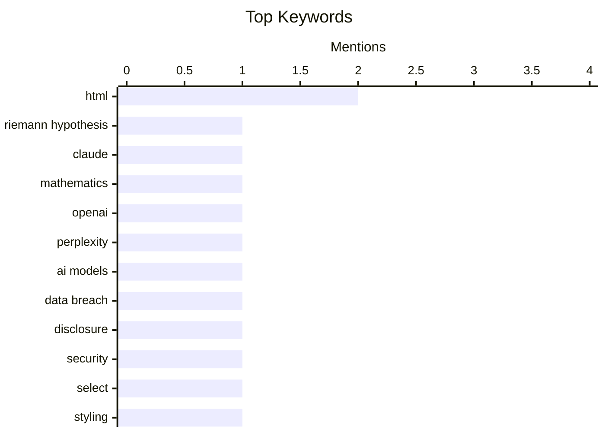

## Today's Highlights
Today's highlights showcase significant advancements in both mathematics and artificial intelligence, with Levent Alpöge claiming to have solved the Riemann Hypothesis, a breakthrough that could reshape our understanding of number theory. Meanwhile, OpenAI's latest insights into model perplexity reflect the ongoing evolution of AI capabilities, emphasizing the importance of transparency in technology. Additionally, the challenges of data breach disclosures underscore the critical need for improved security practices in an increasingly digital landscape.
---
## Must Read Today
1. **Levent Alpöge has solved the Riemann Hypothesis with help of Claude! What does it mean?**
[Levent Alpöge has solved the Riemann Hypothesis with help of Claude! What does it mean?](https://garymarcus.substack.com/p/levent-alpoge-has-solved-the-riemann) — garymarcus.substack.com · 19h ago · 🤖 AI / ML
> Levent Alpöge claims to have solved the Riemann Hypothesis, a longstanding problem in mathematics concerning the distribution of prime numbers. His approach reportedly involves novel techniques that leverage insights from machine learning, particularly using Claude, an AI model. Despite the significance of this claim, the immediate impact on financial markets has been muted, raising questions about the implications of such a breakthrough. The conclusion emphasizes the need for further validation and the potential for future exploration in mathematical research.
💡 **Why read it**: This article is worth reading for its exploration of a major mathematical breakthrough and its implications for both academia and the market.
🏷️ Riemann Hypothesis, Claude, mathematics
2. **Notes on OpenAI's perplexity reveal**
[Notes on OpenAI's perplexity reveal](https://seangoedecke.com/notes-on-openais-perplexity-reveal/) — seangoedecke.com · 14h ago · 🤖 AI / ML
> OpenAI has released a graph detailing the perplexity of its models over time, highlighting the evolution of their language models. The analysis reveals significant improvements in perplexity metrics, indicating enhanced model performance and understanding of language. This information is crucial for developers and researchers in AI, as it provides insights into the effectiveness of different model architectures and training techniques. The main takeaway is that tracking perplexity can inform future developments in AI language modeling.
💡 **Why read it**: This article is valuable for those interested in the technical advancements of AI models and how performance metrics like perplexity can guide future research.
🏷️ OpenAI, perplexity, AI models
3. **Here's Why Data Breach Disclosure is so Hard: Lessons from Hundreds of Emails with Hacked Companies**
[Here's Why Data Breach Disclosure is so Hard: Lessons from Hundreds of Emails with Hacked Companies](https://www.troyhunt.com/heres-why-data-breach-disclosure-is-so-hard-lessons-from-hundreds-of-emails-with-hacked-companies/) — troyhunt.com · 6h ago · 🔒 Security
> The article discusses the challenges of data breach disclosure based on insights from numerous emails exchanged with companies that experienced breaches. Common patterns include evasive communication, delays in response, and a lack of transparency, which complicate the disclosure process. The findings suggest that companies often prioritize reputation management over timely communication with affected parties. Ultimately, the piece underscores the need for clearer guidelines and practices in breach disclosure to protect consumers and maintain trust.
💡 **Why read it**: This article is essential for understanding the complexities of data breach disclosures and the communication failures that often accompany them.
🏷️ data breach, disclosure, security
---
## Data Overview
| Sources Scanned | Articles Fetched | Time Window | Selected |
|:---:|:---:|:---:|:---:|
| 86/92 | 2574 -> 14 | 24h | **14** |
### Category Distribution

### Top Keywords

<details>
<summary>Plain Text Keyword Chart (Terminal Friendly)</summary>
```
html               │ ████████████████████ 2
riemann hypothesis │ ██████████░░░░░░░░░░ 1
claude             │ ██████████░░░░░░░░░░ 1
mathematics        │ ██████████░░░░░░░░░░ 1
openai             │ ██████████░░░░░░░░░░ 1
perplexity         │ ██████████░░░░░░░░░░ 1
ai models          │ ██████████░░░░░░░░░░ 1
data breach        │ ██████████░░░░░░░░░░ 1
disclosure         │ ██████████░░░░░░░░░░ 1
security           │ ██████████░░░░░░░░░░ 1
```
</details>
### Topic Tags
**html**(2) · **riemann hypothesis**(1) · **claude**(1) · mathematics(1) · openai(1) · perplexity(1) · ai models(1) · data breach(1) · disclosure(1) · security(1) · select(1) · styling(1) · browser(1) · zigbee(1) · sensors(1) · iot(1) · to-do list(1) · productivity(1) · ivy(1) · gravity(1)
---
## Other
### 1. Ivy
[Ivy](https://semantical.com/?utm_campaign=df-2026-12) — **daringfireball.net** · 14h ago · ⭐ 15/30
> The article introduces Ivy, a unique to-do list application designed to reset daily tasks, inspired by the Ivy Lee Method. Users create a daily list of tasks, and any unfinished items are returned to a pool of ideas for future consideration. This approach aims to alleviate the stress of perpetual task lists, promoting a more manageable daily workflow. The main takeaway is that Ivy offers a refreshing alternative to traditional to-do lists by focusing on daily completion.
🏷️ to-do list, productivity, Ivy
---
### 2. Gravity on an oblate planet
[Gravity on an oblate planet](https://www.johndcook.com/blog/2026/11/23/oblate-spheroid-gravity/) — **johndcook.com** · 3h ago · ⭐ 15/30
> The article explores the gravitational effects on an oblate spheroid planet, contrasting it with the point-mass approximation used for spherical bodies. It discusses the implications of a planet's equatorial and polar radii on gravitational force, providing mathematical formulations for calculating gravity in such shapes. The findings highlight the limitations of traditional models in accurately predicting gravitational behavior on non-spherical planets. The conclusion stresses the importance of considering planetary shape in gravitational studies.
🏷️ gravity, oblate planet, physics
---
### 3. Zenith Data Systems, Part II
[Zenith Data Systems, Part II](https://www.abortretry.fail/p/zenith-data-systems-part-ii) — **abortretry.fail** · 11h ago · ⭐ 12/30
> The article continues the exploration of Zenith Data Systems, detailing its pioneering efforts in the computing industry amidst financial struggles. It discusses the company's innovations and contributions to technology, while also addressing the challenges it faced in a competitive market. The narrative provides insights into the historical context of computing and the resilience required to innovate under pressure. The conclusion reflects on the importance of perseverance in the tech industry.
🏷️ Zenith, computers, history
---
### 4. Nerd Quiz #5
[Nerd Quiz #5](https://susam.net/code/news/nq/5.0.0.html) — **susam.net** · 14h ago · ⭐ 9/30
> Nerd Quiz #5 is the latest iteration of an interactive quiz designed to test knowledge across various topics, including literature, biology, computing, and music. This update introduces five new questions, enhancing the quiz's breadth and challenge. The quiz format encourages engagement and learning through fun, bite-sized questions. The main takeaway is that it serves as an entertaining tool for self-assessment and knowledge expansion.
🏷️ quiz, nerd, HTML
---
### 5. slopcore
[slopcore](https://geohot.github.io//blog/jekyll/update/2026/11/23/slopcore.html) — **geohot.github.io** · 22h ago · ⭐ 9/30
> The Hitler of the 21st century will try to hold it back. In defiance of nature, insist humans be in charge, insist they are the humans in charge, it’s for your own good you see, no you can’t have 10,0
🏷️ geohot, AI, control
---
### 6. Pluralistic: The Debt Trap (23 Nov 2026)
[Pluralistic: The Debt Trap (23 Nov 2026)](https://pluralistic.net/2026/11/23/grasshoppers-v-ants/) — **pluralistic.net** · 42m ago · ⭐ 6/30
> Today's links The Debt Trap: Obscure causality is the downfall of us all. Hey look at this: Delights to delectate. Object permanence: They Fight Crime; Cantenna wifi TV for Mali; Kakistocracy; Inflati
🏷️ debt, causality, inflation
---
### 7. Why the Atari Jaguar is so expensive
[Why the Atari Jaguar is so expensive](https://dfarq.homeip.net/why-the-atari-jaguar-is-so-expensive/?utm_source=rss&#038;utm_medium=rss&#038;utm_campaign=why-the-atari-jaguar-is-so-expensive) — **dfarq.homeip.net** · 2h ago · ⭐ 6/30
> Atari’s final game console of the 20th century was a console called the Jaguar. It entered a crowded game console market when it was released in late 1993, and it left the market in 1996 with more of 
🏷️ Atari, Jaguar, gaming
---
### 8. Tranquility
[Tranquility](https://blog.coredump.cx/p/tranquility) — **lcamtuf.substack.com** · 10h ago · ⭐ 4/30
> The Oval Office.
🏷️ Oval Office
---
## AI / ML
### 9. Levent Alpöge has solved the Riemann Hypothesis with help of Claude! What does it mean?
[Levent Alpöge has solved the Riemann Hypothesis with help of Claude! What does it mean?](https://garymarcus.substack.com/p/levent-alpoge-has-solved-the-riemann) — **garymarcus.substack.com** · 19h ago · ⭐ 29/30
> Levent Alpöge claims to have solved the Riemann Hypothesis, a longstanding problem in mathematics concerning the distribution of prime numbers. His approach reportedly involves novel techniques that leverage insights from machine learning, particularly using Claude, an AI model. Despite the significance of this claim, the immediate impact on financial markets has been muted, raising questions about the implications of such a breakthrough. The conclusion emphasizes the need for further validation and the potential for future exploration in mathematical research.
🏷️ Riemann Hypothesis, Claude, mathematics
---
### 10. Notes on OpenAI's perplexity reveal
[Notes on OpenAI's perplexity reveal](https://seangoedecke.com/notes-on-openais-perplexity-reveal/) — **seangoedecke.com** · 14h ago · ⭐ 26/30
> OpenAI has released a graph detailing the perplexity of its models over time, highlighting the evolution of their language models. The analysis reveals significant improvements in perplexity metrics, indicating enhanced model performance and understanding of language. This information is crucial for developers and researchers in AI, as it provides insights into the effectiveness of different model architectures and training techniques. The main takeaway is that tracking perplexity can inform future developments in AI language modeling.
🏷️ OpenAI, perplexity, AI models
---
## Tools / Open Source
### 11. Select Styling Specimens
[Select Styling Specimens](https://simonwillison.net/2026/Nov/22/select-styling/) — **simonwillison.net** · 18h ago · ⭐ 21/30
> The article addresses the inconsistent styling of HTML <select> elements across different web browsers, which can lead to a poor user experience. The author presents a tool designed to create visually consistent select boxes, allowing developers to customize their appearance while maintaining functionality. By providing examples and comparisons, the article highlights the importance of uniform design in web development. The main conclusion is that developers should prioritize consistent UI elements to enhance user interaction.
🏷️ HTML, select, styling, browser
---
### 12. Gadget Review: Cheap Zigbee Environmental Sensors ★★★☆☆
[Gadget Review: Cheap Zigbee Environmental Sensors ★★★☆☆](https://shkspr.mobi/blog/2026/11/gadget-review-cheap-zigbee-environmental-sensors/) — **shkspr.mobi** · 1h ago · ⭐ 18/30
> The review evaluates various affordable Zigbee temperature and humidity sensors, focusing on the Sonoff AirGuard TH Lite model. The author discusses their performance, ease of use, and integration within IoT systems, noting that they are compact and cost-effective. Despite some limitations in accuracy, the sensors provide a good entry point for those looking to monitor environmental conditions. The conclusion emphasizes their value for budget-conscious consumers interested in smart home technology.
🏷️ Zigbee, sensors, IoT
---
## Security
### 13. Here's Why Data Breach Disclosure is so Hard: Lessons from Hundreds of Emails with Hacked Companies
[Here's Why Data Breach Disclosure is so Hard: Lessons from Hundreds of Emails with Hacked Companies](https://www.troyhunt.com/heres-why-data-breach-disclosure-is-so-hard-lessons-from-hundreds-of-emails-with-hacked-companies/) — **troyhunt.com** · 6h ago · ⭐ 26/30
> The article discusses the challenges of data breach disclosure based on insights from numerous emails exchanged with companies that experienced breaches. Common patterns include evasive communication, delays in response, and a lack of transparency, which complicate the disclosure process. The findings suggest that companies often prioritize reputation management over timely communication with affected parties. Ultimately, the piece underscores the need for clearer guidelines and practices in breach disclosure to protect consumers and maintain trust.
🏷️ data breach, disclosure, security
---
## Opinion / Essays
### 14. When in doubt, flail about
[When in doubt, flail about](https://seangoedecke.com/when-in-doubt-flail-about/) — **seangoedecke.com** · 14h ago · ⭐ 14/30
> The article presents a controversial perspective on decision-making in uncertain situations, advocating for proactive experimentation rather than cautious inaction. It argues that taking risks and exploring various options can lead to unexpected insights and solutions. However, the author warns that this approach may carry reputational risks in professional environments. The main takeaway is that sometimes, embracing uncertainty and taking action can yield better outcomes than waiting for clarity.
🏷️ decision-making, uncertainty, guidance
---
*Generated at 2026-11-23 14:01 | Scanned 86 sources -> 2574 articles -> selected 14*
*Based on the [Hacker News Popularity Contest 2025](https://refactoringenglish.com/tools/hn-popularity/) RSS source list recommended by [Andrej Karpathy](https://x.com/karpathy)*
*Produced by Dongdianr AI. Follow the same-name WeChat public account for more AI practical tips 💡*
