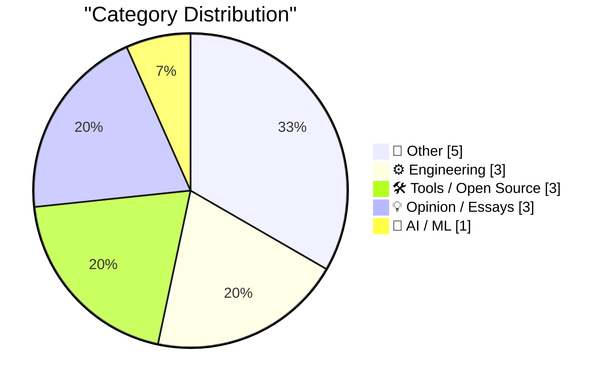
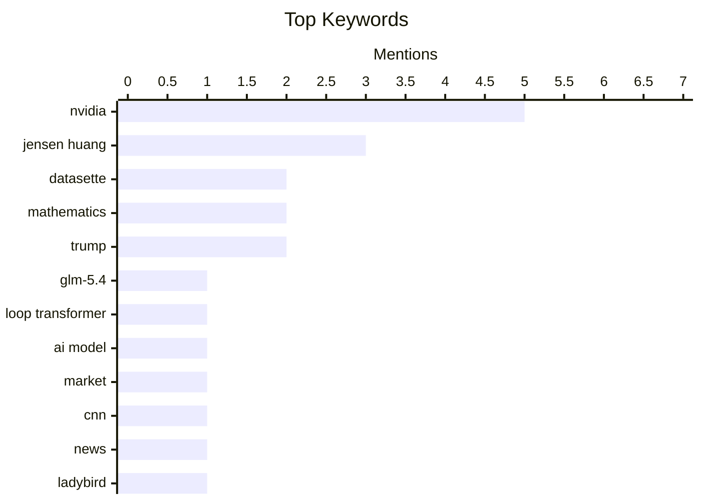

## Today's Highlights
Today's Highlights: The tech landscape is buzzing with innovation as Nvidia's Jensen Huang returns to lead the company amidst a market resurgence, signaling a renewed focus on AI and semiconductor advancements. Meanwhile, the introduction of the GLM-5.4 loop transformer architecture showcases the ongoing evolution in machine learning models, while new tools like datasette-charts and datasette-agent are enhancing data visualization and navigation capabilities. These developments underscore a broader trend of integrating advanced technologies to improve user experience and operational efficiency.
---
## Must Read Today
1. **GLM-5.4: Toward Generalized Coding with Our First Loop Transformer**
[GLM-5.4: Toward Generalized Coding with Our First Loop Transformer](https://simonwillison.net/2026/Nov/23/glm-54/) — simonwillison.net · 14h ago · 🤖 AI / ML
> GLM 5.4 introduces a novel looped transformer architecture aimed at improving model performance. Unlike standard transformers that execute each layer once per forward pass, this model employs weight-shared layers that iterate multiple times, refining hidden states with each pass. This approach enhances the model's ability to learn complex patterns and improve overall efficiency. The main takeaway is that the loop transformer architecture represents a significant advancement in the design of AI models, potentially leading to better performance in various applications.
💡 **Why read it**: This article is worth reading for its insights into innovative transformer architectures that could redefine AI model efficiency.
🏷️ GLM-5.4, loop transformer, AI model
2. **Breaking: Jensen is back. And the market is way up. But things will never be the same.**
[Breaking: Jensen is back. And the market is way up. But things will never be the same.](https://garymarcus.substack.com/p/breaking-jensen-is-back-and-the-market) — garymarcus.substack.com · 21h ago · 📝 Other
> The article discusses the return of Jensen Huang to Nvidia amidst a significant market upturn. It highlights the implications of his reinstatement for Nvidia's future direction and leadership dynamics. The author reflects on the changes in the tech landscape and Nvidia's strategic positioning post-reinstatement. Ultimately, it suggests that while Huang's return is a positive development, the industry will face new challenges moving forward.
💡 **Why read it**: This piece provides a timely analysis of leadership changes in a major tech company and their potential impact on the market.
🏷️ Jensen Huang, market, CNN, news
3. **Ladybird's first alpha release**
[Ladybird's first alpha release](https://simonwillison.net/2026/Nov/23/ladybird/) — simonwillison.net · 16h ago · ⚙️ Engineering
> Ladybird is an ambitious new web browser project that aims to implement core components like HTML parsing, CSS engine, and JavaScript from scratch. While it relies on some external libraries such as HarfBuzz for text shaping and Skia for graphics, it represents a significant step in browser development. The project showcases a commitment to innovation in web technologies. The main conclusion is that Ladybird's alpha release sets the stage for a new era of web browsing capabilities.
💡 **Why read it**: This article is essential for those interested in the future of web browsers and the underlying technologies that power them.
🏷️ Ladybird, browser, WebAssembly
---
## Data Overview
| Sources Scanned | Articles Fetched | Time Window | Selected |
|:---:|:---:|:---:|:---:|
| 86/92 | 2573 -> 20 | 24h | **15** |
### Category Distribution

### Top Keywords

<details>
<summary>Plain Text Keyword Chart (Terminal Friendly)</summary>
```
nvidia           │ ████████████████████ 5
jensen huang     │ ████████████░░░░░░░░ 3
datasette        │ ████████░░░░░░░░░░░░ 2
mathematics      │ ████████░░░░░░░░░░░░ 2
trump            │ ████████░░░░░░░░░░░░ 2
glm-5.4          │ ████░░░░░░░░░░░░░░░░ 1
loop transformer │ ████░░░░░░░░░░░░░░░░ 1
ai model         │ ████░░░░░░░░░░░░░░░░ 1
market           │ ████░░░░░░░░░░░░░░░░ 1
cnn              │ ████░░░░░░░░░░░░░░░░ 1
```
</details>
### Topic Tags
**nvidia**(5) · **jensen huang**(3) · **datasette**(2) · mathematics(2) · trump(2) · glm-5.4(1) · loop transformer(1) · ai model(1) · market(1) · cnn(1) · news(1) · ladybird(1) · browser(1) · webassembly(1) · ceo(1) · board(1) · charts(1) · plugin(1) · agent(1) · iframe(1)
---
## Other
### 1. Breaking: Jensen is back. And the market is way up. But things will never be the same.
[Breaking: Jensen is back. And the market is way up. But things will never be the same.](https://garymarcus.substack.com/p/breaking-jensen-is-back-and-the-market) — **garymarcus.substack.com** · 21h ago · ⭐ 23/30
> The article discusses the return of Jensen Huang to Nvidia amidst a significant market upturn. It highlights the implications of his reinstatement for Nvidia's future direction and leadership dynamics. The author reflects on the changes in the tech landscape and Nvidia's strategic positioning post-reinstatement. Ultimately, it suggests that while Huang's return is a positive development, the industry will face new challenges moving forward.
🏷️ Jensen Huang, market, CNN, news
---
### 2. Nvidia Board Reinstates Jensen Huang
[Nvidia Board Reinstates Jensen Huang](https://nvidianews.nvidia.com/news/nvidia-board-reinstates-jensen-huang-as-president-ceo-and-board-director) — **daringfireball.net** · 23h ago · ⭐ 21/30
> Nvidia's Board of Directors has unanimously reinstated Jensen Huang as President and CEO following discussions regarding his leadership capabilities. The decision reflects confidence in Huang's vision and ability to guide the company through current challenges. The article emphasizes the importance of strong leadership in navigating the tech industry's complexities. The main takeaway is that Huang's return is expected to stabilize Nvidia's strategic direction during a pivotal time.
🏷️ Nvidia, Jensen Huang, CEO, Board
---
### 3. Jensen Huang Returns to Work
[Jensen Huang Returns to Work](https://www.businessinsider.com/jensen-huang-returns-to-nvidia-hq-im-terribly-sorry-2026-11) — **daringfireball.net** · 14h ago · ⭐ 15/30
> Jensen Huang, CEO of Nvidia, made a highly publicized return to the company's headquarters, greeted by enthusiastic employees chanting his name. Huang's return marks a significant moment for Nvidia, especially after a period of uncertainty regarding his leadership. During his arrival, he expressed gratitude and acknowledged the moment as his 'first day at work' in a navy cotton coat, diverging from his usual attire. This event underscores the strong support Huang has within the company and the excitement surrounding his leadership. The main takeaway is that Huang's reinstatement is seen as a pivotal moment for Nvidia's future direction.
🏷️ Jensen Huang, Nvidia, return
---
### 4. Semafor: ‘Hours Before Huang’s Reinstatement, Trump Called Nvidia’s Board to Argue for His Return’
[Semafor: ‘Hours Before Huang’s Reinstatement, Trump Called Nvidia’s Board to Argue for His Return’](https://www.semafor.com/article/11/23/2026/jensen-huang-reinstated-as-nvidia-ceo) — **daringfireball.net** · 22h ago · ⭐ 14/30
> The article reveals that former President Donald Trump intervened in Nvidia's board meeting to advocate for Jensen Huang's reinstatement just hours before the decision was made. Trump's involvement highlights the political dimensions influencing corporate governance, with White House communications director Steven Cheung praising the board's decision as a protective measure for 'geniuses' like Huang. This incident illustrates the intersection of politics and business in high-stakes corporate decisions. The main takeaway is that political advocacy can significantly impact leadership dynamics in major companies.
🏷️ Trump, Nvidia, board meeting
---
### 5. Donald Trump on Jensen Huang’s Reinstatement at Nvidia
[Donald Trump on Jensen Huang’s Reinstatement at Nvidia](https://truthsocial.com/@realDonaldTrump/posts/117666713950631493) — **daringfireball.net** · 20h ago · ⭐ 12/30
> In a post on his blog, former President Donald Trump claimed credit for Jensen Huang's reinstatement as CEO of Nvidia after a lengthy phone interview with CNBC. Trump emphasized his role in facilitating the decision, framing it as a victory for the tech industry and its leaders. This statement reflects Trump's ongoing engagement with corporate affairs and his influence on business decisions. The main takeaway is that Trump's involvement in corporate matters continues to shape narratives around leadership and innovation in the tech sector.
🏷️ Trump, Nvidia, Huang
---
## Engineering
### 6. Ladybird's first alpha release
[Ladybird's first alpha release](https://simonwillison.net/2026/Nov/23/ladybird/) — **simonwillison.net** · 16h ago · ⭐ 21/30
> Ladybird is an ambitious new web browser project that aims to implement core components like HTML parsing, CSS engine, and JavaScript from scratch. While it relies on some external libraries such as HarfBuzz for text shaping and Skia for graphics, it represents a significant step in browser development. The project showcases a commitment to innovation in web technologies. The main conclusion is that Ladybird's alpha release sets the stage for a new era of web browsing capabilities.
🏷️ Ladybird, browser, WebAssembly
---
### 7. Two generators suffice
[Two generators suffice](https://www.johndcook.com/blog/2026/11/23/two-generators-suffice/) — **johndcook.com** · 20h ago · ⭐ 16/30
> The article explores the classification of finite simple groups, asserting that every such group can be generated by at most two elements. It discusses the implications of this finding, particularly the high probability that randomly chosen elements will generate the group. This result is significant in group theory and has broad mathematical implications. The conclusion reinforces the efficiency of two generators in simplifying complex group structures.
🏷️ finite groups, mathematics, group theory
---
### 8. Finite Projective Spaces
[Finite Projective Spaces](https://www.johndcook.com/blog/2026/11/23/finite-projective-spaces/) — **johndcook.com** · 14h ago · ⭐ 15/30
> The article discusses the concept of finite projective spaces, extending the principles of finite projective planes to higher dimensions. It outlines key axioms, such as the unique line passing through any two distinct points and the intersection properties of lines formed by distinct points. The exploration of these mathematical structures provides insights into their geometric and algebraic properties. The main conclusion emphasizes the importance of understanding finite projective spaces in the broader context of geometry and combinatorial design.
🏷️ projective spaces, geometry, mathematics
---
## Tools / Open Source
### 9. datasette-charts 0.2a0
[datasette-charts 0.2a0](https://simonwillison.net/2026/Nov/24/datasette-charts/) — **simonwillison.net** · 9h ago · ⭐ 18/30
> The release of datasette-charts 0.2a0 introduces a new charting plugin for Datasette, enhancing data visualization capabilities. It now integrates with Datasette Agent, allowing users to generate charts through chat interactions. This version improves user experience by leveraging underlying chart suggestion algorithms. The conclusion is that this update significantly enhances the functionality of Datasette for data-driven applications.
🏷️ Datasette, charts, plugin
---
### 10. datasette-agent 0.7a1
[datasette-agent 0.7a1](https://simonwillison.net/2026/Nov/24/datasette-agent/) — **simonwillison.net** · 10h ago · ⭐ 18/30
> The datasette-agent 0.7a1 update introduces improved navigation features, allowing chat sessions to open an iframe side panel for better user interaction. This version enhances integration with other Datasette plugins by utilizing fragment hashes for navigation. The update aims to streamline user experience when interacting with data. The main takeaway is that these enhancements make Datasette Agent more versatile and user-friendly.
🏷️ Datasette, agent, iframe
---
### 11. Virgin Media Hub 5 API
[Virgin Media Hub 5 API](https://shkspr.mobi/blog/2026/11/virgin-media-hub-5-api/) — **shkspr.mobi** · 1h ago · ⭐ 17/30
> This article compiles useful information about the Virgin Media Hub 5 API, detailing various functionalities available for users. It includes insights on testing the API in modem mode and provides guidance on accessing different features. The documentation aims to centralize knowledge for developers working with this hardware. The main takeaway is that this resource is essential for anyone looking to leverage the capabilities of the Virgin Media Hub 5.
🏷️ API, Virgin Media, SuperHub, documentation
---
## Opinion / Essays
### 12. Government Regulation and Demand
[Government Regulation and Demand](https://stratechery.com/2026/obituaries/) — **daringfireball.net** · 22h ago · ⭐ 17/30
> The article discusses the implications of U.S. government regulation on the semiconductor market, particularly regarding Nvidia's role in maintaining supply chains to China. It highlights the strategic importance of keeping China reliant on U.S. technology for AI development. The author argues that while the U.S. can control supply, building a sustainable ecosystem is crucial for long-term success. The conclusion emphasizes the need for strategic foresight in navigating international tech relations.
🏷️ regulation, Nvidia, China
---
### 13. Am I A Design Engineer?
[Am I A Design Engineer?](https://blog.jim-nielsen.com/2026/am-i-a-design-engineer/) — **blog.jim-nielsen.com** · 19h ago · ⭐ 16/30
> The article reflects on the definition of design engineering, emphasizing its subjective nature and distinguishing it from superficial design activities. It critiques common misconceptions about what constitutes design engineering, focusing on the importance of meaningful problem-solving. The author suggests that true design engineering involves a deeper understanding of user needs and technical constraints. The main takeaway is that design engineering is a nuanced field that transcends mere aesthetics.
🏷️ design engineering, definition, perspective
---
### 14. Could Jensengate take down the President?
[Could Jensengate take down the President?](https://garymarcus.substack.com/p/could-jensengate-take-down-the-president) — **garymarcus.substack.com** · 19h ago · ⭐ 13/30
> The article speculates on the potential political ramifications of Jensen Huang's reinstatement as CEO of Nvidia, suggesting that it could attract congressional scrutiny. It discusses the implications of corporate leadership changes on political narratives and public perception. The speculation reflects broader concerns about the intertwining of corporate and political interests in the current landscape. The main conclusion is that corporate events can have significant political consequences, warranting attention from lawmakers.
🏷️ Jensengate, politics, Congress
---
## AI / ML
### 15. GLM-5.4: Toward Generalized Coding with Our First Loop Transformer
[GLM-5.4: Toward Generalized Coding with Our First Loop Transformer](https://simonwillison.net/2026/Nov/23/glm-54/) — **simonwillison.net** · 14h ago · ⭐ 26/30
> GLM 5.4 introduces a novel looped transformer architecture aimed at improving model performance. Unlike standard transformers that execute each layer once per forward pass, this model employs weight-shared layers that iterate multiple times, refining hidden states with each pass. This approach enhances the model's ability to learn complex patterns and improve overall efficiency. The main takeaway is that the loop transformer architecture represents a significant advancement in the design of AI models, potentially leading to better performance in various applications.
🏷️ GLM-5.4, loop transformer, AI model
---
*Generated at 2026-11-24 14:01 | Scanned 86 sources -> 2573 articles -> selected 15*
*Based on the [Hacker News Popularity Contest 2025](https://refactoringenglish.com/tools/hn-popularity/) RSS source list recommended by [Andrej Karpathy](https://x.com/karpathy)*
*Produced by Dongdianr AI. Follow the same-name WeChat public account for more AI practical tips 💡*
