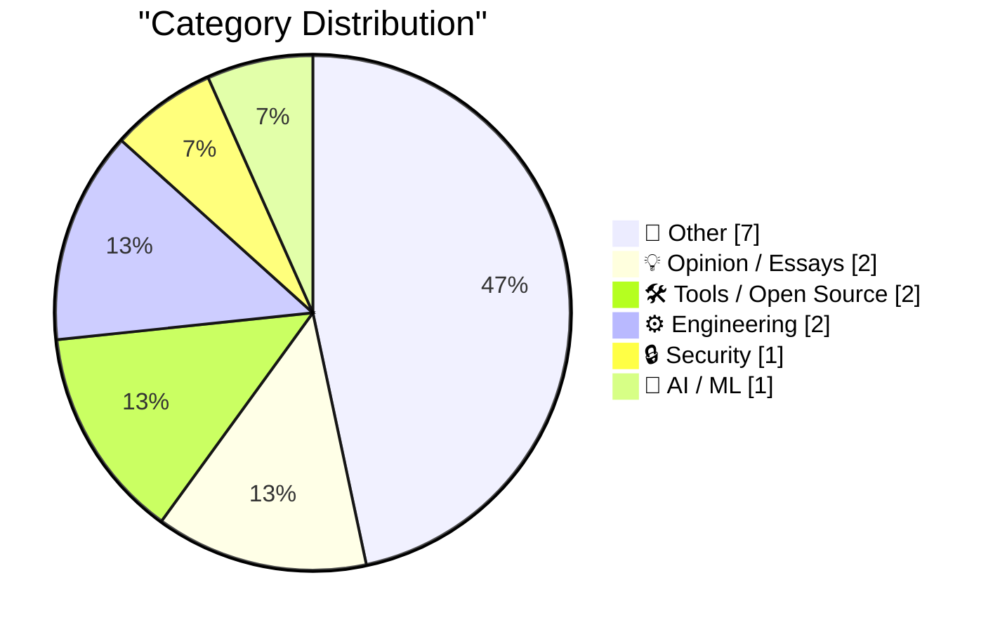
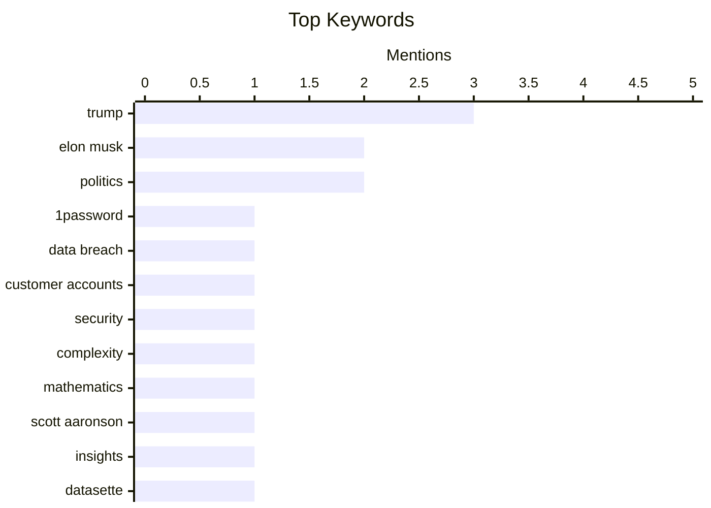

## Today's Highlights
Today's Highlights: A significant security breach at 1Password underscores ongoing vulnerabilities in digital infrastructure, while advancements in mathematical algorithms hint at new possibilities for computational efficiency. Additionally, the release of innovative tools like datasette-charts and sqlite3_rsync reflects a growing trend towards enhancing data visualization and management capabilities in tech.
---
## Must Read Today
1. **1Password’s Backend Systems Were Compromised, Revealing Only Customer Account Metadata**
[1Password’s Backend Systems Were Compromised, Revealing Only Customer Account Metadata](https://1password.com/blog/update-on-nov-2026-security-incident) — daringfireball.net · 15h ago · 🔒 Security
> 1Password experienced a security breach where an attacker accessed backend systems and extracted limited customer account metadata, including names and email addresses. Importantly, customer vault data and secret keys remained secure and unaffected. The company implemented containment measures and restored clean versions of the affected services to prevent further issues. The main takeaway is that while customer metadata was compromised, sensitive vault information was not at risk.
💡 **Why read it**: This article provides crucial insights into the security incident and reassures users about the safety of their sensitive data.
🏷️ 1Password, data breach, customer accounts, security
2. **Quoting Scott Aaronson**
[Quoting Scott Aaronson](https://simonwillison.net/2026/Nov/25/scott-aaronson/) — simonwillison.net · 14h ago · 💡 Opinion / Essays
> Scott Aaronson discusses the potential of new mathematical discoveries that could emerge from advancements in complexity theory. He compares this to historical breakthroughs in science, suggesting that we are on the verge of uncovering a vast new landscape of mathematical truths. The article emphasizes the transformative nature of these developments in understanding complexity. Ultimately, it highlights the excitement surrounding the future of mathematical exploration.
💡 **Why read it**: This article is worth reading for its thought-provoking perspective on the future of mathematics and complexity theory.
🏷️ complexity, mathematics, Scott Aaronson, insights
3. **datasette-charts 0.3a0**
[datasette-charts 0.3a0](https://simonwillison.net/2026/Nov/25/datasette-charts/) — simonwillison.net · 19h ago · 🛠 Tools / Open Source
> The release of datasette-charts 0.3a0 introduces chart annotations, allowing users to enhance visual data representations with lines, shaded areas, and labels. This feature aims to improve the clarity and interpretability of charts generated within the Datasette framework. The update is significant for users seeking to create more informative and visually appealing data presentations. Overall, it enhances the functionality of datasette-charts for data visualization.
💡 **Why read it**: This article is valuable for developers and data analysts looking to improve their data visualization capabilities with the latest features.
🏷️ datasette, charts, annotations, release
---
## Data Overview
| Sources Scanned | Articles Fetched | Time Window | Selected |
|:---:|:---:|:---:|:---:|
| 85/92 | 2565 -> 16 | 24h | **15** |
### Category Distribution

### Top Keywords

<details>
<summary>Plain Text Keyword Chart (Terminal Friendly)</summary>
```
trump             │ ████████████████████ 3
elon musk         │ █████████████░░░░░░░ 2
politics          │ █████████████░░░░░░░ 2
1password         │ ███████░░░░░░░░░░░░░ 1
data breach       │ ███████░░░░░░░░░░░░░ 1
customer accounts │ ███████░░░░░░░░░░░░░ 1
security          │ ███████░░░░░░░░░░░░░ 1
complexity        │ ███████░░░░░░░░░░░░░ 1
mathematics       │ ███████░░░░░░░░░░░░░ 1
scott aaronson    │ ███████░░░░░░░░░░░░░ 1
```
</details>
### Topic Tags
**trump**(3) · **elon musk**(2) · **politics**(2) · 1password(1) · data breach(1) · customer accounts(1) · security(1) · complexity(1) · mathematics(1) · scott aaronson(1) · insights(1) · datasette(1) · charts(1) · annotations(1) · release(1) · ansible(1) · ubuntu(1) · privilege escalation(1) · automation(1) · monte carlo(1)
---
## Other
### 1. ‘The Life of a Composer’
[‘The Life of a Composer’](https://composer.pablostanley.com/#1) — **daringfireball.net** · 20h ago · ⭐ 15/30
> Pablo Stanley's interactive exploration of creating a 'composer' offers a unique and engaging experience that combines design and functionality. The article highlights the creative process behind developing sophisticated input fields, showcasing sound and music elements that enhance user interaction. This innovative approach to interface design serves as an inspiration for designers and developers alike. Ultimately, it emphasizes the importance of creativity in user interface development.
🏷️ composer, design, interactive, exploration
---
### 2. OGP Image Format Support on Major Sites and Apps
[OGP Image Format Support on Major Sites and Apps](https://shkspr.mobi/blog/2026/11/ogp-image-format-support-on-major-sites-and-apps/) — **shkspr.mobi** · 1h ago · ⭐ 15/30
> The article discusses the inconsistencies in Open Graph Protocol (OGP) image format support across various major sites and applications. The author created a tool to assess which image formats are accepted by these platforms, addressing the lack of standardization in OGP implementations. This analysis highlights the challenges developers face when ensuring proper link previews. The main conclusion is the need for clearer guidelines and standards in OGP image format support.
🏷️ OGP, image formats, link previews
---
### 3. Covering a body with eight smaller copies of itself
[Covering a body with eight smaller copies of itself](https://www.johndcook.com/blog/2026/11/25/hadwiger-covering/) — **johndcook.com** · 23h ago · ⭐ 13/30
> The article explores the mathematical concept of covering a geometric body, specifically how to cover a unit ball with smaller balls. It presents a solution for covering a cube with smaller cubes, illustrating the principles of geometric replication. The discussion delves into the implications of these covering problems in mathematical theory. The main takeaway is the fascinating nature of geometric coverings and their applications in mathematics.
🏷️ geometry, covering, balls
---
### 4. Electrek Speculates on Trump’s Claim He ‘Protected’ Elon Musk After a ‘Very Tough Incident’ During His First Term
[Electrek Speculates on Trump’s Claim He ‘Protected’ Elon Musk After a ‘Very Tough Incident’ During His First Term](https://electrek.co/2026/11/24/trump-protected-elon-musk-first-term-tough-incident/) — **daringfireball.net** · 13h ago · ⭐ 6/30
> The article examines a claim made by former President Trump regarding his protection of Elon Musk during a tumultuous period for Tesla. It highlights the SEC's lawsuit against Musk for securities fraud following his controversial tweet about taking Tesla private, which was based on unfulfilled promises. The piece underscores the implications of Musk's actions on his leadership role in public companies and the potential consequences of Trump's alleged interventions. The main conclusion is that the intersection of politics and corporate governance remains a contentious issue.
🏷️ Trump, Elon Musk, Tesla, speculation
---
### 5. ‘Trump Wanted Jensen Huang Back. Now, the President Is Alone in Washington’
[‘Trump Wanted Jensen Huang Back. Now, the President Is Alone in Washington’](https://www.cnbc.com/2026/11/24/trump-jensen-huang-nvidia.html) — **daringfireball.net** · 15h ago · ⭐ 6/30
> This article discusses Trump's desire to reinstate Jensen Huang of NVIDIA amid ongoing investigations into Huang's connections with potential Chinese intelligence assets. It highlights the concerns from lawmakers regarding national security risks associated with Huang's ties. The piece illustrates the tension between technological leadership and geopolitical considerations in the U.S. The conclusion emphasizes the precarious position of corporate leaders in the face of political scrutiny.
🏷️ Trump, Jensen Huang, investigation, politics
---
### 6. 20 Percent He Has Other Problems, Which This Margin Is Too Narrow to Contain
[20 Percent He Has Other Problems, Which This Margin Is Too Narrow to Contain](https://www.wsj.com/politics/policy/trump-says-he-protects-brilliant-ceos-like-elon-musk-and-jensen-huang-b977cfda?st=7ctVgP) — **daringfireball.net** · 21h ago · ⭐ 6/30
> The article covers Trump's assertion that he 'protected' Elon Musk during his presidency, though he does not specify how. It reflects on Trump's mixed feelings about Musk, acknowledging both his brilliance and his flaws. The piece raises questions about the nature of political protection and its effects on influential figures in the tech industry. The main takeaway is the complex interplay between political support and the personal challenges faced by prominent CEOs.
🏷️ Trump, Elon Musk, protection, interview
---
### 7. Pluralistic: Charles Koch is a cult leader (26 Nov 2026)
[Pluralistic: Charles Koch is a cult leader (26 Nov 2026)](https://pluralistic.net/2026/11/26/science-of-liberty/) — **pluralistic.net** · 1h ago · ⭐ 4/30
> The article critiques Charles Koch's ideology, likening it to a cult rather than a legitimate scientific framework. It discusses various topics, including corporate tax breaks, the impact of consulting firms on drug pricing, and labor issues. The author argues that Koch's 'science of liberty' lacks empirical support, drawing parallels to other controversial belief systems. The conclusion suggests a need for critical examination of influential ideologies in contemporary society.
🏷️ Charles Koch, cult leader, liberty, politics
---
## Opinion / Essays
### 8. Quoting Scott Aaronson
[Quoting Scott Aaronson](https://simonwillison.net/2026/Nov/25/scott-aaronson/) — **simonwillison.net** · 14h ago · ⭐ 21/30
> Scott Aaronson discusses the potential of new mathematical discoveries that could emerge from advancements in complexity theory. He compares this to historical breakthroughs in science, suggesting that we are on the verge of uncovering a vast new landscape of mathematical truths. The article emphasizes the transformative nature of these developments in understanding complexity. Ultimately, it highlights the excitement surrounding the future of mathematical exploration.
🏷️ complexity, mathematics, Scott Aaronson, insights
---
### 9. Have You Tried Using Your Agent?
[Have You Tried Using Your Agent?](https://blog.jim-nielsen.com/2026/have-you-tried-your-agent/) — **blog.jim-nielsen.com** · 19h ago · ⭐ 12/30
> The article discusses the increasing focus on artificial intelligence (AI) in software development, potentially at the expense of user experience. The author expresses concern that while tools are becoming more accessible to robots, they remain difficult for people to use. He emphasizes the need for a balance between technological advancement and human-centric design. Ultimately, the takeaway is a call to prioritize the human experience in software development over purely technical achievements.
🏷️ AX, software development, priorities
---
## Tools / Open Source
### 10. datasette-charts 0.3a0
[datasette-charts 0.3a0](https://simonwillison.net/2026/Nov/25/datasette-charts/) — **simonwillison.net** · 19h ago · ⭐ 21/30
> The release of datasette-charts 0.3a0 introduces chart annotations, allowing users to enhance visual data representations with lines, shaded areas, and labels. This feature aims to improve the clarity and interpretability of charts generated within the Datasette framework. The update is significant for users seeking to create more informative and visually appealing data presentations. Overall, it enhances the functionality of datasette-charts for data visualization.
🏷️ datasette, charts, annotations, release
---
### 11. sqlite3_rsync: Database Remote-Copy Tool For SQLite
[sqlite3_rsync: Database Remote-Copy Tool For SQLite](https://simonwillison.net/2026/Nov/26/sqlite3-rsync/) — **simonwillison.net** · 7h ago · ⭐ 18/30
> The sqlite3_rsync tool, introduced in SQLite 3.47.0 and enhanced in 3.50.0, provides a method for remotely copying SQLite databases. The author highlights its appealing characteristics, such as efficiency and ease of use for database replication tasks. This tool is particularly useful for developers needing to synchronize databases across different environments. The conclusion emphasizes the tool's practicality in modern database management.
🏷️ SQLite, database, remote-copy, tool
---
## Engineering
### 12. Ansible Fails waiting for privilege escalation on Ubuntu 26
[Ansible Fails waiting for privilege escalation on Ubuntu 26](https://www.jeffgeerling.com/blog/2026/ansible-fails-become-ubuntu2604/) — **jeffgeerling.com** · 16h ago · ⭐ 21/30
> The author encountered issues with Ansible automation failing on Ubuntu 26 when password protection for sudo was enabled. This problem arose during the migration from earlier Ubuntu versions, indicating compatibility issues with Ansible's privilege escalation. The article discusses the need for adjustments in Ansible playbooks to accommodate the changes in Ubuntu 26. The conclusion emphasizes the importance of testing automation scripts when upgrading operating systems.
🏷️ Ansible, Ubuntu, privilege escalation, automation
---
### 13. Why did it seem that the entries in the CoreApplication Properties expired when the source application shut down?
[Why did it seem that the entries in the CoreApplication Properties expired when the source application shut down?](https://devblogs.microsoft.com/oldnewthing/20261125-00/?p=112895/) — **devblogs.microsoft.com/oldnewthing** · 23h ago · ⭐ 16/30
> The article addresses a common misconception regarding the expiration of entries in CoreApplication Properties when the source application closes. It clarifies that the issue lies not with the properties themselves but with the objects stored within them. This distinction is crucial for developers working with application properties in their software. The main takeaway is the importance of understanding object lifecycle in application development.
🏷️ CoreApplication, properties, object lifecycle
---
## Security
### 14. 1Password’s Backend Systems Were Compromised, Revealing Only Customer Account Metadata
[1Password’s Backend Systems Were Compromised, Revealing Only Customer Account Metadata](https://1password.com/blog/update-on-nov-2026-security-incident) — **daringfireball.net** · 15h ago · ⭐ 26/30
> 1Password experienced a security breach where an attacker accessed backend systems and extracted limited customer account metadata, including names and email addresses. Importantly, customer vault data and secret keys remained secure and unaffected. The company implemented containment measures and restored clean versions of the affected services to prevent further issues. The main takeaway is that while customer metadata was compromised, sensitive vault information was not at risk.
🏷️ 1Password, data breach, customer accounts, security
---
## AI / ML
### 15. Las Vegas, Monte Carlo, and Integer Factorization
[Las Vegas, Monte Carlo, and Integer Factorization](https://www.johndcook.com/blog/2026/11/26/las-vegas-monte-carlo/) — **johndcook.com** · 47m ago · ⭐ 21/30
> The article explores the differences between Monte Carlo and Las Vegas algorithms, highlighting their respective fixed and variable runtime characteristics. It traces the historical development of these concepts, beginning with Stanisław Ulam's introduction of Monte Carlo methods. The discussion includes their implications for integer factorization, a critical area in computational number theory. The main takeaway is the importance of understanding these algorithmic distinctions in practical applications.
🏷️ Monte Carlo, Las Vegas, integer factorization
---
*Generated at 2026-11-26 14:01 | Scanned 85 sources -> 2565 articles -> selected 15*
*Based on the [Hacker News Popularity Contest 2025](https://refactoringenglish.com/tools/hn-popularity/) RSS source list recommended by [Andrej Karpathy](https://x.com/karpathy)*
*Produced by Dongdianr AI. Follow the same-name WeChat public account for more AI practical tips 💡*
