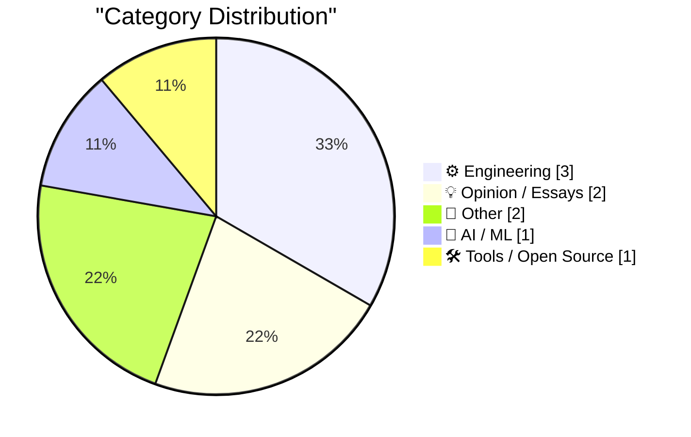
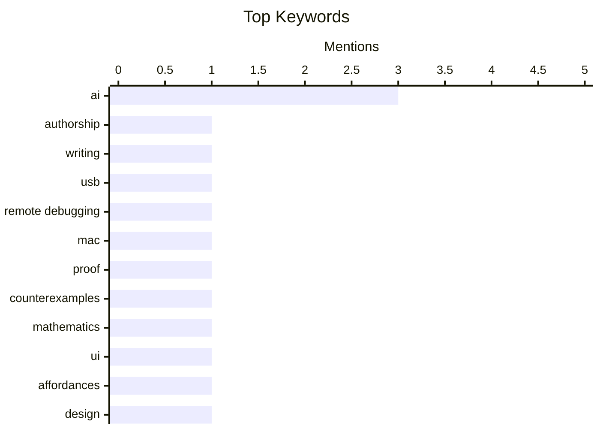

## Today's Highlights
Today's Highlights: The conversation around AI continues to intensify, particularly regarding authorship and the implications of AI's de-individualization effects in media. Meanwhile, user interface design is seeing a push for the return of obvious affordances, reflecting a desire for more intuitive interactions. Additionally, innovative technical solutions, such as remote debugging of USB devices, showcase the ongoing evolution in engineering practices.
---
## Must Read Today
1. **Who gets to decide if something is written by AI?**
[Who gets to decide if something is written by AI?](https://seangoedecke.com/who-gets-to-decide-if-something-is-written-by-ai/) — seangoedecke.com · 14h ago · 🤖 AI / ML
> The article discusses the ongoing debates surrounding the authorship of texts generated by AI. It highlights instances where AI-generated content has led to controversies, such as a writing prize awarded to a story suspected to be AI-generated and an author losing a contract due to AI-related suspicions. The author argues that these situations raise important questions about the criteria and authority determining what constitutes 'authorship.' Ultimately, the piece emphasizes the need for clearer guidelines in distinguishing human and AI contributions in creative works.
💡 **Why read it**: This article is worth reading for its exploration of the implications of AI in creative fields and the challenges it poses to traditional notions of authorship.
🏷️ AI, authorship, writing
2. **Remotely unplugging a USB device on my Mac, without touching it**
[Remotely unplugging a USB device on my Mac, without touching it](https://www.jeffgeerling.com/blog/2026/remote-control-usb-hub/) — jeffgeerling.com · 8h ago · 🛠 Tools / Open Source
> The article details a method for remotely debugging a USB-C device connected to a Mac Studio using a WireGuard VPN tunnel. The author describes the process of flashing firmware to the device and the challenges faced during remote access. Key tools mentioned include the WireGuard VPN for secure connections and specific firmware flashing techniques. The main takeaway is that remote debugging can be effectively achieved with the right setup, allowing for efficient troubleshooting without physical access.
💡 **Why read it**: This article is valuable for tech enthusiasts interested in remote device management and debugging techniques.
🏷️ USB, remote debugging, Mac
3. **Counterexamples to proof by example**
[Counterexamples to proof by example](https://www.johndcook.com/blog/2026/11/27/counterexample-to-proof-by-example/) — johndcook.com · 57m ago · ⚙️ Engineering
> The article addresses the fallacy of relying on examples to prove mathematical statements, presenting several counterexamples that initially seem valid. It discusses prime generating polynomials, Borwein integrals, and Mercer’s circle problem as cases where examples fail to hold universally. The author emphasizes the importance of rigorous proof rather than anecdotal evidence in mathematics. The conclusion is a cautionary reminder that not all examples can be trusted to validate a claim.
💡 **Why read it**: This article is essential for mathematicians and students to understand the limitations of proof by example in mathematical reasoning.
🏷️ proof, counterexamples, mathematics
---
## Data Overview
| Sources Scanned | Articles Fetched | Time Window | Selected |
|:---:|:---:|:---:|:---:|
| 85/92 | 2566 -> 9 | 24h | **9** |
### Category Distribution

### Top Keywords

<details>
<summary>Plain Text Keyword Chart (Terminal Friendly)</summary>
```
ai               │ ████████████████████ 3
authorship       │ ███████░░░░░░░░░░░░░ 1
writing          │ ███████░░░░░░░░░░░░░ 1
usb              │ ███████░░░░░░░░░░░░░ 1
remote debugging │ ███████░░░░░░░░░░░░░ 1
mac              │ ███████░░░░░░░░░░░░░ 1
proof            │ ███████░░░░░░░░░░░░░ 1
counterexamples  │ ███████░░░░░░░░░░░░░ 1
mathematics      │ ███████░░░░░░░░░░░░░ 1
ui               │ ███████░░░░░░░░░░░░░ 1
```
</details>
### Topic Tags
**ai**(3) · **authorship**(1) · **writing**(1) · usb(1) · remote debugging(1) · mac(1) · proof(1) · counterexamples(1) · mathematics(1) · ui(1) · affordances(1) · design(1) · de-individualization(1) · claude(1) · taylorism(1) · control(1) · coreapplication(1) · non-agile(1) · properties(1) · government(1)
---
## Engineering
### 1. Counterexamples to proof by example
[Counterexamples to proof by example](https://www.johndcook.com/blog/2026/11/27/counterexample-to-proof-by-example/) — **johndcook.com** · 57m ago · ⭐ 18/30
> The article addresses the fallacy of relying on examples to prove mathematical statements, presenting several counterexamples that initially seem valid. It discusses prime generating polynomials, Borwein integrals, and Mercer’s circle problem as cases where examples fail to hold universally. The author emphasizes the importance of rigorous proof rather than anecdotal evidence in mathematics. The conclusion is a cautionary reminder that not all examples can be trusted to validate a claim.
🏷️ proof, counterexamples, mathematics
---
### 2. ★ Obvious Affordances Are Due for a Comeback
[★ Obvious Affordances Are Due for a Comeback](https://daringfireball.net/2026/11/obvious_affordances_are_due_for_a_comeback) — **daringfireball.net** · 22h ago · ⭐ 17/30
> The article argues for the resurgence of obvious affordances in user interface design, emphasizing that simplicity should not come at the cost of usability. It critiques modern design trends that obscure clickable elements, making interfaces less intuitive. The author cites the principle attributed to Einstein that designs should be as simple as possible, but not simpler, advocating for a balance between aesthetics and functionality. The main takeaway is that clear affordances enhance user experience and should be prioritized in design.
🏷️ UI, affordances, design
---
### 3. What happens when you put a non-agile object in the CoreApplication Properties?
[What happens when you put a non-agile object in the CoreApplication Properties?](https://devblogs.microsoft.com/oldnewthing/20261126-00/?p=112899/) — **devblogs.microsoft.com/oldnewthing** · 23h ago · ⭐ 14/30
> The article explores the consequences of placing a non-agile object in the CoreApplication Properties of a Windows application, detailing how it leads to reference expiration while the entry remains. The author provides insights into the behavior of COM objects in this context, highlighting potential pitfalls for developers. The main conclusion is that understanding the implications of object agility is crucial for maintaining application stability and performance.
🏷️ CoreApplication, non-agile, properties
---
## Opinion / Essays
### 4. Quoting Jack Despain Zhou
[Quoting Jack Despain Zhou](https://simonwillison.net/2026/Nov/26/jack-despain-zhou/) — **simonwillison.net** · 22h ago · ⭐ 15/30
> The article reflects on the de-individualization effects of AI in various media, highlighting how AI-generated content permeates personal and professional spaces. It discusses the implications of encountering AI voices and content in everyday experiences, such as YouTube and conference presentations. The author raises concerns about the authenticity and originality of content in an AI-dominated landscape. The conclusion stresses the need for awareness of AI's pervasive influence on individual expression.
🏷️ AI, de-individualization, Claude
---
### 5. Pluralistic: Taylorism and AI's shared sales-pitch (27 Nov 2026)
[Pluralistic: Taylorism and AI's shared sales-pitch (27 Nov 2026)](https://pluralistic.net/2026/11/27/taylor-made/) — **pluralistic.net** · 22m ago · ⭐ 15/30
> The article critiques the parallels between Taylorism and the current AI sales pitch to employers, suggesting that both emphasize control over workers. It discusses how businesses are eager to adopt technologies that promise increased oversight and efficiency, often at the expense of worker autonomy. The author provides examples of various technologies and their implications for labor dynamics. The main takeaway is a warning against the uncritical adoption of AI as a means of control in the workplace.
🏷️ Taylorism, AI, control
---
## Other
### 6. Het succesvolle Fieldlab van de Nederlandse Digitale Dienst deze week
[Het succesvolle Fieldlab van de Nederlandse Digitale Dienst deze week](https://berthub.eu/articles/posts/fieldlab-is-van-de-it/) — **berthub.eu** · 2h ago · ⭐ 13/30
> The article discusses the Dutch government's reliance on American cloud services and the implications for digital autonomy. It critiques the current state of IT management within the government, highlighting the challenges faced in improving IT infrastructure. The author suggests that achieving digital independence is essential for maintaining control over governmental operations. The conclusion emphasizes the urgent need for reform in how the government approaches IT and digital services.
🏷️ government, IT, vacancy
---
### 7. Gadget Review: WiFi Carbon Monoxide Alarm (JKD-625W) ★★★★⯪
[Gadget Review: WiFi Carbon Monoxide Alarm (JKD-625W) ★★★★⯪](https://shkspr.mobi/blog/2026/11/gadget-review-wifi-carbon-monoxide-alarm-jkd-625w/) — **shkspr.mobi** · 1h ago · ⭐ 10/30
> The article reviews the WiFi Carbon Monoxide Alarm (JKD-625W), highlighting its affordability and compatibility with smart home systems like HomeAssistant. The author shares a personal anecdote about the urgency of replacing a malfunctioning alarm, emphasizing the importance of safety in home environments. Key features include WiFi connectivity for remote monitoring and alerts. The main takeaway is that this alarm offers a reliable and cost-effective solution for carbon monoxide detection.
🏷️ gadget, review, alarm
---
## AI / ML
### 8. Who gets to decide if something is written by AI?
[Who gets to decide if something is written by AI?](https://seangoedecke.com/who-gets-to-decide-if-something-is-written-by-ai/) — **seangoedecke.com** · 14h ago · ⭐ 25/30
> The article discusses the ongoing debates surrounding the authorship of texts generated by AI. It highlights instances where AI-generated content has led to controversies, such as a writing prize awarded to a story suspected to be AI-generated and an author losing a contract due to AI-related suspicions. The author argues that these situations raise important questions about the criteria and authority determining what constitutes 'authorship.' Ultimately, the piece emphasizes the need for clearer guidelines in distinguishing human and AI contributions in creative works.
🏷️ AI, authorship, writing
---
## Tools / Open Source
### 9. Remotely unplugging a USB device on my Mac, without touching it
[Remotely unplugging a USB device on my Mac, without touching it](https://www.jeffgeerling.com/blog/2026/remote-control-usb-hub/) — **jeffgeerling.com** · 8h ago · ⭐ 23/30
> The article details a method for remotely debugging a USB-C device connected to a Mac Studio using a WireGuard VPN tunnel. The author describes the process of flashing firmware to the device and the challenges faced during remote access. Key tools mentioned include the WireGuard VPN for secure connections and specific firmware flashing techniques. The main takeaway is that remote debugging can be effectively achieved with the right setup, allowing for efficient troubleshooting without physical access.
🏷️ USB, remote debugging, Mac
---
*Generated at 2026-11-27 14:01 | Scanned 85 sources -> 2566 articles -> selected 9*
*Based on the [Hacker News Popularity Contest 2025](https://refactoringenglish.com/tools/hn-popularity/) RSS source list recommended by [Andrej Karpathy](https://x.com/karpathy)*
*Produced by Dongdianr AI. Follow the same-name WeChat public account for more AI practical tips 💡*
